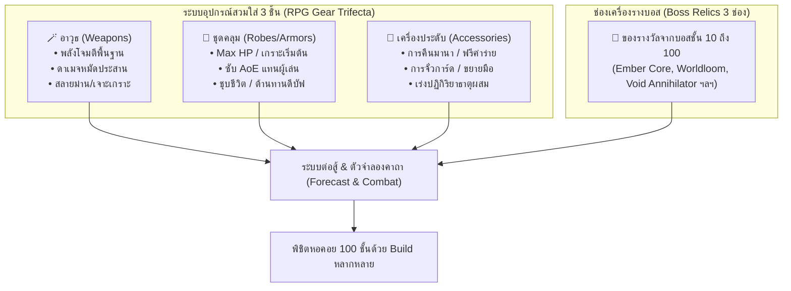

# เอกสารการออกแบบระบบอุปกรณ์สวมใส่: ส่วนที่ 3 — สารบบเครื่องประดับและแหวนเวท (Accessories & Trinkets System)
**เกม:** คาถานอกตำรา (Spell Foundry)  
**หมวดหมู่:** อุปกรณ์สวมใส่ช่องที่ 3 — เครื่องประดับ/แหวน/จี้ (Accessory / Trinket / Ring Slot)  
**สถานะ:** เอกสารข้อกำหนดระบบ (Game Design Specification — Approved Draft)

---

## 1. ปรัชญาและโครงสร้างระบบเครื่องประดับ (Accessory Slot Architecture)

ช่องสวมใส่ **"เครื่องประดับและแหวนเวท" (Accessory / Trinket Slot)** เป็นสล็อตอุปกรณ์ลำดับที่ 3 ของระบบ RPG Gear ทำหน้าที่เป็น **"ตัวเร่งคอมโบและการบริหารทรัพยากร (Synergy Catalyst & Action Economy Engine)"** ที่เชื่อมโยงระหว่าง *อาวุธ* (เชิงรุก) และ *ชุดคลุม* (เชิงรับ) โดยมีบทบาทสำคัญดังนี้:

1. **บทบาทหลักของเครื่องประดับ:**  
   * **การบริหารมานาและการคืนค่าร่าย (Mana Economy):** คืนมานาเมื่อทำเงื่อนไขสำเร็จ, ลดค่าร่ายคอมโบเฉพาะทาง, หรือเพิ่มขีดจำกัด Max MP  
   * **การหมุนเวียนการ์ดในมือ (Card Flow & Draw Engine):** จั่วการ์ดเพิ่มเมื่อสัตว์แตกสลาย/ออกหมัด, ป้องกันการถูกบังคับทิ้งการ์ด, และขยายขนาดมือ  
   * **การเร่งปฏิกิริยาธาตุและทริกเกอร์พิเศษ (Reaction Amplifiers & Triggers):** เพิ่มความรุนแรงของปฏิกิริยาธาตุผสม (เช่น น้ำสาดเปียกแล้วสายฟ้าช็อตแรงขึ้น, ไฟปะทะน้ำแข็งละลายเกราะดับเบิ้ล), และทริกเกอร์ตอนสัตว์เปลี่ยนตัว (Summon Relay)
2. **การทำงานร่วมกับระบบ 3 + 3 สล็อต:**  
   สวมใส่ควบคู่กับ **อาวุธ (ช่อง 1)** และ **ชุดคลุม (ช่อง 2)** ในแผงอุปกรณ์หลัก โดย **ไม่ทับซ้อนกับเครื่องรางบอส 3 ช่องเดิม (Boss Relics 10..100)**
3. **แหล่งที่มา 2 ทางชัดเจน:**  
   * **ระดับธรรมดา (Common) และ หายาก (Rare):** วางจำหน่ายใน **ร้านค้าชั้นพัก (Sanctuary Shop)** เพื่อใช้ทองคำซื้อสำหรับคอมโบเริ่มต้น  
   * **ระดับพิเศษ (Special), มหากาพย์ (Epic), และ ตำนาน (Legendary):** ดรอปเฉพาะจากการพิชิต **"รอยแยกอุปกรณ์ (Gear Rift)"**

---

## 2. สารบบเครื่องประดับ 40 ชนิด ครอบคลุม 5 ระดับความหายาก (Accessory Catalog)

```text
สรุปสัดส่วนเครื่องประดับ 40 ชิ้น:
- ระดับธรรมดา (Common)    : 6 ชิ้น  (ของร้านค้าชั้น 5–25)
- ระดับหายาก (Rare)        : 8 ชิ้น  (ของร้านค้าชั้น 35–55 / Gear Rift เทียร์ 20–40)
- ระดับพิเศษ (Special)     : 10 ชิ้น (Gear Rift เทียร์ 50–70 / Vault Shop)
- ระดับมหากาพย์ (Epic)     : 10 ชิ้น (Gear Rift เทียร์ 70–90)
- ระดับตำนาน (Legendary)   : 6 ชิ้น  (Gear Rift เทียร์ 90–100 / ลับ)
```

---

### 2.1 ระดับธรรมดา (Common) — 6 ชิ้น
> **แหล่งที่มา:** ร้านค้าชั้นพัก (Sanctuary Shop ชั้น 5, 15, 25) | **ราคา:** 40 – 75 ทอง

| ID | ชื่อเครื่องประดับ (ไทย / อังกฤษ) | ไอคอน | สไตล์การเล่นหลัก | สเตตัสและเอฟเฟกต์เฉพาะตัว (Traits) | แหล่งที่มา / ราคา | คำอธิบาย (Flavor Text) |
| :--- | :--- | :---: | :--- | :--- | :---: | :--- |
| `ring_copper_meditation`| **แหวนทองแดงสมาธิจิต**<br>Copper Meditation Ring | 💍 | ฟื้นมานาต้นศึก<br>(Starting Mana) | • เริ่มต้นการต่อสู้ ผู้เล่นได้รับ $+1$ MP ฟรีทันที<br>• Max MP $+1$ | ร้านชั้น 5<br>(40 g) | แหวนทองแดงเรียบง่าย ช่วยรวมศูนย์สมาธิในการเปิดศึก |
| `bracelet_red_string` | **กำไลด้ายแดงผูกจิตสัตว์**<br>Spirit-Thread Bracelet | 📿 | อัญเชิญสัตว์เล็ก<br>(Common Summon) | • เมื่อร่ายอัญเชิญสัตว์ระดับ Common ได้รับคืน $+1$ MP<br>• สัตว์ Common หมัดประสาน $+2$ ดาเมจ | ร้านชั้น 5<br>(50 g) | ด้ายแดงถักทอด้วยมนต์ผูกพัน ช่วยลดภาระการเชื่อมจิตกับสัตว์เลี้ยง |
| `pendant_spark_amber` | **จี้อำพันประกายไฟ**<br>Amber Spark Pendant | 📿 | ธาตุไฟ (Fire Burn) | • คาถาไฟติดสถานะเผา (Burn) นานขึ้น $+1$ เทิร์น<br>• ดาเมจไฟ $+2$ | ร้านชั้น 5<br>(50 g) | หยาดอำพันกักขังสะเก็ดไฟโบราณ แผ่ไออุ่นหล่อเลี้ยงเปลวเพลิง |
| `ring_dewdrop_pearl` | **แหวนไข่มุกหยาดน้ำค้าง**<br>Dewdrop Pearl Ring | 💍 | ธาตุน้ำ (Water Heal) | • เมื่อร่ายคาถาน้ำ ฟื้นฟูเลือดเพิ่ม $+2$ HP<br>• เป้าหมายติดเปียกยาวนานขึ้น $+1$ เทิร์น | ร้านชั้น 15<br>(60 g) | ไข่มุกน้ำจืดใสสะอาด กักเก็บความชุ่มชื้นบริสุทธิ์ของรุ่งอรุณ |
| `brooch_static_quartz` | **เข็มกลัดควอตซ์ประจุไฟฟ้า**<br>Static Quartz Brooch | ⚡ | ธาตุสายฟ้า (Lightning)| • คาถาสายฟ้ามีโอกาส $30\%$ ที่จะชิ่งใส่ศัตรูข้างเคียง 4 ดาเมจ<br>• ข้ามเกราะเพิ่ม $+1$ | ร้านชั้น 15<br>(60 g) | ผลึกควอตซ์ใสที่มีประจุไฟฟ้าแล่นผ่านตลอดเวลา |
| `bangle_carved_slate` | **กำไลหินชนวนแกะสลัก**<br>Carved Slate Bangle | 🪨 | ธาตุดิน & โล่ (Earth) | • โล่ชั้นแรกที่ร่ายในแต่ละศึกจะมีความจุเพิ่ม $+3$ หน่วย<br>• ทุบเกราะศัตรูเพิ่ม $-1$ เมื่อใช้คาถาดิน | ร้านชั้น 25<br>(75 g) | กำไลหินแกะสลักอักขระโบราณ หนักแน่นและมอบความมั่นคง |

---

### 2.2 ระดับหายาก (Rare) — 8 ชิ้น
> **แหล่งที่มา:** ร้านค้าชั้นพัก (ชั้น 35, 45, 55) หรือ Gear Rift เทียร์ 20–40 | **ราคา:** 120 – 190 ทอง

| ID | ชื่อเครื่องประดับ (ไทย / อังกฤษ) | ไอคอน | สไตล์การเล่นหลัก | สเตตัสและเอฟเฟกต์เฉพาะตัว (Traits) | แหล่งที่มา / ราคา | คำอธิบาย (Flavor Text) |
| :--- | :--- | :---: | :--- | :--- | :---: | :--- |
| `bell_soul_affinity` | **กระดิ่งวิญญาณผูกมิตร**<br>Soul-Affinity Bell | 🔔 | แตกสลายคืนทุน<br>(Summon On-Break) | • เมื่อสัตว์อัญเชิญแตกสลาย คืน $+2$ MP ทันที และจั่วการ์ด $+1$ ใบ<br>• สัตว์อัญเชิญมี HP $+10$ | ร้านชั้น 35 / Rift 20<br>(130 g) | เสียงกระดิ่งกังวานใส ปลอบประโลมดวงวิญญาณและแปลงเป็นพลังเวท |
| `ring_gemini_echo` | **แหวนทวินสะท้อนก้อง**<br>Gemini Echo Ring | ♊ | เวทคู่ & ร่ายซ้ำ<br>(Pair Multiplier) | • เมื่อร่ายคาถาที่มีคำว่า "คู่" จั่วการ์ด $+1$ ใบจากกองจั่วทันที<br>• คาถาคู่ฮิตที่สองมีโอกาสคริติคอล $50\%$ | ร้านชั้น 35 / Rift 20<br>(140 g) | แหวนเงินวงคู่ที่เชื่อมร้อยต่อกัน สะท้อนพลังเวทซ้ำสองอย่างไร้รอยต่อ |
| `amulet_cheetah_stride`| **จี้เขี้ยวเสือดาวว่องไว**<br>Cheetah Stride Amulet | 🐆 | จั่วการ์ด & หลบหลีก<br>(Draw & Agility) | • ขนาดมือสูงสุด (Hand Limit) $+1$ ใบ<br>• ในเทิร์นที่จั่วการ์ดเกิน 3 ใบ ผู้เล่นได้รับสิทธิ์หลบหลีกการโจมตี $25\%$ | ร้านชั้น 45 / Rift 30<br>(150 g) | เขี้ยวสัตว์นักล่าแห่งทุ่งหญ้า มอบความปราดเปรียวและปฏิกิริยาตอบสนองฉับไว |
| `insignia_chain_volt` | **ตราประทับสายฟ้าชิ่งไม่สิ้นสุด**<br>Chain-Volt Insignia | ⚡ | สายฟ้าชิ่ง<br>(Lightning Chain Amp)| • สายฟ้าชิ่งข้ามเกราะของศัตรูทุกตัวที่โดน $100\%$<br>• เมื่อชิ่งโดนศัตรูเกิน 2 ตัว คืน $+1$ มานา | ร้านชั้น 45 / Rift 30<br>(160 g) | ตราประทับทองเหลืองสลักลายอสุนีบาต ควบคุมทิศทางกระแสไฟฟ้าให้พุ่งสู่เป้าหมาย |
| `ring_vortex_siphon` | **แหวนน้ำวนสูบพลังชีวิต**<br>Vortex Siphon Ring | 🌀 | น้ำ & ดูดเลือด<br>(Water Life Siphon) | • เมื่อเป้าหมายที่ติดเปียกได้รับความเสียหาย ผู้เล่นฟื้นเลือด $+2$ HP<br>• คาถาน้ำทำดาเมจแรงขึ้น $+3$ | ร้านชั้น 55 / Rift 40<br>(170 g) | วงแหวนศิลาน้ำเงินเข้ม ก่อเกิดกระแสน้ำวนดูดกลืนพลังชีวิตกลับสู่ผู้ร่าย |
| `bangle_cyclone_impact`| **กำไลลมกรดกระแทกทลวง**<br>Gale-Impact Bangle | 🌪️ | ลมผลัก & ชนขอบ<br>(Wind Slam Knockback)| • ดาเมจจากการผลักศัตรูชนกันหรือชนขอบแรงขึ้นเป็น $12$ หน่วย (จากเดิม 8)<br>• ผลักไกลขึ้น $+1$ ช่องเสมอ | ร้านชั้น 55 / Rift 40<br>(175 g) | กำไลเงินสลักลายพายุหมุน เพิ่มแรงอัดอากาศผลักดันศัตรูอย่างรุนแรง |
| `talisman_armor_breaker`| **ตะกรุดศิลาทลายเกราะ**<br>Crag Armor-Breaker Talisman| ⛏️ | ดิน & ล้างเกราะถาวร<br>(Permanent Shred) | • การทุบเกราะถาวรของดินและสัตว์สายศิลาเพิ่มขึ้น $+1$ หน่วยเสมอ<br>• หากเป้าหมายเกราะเหลือ 0 โดนดาเมจเพิ่ม $+25\%$ | Rift 40<br>(180 g) | ตะกรุดหินแร่เหล็กกล้า บดขยี้เกราะกำแพงศัตรูจนไร้การป้องกัน |
| `ring_twin_bullet` | **แหวนประจุลูกกระสุนแฝด**<br>Twin Shot Signet | 🔘 | ลูก & กระสุนเวท<br>(Shot Synergy) | • คาถาที่ขึ้นต้นด้วย "ลูก" ทำดาเมจแรงขึ้น $+4$ หน่วย<br>• เมื่อลูกกระทบเป้าหมาย ลดเกราะเป้าหมายชั่วคราว $-1$ ในเทิร์นนั้น | Rift 40<br>(190 g) | ตราแหวนสลักรูนกระสุนเวท ควบแน่นมวลพลังงานให้พุ่งทะลวงเป้าหมาย |

---

### 2.3 ระดับพิเศษ (Special) — 10 ชิ้น
> **แหล่งที่มา:** Gear Rift เทียร์ 50–70 หรือ Sanctuary Vault Shop | **ราคา:** 250 – 400 ทอง

| ID | ชื่อเครื่องประดับ (ไทย / อังกฤษ) | ไอคอน | สไตล์การเล่นหลัก | สเตตัสและเอฟเฟกต์เฉพาะตัว (Traits) | แหล่งที่มา / ราคา | คำอธิบาย (Flavor Text) |
| :--- | :--- | :---: | :--- | :--- | :---: | :--- |
| `pendant_titan_heart` | **จี้ดวงใจศิลาไททัน**<br>Heart of the Colossus | 🗿 | โกเลม & สลับร่าง<br>(Titan Relay & Ward) | • เมื่อร่ายสัตว์อัญเชิญซ้ำในเทิร์น 2 (Relay Strike) หมัดส่งต่อแรงขึ้น $+50\%$ และแถมม่าน 1 ชั้นให้ตัวใหม่<br>• โกเลมมี HP $+30$ | Rift 50 / Vault<br>(280 g) | ผลึกศิลาสีอำพันที่เต้นเป็นจังหวะ ถ่ายทอดพละกำลังระหว่างยูนิตแนวหน้า |
| `bangle_gargoyle_wing`| **กำไลปีกการ์กอยล์สะท้อนม่าน**<br>Gargoyle Wing Bangle | 🦇 | สกัด AoE & สะท้อน<br>(AoE Retaliation) | • เมื่อสัตว์สายรับ AoE สกัดดาเมจหมู่แทนผู้เล่น สะท้อนดาเมจแท้ $12$ หน่วยใส่ศัตรูทุกคน<br>• การ์กอยล์มีเกราะ $+2$ | Rift 50<br>(300 g) | กำไลหินอ่อนสลักรูปปีกการ์กอยล์ แปลงแรงกระแทกจากเวทหมู่ให้กลายเป็นคลื่นสะท้อน |
| `insignia_lion_royalty`| **ตราประทับราชันย์จ่าฝูงสิงโต**<br>Lion Sovereign Crest | 🦁 | คริติคอล & สัตว์โต<br>(Crit & Pack Burst) | • สัตว์อัญเชิญทุกตัวมีโอกาสคริติคอล $35\%$ ในการสวนกลับและหมัดประสาน<br>• หากคริติคอล จะคืน $+1$ มานาและจั่ว $+1$ ใบ | Rift 60<br>(320 g) | ตราประทับทองคำสลักรูปหัวสิงโตคำราม ปลุกเร้าความดุร้ายของสัตว์อัญเชิญทุกตัว |
| `pendant_siren_pearl` | **จี้หอยมุกสมุทรไซเรน**<br>Siren Oceanic Pearl | 🧜‍♀️ | ไซเรน & คลื่นเปียก<br>(Siren Wet Engine) | • ไซเรนร้องเพลงสวนกลับสาดเปียกศัตรูทุกคนในสนาม 2 เทิร์นเต็ม<br>• สัตว์อัญเชิญงับเป้าหมายที่เปียกแรงขึ้น $1.75$ เท่า (จากเดิม 1.5) | Rift 60<br>(340 g) | ไข่มุกสีรุ้งจากหอยมุกใต้สมุทรลึก เสียงคลื่นซัดสาดกล่อมเกลาจิตใจศัตรู |
| `ring_sprite_wellspring`| **แหวนตาน้ำมนตราภูตพราย**<br>Sprite Wellspring Ring | 🧚 | ภูตพราย & มานาท่วม<br>(Mana Overflow Shield)| • มานาที่เติมหรือฟื้นฟูเกิน Max MP จะถูกแปลงเป็นโล่ป้องกันผู้เล่นในอัตรา $1 \text{ MP} = 4 \text{ Shield}$<br>• ภูตพรายแตกสลายคืน $+4$ MP | Rift 60<br>(350 g) | วงแหวนเถาวัลย์ผลิใบสีมรกต หลั่งรินพลังงานเวทตกค้างมาเป็นเกราะกำบัง |
| `seal_magma_basin` | **ตราประทับเตาหลอมแอ่งลาวา**<br>Magma Basin Crucible Seal| 🌋 | แมกม่า & เผาผลาญ<br>(Magma Pool Amplifier)| • แอ่งแมกม่าที่พื้นปะทุใส่ศัตรูแรงขึ้น $+10$ ดาเมจ และลดเกราะ $-2$ ถาวรทุกเทิร์น<br>• การร่ายคาถาไฟ/ดิน มอบโล่ $+4$ หน่วย | Rift 70<br>(360 g) | แผ่นตราศิลาภูเขาไฟ ร้อนระอุด้วยลาวาเหลวที่พร้อมหลอมละลายทุกสิ่ง |
| `pendant_heman_rime` | **จี้ผลึกละอองหนาวเหมันต์**<br>Heman Glacial Pendant | ❄️ | เหมันต์ & แช่แข็งหมู่<br>(Heman Freeze Catalyst)| • เมื่อศัตรูติดสถานะแช่แข็ง (Freeze) จะกระจายความหนาว 4 หน่วยใส่ศัตรูข้างเคียงทันที<br>• คาถาน้ำแข็งใช้มานาลดลง $-1$ MP | Rift 70<br>(360 g) | ผลึกน้ำแข็งหกเหลี่ยมบริสุทธิ์ แผ่รังสีความเย็นยะเยือกหยุดการเคลื่อนไหว |
| `ring_asani_overcharge`| **แหวนอัสนีบาตประจุคู่**<br>Asani Overcharge Ring | ϟ | อัสนี & ช็อตทะลวง<br>(Double Chain Lightning)| • อัสนีชิ่งหาเป้าหมายข้างเคียงเพิ่มเป็น 2 เป้าหมาย (จากเดิม 1 เป้า)<br>• ข้ามเกราะเพิ่ม $+3$ หน่วย และช็อตทะลุม่าน $100\%$ | Rift 70<br>(380 g) | แหวนทองคำขาวเหนี่ยวนำกระแสไฟฟ้า ปลดปล่อยสายฟ้าฟาดแยกแขนงอย่างบ้าคลั่ง |
| `bangle_wari_deluge` | **กำไลมหาสึนามิล้างบาง**<br>Wari Deluge Bangle | 🌊 | วารี & ชะล้างดีบัฟ<br>(Wari Cleanse Wave) | • วารีลบม่านของศัตรูทุกคนในสนาม 1 ชั้น และล้างดีบัฟทั้งหมดของผู้เล่น<br>• ฟื้นฟูเลือดเพิ่มเป็น $+10$ HP | Rift 70<br>(380 g) | กำไลแก้วบรรจุน้ำทะเลศักดิ์สิทธิ์ ชำระล้างสิ่งสกปรกและมลทินทั้งปวง |
| `seal_vayu_tempest` | **ตราประทับพายุวายุคลั่ง**<br>Vayu Tempest Seal | 🌪️ | วายุ & ชนกระแทกแฝด<br>(Vayu Double Slam) | • วายุผลักศัตรู 2 ช่อง และหากชนศัตรูอื่น จะดึงดูดศัตรูตัวข้างเคียงเข้ามาชนซ้ำอีก 1 ระลอก<br>• สัตว์อัญเชิญมีโอกาสหลบหลีก $+35\%$ | Rift 70 / Vault<br>(400 g) | แผ่นหินสลักวงกวนของพายุ ปลดปล่อยแรงดันลมกระชากมวลสารเข้าหากัน |

---

### 2.4 ระดับมหากาพย์ (Epic) — 10 ชิ้น
> **แหล่งที่มา:** Gear Rift เทียร์ 70–90 | **ราคาประเมิน:** 500 – 750 ทอง

| ID | ชื่อเครื่องประดับ (ไทย / อังกฤษ) | ไอคอน | สไตล์การเล่นหลัก | สเตตัสและเอฟเฟกต์เฉพาะตัว (Traits) | แหล่งที่มา / ราคา | คำอธิบาย (Flavor Text) |
| :--- | :--- | :---: | :--- | :--- | :---: | :--- |
| `bell_behemoth_quake` | **กระดิ่งมหาอสูรแผ่นดินไหว**<br>Behemoth Quake Bell | 🦏 | เบฮีมอธ & ทุบเกราะหมู่<br>(Behemoth Sunder) | • เมื่อเบฮีมอธลงสนาม ทุบเกราะศัตรูทุกคน $-3$ ทันที และทำดาเมจแท้ $15$ หน่วย<br>• หมัดประสานของเบฮีมอธแรงขึ้นเป็น $60$ ดาเมจ (จากเดิม 40) | Rift 80<br>(600 g) | กระดิ่งทองสัมฤทธิ์ขนาดยักษ์ สั่นพ้องกับชีพจรของแผ่นดินจนศัตรูเสียหลัก |
| `bangle_hydra_vitality`| **กำไลเกล็ดไฮดราสมานแผล**<br>Hydra Vitality Bangle | 🐉 | ไฮดรา & ฟื้นชีพเร็ว<br>(Hydra Ultra Regen) | • ไฮดราฟื้นเลือด $+15$ HP/เทิร์น และสวนกลับแทง 5 ครั้งรวด (พิษ 8 หน่วย)<br>• เมื่อผู้เล่นใช้ "ฮีล" หรือ "เติม เลือด" จะได้ผลแรงขึ้น $+50\%$ | Rift 80<br>(600 g) | กำไลเกล็ดมังกรเขียวที่ขยับตัวได้ราวกับมีชีวิต สมานเซลล์ร่างกายฉับพลัน |
| `ring_kraken_eye` | **แหวนเนตรหมึกดำคราเคน**<br>Eye of the Deep Kraken | 🐙 | คราเคน & ตัดม่านหมู่<br>(Kraken True Sight) | • คราเคนสลายม่านของศัตรูทั้งหมดถาวร และทำให้บอสวืดการโจมตีใหญ่ $40\%$<br>• สัตว์อัญเชิญโจมตีข้ามม่าน $100\%$ | Rift 80<br>(600 g) | แหวนทองคำฝังอัญมณีตาสัตว์ประหลาดใต้สมุทร มองทะลุม่านลวงตาทุกรูปแบบ |
| `crucible_fusion_catalyst`| **ตราประทับเตาหลอมสองธาตุ**<br>Dual Fusion Alchemical Catalyst| ⚗️ | เวทผสมสองธาตุ<br>(Dual Fusion Engine) | • เวทผสมธาตุ (แมกม่า, พลาสมา, ไอเดือด ฯลฯ) ลดค่าร่าย $-2$ มานา (ขั้นต่ำ 5)<br>• เอฟเฟกต์รองของธาตุผสมทำงานแรงขึ้นสองเท่า | Rift 85<br>(650 g) | ตราประทับวงกลมแปรธาตุ ผสานสองขั้วพลังงานให้ปลดปล่อยอานุภาพสูงสุด |
| `pendant_plasma_flare` | **จี้พลาสมาดาวฤกษ์ระเบิด**<br>Plasma Stellar Pendant | ✦ | พลาสมา & ความร้อนสูง<br>(Plasma Overkill Flare)| • คาถาพลาสมาทำดาเมจเดี่ยวรุนแรงสูงสุด $+50\%$ และข้ามเกราะ $6$ หน่วย<br>• ดาเมจส่วนเกินที่ฆ่าศัตรู (Overkill) จะระเบิดกระจายใส่ศัตรูที่เหลือทั้งหมด | Rift 85<br>(680 g) | จี้ห้อยคอบรรจุดวงดาวพลาสมาขนาดจิ๋ว แผ่รังสีความร้อนทำลายล้างมวลสาร |
| `ring_frostvolt_chain` | **แหวนผลึกช็อตเยือกแข็ง**<br>Frostvolt Superconductor Ring | ❆ | ผลึกช็อต & แช่แข็งช็อต<br>(Frostvolt Freeze Shock)| • สายฟ้าที่ชิ่งหาเป้าหมายที่ติดหนาวจะติดสถานะแช่แข็ง (Freeze) ทันที 1 เทิร์น<br>• เพิ่มดาเมจชิ่งขึ้นเป็น $100\%$ เต็มพลัง | Rift 85<br>(680 g) | แหวนตัวนำยิ่งยวดอุณหภูมิติดลบ ปล่อยกระแสไฟฟ้าแช่แข็งศัตรูพร้อมกัน |
| `seal_scald_melter` | **ตราประทับไอเดือดหลอมเหล็ก**<br>Scald Steam Melter Seal | ♨️ | ไอเดือด & ล้างเกราะ 0<br>(Scald Zero Armor) | • คาถาไอเดือดลดเกราะเป้าหมายเหลือ 0 หน่วยถาวรทันที และทำให้ชะงัก (Stun) 1 เทิร์น<br>• คืน $+2$ MP เมื่อใช้ใส่เป้าหมายที่มีเกราะ | Rift 90<br>(700 g) | แผ่นตราหม้อต้มความดันมหาศาล ระเบิดไอร้อนหลอมละลายแผ่นเหล็กกล้าเป็นน้ำ |
| `bangle_shockstream_grid`| **กำไลกระแสช็อตสายฟ้าฟาด**<br>Shockstream Arc Grid Bangle| ϟ | กระแสช็อต & ช็อตล้างบาง<br>(Shockstream Field) | • กระแสช็อตทำดาเมจใส่ศัตรูเปียกทุกคนแรงขึ้น $+15$ ดาเมจ และผลักถอย 1 ช่อง<br>• หากมีศัตรูเปียกตั้งแต่ 3 ตัวขึ้นไป ร่ายกระแสช็อตฟรี 0 มานา | Rift 90<br>(720 g) | กำไลตาข่ายสายฟ้า เชื่อมโยงสนามพลังงานไฟฟ้าทั่วผืนน้ำบนสนามรบ |
| `ring_barrage_overclock`| **แหวนจักรกลกระหน่ำยิงโอเวอร์คล็อก**<br>Barrage Overclocked Ring | ⚙️ | กระหน่ำ & จั่วกระสุน<br>(Barrage Bullet Draw) | • เมื่อร่ายคาถากระหน่ำ 5 ครั้ง จะจั่วการ์ดใหม่ 3 ใบทันทีระหว่างการยิง<br>• แต่ละฮิตที่โจมตีโดน ฟื้น $+1$ HP ให้ผู้ร่าย (รวม $+5$ HP) | Rift 90<br>(720 g) | กลไกฟันเฟืองทองเหลือง เร่งรอบการยิงกระสุนเวทมนตร์สู่ขีดสุด |
| `catalyst_devastation_rupture`| **ตราประทับกลียุคทำลายล้าง**<br>Devastation Rupture Seal | ✷ | ทำลายล้าง & วินาศแฝด<br>(Devastation Quake) | • คาถาทำลายล้างทำดาเมจแรงขึ้นเป็น 2.5 เท่า (จากเดิม 2 เท่า)<br>• การระเบิดซ้ำทำลายเกราะศัตรูทุกคนในรัศมี $-3$ หน่วยถาวร | Rift 90<br>(750 g) | ตราประทับหินสีเลือดอสูร สั่งการรอยเลื่อนมิติให้ฉีกขาดและระเบิดทำลายล้าง |

---

### 2.5 ระดับตำนาน (Legendary) — 6 ชิ้น
> **แหล่งที่มา:** Gear Rift เทียร์ 90–100 หรือ ชนะบอสลับ | **ราคาประเมิน:** 1,200 – 2,000 ทอง

| ID | ชื่อเครื่องประดับ (ไทย / อังกฤษ) | ไอคอน | สไตล์การเล่นหลัก | สเตตัสและเอฟเฟกต์เฉพาะตัว (Traits) | แหล่งที่มา / ราคา | คำอธิบาย (Flavor Text) |
| :--- | :--- | :---: | :--- | :--- | :---: | :--- |
| `ring_dragon_eye` | **แหวนเนตรราชันมังกรโบราณ**<br>Eye of the Drake Sovereign| 🐲 | มังกร & ดาเมจแท้สองเท่า<br>(Dragon Double True Strike)| • มังกรอัญเชิญออกหมัดประสานเป็นดาเมจแท้ $100\%$ และ **ออกหมัดซ้ำสองครั้งรวด (เบิ้ล 100+ ดาเมจ)**<br>• ผู้เล่นได้รับมานาฟื้นฟูเทิร์นละ $+2$ MP ตลอดกาล | Rift 90–100<br>(1,600 g) | ดวงตามังกรแดงโบราณที่ยังมีประกายเพลิงลุกโชน มองทะลุจุดตายและสั่งการมังกรพิฆาต |
| `pendant_phoenix_feather`| **จี้ขนนกฟีนิกซ์ทองคำอมตะ**<br>Golden Phoenix Feather Amulet| 🪶 | ฟีนิกซ์ & มานาไม่จำกัด<br>(Phoenix Eternal Flame)| • เมื่อฟีนิกซ์ชุบชีวิตผู้เล่น จะมอบสถานะ **"ร่ายฟรี 0 มานา" ตลอด 2 เทิร์นเต็ม**<br>• ทุกครั้งที่สัตว์อัญเชิญโจมตี ฟื้นฟูเลือดผู้เล่น $+10$ HP และล้างดีบัฟ | Rift 90–100<br>(1,600 g) | ขนนกฟีนิกซ์สีทองบริสุทธิ์ ประจุเปลวเพลิงศักดิ์สิทธิ์ที่ไม่มีวันมอดดับ |
| `hourglass_chronos_infinite`| **นาฬิกาทรายหยุดกาลโครนอส**<br>Chronos Infinite Hourglass | ⏳ | หยุดเวลา & คอมโบอนันต์<br>(Infinite Timeturn) | • เมื่อใช้คาถา "หยุดเวลา" จะคืนการ์ดทั้งหมดในสุสานกลับเข้ามือ และฟื้น $+12$ MP เต็มทันที<br>• การกระทำทั้งหมดในเทิร์นหยุดเวลาไม่ใช้มานา | Rift 100<br>(1,800 g) | นาฬิกาทรายที่ทรายไหลย้อนกลับ ย้อนคืนทรัพยากรทั้งหมดสู่จุดสูงสุดแห่งกาลเวลา |
| `ring_singularity_void` | **แหวนหลุมดำยุบเอกภพ**<br>Singularity Collapse Ring | ◉ | หลุมดำ & ดูดซับพลัง<br>(Blackhole Void Mastery)| • คาถาหลุมดำ: ดาเมจยุบตัวระเบิดเพิ่มเป็น $500$ แท้ที่จุดศูนย์กลาง (ข้ามม่านและเกราะ 100%)<br>• สังหารศัตรูด้วยหลุมดำ จะขโมย Max HP ของศัตรูมาเพิ่มให้ผู้เล่น $+10$ HP ถาวร | Rift 100<br>(1,800 g) | วงแหวนแร่ดาร์กแมตเตอร์ กลืนกินทุกสิ่งเข้าสู่จุดอนันต์แห่งความว่างเปล่า |
| `seal_thanatos_reaper` | **ตราประทับเคียวมรณะยมทูต**<br>Thanatos Grim Reaper Seal | † | คำสั่งตาย & ปลิดชีพต่อเนื่อง<br>(Death Re-Cast Chain) | • คาถา "ตาย" สามารถร่ายซ้ำได้เรื่อยๆ หากเป้าหมายก่อนหน้าถูกสังหารสำเร็จ<br>• ทำดาเมจแท้ใส่บอสเพิ่มเป็น $350$ หน่วย ข้ามม่าน/เกราะ | Rift 100<br>(1,800 g) | ตราประทับกะโหลกสีนิล ปลดปล่อยวิญญาณแห่งความตายให้ร่ายรำไปทั่วสนามรบ |
| `crown_omni_genesis` | **มงกุฎจุติมหาเทวะสมบูรณ์แบบ**<br>Genesis Ascendant Diadem | ✺ | จุติ & ฟรีมานาตลอดกาล<br>(Permanent Ascension Aura)| • เมื่อร่าย "จุติ" สำเร็จ ผู้เล่นจะอยู่ในสถานะจุติ (การ์ด $+10$ และร่ายฟรี) ตลอดการต่อสู้จนจบศึก<br>• ขยายขนาดมือสูงสุดเป็น $13$ ใบ และจั่วการ์ดเต็มมือทุกเทิร์น | ลับ (Floor 100 Boss)<br>(2,000 g) | มงกุฎแสงแห่งพระผู้สร้าง ปลดล็อกขีดจำกัดสูงสุดของมนุษย์สู่ความเป็นอมตะเทวะ |

---

## 3. ความลงตัวในการประสานพลัง 3 ส่วน (The Trifecta Synergy)



### ตัวอย่างการคอมโบ 3 ชิ้นสำหรับสายอัญเชิญ (Summoner Build Example)
1. **อาวุธ:** `scepter_dragon_sovereign` (มังกร HP $+50$, เกราะ $+3$, หมัดประสานดาเมจแท้ $100\%$)
2. **ชุดคลุม:** `scales_dragon_sovereign` (มังกร HP $+60$, เกราะ $+4$, สะท้อนเพลิง $100\%$, ผู้เล่นเกราะ $+3$)
3. **เครื่องประดับ:** `ring_dragon_eye` (มังกรออกหมัดประสานแท้ **ซ้ำสองครั้งรวด (Double Strike 100+ x 2)** และฟื้น $+2$ MP ทุกเทิร์น)
* **ผลลัพธ์:** มังกรตัวเดียวกลายเป็น **"ป้อมปราการถล่มพิภพ"** มีเลือดเกือบ 250 HP, เกราะ 10, ม่าน 2 ชั้น, สะท้อนดาเมจ $100\%$, และเมื่อเทิร์น 2 มาถึง จะปล่อยหมัดมหาวินาศดาเมจแท้ 2 ฮิตรวมกันกว่า **200+ ดาเมจแท้** ปิดฉากบอสได้อย่างงดงาม!

---

## 4. แผนงานขั้นตอนถัดไป (Next Steps)

เมื่อเรามีเอกสารการออกแบบครบทั้ง 3 หมวดหมู่แล้ว:
1. [DESIGN_GEAR_WEAPONS.md](file:///c:/Users/onura/OneDrive/Desktop/James/spell-foundry-merged-floors-5-8/DESIGN_GEAR_WEAPONS.md) — สารบบอาวุธ 40 ชนิด
2. [DESIGN_GEAR_ARMORS.md](file:///c:/Users/onura/OneDrive/Desktop/James/spell-foundry-merged-floors-5-8/DESIGN_GEAR_ARMORS.md) — สารบบชุดคลุม 40 ชนิด
3. [DESIGN_GEAR_ACCESSORIES.md](file:///c:/Users/onura/OneDrive/Desktop/James/spell-foundry-merged-floors-5-8/DESIGN_GEAR_ACCESSORIES.md) — สารบบเครื่องประดับ 40 ชนิด

ขั้นตอนถัดไปคือการออกแบบ **"ระบบ Gear Rift และแท่นสวมใส่อุปกรณ์ในจุดพัก (Sanctuary Armory & Gear Rift Integration)"** เพื่อนำระบบทั้งหมดเข้าสู่โค้ดเกมอย่างเป็นทางการครับ!
