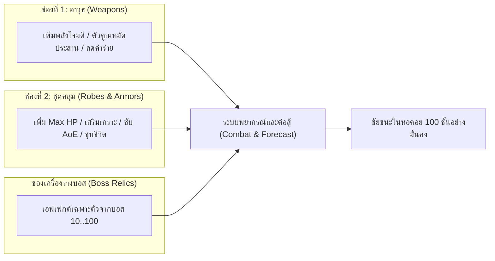

# เอกสารการออกแบบระบบอุปกรณ์สวมใส่: ส่วนที่ 2 — สารบบชุดคลุมและเสื้อเกราะเวท (Robes & Armors System)
**เกม:** คาถานอกตำรา (Spell Foundry)  
**หมวดหมู่:** อุปกรณ์สวมใส่ช่องที่ 2 — ชุดคลุม/เสื้อเกราะ (Armor / Robe Slot)  
**สถานะ:** เอกสารข้อกำหนดระบบ (Game Design Specification — Approved Draft)

---

## 1. ปรัชญาและโครงสร้างระบบชุดคลุมและเสื้อเกราะ (Armor Slot Architecture)

ช่องสวมใส่ **"ชุดคลุมและเสื้อเกราะ" (Armor / Robe Slot)** เป็นสล็อตอุปกรณ์ลำดับที่ 2 ของระบบ RPG Gear ทำหน้าที่เป็น **แกนหลักด้านการป้องกันและการอยู่รอด (Defensive & Survivability Backbone)** ของผู้ร่ายและสิ่งอัญเชิญ โดยมีบทบาทสำคัญดังนี้:

1. **บทบาทหลักของชุดคลุมและเสื้อเกราะ:**  
   * **เสริมความทนทานแก่ผู้เล่น (Player Vitality):** เพิ่ม Max HP, มอบโล่ป้องกันต้นเทิร์น (Start-of-Turn Shielding), และกางม่านคุ้มภัย (Ward Layers)  
   * **เสริมความแข็งแกร่งให้แนวหน้า (Summon Bulk & Tenacity):** มอบ HP เพิ่มเติมให้สัตว์อัญเชิญ, เสริมเกราะธรรมชาติ (Natural Armor), และช่วยซับดาเมจแบบหมู่ (AoE Dampening)  
   * **การต้านทานและการโต้กลับ (Resistance & Retaliation):** ลดทอนสถานะผิดปกติ (ลดความแรงของ Burn/Chill), สะท้อนดาเมจหนาม (Thorns), หรือคืนมานา/เลือดเมื่อถูกโจมตีหนัก
2. **การทำงานร่วมกับระบบเดิม:**  
   สวมใส่ผ่านแท่นบูชาจุดพัก (Sanctuary Armory) ควบคู่กับ *อาวุธ* และ *เครื่องประดับ* โดย **ไม่แย่งช่องกับเครื่องรางบอส 3 ช่องเดิม (Boss Relics)**
3. **แหล่งที่มา 2 ทางชัดเจน:**  
   * **ระดับธรรมดา (Common) และ หายาก (Rare):** วางจำหน่ายใน **ร้านค้าชั้นพัก (Sanctuary Shop)** เพื่อใช้ทองคำซื้อสำหรับประคองตัวในหอคอยชั้นต้น-กลาง  
   * **ระดับพิเศษ (Special), มหากาพย์ (Epic), และ ตำนาน (Legendary):** ดรอปเฉพาะจากการพิชิต **"รอยแยกอุปกรณ์ (Gear Rift)"**

---

## 2. สารบบชุดคลุมและเสื้อเกราะ 40 ชนิด ครอบคลุม 5 ระดับความหายาก (Armor Catalog)

```text
สรุปสัดส่วนชุดคลุมและเสื้อเกราะ 40 ชิ้น:
- ระดับธรรมดา (Common)    : 6 ชิ้น  (ของร้านค้าชั้น 5–25)
- ระดับหายาก (Rare)        : 8 ชิ้น  (ของร้านค้าชั้น 35–55 / Gear Rift เทียร์ 20–40)
- ระดับพิเศษ (Special)     : 10 ชิ้น (Gear Rift เทียร์ 50–70 / Vault Shop)
- ระดับมหากาพย์ (Epic)     : 10 ชิ้น (Gear Rift เทียร์ 70–90)
- ระดับตำนาน (Legendary)   : 6 ชิ้น  (Gear Rift เทียร์ 90–100 / ลับ)
```

---

### 2.1 ระดับธรรมดา (Common) — 6 ชิ้น
> **แหล่งที่มา:** ร้านค้าชั้นพัก (Sanctuary Shop ชั้น 5, 15, 25) | **ราคา:** 40 – 75 ทอง

| ID | ชื่อชุดคลุม (ไทย / อังกฤษ) | ไอคอน | สไตล์การเล่นหลัก | สเตตัสและเอฟเฟกต์เฉพาะตัว (Traits) | แหล่งที่มา / ราคา | คำอธิบาย (Flavor Text) |
| :--- | :--- | :---: | :--- | :--- | :---: | :--- |
| `robe_apprentice_linen`| **เสื้อคลุมผ้าลินินฝึกหัด**<br>Apprentice Linen Robe | 🥋 | พื้นฐาน / ทั่วไป | • Max HP ผู้เล่น $+8$<br>• เริ่มต้นการต่อสู้มอบโล่ $+3$ หน่วย | ร้านชั้น 5<br>(40 g) | เสื้อคลุมทอจากผ้าลินินเนื้อหยาบ น้ำหนักเบาและระบายอากาศได้ดี |
| `vest_hound_fur` | **เสื้อกั๊กขนสุนัขป่า**<br>Wolfhound Fur Vest | 🦺 | อัญเชิญสัตว์เล็ก<br>(Common Summon) | • สัตว์อัญเชิญระดับ Common ได้รับ HP $+8$<br>• Max HP ผู้เล่น $+6$ | ร้านชั้น 5<br>(50 g) | เสื้อกั๊กขนสัตว์หนานุ่ม กลิ่นอายจ่าฝูงทำให้สัตว์เลี้ยงรู้สึกปลอดภัย |
| `robe_pyro_insulation` | **ผ้าคลุมใยหินทนไฟ**<br>Asbestos Pyro Cloak | 🥼 | ต้านไฟ (Fire Ward) | • ดาเมจจากสถานะเผา (Burn) ที่ผู้เล่นได้รับลดลง $-1$ หน่วย<br>• เมื่อโดนโจมตีด้วยธาตุไฟ ได้เกราะ $+3$ | ร้านชั้น 5<br>(50 g) | ผ้าคลุมทอจากเส้นใยหินทนความร้อนสูง ป้องกันสะเก็ดไฟลวกลาม |
| `tunic_frost_weave` | **เสื้อกั๊กถักทอไอเย็น**<br>Frost-Woven Tunic | 🎽 | ต้านน้ำแข็ง (Ice Ward)| • สถานะหนาว (Chill) ที่โดนผู้เล่นลดลงเหลือครึ่งหนึ่ง<br>• Max HP ผู้เล่น $+8$ | ร้านชั้น 15<br>(60 g) | เสื้อกั๊กถักจากไหมน้ำแข็ง สวมใส่แล้วสบายตัวแม้เผชิญลมหนาว |
| `cloak_grounded_wool` | **เสื้อคลุมขนสัตว์ต่อสายดิน**<br>Grounded Wool Cloak | 🧥 | ต้านสายฟ้า (Lightning)| • ลดความเสียหายสายฟ้าที่ผู้เล่นได้รับลง $-2$ หน่วย<br>• สัตว์อัญเชิญป้องกันการติดช็อตชิ่งสายฟ้า | ร้านชั้น 15<br>(60 g) | สอดเส้นลวดทองแดงลงสู่พื้น สลายกระแสไฟฟ้าสถิตได้อย่างปลอดภัย |
| `cuirass_light_crag` | **เกราะอกศิลาแผ่นบาง**<br>Light Crag Cuirass | 🛡️ | เกราะปฐพี (Earth Bulk) | • เริ่มต้นทุกเทิร์น ได้รับเกราะ $+2$ หน่วยอัตโนมัติ<br>• สัตว์อัญเชิญมี HP $+6$ | ร้านชั้น 25<br>(75 g) | แผ่นหินชนวนประกบหนังฟอก มอบการป้องกันทางกายภาพขั้นต้น |

---

### 2.2 ระดับหายาก (Rare) — 8 ชิ้น
> **แหล่งที่มา:** ร้านค้าชั้นพัก (ชั้น 35, 45, 55) หรือ Gear Rift เทียร์ 20–40 | **ราคา:** 120 – 190 ทอง

| ID | ชื่อชุดคลุม (ไทย / อังกฤษ) | ไอคอน | สไตล์การเล่นหลัก | สเตตัสและเอฟเฟกต์เฉพาะตัว (Traits) | แหล่งที่มา / ราคา | คำอธิบาย (Flavor Text) |
| :--- | :--- | :---: | :--- | :--- | :---: | :--- |
| `carapace_turtle_shell`| **เกราะอกกระดองเต่าศิลา**<br>Tortoise Shell Carapace | 🐢 | เต่า & สายแทงก์<br>(Turtle & Guard) | • เต่าอัญเชิญมอบโล่ให้ผู้เล่นเพิ่มเป็น $10$ หน่วย (จากเดิม 6)<br>• ผู้เล่นมีเกราะธรรมชาติ $+1$ ตลอดการต่อสู้ | ร้านชั้น 35 / Rift 20<br>(130 g) | หลอมจากเศษกระดองเต่าโบราณ แข็งแกร่งทนทานต่อแรงกระแทก |
| `robe_pack_howl` | **ชุดคลุมจ่าฝูงหอนพงไพร**<br>Packleader Howling Robe| 🐺 | หมาป่า & บัฟเวท<br>(Wolf & Spell Amp) | • สัตว์อัญเชิญสาย Rare ทุกตัวได้รับ HP $+14$<br>• เมื่อสัตว์อัญเชิญแตกสลาย บัฟเวทผู้เล่นเพิ่ม $+30\%$ (จากเดิม $+20\%$) | ร้านชั้น 35 / Rift 20<br>(140 g) | ชุดคลุมขนหมาป่าสีเงิน ปลุกเร้าสัญชาตญาณสัตว์ป่าเมื่อจ่าฝูงล้มลง |
| `cloak_slime_absorber` | **เสื้อคลุมสสารกลืนกิน**<br>Slime Membrane Cloak | 🫧 | สไลม์ & ซับดาเมจ<br>(Slime Absorption) | • เมื่อผู้เล่นโดนโจมตีเกิน 15 หน่วย สสารเมือกจะซับดาเมจ $-4$ หน่วยทันที<br>• สไลม์อัญเชิญลดพลังโจมตีศัตรู $-6$ เมื่อแตก (จากเดิม $-4$) | ร้านชั้น 45 / Rift 30<br>(150 g) | เคลือบผิวด้วยเจลสไลม์ยืดหยุ่น ยุบตัวกระจายแรงกระแทกได้ยอดเยี่ยม |
| `hauberk_iron_bear` | **เสื้อเกราะโซ่ถักหมีเหล็ก**<br>Ironbear Chainmail | 🐻 | หมี & ผลักศัตรู<br>(Bear & Knockback) | • หมีอัญเชิญมี HP $+18$ และเกราะ $+1$<br>• เมื่อสัตว์อัญเชิญสวนกลับผลักศัตรู จะสร้างดาเมจกระแทก $+6$ แท้ | ร้านชั้น 45 / Rift 30<br>(160 g) | เกราะโซ่ถักซ้อนชั้นด้วยหนังหมีพงไพร มั่นคงและเปี่ยมพลังผลักดัน |
| `robe_mist_mirage` | **ชุดคลุมภาพลวงตาหมอก**<br>Mist Mirage Robe | 🌫️ | หมอก & หลบหลีก<br>(Mist & Dodge) | • นก, แมว, และสัตว์สายบิน มีโอกาสหลบหลีก $+25\%$<br>• ผู้เล่นมีโอกาสหลบการโจมตีครั้งแรกในแต่ละเทิร์น $20\%$ | ร้านชั้น 55 / Rift 40<br>(170 g) | ทอจากละอองหมอกเวท บิดเบือนการมองเห็นของศัตรูจนโจมตีพลาดเป้า |
| `mantle_croc_scute` | **เสื้อคลุมเกล็ดหนาจระเข้**<br>Crocodile Scute Mantle | 🐊 | จระเข้ & ผิวหนา<br>(Croc Heavy Armor) | • จระเข้และสัตว์เกราะลดทอนดาเมจโจมตีลง $-3$ (จากเดิม $-2$)<br>• Max HP ผู้เล่น $+14$ | ร้านชั้น 55 / Rift 40<br>(175 g) | เกล็ดแข็งบริเวณหลังจระเข้ยักษ์ คมเขี้ยวใดๆ ก็ยากจะเจาะทะลุ |
| `robe_siphon_bat` | **เสื้อคลุมปีกค้างคาวดูดเลือด**<br>Vampiric Wing Robe | 🦇 | ค้างคาว & ฟื้นเลือด<br>(Bat Life Leech) | • เมื่อค้างคาวหรือเวทน้ำฟื้นเลือดผู้เล่น เพิ่มปริมาณฮีลขึ้น $+2$ HP<br>• หากเลือดผู้เล่นเต็ม ฮีลส่วนเกินจะแปลงเป็นโล่ชั่วคราว | Rift 40<br>(180 g) | ปีกค้างคาวสีนิลแผ่สยาย ดูดซับหยาดโลหิตในสนามรบมาหล่อเลี้ยงชีพ |
| `cuirass_bone_splinter`| **เกราะกระดูกระเบิดหนาม**<br>Bone Splinter Cuirass | 💀 | โครงกระดูก & สวนกลับ<br>(Skeleton Revenge) | • โครงกระดูกระเบิดหลังแตกทำดาเมจแท้ $22$ หน่วย (จากเดิม 14)<br>• เมื่อโล่ผู้เล่นแตก ระเบิดสะเก็ดกระดูก 8 ดาเมจใส่ศัตรูทั้งหมด | Rift 40<br>(190 g) | เสื้อเกราะโครงกระดูกนักรบโบราณ พร้อมแตกกระจายเป็นหนามแหลมสังหาร |

---

### 2.3 ระดับพิเศษ (Special) — 10 ชิ้น
> **แหล่งที่มา:** Gear Rift เทียร์ 50–70 หรือ Sanctuary Vault Shop | **ราคา:** 250 – 400 ทอง

| ID | ชื่อชุดคลุม (ไทย / อังกฤษ) | ไอคอน | สไตล์การเล่นหลัก | สเตตัสและเอฟเฟกต์เฉพาะตัว (Traits) | แหล่งที่มา / ราคา | คำอธิบาย (Flavor Text) |
| :--- | :--- | :---: | :--- | :--- | :---: | :--- |
| `stoneplate_gargoyle` | **เกราะศิลาปีกการ์กอยล์**<br>Gargoyle Winged Stoneplate| 🦇 | สกัด AoE แทนผู้เล่น<br>(AoE Intercept Core) | • การ์กอยล์และเบฮีมอธได้รับ HP $+30$ และเกราะ $+2$<br>• เมื่อรับท่า AoE ดาเมจที่ทะลุ (Overflow) สู่ผู้เล่นลดลง $-50\%$ | Rift 50 / Vault<br>(280 g) | แผ่นศิลาสลักลวดลายปีกการ์กอยล์ ป้องกันการโจมตีกวาดล้างสนามได้อย่างสมบูรณ์ |
| `robe_titan_aegis` | **ชุดคลุมปราการมหาไททัน**<br>Titan Aegis Robe | 🗿 | โกเลม & มหาเกราะ<br>(Golem Fortress) | • โกเลมมี HP $+35$, เกราะ $+2$, และเกิดพร้อมม่าน 1 ชั้น<br>• เมื่อโกเลมแตกสลาย มอบโล่ $20$ หน่วยให้ผู้เล่นทันที | Rift 50<br>(300 g) | เศษผ้าคลุมจากรูปปั้นยักษ์ไททันโบราณ หนักแน่นและไม่มีวันพังทลาย |
| `robe_lion_mane` | **เสื้อคลุมแผงคอราชสีห์ทองคำ**<br>Golden Lion Mane Robe | 🦁 | สิงโต & ลดดาเมจ<br>(Lion Pride Armor) | • สิงโตลดดาเมจจากการโจมตีลง $-5$ (จากเดิม $-3$)<br>• ผู้เล่นได้รับดาเมจทางกายภาพลดลง $-3$ หน่วยตลอดเวลา | Rift 60<br>(320 g) | แผงคอสิงโตทองคำหนานุ่ม ซับแรงกระแทกและสร้างความยำเกรงแก่ศัตรู |
| `robe_siren_seafoam` | **ชุดคลุมฟองคลื่นไซเรน**<br>Siren Seafoam Gown | 🧜‍♀️ | ไซเรน & ม่านคุ้มภัย<br>(Siren Ward Layers) | • ไซเรนเกิดพร้อมม่านคุ้มภัย $+2$ ชั้น (จากเดิม 1 ชั้น)<br>• เมื่อผู้เล่นหรือไซเรนถูกโจมตี สาดสถานะเปียกใส่ผู้โจมตีทันที 2 เทิร์น | Rift 60<br>(340 g) | ผ้าไหมทอจากฟองคลื่นสีคราม แผ่ละอองน้ำลบล้างการโจมตีอย่างสง่างาม |
| `robe_sprite_glamour` | **ชุดคลุมละอองภูตพราย**<br>Sprite Glamour Shroud | 🧚 | ภูตพราย & มานาฮีล<br>(Sprite Sustain) | • เมื่อภูตพรายแตกสลาย ฟื้นเลือดผู้เล่น $+20$ HP (จากเดิม 12) และ $+3$ MP<br>• Max MP ผู้เล่น $+2$ หน่วย | Rift 60<br>(350 g) | เสื้อคลุมโปร่งแสงประกายระยิบระยับ ปลดปล่อยพลังงานธรรมชาติเยียวยาบาดแผล |
| `harness_magma_forge` | **สายรัดอกเตาหลอมลาวา**<br>Magma Forge Harness | 🌋 | แมกม่า & ดินไฟ<br>(Magma & Earthfire) | • แอ่งแมกม่าที่พื้นปะทุแรงขึ้น $+8$ ดาเมจ และทุบเกราะ $-3$ ถาวร<br>• ผู้เล่นและสิ่งอัญเชิญป้องกันดาเมจจากสถานะเผา $100\%$ | Rift 70<br>(360 g) | แถบหนังทนไฟรัดแผ่นหินภูเขาไฟ ร้อนระอุแต่ปกป้องผู้ถือครองจากความร้อน |
| `shroud_permafrost_ice`| **ผ้าคลุมศิลาเยือกแข็ง**<br>Permafrost Shroud | 🧊 | เยือกศิลา & เกราะน้ำแข็ง<br>(Permafrost Barrier) | • เมื่อร่ายเยือกศิลา ผู้เล่นได้เกราะ $+10$ หน่วย (จากเดิม 6)<br>• ศัตรูที่โจมตีใส่เกราะจะติดหนาว $4$ หน่วยสะสมทันที | Rift 70<br>(360 g) | ผ้าคลุมผลึกน้ำแข็งผสานแร่หิน ไอเย็นสะท้อนกลับทำลายคมอาวุธศัตรู |
| `mantle_storm_insulator`| **เสื้อคลุมฉนวนฟ้าคะนอง**<br>Storm Insulator Mantle | ⛈️ | ฟ้าคะนอง & สายฟ้า<br>(Lightning Shield) | • ดาเมจสายฟ้าข้ามเกราะและม่านของผู้เล่นจะถูกสลายทิ้ง $100\%$<br>• เมื่อถูกโจมตี ปล่อยกระแสช็อตสวนกลับ 8 ดาเมจใส่ตัวการ | Rift 70<br>(380 g) | ฉนวนยางมนตรากันไฟฟ้าแรงสูง สลายประจุสายฟ้าของศัตรูอย่างไร้ผล |
| `cuirass_dust_deflector`| **เกราะอกธุลีเบี่ยงวิถี**<br>Dust Deflector Cuirass | 🌪️ | ธุลี & ผลักลมดิน<br>(Dust Armor Shred) | • การผลักกระแทกทะลุเกราะเพิ่มเป็น $10$ หน่วย (จากเดิม 6)<br>• สัตว์อัญเชิญธาตุลมและดินได้รับ HP $+20$ | Rift 70<br>(380 g) | แผ่นเกราะทรายอัดมนตรา เบี่ยงเบนวิถีกระสุนและระเบิดพลังผลักดัน |
| `vestment_sanctuary_nun`| **ชุดนักพรตอารามศักดิ์สิทธิ์**<br>Sanctuary Vestment | ✧ | อวยพร & ศรัทธา<br>(Bless & Heal Buff) | • คาถา "อวยพร" และ "เสริม" อยู่นานขึ้น $+1$ เทิร์น<br>• เมื่อผู้เล่นได้รับฮีล จะได้เกราะชั่วคราวแถมฟรีเท่ากับ $50\%$ ของค่าฮีล | Rift 70 / Vault<br>(400 g) | ชุดนักพรตสีขาวบริสุทธิ์ แผ่รัศมีแห่งการปกป้องและศรัทธาอันแน่วแน่ |

---

### 2.4 ระดับมหากาพย์ (Epic) — 10 ชิ้น
> **แหล่งที่มา:** Gear Rift เทียร์ 70–90 | **ราคาประเมิน:** 500 – 750 ทอง

| ID | ชื่อชุดคลุม (ไทย / อังกฤษ) | ไอคอน | สไตล์การเล่นหลัก | สเตตัสและเอฟเฟกต์เฉพาะตัว (Traits) | แหล่งที่มา / ราคา | คำอธิบาย (Flavor Text) |
| :--- | :--- | :---: | :--- | :--- | :---: | :--- |
| `hide_behemoth_colossus`| **ชุดคลุมหนังมหาเบฮีมอธ**<br>Colossal Behemoth Hide | 🦏 | มหาแทงก์ AoE<br>(Behemoth Bulwark) | • เบฮีมอธได้รับ HP $+50$ และเกราะ $+3$<br>• **ดูดซับดาเมจ AoE แทนผู้เล่นได้ 100% เต็ม** โดยไม่มีส่วนล้นสู่ตัวคนเล่นจนกว่าเบฮีมอธจะตาย | Rift 80<br>(600 g) | หนังหนาชั้นนอกของพญาอสูรปฐพี ซับแรงระเบิดและแผ่นดินไหวได้อย่างไร้รอยขีดข่วน |
| `scales_hydra_endurance`| **เกราะเกล็ดไฮดราเก้าชีวิต**<br>Hydra Regenerative Scales| 🐉 | ไฮดรา & ฟื้นฟูต่อเนื่อง<br>(Hydra Enduring Armor) | • ไฮดราและผู้เล่นฟื้นฟูเลือด $+6$ HP ในช่วงต้นทุกเทิร์น<br>• เมื่อผู้เล่นเลือดลดต่ำกว่า $30\%$ กางม่านคุ้มภัย 2 ชั้นฉุกเฉินทันที (1 ครั้ง/ศึก) | Rift 80<br>(600 g) | เกล็ดมังกรน้ำหลายเศียร มีชีวิตชีวาและสมานบาดแผลได้อย่างรวดเร็ว |
| `cloak_abyssal_ink` | **เสื้อคลุมหมึกดำห้วงบาดาล**<br>Abyssal Inksilk Cloak | 🐙 | คราเคน & หลบวืด<br>(Kraken Blind Veil) | • คราเคนได้รับ HP $+40$, และทำให้ศัตรูวืดการโจมตีเพิ่มเป็น $50\%$<br>• ผู้เล่นได้รับการคุ้มกันจากดาเมจพิษและคำสาป $100\%$ | Rift 80<br>(600 g) | ผ้าไหมสีดำสนิทย้อมด้วยน้ำหมึกคราเคน ลวงตาและกลืนกินคมดาบ |
| `plate_scald_steamburst`| **เกราะแผ่นไอร้อนเดือดพล่าน**<br>Scald Steamplate | ♨️ | ไอเดือด (Scald)<br>(Steam Armor Melt) | • เมื่อศัตรูโจมตีใส่ผู้เล่นหรือสิ่งอัญเชิญ พ่นไอเดือดทุบเกราะศัตรู $-2$ ถาวร<br>• คาถาไอเดือดคืน $+2$ มานาเมื่อร่ายสำเร็จ | Rift 85<br>(650 g) | แผ่นเกราะหม้อต้มไอน้ำ ปลดปล่อยแรงดันไอร้อนเผาผลาญเกราะของผู้รุกราน |
| `cuirass_plasma_radiance`| **เกราะอกสะท้อนความร้อนพลาสมา**<br>Plasma Radiant Cuirass | ✦ | พลาสมา & สะท้อนพลัง<br>(Plasma Reflection) | • สะท้อนความเสียหายจากเวทโจมตีทุกชนิด $30\%$ คืนสู่ผู้โจมตี<br>• สัตว์อัญเชิญทำดาเมจสวนกลับเพิ่มขึ้น $+25\%$ เป็นดาเมจไฟสายฟ้า | Rift 85<br>(680 g) | โลหะผสมพิเศษทนความร้อนสูง สะท้อนคลื่นพลังงานความร้อนกลับสู่ต้นกำเนิด |
| `robe_monsoon_tempest` | **ชุดคลุมมรสุมปัดป้องพิโรธ**<br>Monsoon Stormwarden Robe| 🌊 | มรสุม & สลายม่าน<br>(Monsoon Ward Buff) | • เมื่อร่ายมรสุม ฟื้นฟูเลือดผู้เล่น $+8$ HP (จากเดิม 4) และผลักศัตรูทุกคน 2 ช่อง<br>• ผู้เล่นมีม่านคุ้มภัยถาวร 1 ชั้นที่จะรีเซ็ตใหม่ทุก 3 เทิร์น | Rift 85<br>(700 g) | เสื้อคลุมสีครามครามแห่งเทพมรสุม ปัดเป่าการโจมตีด้วยสายลมและหยาดฝน |
| `shroud_void_singularity`| **ผ้าคลุมมิติสุญญากาศ**<br>Void Singularity Shroud| 🕳️ | หลุมดำ & ม่านมิติ<br>(Void Gravity Dampener) | • ลดความเสียหายจากท่าหนัก (Heavy Attack) ของบอสลง $-30\%$<br>• คาถาหลุมดำใช้มานาลดลง $-3$ MP (เหลือ 17 มานา) | Rift 90<br>(720 g) | ผืนผ้าทอจากรอยต่อมิติ บิดเบือนแรงโน้มถ่วงเพื่อลดทอนแรงปะทะมหาศาล |
| `tunic_barrage_overdrive`| **เสื้อกั๊กกลไกกระหน่ำยิง**<br>Barrage Overdrive Tunic | ⚙️ | กระหน่ำ & เกราะจักรกล<br>(Barrage Machine Armor) | • ทุกครั้งที่กระสุนของคาถา "กระหน่ำ" กระทบศัตรู ผู้เล่นได้เกราะ $+2$ หน่วย (รวม $+10$ เกราะ/การร่าย)<br>• Max HP ผู้เล่น $+20$ | Rift 90<br>(720 g) | เสื้อกั๊กติดเกราะกลไก แปลงแรงสะท้อนจากการยิงกระหน่ำมาเป็นพลังงานป้องกัน |
| `mantle_devastation_core`| **เสื้อคลุมแกนทำลายล้าง**<br>Devastation Core Mantle | 💥 | ทำลายล้าง & กันระเบิด<br>(Blast Immunity) | • ผู้เล่นและสัตว์อัญเชิญป้องกันดาเมจจากแรงระเบิดและสะเก็ดไฟ $100\%$<br>• เมื่อคาถาทำลายล้างระเบิด จะเพิ่มโล่ให้ผู้เล่น $15$ หน่วย | Rift 90<br>(750 g) | ผ้าคลุมทอจากแกนระเบิดกัมปนาท ทนทานต่อแรงกระแทกจากคลื่นทำลายล้างสูงสุด |
| `robe_archmage_prismatic`| **ชุดคลุมมหาจอมเวทปริซึม**<br>Archmage Prismatic Robe | 🌈 | ผสมธาตุรอบด้าน<br>(All Elements Buffer) | • เกราะจากคาถาดิน $+4$, ฮีลจากน้ำ $+4$, และความเสียหายไฟ/สายฟ้า/ลม $+4$<br>• Max MP ผู้เล่น $+2$ หน่วย | Rift 90<br>(750 g) | เสื้อคลุมเจ็ดสีของมหาปราชญ์ ผสานพลังงานแห่งธาตุทั้งปวงอย่างสมดุล |

---

### 2.5 ระดับตำนาน (Legendary) — 6 ชิ้น
> **แหล่งที่มา:** Gear Rift เทียร์ 90–100 หรือ ชนะบอสลับ | **ราคาประเมิน:** 1,200 – 2,000 ทอง

| ID | ชื่อชุดคลุม (ไทย / อังกฤษ) | ไอคอน | สไตล์การเล่นหลัก | สเตตัสและเอฟเฟกต์เฉพาะตัว (Traits) | แหล่งที่มา / ราคา | คำอธิบาย (Flavor Text) |
| :--- | :--- | :---: | :--- | :--- | :---: | :--- |
| `scales_dragon_sovereign`| **เกราะเกล็ดราชันมังกรโบราณ**<br>Dragon Sovereign Scaleplate| 🐲 | มังกร & สะท้อนเพลิงกัลป์<br>(Dragon Scale Armor) | • มังกรอัญเชิญได้รับ HP $+60$, เกราะ $+4$, และ **สะท้อนดาเมจ $100\%$ คืนศัตรูเสมอ**<br>• ผู้เล่นได้รับเกราะธรรมชาติ $+3$ ตลอดกาล และดาเมจรับจากบอสลดลง $-25\%$ | Rift 90–100<br>(1,600 g) | เกล็ดมังกรแดงโบราณที่ผ่านไฟบรรลัยกัลป์มานับพันปี มอบการปกป้องระดับราชัน |
| `shroud_phoenix_rebirth`| **ผ้าคลุมเพลิงวิหคจุตินิรันดร์**<br>Phoenix Rebirth Shroud | 🪶 | ฟีนิกซ์ & คืนชีพคู่<br>(Dual Cheat-Death) | • ฟีนิกซ์เกิดพร้อมม่าน $+3$ ชั้น และฟื้นคืนชีพจากไข่ได้ 2 ครั้ง<br>• **หากผู้เล่นโดนดาเมจถึงชีวิต ผ้าคลุมจะสละชีพชุบชีวิตผู้เล่น 1 ครั้ง** (ฟื้น HP 100% ทันทีแม้ไม่มีสัตว์ในสนาม) | Rift 90–100<br>(1,600 g) | ทอจากขนนกฟีนิกซ์ทองคำ เปลวเพลิงแห่งชีวิตจะลุกโชนขึ้นใหม่แม้ชีพดับสูญ |
| `robe_chronos_timeless` | **ชุดคลุมเหนือกาลเวลาแห่งโครนอส**<br>Chronos Timeless Robe | ⏳ | ควบคุมเทิร์น & หยุดเวลา<br>(Time Dilation) | • ทุก 4 เทิร์น ผู้เล่นจะได้รับสิทธิ์ "ข้ามการโจมตีของศัตรูทั้งหมด" ฟรี 1 รอบอัตโนมัติ<br>• ในช่วงเวลาหยุด เวลาไม่นับอายุของโล่และม่าน (โล่และม่านไม่หมดอายุ) | Rift 100<br>(1,800 g) | เสื้อคลุมสีเงินยวบยาบที่หลุดพ้นจากสายธารเวลา ผู้สวมใส่เคลื่อนไหวในมิติที่ไร้การไหลผ่าน |
| `cuirass_void_eater` | **เกราะอกกลืนกินความว่างเปล่า**<br>Void Devourer Cuirass | 🕳️ | ดาเมจเดี่ยวแท้ & ซับล้น<br>(True Damage Absorption) | • เมื่อผู้เล่นหรือสิ่งอัญเชิญได้รับดาเมจ ดาเมจส่วนเกินจาก Max HP (Overkill) ทั้งหมดจะถูกลบล้างทิ้ง $100\%$<br>• เปลี่ยนความเสียหาย $20\%$ ที่ได้รับให้กลายเป็นมานาคืนสู่ผู้เล่น | Rift 100<br>(1,800 g) | เกราะอกสีมืดสนิทที่เปิดปากหลุมดำคอยดูดกลืนการโจมตีที่รุนแรงเกินขีดจำกัด |
| `mantle_nether_emperor` | **เสื้อคลุมจอมอสูรนรกานต์**<br>Nether Emperor Mantle | 💀 | ดูดเลือด & ล้างเกราะ<br>(Soul Leech Mantle) | • ทุกครั้งที่สิ่งอัญเชิญออกหมัดประสานหรือสวนกลับ ผู้เล่นฟื้นเลือด $+50\%$ ของดาเมจที่ทำได้<br>• ลดเกราะของศัตรูทุกคนในสนามลง $-2$ หน่วยทุกต้นเทิร์นอัตโนมัติ | Rift 100<br>(1,800 g) | เสื้อคลุมขนสัตว์สีดำทมิฬของจอมอสูร กลิ่นอายความตายสูบกลืนวิญญาณศัตรูมาบำรุงชีพ |
| `vestment_omni_ascendant`| **ชุดคลุมมหาจุตินิรันดร์ปฐมกาล**<br>Genesis Ascendant Vestment | ✺ | จุติ & สถานะเทพ<br>(Godhood Defense) | • เริ่มต้นการต่อสู้ ผู้เล่นและสิ่งอัญเชิญได้รับ **ม่านคุ้มภัย 3 ชั้น** และ **เกราะ 10 หน่วย** ทันที<br>• ต้านทานดีบัฟทุกชนิด (ไม่ติดหนาว, ไม่ติดเผา, ไม่ติดเปียก, ไม่ถูกลดพลังโจมตี) | ลับ (Floor 100 Boss)<br>(2,000 g) | เครื่องทรงแห่งพระเจ้าปฐมกาล ถักทอจากแสงแรกของจักรวาล ไร้มลทินและอยู่เหนือความตาย |

---

## 3. สรุปความเข้ากันได้กับการทำงานจริงในระบบเกม (Game Engine Synergy)



1. **แก้ปัญหาคอขวดชั้น 68 และ 88–89 อย่างตรงจุด:**  
   ชุดคลุมสายสกัด AoE เช่น `stoneplate_gargoyle` (Special) และ `hide_behemoth_colossus` (Epic) ถูกออกแบบมาเพื่อปิดช่องว่างที่ผู้เล่นมักโดนท่ากวาดล้างของบอสทะลุสัตว์เล็กมาสังหารตัวผู้เล่น
2. **ไม่ทำให้เกมง่ายจนเกินไป:**  
   ของระดับสูง (Epic / Legendary) ต้องอาศัยการลง Gear Rift ชั้นลึก (Floor 70+) เพื่อฟาร์มหา ซึ่งผู้เล่นต้องใช้ฝีมือในการผ่านด่านมาก่อน ไม่สามารถซื้อข้ามขั้นได้ตั้งแต่ต้นเกม
3. **ส่งเสริมการมิกซ์แอนด์แมตช์:**  
   ผู้เล่นสามารถจับคู่ **อาวุธสายโจมตี (เช่น คทาพลาสมา)** กับ **ชุดคลุมสายแทงก์ (เช่น เกราะเบฮีมอธซับ AoE)** เพื่อสร้างบิลด์ที่สมดุลทั้งรุกและรับได้อย่างอิสระ
