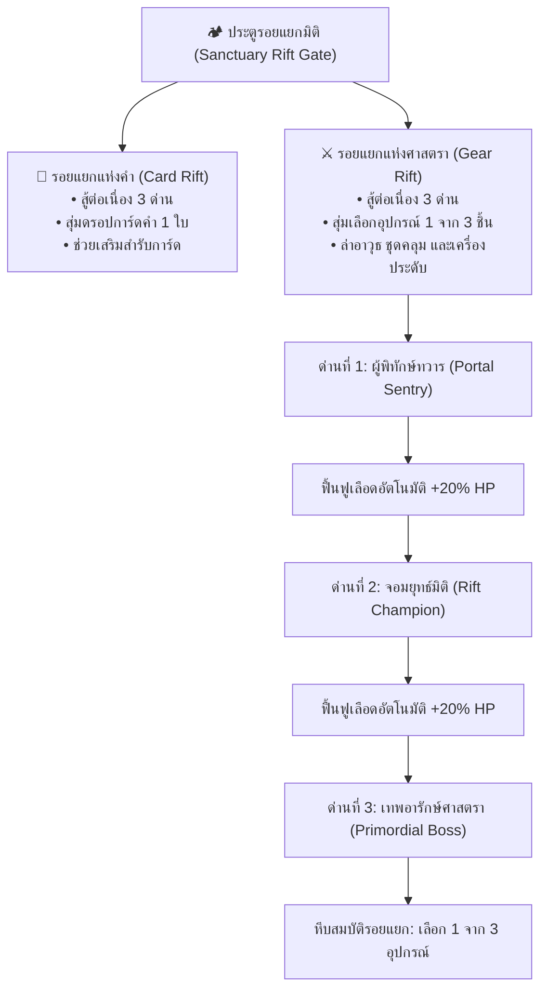

# เอกสารการออกแบบระบบรอยแยกแห่งศาสตรา: โครงสร้าง มอนสเตอร์ เงื่อนไขการเข้า และกฎการดรอปอุปกรณ์ (Gear Rift System)
**เกม:** คาถานอกตำรา (Spell Foundry)  
**หมวดหมู่:** ดันเจี้ยนท้าทายพิเศษล่าอุปกรณ์ RPG (Endgame & Progression Gear Dungeon)  
**สถานะ:** เอกสารข้อกำหนดระบบ (Game Design Specification — Approved Draft)

---

## 1. ปรัชญาและโครงสร้างระบบรอยแยกแห่งศาสตรา (Gear Rift Architecture)

**"รอยแยกแห่งศาสตรา" (Gear Rift)** เป็นดันเจี้ยนท้าทายคู่ขนานกับ "รอยแยกแห่งคำ" (Card/Grimoire Rift) ที่เข้าถึงได้ผ่าน **ประตูรอยแยก (Rift Portal)** ในจุดพักชั้นต่างๆ ทำหน้าที่เป็น **"แหล่งฟาร์มอุปกรณ์ RPG สวมใส่ (Weapons, Armors, Accessories) ระดับ Rare, Special, Epic, และ Legendary"** ที่ผู้เล่นสามารถกำหนดทิศทางของอุปกรณ์เพื่อนำมาเสริมพลัง Build ให้สมบูรณ์



### 1.1 จุดเด่นที่แตกต่างจาก Card Rift
1. **ระบบรางวัลแบบเลือกได้ (Choice of 3 Drafting):** ในขณะที่ Card Rift สุ่มมอบการ์ดให้ 1 ใบโดยเลือกไม่ได้ Gear Rift จะเปิด **หีบสมบัติ 3 ชิ้น (Choice of 3)** ให้ผู้เล่นเลือกหยิบชิ้นที่ตรงกับสายการเล่นของตนเองมากที่สุด
2. **การใช้อุปกรณ์นำทาง (Compass Targeting):** ผู้เล่นสามารถใช้ **เข็มทิศนำทาง (Resonant Compasses)** จากร้านค้าจุดพัก เพื่อบังคับล็อกประเภทอุปกรณ์ที่ดรอป (เช่น ล็อกอาวุธล้วน, ล็อกชุดคลุมล้วน, หรือล็อกเครื่องประดับล้วน)
3. **มอนสเตอร์สายทหารช่างและโกเลมโบราณ (Forge Constructs):** ศัตรูใน Gear Rift มีลักษณะเฉพาะทางยุทธวิธี เช่น เคลือบเกราะรูนหนา, สลายม่าน, สะท้อนธาตุ, และระเบิดสนามรบ ทำให้ผู้เล่นต้องใช้คอมโบเวทและสัตว์อัญเชิญอย่างชาญฉลาด

---

## 2. ลำดับขั้นเทียร์และการปลดล็อก (Rift Tiers & Progression)

Gear Rift มีทั้งหมด **9 เทียร์ (Tiers 20, 30, 40, 50, 60, 70, 80, 90, 100)** สอดคล้องกับชั้นของหอคอยหลัก:

| เทียร์ (Tier) | ช่วงเลเวลศัตรู | เงื่อนไขการปลดล็อก (Unlock Requirement) | ระดับอุปกรณ์หลักที่ดรอป | จุดพักที่แนะนำให้เข้า |
| :---: | :---: | :--- | :---: | :---: |
| **Tier 20** | Lv. 20–25 | พิชิตบอสใหญ่ชั้น 20 (มังกรฟ้าปฐมกาล) | **Common ($50\%$) / Rare ($50\%$)** | ชั้น post20, ชั้น 25 |
| **Tier 30** | Lv. 30–35 | พิชิตบอสใหญ่ชั้น 30 (วิหคเพลิงอมตะ) | **Common ($30\%$) / Rare ($70\%$)** | ชั้น post30, ชั้น 35 |
| **Tier 40** | Lv. 40–45 | พิชิตบอสใหญ่ชั้น 40 (ราชาโกเลมศิลา) | **Rare ($80\%$) / Special ($20\%$)** | ชั้น post40, ชั้น 45 |
| **Tier 50** | Lv. 50–55 | พิชิตบอสใหญ่ชั้น 50 (ราชันกี่ทอโลก) | **Rare ($55\%$) / Special ($40\%$) / Epic ($5\%$)** | ชั้น post50, ชั้น 55 |
| **Tier 60** | Lv. 60–65 | พิชิตบอสใหญ่ชั้น 60 (โคลอสซัสภูเขาไฟ) | **Rare ($30\%$) / Special ($55\%$) / Epic ($15\%$)** | ชั้น post60, ชั้น 65 |
| **Tier 70** | Lv. 70–75 | พิชิตบอสใหญ่ชั้น 70 (จักรพรรดิมังกรสายฟ้า) | **Special ($45\%$) / Epic ($45\%$) / Legendary ($10\%$)** | ชั้น post70, ชั้น 75 |
| **Tier 80** | Lv. 80–85 | พิชิตบอสใหญ่ชั้น 80 (คราเคนบรรพกาล) | **Special ($25\%$) / Epic ($60\%$) / Legendary ($15\%$)** | ชั้น post80, ชั้น 85 |
| **Tier 90** | Lv. 90–95 | พิชิตบอสใหญ่ชั้น 90 (จอมอสูรเนเธอร์) | **Epic ($70\%$) / Legendary ($30\%$)** | ชั้น post90, ชั้น 95 |
| **Tier 100** | Lv. 100+ | พิชิตบอสใหญ่ชั้น 100 (จอมราชันนิรันดร์กาล) | **Epic ($40\%$) / Legendary ($60\%$)** | ชั้น 100 (Endgame) |

---

## 3. มอนสเตอร์และบอสใน Gear Rift (Monsters & Encounters)

การต่อสู้ใน Gear Rift ประกอบด้วย 3 ด่านต่อเนื่อง:
* **ด่านที่ 1 (Stage 1):** กองระวังหน้าและโกเลมผู้พิทักษ์ (Sentry Constructs & Guardians)
* **ด่านที่ 2 (Stage 2):** นายช่างมิติและนักรบเวทมนตร์คู่หู (Rift Artificers & Champions)
* **ด่านที่ 3 (Stage 3):** เทพอารักษ์เตาหลอมโบราณประจำเทียร์ (Primordial Forge Boss)

---

### 3.1 สารบบมอนสเตอร์ลูกสมุนและผู้เฝ้าประตู (Gear Rift Minions & Elites)

```text
คุณสมบัติทางยุทธวิธีของมอนสเตอร์สายเกราะ:
• เน้นความทนทาน (High Armor & Ward)
• มีกลไกการสลับตำแหน่ง (Swap) และการโจมตีระยะไกล (Distance Strike)
• ปล่อยทักษะสนับสนุนเพื่อนร่วมทีม เช่น เสริมเกราะ, สลายม่านผู้เล่น, และจุดชนวนระเบิด
```

| รหัสศัตรู (ID) | ชื่อมอนสเตอร์ (ไทย / อังกฤษ) | HP | เกราะ | ม่าน | พลังโจมตี | ธาตุหลัก | ความสามารถพิเศษ (Tactical Traits) |
| :--- | :--- | :---: | :---: | :---: | :---: | :---: | :--- |
| `rune_anvil_golem` | **โกเลมทั่งตีเหล็กลงอักขระ**<br>Rune Anvil Golem | 95 | 4 | 1 | 9 | ดิน (Earth) | **สะท้อนคลื่นสั่นสะเทือน:** เมื่อถูกโจมตีด้วยเวทกายภาพ ทำดาเมจสะท้อน 4 หน่วยใส่ผู้เล่น |
| `void_forge_smith` | **ช่างหลอมแห่งความว่างเปล่า**<br>Void Forge Artificer | 75 | 2 | 2 | 8 | ไฟ (Fire) | **เสริมความแกร่ง:** เพิ่มเกราะ $+2$ ให้เพื่อนร่วมทีมทุกเทิร์น และสลายโล่ของผู้เล่น 1 ชั้น |
| `crystal_gear_drone` | **โดรนผลึกฟันเฟืองจักรกล**<br>Crystal Gear Drone | 60 | 1 | 0 | 7 | สายฟ้า (Volt) | **ช็อตดูดมานา:** โจมตีชิ่งข้ามเกราะ และมีโอกาส $50\%$ ที่จะเผาผลาญ 1 MP ของผู้เล่น |
| `magma_crucible_hound`| **สุนัขล่าเนื้อเตาหลอมลาวา**<br>Crucible Magma Hound | 80 | 2 | 0 | 10 | ไฟ (Fire) | **แอ่งแมกม่า:** เมื่อโจมตี สร้างแอ่งลาวาเผาไหม้ 5 ดาเมจต่อเทิร์นที่พื้น |
| `spectral_blade_warden`| **ผู้คุมดาบวิญญาณเร้นลับ**<br>Spectral Blade Warden | 85 | 3 | 1 | 11 | ลม (Wind) | **สวนกลับฉับพลัน:** โจมตีสวนกลับ 6 ดาเมจทันทีเมื่อผู้เล่นร่ายคาถาเป้าหมายเดี่ยว |
| `aegis_mirror_construct`| **จักรกลกระจกเอจิสสะท้อนเวท**<br>Aegis Mirror Construct | 90 | 3 | 2 | 8 | น้ำแข็ง (Ice) | **สะท้อนธาตุ:** สะท้อนความเสียหายจากธาตุแรกที่โจมตีเข้ามากลับคืน $40\%$ |
| `heavy_quarry_crusher` | **อสูรบดหินเหมืองแร่ยักษ์**<br>Quarry Crusher Brute | 130 | 5 | 0 | 14 | ดิน (Earth) | **ทุบแผ่นดิน:** การโจมตีลดเกราะของผู้เล่น $-1$ ถาวร และสร้างสตัน 1 เทิร์นหากไร้โล่ |
| `plasma_arc_channeler` | **ผู้อัญเชิญลำแสงพลาสมา**<br>Plasma Arc Channeler | 88 | 2 | 1 | 12 | สายฟ้า (Volt) | **ลำแสงทะลวง:** ยิงพลาสมาทำดาเมจแท้ 10 หน่วย ข้ามทั้งเกราะและม่าน |

---

### 3.2 สารบบบอสใหญ่ประจำ 9 เทียร์ (Primordial Gear Rift Bosses)

บอสใหญ่ในด่านที่ 3 ของแต่ละเทียร์ถูกออกแบบมาเพื่อทดสอบ Build ของผู้เล่นอย่างเข้มข้น:

#### 1. Tier 20 Boss: `ironforge_automaton` (มหาโกเลมเตาหลอมเหล็กกล้า)
* **สเตตัส:** HP 320 | เกราะ 4 | ม่าน 2 | พลังโจมตี 14 | ธาตุ: ดิน/ไฟ
* **ท่าไม้ตาย (Turn 3 Cycle):** `Steam Pressure Burst` — พ่นไอน้ำเดือดล้างเกราะผู้เล่นเหลือ 0 พร้อมฟาดกระบองเหล็ก 22 ดาเมจ
* **วิธีแก้ทาง:** ใช้คาถาน้ำแข็งลดความร้อน หรือใช้คาถาน้ำสลายเกราะหิน

#### 2. Tier 30 Boss: `tempest_blade_seraph` (เซราฟดาบพายุอสุนี)
* **สเตตัส:** HP 420 | เกราะ 3 | ม่าน 2 | พลังโจมตี 16 | ธาตุ: สายฟ้า/ลม
* **ท่าไม้ตาย (Turn 3 Cycle):** `Seven-Sword Flurry` — กระหน่ำฟัน 7 ฮิตต่อเนื่อง ฮิตละ 4 ดาเมจ (รวม 28 ดาเมจ) ข้ามเกราะ
* **วิธีแก้ทาง:** อัญเชิญสัตว์ที่มีโล่มารับดาเมจแทน (เช่น สุนัข หรือการ์กอยล์) เพื่อไม่ให้ผู้เล่นโดนชุดใหญ่

#### 3. Tier 40 Boss: `abyssal_tide_colossus` (ไททันกระแสน้ำวนกลืนสมุทร)
* **สเตตัส:** HP 540 | เกราะ 4 | ม่าน 3 | พลังโจมตี 18 | ธาตุ: น้ำ/น้ำแข็ง
* **ท่าไม้ตาย (Turn 3 Cycle):** `Tsunami Crushing Wave` — คลื่นยักษ์ซัด 30 ดาเมจ สาดเปียก 3 เทิร์น และแช่แข็งสัตว์อัญเชิญ
* **วิธีแก้ทาง:** ร่ายคาถาสายฟ้าชิ่งทำดาเมจดับเบิ้ลใส่ตอนบอสติดสถานะเปียก หรือใช้ดินดูดซับคลื่น

#### 4. Tier 50 Boss: `magma_core_juggernaut` (จักเกอร์นอทแก่นเพลิงปะทุ)
* **สเตตัส:** HP 680 | เกราะ 5 | ม่าน 2 | พลังโจมตี 21 | ธาตุ: ไฟ/ดิน
* **ท่าไม้ตาย (Turn 4 Cycle):** `Molten Eruption` — ทุบพื้นระเบิดลาวาทั่วสนาม ทำดาเมจหมู่ 35 หน่วย และสร้างแอ่งแมกม่า 3 แอ่ง
* **วิธีแก้ทาง:** ใช้คาถาวารีล้างแอ่งแมกม่า และใช้การ์กอยล์/เบฮีมอธกางปีกรับดาเมจแทนผู้เล่น

#### 5. Tier 60 Boss: `chitin_bastion_behemoth` (เบฮีมอธปราการกระดองเหล็ก)
* **สเตตัส:** HP 850 | เกราะ 6 | ม่าน 3 | พลังโจมตี 24 | ธาตุ: ดิน
* **คุณสมบัติพิเศษ:** `Impervious Plating` — ได้รับความเสียหายจากการโจมตีธรรมดาลดลง $50\%$ จนกว่าเกราะจะถูกทุบจนเหลือ 0
* **วิธีแก้ทาง:** ใช้คาถาดินทุบเกราะ หรือใช้อัญเชิญสายโกเลม/เบฮีมอธหมัดประสานทะลวงเกราะ

#### 6. Tier 70 Boss: `storm_sovereign_drake` (มังกรฟ้าอสุนีบาตมหาพายุ)
* **สเตตัส:** HP 1,100 | เกราะ 5 | ม่าน 3 | พลังโจมตี 27 | ธาตุ: สายฟ้า/ลม
* **ท่าไม้ตาย (Turn 4 Cycle):** `Star-Static Thunderstorm` — สะท้อนสายฟ้าฟาดใส่ผู้เล่น 3 ครั้งรวด (ครั้งละ 12 ดาเมจ ข้ามม่าน 100%)
* **วิธีแก้ทาง:** สวมใส่เกราะกันสายฟ้า หรือใช้คาถาดินสร้างสนามดูดประจุลงดิน (Earth Grounding)

#### 7. Tier 80 Boss: `void_kraken_leviathan` (เลเวียธานหมึกมืดกลืนมิติ)
* **สเตตัส:** ตัวจริง HP 1,450 | หนวด 4 ข้าง ข้างละ HP 200 | เกราะ 4 | ม่าน 4 | พลังโจมตี 30
* **คุณสมบัติพิเศษ:** `Dimensional Tentacles` — ตราบใดที่หนวดทั้ง 4 ยังไม่ถูกทำลาย ตัวจริงจะไม่ได้รับความเสียหาย
* **วิธีแก้ทาง:** ใช้คาถาโจมตีหมู่ (กวาดล้าง/พายุ/ระเบิด) ทำลายหนวดพร้อมกันอย่างรวดเร็ว

#### 8. Tier 90 Boss: `nether_forge_overlord` (จอมราชันเตาหลอมเนเธอร์)
* **สเตตัส:** HP 2,200 | เสาหลอม 3 ต้น ต้นละ HP 350 | เกราะ 6 | ม่าน 3 | พลังโจมตี 35
* **ท่าไม้ตาย:** `Soul-Drain Smelt` — หากเสาหลอมยังทำงาน บอสจะดูดเลือดผู้เล่นเทิร์นละ 20 HP มาฮีลตัวเอง
* **วิธีแก้ทาง:** โฟกัสระเบิดเสาหลอมทีละต้น จากนั้นร่ายคอมโบธาตุผสมเพื่อเบิร์นบอสในเทิร์นที่เปิดช่องโหว่

#### 9. Tier 100 Boss: `eternity_armory_god` (มหาเทพอารักษ์คลังศาสตรานิรันดร์)
* **สเตตัส:** HP 4,500 | เกราะ 8 | ม่าน 5 | พลังโจมตี 42 | ธาตุ: ครบทุกธาตุ
* **ระบบ 3 เฟส:**
  * **เฟส 1 (คทาเวทมนตร์):** สาดเวทผสมพลาสมาและไอเดือด ทำดาเมจทะลวงม่าน
  * **เฟส 2 (เกราะปราการ):** กางเกราะอมตะ 100 หน่วย พร้อมสะท้อนดาเมจ $50\%$
  * **เฟส 3 (มงกุฎจุติ):** ร่ายคาถาจุติ (Ascension) ออกหมัดแท้ 50 ดาเมจทุกเทิร์น ต้องรีบปิดเกมด้วยมังกรหรือหลุมดำ

---

## 4. เงื่อนไขการเข้าเล่นและระบบโควตา (Entry Requirements & Quotas)

### 4.1 ข้อกำหนดการปลดล็อกและการเข้าเล่น
1. **การปลดล็อกเทียร์:** ผู้เล่นต้องเอาชนะบอสใหญ่ของชั้นนั้นในหอคอยหลักก่อน รอยแยกเทียร์นั้นจึงจะเปิดให้เข้า (เช่น ชนะบอส 60 จึงจะปลดล็อก Rift 60)
2. **เข้าได้เฉพาะที่จุดพัก (Sanctuary Only):** ผู้เล่นต้องแวะที่จุดพัก (Sanctuary) และเปิดหน้าต่าง **"รอยแยกมิติ" (Rift Panel)** จึงจะเลือกเข้า Gear Rift ได้

### 4.2 ระบบโควตารายวันและกุญแจรอยแยก (Daily Quota vs. Rift Keys)
* **โควตาฟรีประจำวัน (Daily Free Quota):**  
  ผู้เล่นได้รับโควตาฟรีต่อวันเท่ากับ **จำนวนชั้นสูงสุดที่เคลียร์ได้ (Cap)** ซึ่งแชร์ร่วมกันระหว่าง Card Rift และ Gear Rift
* **การใช้กุญแจรอยแยกอุปกรณ์ (Gear Rift Keys):**  
  หากโควตาฟรีประจำวันหมดแล้ว ผู้เล่นสามารถใช้ **กุญแจรอยแยก (Rift Key)** ที่ซื้อจากร้านค้าจุดพักเพื่อเข้าเล่นได้ทันที:
  * `rift_key_tier1` (80 ทอง): ใช้ลง Rift Tier 20–40
  * `rift_key_tier2` (180 ทอง): ใช้ลง Rift Tier 50–70
  * `rift_key_tier3` (350 ทอง): ใช้ลง Rift Tier 80–100

### 4.3 กฎการฟื้นฟูและการยอมแพ้ (Safety & Recovery Rules)
* **การฟื้นฟูระหว่างด่าน:** เมื่อเคลียร์ Stage 1 และ Stage 2 สำเร็จ ผู้เล่นจะได้รับการฟื้นฟูเลือดอัตโนมัติ $+20\%$ Max HP (ขั้นต่ำ 12 HP)
* **ความปลอดภัยของความคืบหน้า (No Progress Loss):**  
  หากผู้เล่นพ่ายแพ้ใน Gear Rift หรือกดปุ่ม **ยอมแพ้/ถอยทัพ (Retreat)** ตัวเกมจะส่งผู้เล่นกลับมายังจุดพักเดิมอย่างปลอดภัย เลือดและมานาจะคงเดิม ไม่มีการสูญเสียความคืบหน้าของหอคอยหลัก

---

## 5. เงื่อนไขและกฎการดรอปอุปกรณ์ (Gear Drop & Acquisition Rules)

### 5.1 ระบบดรอปแบบเลือก 1 จาก 3 (Choice of 3 Drafting Vault)
เมื่อผู้เล่นพิชิต Stage 3 (ปราบบอสใหญ่ของรอยแยก) สำเร็จ หน้าต่าง **"หีบสมบัติศาสตรา" (Gear Vault Chest)** จะปรากฏขึ้น โดยสุ่มอุปกรณ์ 3 ชิ้นให้ผู้เล่นเลือกว่าจะรับชิ้นใดเข้าสู่คลัง:

```text
+---------------------------------------------------------------------------------+
|  🏆 พิชิต GEAR RIFT เทียร์ 70 สำเร็จ! — เลือกอุปกรณ์ที่ต้องการ 1 ชิ้น            |
+---------------------------------------------------------------------------------+
|                                                                                 |
|  [ ตัวเลือกที่ 1: อาวุธ ]        [ ตัวเลือกที่ 2: ชุดคลุม ]     [ ตัวเลือกที่ 3: ประดับ ] |
|  🪄 คทามังกรเหมันต์              🦺 เสื้อเกราะมังกรอสุนี        💍 ตราประทับพายุวายุคลั่ง   |
|  ระดับ: พิเศษ (Special)          ระดับ: มหากาพย์ (Epic)         ระดับ: พิเศษ (Special)    |
|  • แช่แข็งเป้าหมาย 2 เทิร์น      • สกัด AoE สะท้อน 15 แท้       • วายุผลัก 2 ช่อง & ดูดศัตรู |
|  • คริติคอลน้ำแข็ง +60%          • เกราะถาวร +3, HP +40         • สัตว์หลบหลีก +35%        |
|                                                                                 |
|  [ ปุ่ม: เลือกชิ้นนี้ ]          [ ปุ่ม: เลือกชิ้นนี้ ]         [ ปุ่ม: เลือกชิ้นนี้ ]    |
+---------------------------------------------------------------------------------+
```

---

### 5.2 ตารางอัตราการดรอปแบ่งตามเทียร์ (Drop Rates by Tier)

ในแต่ละช่องของตัวเลือกทั้ง 3 ชิ้น จะสุ่มระดับความหายากตามตารางความน่าจะเป็นดังนี้:

| ระดับรอยแยก (Rift Tier) | ธรรมดา (Common) | หายาก (Rare) | พิเศษ (Special) | มหากาพย์ (Epic) | ตำนาน (Legendary) |
| :---: | :---: | :---: | :---: | :---: | :---: |
| **Tier 20** | **$60\%$** | **$40\%$** | $0\%$ | $0\%$ | $0\%$ |
| **Tier 30** | **$35\%$** | **$65\%$** | $0\%$ | $0\%$ | $0\%$ |
| **Tier 40** | **$15\%$** | **$75\%$** | **$10\%$** | $0\%$ | $0\%$ |
| **Tier 50** | $0\%$ | **$55\%$** | **$40\%$** | **$5\%$** | $0\%$ |
| **Tier 60** | $0\%$ | **$30\%$** | **$55\%$** | **$15\%$** | $0\%$ |
| **Tier 70** | $0\%$ | $0\%$ | **$45\%$** | **$45\%$** | **$10\%$** |
| **Tier 80** | $0\%$ | $0\%$ | **$25\%$** | **$60\%$** | **$15\%$** |
| **Tier 90** | $0\%$ | $0\%$ | $0\%$ | **$70\%$** | **$30\%$** |
| **Tier 100** | $0\%$ | $0\%$ | $0\%$ | **$40\%$** | **$60\%$** |

---

### 5.3 อุปกรณ์เสริมพิเศษสำหรับควบคุมการดรอป (Rift Modifiers)
ผู้เล่นสามารถใช้งานไอเทมพิเศษที่ซื้อจากจุดพักก่อนก้าวเข้าสู่ Gear Rift:
1. **เข็มทิศเล็งศรคทา / เกราะ / ประดับ (Resonant Compasses - 60 g):**
   * บังคับให้ **ตัวเลือกทั้ง 3 ชิ้นในหีบสมบัติกลายเป็นอุปกรณ์ประเภทที่เลือก $100\%$** (ช่วยตัดปัญหาการสุ่มไม่ตรงช่องที่ต้องการ)
2. **ลูกแก้วปั่นป่วนมิติ (Dimensional Instability Orb - 100 g):**
   * บัพให้ศัตรูทุกตัวใน Rift เลเวล $+5$ ชั้น (เกราะ $+1$, ดาเมจ $+15\%$)
   * แลกกับ **เพิ่มโอกาสสุ่มได้เกรด Epic และ Legendary ขึ้นอีก $+20\%$** (และตัดเกรด Rare ออกจากพูล)

---

### 5.4 การจัดการกรณีได้รับอุปกรณ์ซ้ำ (Duplicate Handling System)
หากผู้เล่นเลือกอุปกรณ์ที่มีอยู่แล้วในคลังสวมใส่:
1. **ตีบวกอุปกรณ์ฟรีทันที (Auto-Refine +1):**  
   หากอุปกรณ์ชิ้นนั้นยังไม่เต็ม (+5) การเลือกชิ้นซ้ำจะทำการ **เลื่อนขั้นตีบวกให้อุปกรณ์ชิ้นเดิม $+1$ ขั้นฟรีทันที** โดยไม่ต้องเสียทองคำหรือหินตีบวกที่แท่นตีเหล็ก
2. **แปลงเป็นทองคำและวัตถุดิบ (Over-Cap Conversion):**  
   หากอุปกรณ์ชิ้นนั้นตีบวกเต็ม +5 แล้ว การเลือกชิ้นซ้ำจะแปลงเป็นรางวัลทดแทนมูลค่าสูง:
   * **Rare Duplicate:** ได้รับ **100 ทอง** + **หินตีบวกอักษร** 2 ก้อน
   * **Special Duplicate:** ได้รับ **200 ทอง** + **ผลึกตีบวกชั้นกลาง** 1 ก้อน
   * **Epic Duplicate:** ได้รับ **400 ทอง** + **หินตีบวกชั้นสูง** 1 ก้อน
   * **Legendary Duplicate:** ได้รับ **800 ทอง** + **สารสกัดตีบวกเทพเจ้า** 1 ชิ้น

---

## 6. ความเชื่อมโยงกับโค้ดและระบบในเกม (System Integration)

1. **โครงสร้างข้อมูลใน `src/run.js`:**
   * ขยาย `state.rift` ให้รองรับฟิลด์ `type: 'gear' | 'card'`
   * เพิ่มฟังก์ชัน `startGearRiftRun(state, tier, options)`
   * เพิ่มฟังก์ชัน `resolveGearRiftVictory(state)` เพื่อสร้างตัวเลือกดรอป 3 ชิ้น
2. **การบันทึกใน `src/save.js`:**
   * บันทึกอุปกรณ์ที่ผู้เล่นครอบครองใน `state.player.gearInventory = []`
   * บันทึกประวัติการเคลียร์ Gear Rift ใน `state.clearedGearRifts = []`
3. **การแสดงผลใน UI (`src/ui/sanctuary-ui.js`):**
   * เพิ่มแท็บสลับระหว่าง `[ 📜 รอยแยกแห่งคำ ]` และ `[ ⚔️ รอยแยกแห่งศาสตรา ]` ในหน้าต่าง Sanctuary Rift Panel

---

## 7. แผนที่เอกสารการออกแบบทั้งหมด

1. [DESIGN_GEAR_RIFT.md](file:///c:/Users/onura/OneDrive/Desktop/James/spell-foundry-merged-floors-5-8/DESIGN_GEAR_RIFT.md) — ระบบรอยแยกแห่งศาสตรา (Gear Rift)
2. [DESIGN_SANCTUARY_COMMERCE.md](file:///c:/Users/onura/OneDrive/Desktop/James/spell-foundry-merged-floors-5-8/DESIGN_SANCTUARY_COMMERCE.md) — ระบบเศรษฐกิจ การซื้อขาย และราคาที่จุดพัก
3. [DESIGN_GEAR_WEAPONS.md](file:///c:/Users/onura/OneDrive/Desktop/James/spell-foundry-merged-floors-5-8/DESIGN_GEAR_WEAPONS.md) — สารบบอาวุธ 40 ชิ้น
4. [DESIGN_GEAR_ARMORS.md](file:///c:/Users/onura/OneDrive/Desktop/James/spell-foundry-merged-floors-5-8/DESIGN_GEAR_ARMORS.md) — สารบบชุดคลุม 40 ชิ้น
5. [DESIGN_GEAR_ACCESSORIES.md](file:///c:/Users/onura/OneDrive/Desktop/James/spell-foundry-merged-floors-5-8/DESIGN_GEAR_ACCESSORIES.md) — สารบบเครื่องประดับ 40 ชิ้น
