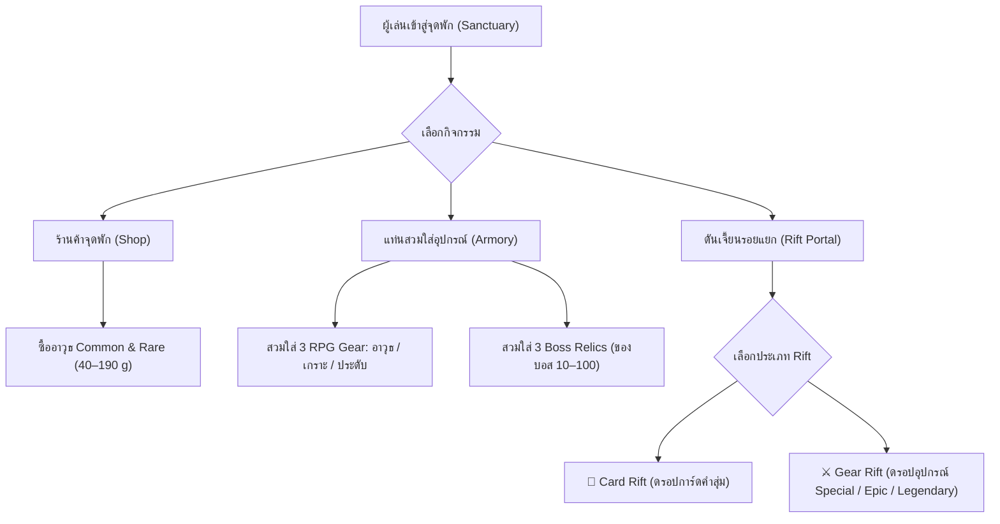

# เอกสารการออกแบบระบบอุปกรณ์สวมใส่: ส่วนที่ 1 — สารบบอาวุธและคทาเวท (Weapons & Staves System)
**เกม:** คาถานอกตำรา (Spell Foundry)  
**หมวดหมู่:** อุปกรณ์สวมใส่ช่องที่ 1 — อาวุธ/คทาเวท (Weapon / Staff / Catalyst Slot)  
**สถานะ:** เอกสารข้อกำหนดระบบ (Game Design Specification — Approved Draft)

---

## 1. ปรัชญาและโครงสร้างระบบอาวุธ (Weapon Slot Architecture)

ช่องสวมใส่ **"อาวุธ/คทาเวท" (Weapon Slot)** เป็น 1 ใน 3 สล็อตอุปกรณ์หลักของระบบ RPG Gear (ร่วมกับ *ชุดคลุม* และ *เครื่องประดับ*) โดยมีกฎและบทบาทสำคัญดังนี้:

1. **บทบาทหลักของอาวุธ:**  
   มุ่งเน้นที่การ **"เพิ่มพลังคาถา (Spell Output), เพิ่มความสามารถของสิ่งอัญเชิญ (Summon Enhancement), และการปรับแต่งกลไกการร่าย (Casting Modification)"**  
2. **การทำงานร่วมกับระบบเดิม:**  
   อาวุธจะถูกสวมใส่ผ่านแท่นบูชาจุดพัก (Sanctuary Forge/Armory) โดย **ไม่ทับซ้อนและไม่แย่งช่องกับเครื่องรางบอส 3 ช่องเดิม (Boss Relics)**
3. **แหล่งที่มา 2 ทางชัดเจน:**  
   * **ระดับธรรมดา (Common) และ หายาก (Rare):** วางจำหน่ายใน **ร้านค้าชั้นพัก (Sanctuary Shop)** ด้วยทองคำ เพื่อเป็นของเริ่มต้นให้ผู้เล่นซื้อมาเซ็ตสายการเล่น  
   * **ระดับพิเศษ (Special), มหากาพย์ (Epic), และ ตำนาน (Legendary):** ดรอปเฉพาะจากการพิชิต **"รอยแยกอุปกรณ์ (Gear Rift)"** หรือหีบลับหลังบอสใหญ่
4. **ความสอดคล้องกับตัวจำลองคาถา (Forecast Parity):**  
   บัฟและคุณสมบัติของอาวุธทุกชนิดจะถูกคำนวณเข้าสู่ระบบ Forecast ล่วงหน้าเสมอ เพื่อให้ตัวเลขที่แสดงบนหัวศัตรูตรงกับความเป็นจริงในการต่อสู้ 100%

---

## 2. สารบบอาวุธ 40 ชนิด ครอบคลุม 5 ระดับความหายาก (Weapon Catalog)

```text
สรุปสัดส่วนอาวุธ 40 ชิ้น:
- ระดับธรรมดา (Common)    : 6 ชิ้น  (ของร้านค้าชั้น 5–25)
- ระดับหายาก (Rare)        : 8 ชิ้น  (ของร้านค้าชั้น 35–55 / Gear Rift เทียร์ 20–40)
- ระดับพิเศษ (Special)     : 10 ชิ้น (Gear Rift เทียร์ 50–70 / Vault Shop)
- ระดับมหากาพย์ (Epic)     : 10 ชิ้น (Gear Rift เทียร์ 70–90)
- ระดับตำนาน (Legendary)   : 6 ชิ้น  (Gear Rift เทียร์ 90–100 / ลับ)
```

---

### 2.1 ระดับธรรมดา (Common) — 6 ชิ้น
> **แหล่งที่มา:** ร้านค้าชั้นพัก (Sanctuary Shop ชั้น 5, 15, 25) | **ราคา:** 40 – 75 ทอง

| ID | ชื่ออาวุธ (ไทย / อังกฤษ) | ไอคอน | สไตล์การเล่นหลัก | สเตตัสและเอฟเฟกต์เฉพาะตัว (Traits) | แหล่งที่มา / ราคา | คำอธิบาย (Flavor Text) |
| :--- | :--- | :---: | :--- | :--- | :---: | :--- |
| `staff_apprentice_oak` | **ไม้เท้าโอ๊กฝึกหัด**<br>Apprentice Oak Staff | 🦯 | พื้นฐาน / ทุกสาย | • ดาเมจคาถาทุกชนิด $+2$<br>• Max HP ผู้เล่น $+4$ | ร้านชั้น 5<br>(40 g) | ไม้เท้าเนื้อแข็งเรียบง่าย เหมาะสำหรับผู้เริ่มต้นศึกษาศาสตร์เวท |
| `wand_hound_whistle` | **คทาผิวปากเรียกฝูง**<br>Houndcaller Wand | 🪄 | สายอัญเชิญฝูง<br>(Summon Swarm) | • HP สัตว์อัญเชิญระดับ Common $+6$<br>• หมัดประสานเทิร์น 2 แรงขึ้น $+3$ | ร้านชั้น 5<br>(50 g) | คทาแกะสลักรูปหัวสุนัข ส่งเสียงความถี่สูงที่กระตุ้นสัญชาตญาณสัตว์ป่า |
| `wand_ember_torch` | **คบเพลิงประกายไฟ**<br>Ember Torch Wand | 🕯️ | ธาตุไฟ (Fire) | • คาถาธาตุไฟแรงขึ้น $+3$<br>• การโจมตีติดสถานะเผา $+1$ | ร้านชั้น 5<br>(50 g) | คบเพลิงหินที่เปลวไฟไม่เคยดับ ช่วยรวมศูนย์ความร้อน |
| `wand_frost_pipette` | **หลอดแก้วหยาดเหมันต์**<br>Frost Pipette Wand | 🧪 | ธาตุน้ำแข็ง (Ice) | • คาถาน้ำแข็งแรงขึ้น $+2$<br>• ลดการโจมตีศัตรูที่ติดหนาวเพิ่มอีก $-1$ | ร้านชั้น 15<br>(60 g) | หลอดแก้วแช่แข็งที่กักเก็บไอเย็นขั้วโลก ทำให้ศัตรูชะงักงัน |
| `wand_copper_rod` | **คทาทองแดงล่อสายฟ้า**<br>Copper Lightning Rod | ⚡ | ธาตุสายฟ้า (Lightning)| • คาถาสายฟ้าข้ามเกราะเพิ่ม $+1$<br>• ดาเมจสายฟ้า $+2$ | ร้านชั้น 15<br>(60 g) | แกนทองแดงขัดเงา ช่วยดึงประจุไฟฟ้าสถิตในอากาศมาสู่เป้าหมาย |
| `staff_crag_pestle` | **สากศิลาปฐพี**<br>Crag Pestle Staff | 🪨 | ธาตุดิน & โล่ (Earth) | • เกราะจากคาถาดิน/โล่ $+2$ หน่วย<br>• สวนกลับของสิ่งอัญเชิญ $+2$ | ร้านชั้น 25<br>(75 g) | สากหินศิลาแกร่ง ทรงตัวมั่นคงดั่งขุนเขา |

---

### 2.2 ระดับหายาก (Rare) — 8 ชิ้น
> **แหล่งที่มา:** ร้านค้าชั้นพัก (ชั้น 35, 45, 55) หรือ Gear Rift เทียร์ 20–40 | **ราคา:** 120 – 190 ทอง

| ID | ชื่ออาวุธ (ไทย / อังกฤษ) | ไอคอน | สไตล์การเล่นหลัก | สเตตัสและเอฟเฟกต์เฉพาะตัว (Traits) | แหล่งที่มา / ราคา | คำอธิบาย (Flavor Text) |
| :--- | :--- | :---: | :--- | :--- | :---: | :--- |
| `staff_pack_alpha` | **คทาเขี้ยวจ่าฝูง**<br>Alpha Fang Scepter | 🐺 | อัญเชิญหมาป่า/ฝูง<br>(Pack Hunt) | • สัตว์อัญเชิญโจมตีทะลวงเกราะ $+2$<br>• เมื่อสัตว์อัญเชิญแตกสลาย สวนกลับทำดาเมจแท้ $8$ หน่วยใส่ตัวการ | ร้านชั้น 35 / Rift 20<br>(120 g) | คทาที่ประดับด้วยเขี้ยวหมาป่าโลกันตร์ ปลุกเร้าจิตวิญญาณแห่งการล้างแค้น |
| `wand_gemini_resonance`| **คทาทวินสะท้อนมนตรา**<br>Gemini Resonator | ♊ | สายเวทคู่<br>(Pair Combos) | • ลดค่าร่ายคาถาที่มีคำว่า "คู่" ลง $-1$ มานา (ขั้นต่ำ 2)<br>• คาถาคู่ฮิตที่สองแรงขึ้น $+20\%$ | ร้านชั้น 35 / Rift 20<br>(140 g) | คทาแยกสองง่ามที่สั่นพ้องประสานคลื่นเวทได้อย่างสมบูรณ์แบบ |
| `staff_pyro_blaster` | **ไม้เท้าดินปืนระเบิดเพลิง**<br>Pyrogun Staff | 🧨 | ไฟระเบิด<br>(Fire & Blast) | • คาถาที่มีคำว่า "ระเบิด" รัศมีกระจายแรงขึ้น $+4$<br>• เมื่อระเบิดโดนเป้าหมายที่ติดเผา จะจุดระเบิดซ้ำ 1 ครั้ง | ร้านชั้น 45 / Rift 30<br>(150 g) | ไม้เท้าที่บรรจุดินปืนมนตรา ยิงระเบิดเพลิงปะทุเป็นวงกว้าง |
| `scepter_tide_caller` | **คทาเรียกกระแสน้ำวน**<br>Tidecaller Scepter | 🌊 | น้ำ & ซัพพอร์ต<br>(Water & Heal) | • คาถาน้ำฟื้นฟูเลือดเพิ่ม $+3$ HP<br>• เป้าหมายที่เปียกจะได้รับความเสียหายจากสายฟ้าแรงขึ้น $+4$ (จากเดิม $+2$) | ร้านชั้น 45 / Rift 30<br>(150 g) | คทาไข่มุกบาดาลที่แผ่ละอองน้ำเย็นฉ่ำครอบคลุมแนวหน้า |
| `wand_tempest_gale` | **คทาวายุหอบสะบัด**<br>Gale-Force Wand | 🌪️ | ลม & ผลักกระแทก<br>(Wind & Push) | • ดาเมจกระแทกชนศัตรู/ชนขอบของลมแรงขึ้น $+4$<br>• โอกาสหลบหลีกของสัตว์อัญเชิญสายบิน (นก/อินทรี) $+20\%$ | ร้านชั้น 55 / Rift 40<br>(170 g) | ไม้กายสิทธิ์ขนปักษาวายุ กวัดแกว่งสร้างลมหมุนกระแทกศัตรูถอยร่น |
| `staff_iron_aegis` | **กระบองปราการเหล็ก**<br>Iron Fortress Cudgel | 🛡️ | โล่ & สายรับแทน<br>(Shield & Turtle) | • เกราะของสัตว์อัญเชิญทุกตัว $+1$<br>• เมื่อร่าย "โล่" กางม่านคุ้มกันให้สัตว์อัญเชิญ 1 ชั้น | ร้านชั้น 55 / Rift 40<br>(170 g) | กระบองเหล็กหนาหนัก ออกแบบเพื่อต้านรับคมดาบทุกรูปแบบ |
| `axe_spell_sunderer` | **ขวานสลักรูนทลายเกราะ**<br>Rune-Sunder Axe | 🪓 | ขวาน & เจาะเกราะ<br>(Axe & Pierce) | • คาถาขวานทำลายเกราะศัตรูถาวร $-1$ หน่วยเมื่อจามโดน<br>• ขวานคริติคอล $+25\%$ หากศัตรูมีเกราะเดิมตั้งแต่ 3 ขึ้นไป | Rift 40<br>(180 g) | คมขวานศิลาลงอาคม บดขยี้เกราะหนาจนแตกละเอียด |
| `wand_needle_lance` | **คทาเข็มทมิฬแทงทะลุ**<br>Needle-Lance Wand | ➶ | หอก & ลำแสง<br>(Spear & Beam) | • คาถาหอก: ตัวข้างหลังรับดาเมจ $80\%$ (จากเดิม $50\%$)<br>• คาถาลำแสง: ดาเมจ $+4$ และสลายม่านศัตรู 1 ชั้น | Rift 40<br>(190 g) | เข็มเวทเรียวยาว แทงทะลวงทะลุม่านและแนวรบเป็นเส้นตรง |

---

### 2.3 ระดับพิเศษ (Special) — 10 ชิ้น
> **แหล่งที่มา:** Gear Rift เทียร์ 50–70 หรือ Sanctuary Vault Shop | **ราคา:** 250 – 400 ทอง

| ID | ชื่ออาวุธ (ไทย / อังกฤษ) | ไอคอน | สไตล์การเล่นหลัก | สเตตัสและเอฟเฟกต์เฉพาะตัว (Traits) | แหล่งที่มา / ราคา | คำอธิบาย (Flavor Text) |
| :--- | :--- | :---: | :--- | :--- | :---: | :--- |
| `scepter_titan_core` | **คทาแกนศิลาไททัน**<br>Titan Core Scepter | 🗿 | โกเลม & ปฐพี<br>(Golem & Earth) | • โกเลมและสัตว์สายศิลามี HP $+25$ และเกราะ $+1$<br>• หมัดไททันทุบเกราะศัตรูทุกคนในสนาม $-2$ ถาวร | Rift 50 / Vault<br>(260 g) | แกนศิลาโบราณจากชั้นใต้พิภพ แผ่ไอพลังธาตุดินหนาแน่น |
| `staff_gargoyle_perch` | **ไม้เท้ารูปสลักการ์กอยล์**<br>Gargoyle Perch Staff | 🦇 | สกัด AoE<br>(AoE Intercept) | • สัตว์สายรับ AoE (การ์กอยล์/เบฮีมอธ) ลดทอนดาเมจ AoE ลง $-25\%$ ก่อนหัก HP<br>• เมื่อรับดาเมจแทน คืน $+1$ MP | Rift 50<br>(280 g) | เสาหินจำลองปีกการ์กอยล์ กางอาณาเขตคุ้มเกล้าผู้ร่ายจากเวทหมู่ |
| `staff_akki_blaze` | **ไม้เท้าเพลิงอัคคีพิโรธ**<br>Akki Hellfire Staff | 🔥 | ไฟขั้นสอง (Akki)<br>(Hellfire & Burn) | • คาถาอัคคีทำดาเมจแรงขึ้น $+8$<br>• ตัดการฮีลของเป้าหมาย $100\%$ ในเทิร์นถัดไป (จากเดิม $50\%$) | Rift 60<br>(300 g) | สลักด้วยรูนอัคคีบรรพกาล เผาผลาญจนไม่เหลือแม้แต่เถ้าถ่าน |
| `scepter_heman_rime` | **คทาผลึกเหมันต์นิรันดร์**<br>Heman Permafrost Scepter| ❄️ | น้ำแข็งขั้นสอง<br>(Heman & Chill) | • คาถาเหมันต์ติดหนาว $6$ หน่วย และคงอยู่ถาวร (Lasting Chill)<br>• เมื่อศัตรูติดหนาวครบ 8 หน่วย แช่แข็งอัตโนมัติ 1 เทิร์น | Rift 60<br>(300 g) | แท่งผลึกน้ำแข็งบริสุทธิ์จากหุบเขาเยือกแข็ง ไอเย็นเกาะกุมจนแทบหยุดเวลา |
| `rod_asani_thunderclap`| **กระบองสายฟ้าอัสนีบาต**<br>Asani Stormhammer | ⚡ | สายฟ้าขั้นสอง<br>(Asani & Chain) | • อัสนีชิ่งหาเป้าหมายข้างเคียงด้วยพลังเต็ม $100\%$ (จากเดิม $50\%$)<br>• ข้ามเกราะเพิ่ม $+3$ หน่วย | Rift 60<br>(320 g) | กระบองสลักลวดลายสายฟ้าฟาด กึกก้องกัมปนาทสะเทือนถึงวิญญาณ |
| `staff_pathaphi_monolith`| **ไม้เท้าปฐพีเสาศิลา**<br>Pathaphi Monolith Staff | ⛰️ | ดินขั้นสอง<br>(Pathaphi Tank) | • ปฐพีมอบเกราะชั่วคราว $+8$ (จากเดิม $+4$) และทุบเกราะเป้า $-3$<br>• หากผู้เล่นมีเกราะเกิน 10 หน่วย สะท้อนดาเมจแท้ $6$ คืนศัตรู | Rift 70<br>(350 g) | เสาหินแกนโลก มอบพลังพิทักษ์ที่ไม่มีสิ่งใดทะลวงผ่านได้ |
| `scepter_wari_tsunami` | **คทามหาสึนามิวารี**<br>Wari Tsunami Scepter | 🌊 | น้ำขั้นสอง<br>(Wari & Cleanse)| • วารีฟื้นพลังชีวิต $+8$ HP (จากเดิม $+4$) และลบม่านศัตรู 1 ชั้น<br>• เป้าหมายเปียกยาวนาน 3 เทิร์นเต็ม | Rift 70<br>(350 g) | หัวคทารูปคลื่นน้ำซัดสาด ชำระล้างมลทินและฟื้นฟูพลังชีวิตอย่างล้นพ้น |
| `wand_vayu_cyclone` | **คทาพายุไซโคลนวายุ**<br>Vayu Cyclone Wand | 🌀 | ลมขั้นสอง<br>(Vayu Slam) | • วายุผลักศัตรูถอยหลัง 2 ช่อง กระแทกทะลุเกราะ $10$ หน่วยใส่ทั้งสองตัว<br>• เพิ่มความเร็วหลบหลีกให้สิ่งอัญเชิญ $+30\%$ | Rift 70<br>(350 g) | แกนกลางพายุหมุนอัดแน่น พร้อมปลดปล่อยแรงลมผลักทำลายกระบวนรบ |
| `wand_mana_tap_sprite` | **ไม้กายสิทธิ์ภูตคืนเวท**<br>Sprite Mana-Siphon Wand | 🧚 | ฟื้นมานา & จั่ว<br>(Sprite & Mana) | • สัตว์สายภูต/ไซเรน สวนกลับคืน $+3$ MP และจั่ว $+2$ ใบ<br>• ลดค่าร่ายคาถาที่ใช้เกิน 6 มานาลง $-1$ มานา | Rift 60 / Vault<br>(380 g) | ไม้กายสิทธิ์ประดับปีกแฟรี่ ดูดซับกระแสเวทตกค้างกลับมาเป็นพลังงาน |
| `blade_lion_reflection`| **มีดกรงเล็บราชสีห์สะท้อนคม**<br>Lion Pride Cleaver | 🦁 | คริติคอล & สวนกลับ<br>(Lion & Crit) | • หมัดประสานของสัตว์อัญเชิญคริติคอล $+50\%$ ดาเมจต่อเป้าหมายติดดีบัฟ<br>• สิ่งอัญเชิญลดทอนดาเมจโจมตีลง $-3$ หน่วย | Rift 70<br>(400 g) | ดาบสั้นแผงคอสิงโต สวนกลับด้วยกรงเล็บฉีกกระชากจุดอ่อน |

---

### 2.4 ระดับมหากาพย์ (Epic) — 10 ชิ้น
> **แหล่งที่มา:** Gear Rift เทียร์ 70–90 | **ราคาประเมิน:** 500 – 750 ทอง

| ID | ชื่ออาวุธ (ไทย / อังกฤษ) | ไอคอน | สไตล์การเล่นหลัก | สเตตัสและเอฟเฟกต์เฉพาะตัว (Traits) | แหล่งที่มา / ราคา | คำอธิบาย (Flavor Text) |
| :--- | :--- | :---: | :--- | :--- | :---: | :--- |
| `staff_dual_crucible` | **ไม้เท้าเตาหลอมสองธาตุ**<br>Dual Crucible Staff | ⚗️ | ธาตุผสมทั้งหมด<br>(Dual Fusion Master) | • เวทผสมธาตุ (เช่น แมกม่า, พลาสมา, ไอเดือด ฯลฯ) ดาเมจแรงขึ้น $+35\%$<br>• คืน $+1$ มานาทันทีเมื่อร่ายเวทผสมสองธาตุสำเร็จ | Rift 70<br>(550 g) | เบ้าหลอมแก้วแปรธาตุ ผสานพลังงานธาตุคู่ตรงข้ามให้เสถียรอย่างไร้ที่ติ |
| `scepter_behemoth_quake`| **คทามหาอสูรแผ่นดินไหว**<br>Behemoth Earthshaker | 🦏 | เบฮีมอธ & มหาแทงก์<br>(Behemoth Quake) | • เบฮีมอธมี HP $+40$, เกราะ $+2$, และทุบเกราะศัตรูทุกคน $-3$ ถาวร<br>• เมื่อรับท่า AoE สวนกลับเป็นคลื่นกระแทก 20 ดาเมจแท้ใส่ศัตรูทั้งหมด | Rift 80<br>(600 g) | คทาที่หล่อจากเขาเบฮีมอธยักษ์ ทุกย่างก้าวสะเทือนเลื่อนลั่นปฐพี |
| `staff_hydra_vitality` | **ไม้เท้าเก้าเศียรฟื้นชีพ**<br>Hydra Rebirth Staff | 🐉 | ไฮดรา & อมตะ<br>(Hydra Regen) | • ไฮดราฟื้นฟูเลือดเทิร์นละ $+12$ HP (จากเดิม $+6$)<br>• สวนกลับแทงซ้ำ 4 ครั้ง พร้อมพิษรุนแรง 6 หน่วยข้ามเกราะ | Rift 80<br>(600 g) | แก่นไม้โบราณที่พันด้วยหนังไฮดรา ฟื้นคืนสภาพได้ไม่สิ้นสุด |
| `scepter_kraken_depths`| **คทาหนวดหมึกห้วงบาดาล**<br>Abyssal Kraken Rod | 🐙 | คราเคน & คุมสนาม<br>(Kraken Abyss) | • คราเคนพ่นหมึกทำให้การโจมตีของศัตรูทุกตัวในเทิร์นนั้นวืด $40\%$<br>• หมัดหนวดสลายม่านศัตรูทั้งหมดในสนาม 100% | Rift 80<br>(600 g) | คทาหินปะการังดำจากก้นเหวลึก กักขังศัตรูไว้ในความมืดมิดไร้ก้นบึ้ง |
| `wand_plasma_singularity`| **คทาพลาสมาดวงดาว**<br>Plasma Star Wand | ✦ | พลาสมา (ไฟ+สายฟ้า)<br>(Plasma Burst) | • คาถาพลาสมาดาเมจเดี่ยวรุนแรงขึ้น $+40\%$ ข้ามเกราะ $4$ หน่วย<br>• หากเป้าหมายตายจากพลาสมา ระเบิดสะเก็ดดาว 20 ดาเมจใส่ตัวรอบข้าง | Rift 80<br>(650 g) | แกนกลางดวงดาราอัดแน่น ปลดปล่อยความร้อนและประจุไฟฟ้าทำลายล้าง |
| `staff_frostvolt_spire`| **ไม้เท้าผลึกช็อตน้ำแข็ง**<br>Frostvolt Spire | ❆ | ผลึกช็อต (น้ำแข็ง+ฟ้า)<br>(Freeze & Shock) | • ช็อตสายฟ้าใส่ศัตรูที่ติดหนาวแรงขึ้น $+50\%$ และแช่แข็งศัตรูข้างเคียงทันที<br>• ข้ามเกราะและลดดาเมจศัตรู $-3$ หน่วย | Rift 80<br>(650 g) | เสาผลึกสายฟ้าเย็นเยือก เชื่อมกระแสไฟฟ้าเหน็บหนาวไปทั่วสนามรบ |
| `scepter_scald_boiler` | **คทาไอเดือดสะเทือนผิว**<br>Scald Thermal Scepter | ♨️ | ไอเดือด (ไฟ+น้ำแข็ง)<br>(Armor Melt) | • ไอเดือดหลอมละลายเกราะเป้าหมาย $-4$ ถาวร (จากเดิม $-2$)<br>• ทำให้ศัตรูชะงัก (Stun) ข้ามการโจมตีในเทิร์นนั้นทันที | Rift 85<br>(680 g) | คทาไอน้ำแรงดันสูง บิดผันอุณหภูมิเฉียบพลันจนเกราะเหล็กแตกกระจาย |
| `staff_shockstream_hydra`| **ไม้เท้ากระแสช็อตวารี**<br>Shockstream Torrent | ϟ | กระแสช็อต (น้ำ+สายฟ้า)<br>(AoE Wet Shock) | • ช็อตสายฟ้าทะลวงเป้าหมายเปียกทั้งหมดในสนามด้วยพลัง $100\%$ (ไม่หารดาเมจ)<br>• คืน $+1$ MP ต่อศัตรูที่เปียก 1 ตัวที่โดนช็อต | Rift 85<br>(700 g) | ไม้เท้านำกระแสน้ำไฟฟ้า สาดคลื่นช็อตลัดวงจรทั้งสนาม |
| `wand_barrage_repeater`| **คทากระหน่ำห้าวิถี**<br>Barrage Repeater Wand | Ⅴ | กระหน่ำ 5 ครั้ง<br>(Barrage Machine) | • ลดตัวคูณค่าร่ายของคำว่า "กระหน่ำ" จาก $\times 3.5$ เหลือ $\times 2.8$<br>• การโจมตีทั้ง 5 ฮิต เพิ่มโอกาสติดคริติคอลฮิตละ $+10\%$ ซ้อนทับกัน | Rift 90<br>(720 g) | ลำกล้องเวทกลไกจักรกล ร่ายกระสุนเวทซ้ำ 5 ระลอกอย่างบ้าคลั่ง |
| `catalyst_devastation` | **สื่อเวทผลาญพิภพทำลายล้าง**<br>Devastation Catalyst | ✷ | ทำลายล้าง (Devastation)<br>(Double Burst) | • คาถาทำลายล้างระเบิดซ้ำรัศมี 3 ช่อง (จากเดิม 2 ช่อง) ด้วยพลัง $75\%$ (จากเดิม $50\%$)<br>• ข้ามม่านศัตรูทั้งหมดในรัศมีระเบิด | Rift 90<br>(750 g) | ผลึกสีเลือดบรรจุความบ้าคลั่ง ทวีคูณแรงระเบิดจนสนามรบกลายเป็นทะเลเพลิง |

---

### 2.5 ระดับตำนาน (Legendary) — 6 ชิ้น
> **แหล่งที่มา:** Gear Rift เทียร์ 90–100 หรือ ชนะบอสลับ | **ราคาประเมิน:** 1,200 – 2,000 ทอง

| ID | ชื่ออาวุธ (ไทย / อังกฤษ) | ไอคอน | สไตล์การเล่นหลัก | สเตตัสและเอฟเฟกต์เฉพาะตัว (Traits) | แหล่งที่มา / ราคา | คำอธิบาย (Flavor Text) |
| :--- | :--- | :---: | :--- | :--- | :---: | :--- |
| `scepter_dragon_sovereign`| **คทาราชันเพลิงมังกรโบราณ**<br>Drake Sovereign Scepter | 🐲 | ราชันมังกร & ดาเมจแท้<br>(Dragon Sovereign) | • มังกรอัญเชิญได้รับ HP $+50$, เกราะ $+3$, และม่านคุ้มภัย $+1$ ชั้น<br>• สะท้อนดาเมจเพลิง $100\%$ คืนผู้โจมตี และหมัดประสานเป็น **ดาเมจแท้ 100% ข้ามม่านและเกราะ** | Rift 90–100<br>(1,500 g) | คทาที่สกัดจากกระดูกสันหลังมังกรโบราณ เปี่ยมด้วยไอเพลิงอมตะที่พร้อมแผดเผาทุกสิ่ง |
| `staff_phoenix_immortal`| **ไม้เท้าเพลิงจุตินิรันดร์**<br>Phoenix Immortality Staff | 🪶 | ฟีนิกซ์ & ชุบชีวิต<br>(Phoenix Rebirth) | • ฟีนิกซ์เกิดพร้อมม่าน $+2$ ชั้น และชุบชีวิตผู้เล่นได้ 2 ครั้งต่อศึก (ฟื้น HP 100% + MP 12 เต็ม)<br>• ทุกครั้งที่ร่ายอัญเชิญ ล้างดีบัฟผู้เล่นและฮีล $+20$ HP ทันที | Rift 90–100<br>(1,500 g) | ขนนกฟีนิกซ์ทองคำที่ส่องประกายแห่งชีวิต แม้ความตายก็ไม่อาจพรากวิญญาณผู้ถือครอง |
| `wand_chronos_timeweaver`| **ไม้เท้าทอสถิตกาลเวลา**<br>Chronos Time-Weaver Wand | ◷ | หยุดเวลา & ร่ายซ้ำ<br>(Timestop & Mana) | • คาถา "หยุดเวลา" ร่ายได้ 2 ครั้งต่อศึก (จากเดิม 1 ครั้ง)<br>• ในเทิร์นที่เวลาหยุด ผู้เล่นได้มานาสูงสุดชั่วคราว $+6$ MP และจั่วการ์ดเต็มมือ (11 ใบ) | Rift 100<br>(1,800 g) | เข็มนาฬิกาแห่งชะตากรรมที่หลุดลอยจากมิติ ควบคุมการไหลเวียนของกาลเวลาได้ดั่งใจนึก |
| `orb_void_blackhole` | **ลูกแก้วแกนหลุมดำเอกภพ**<br>Singularity Void Orb | ◉ | หลุมดำ (Blackhole)<br>(Gravity Crush) | • คาถาหลุมดำ: แรงดูดกระแทกชนเพิ่มเป็น $150$ ต่อตัว (จากเดิม 100) และแรงยุบตัวระเบิด $450 / 250$<br>• ดูดซับมานาของศัตรูที่โดนดูดมาเติมให้ผู้เล่น $+1$ MP ต่อตัว | Rift 100<br>(1,800 g) | ลูกแก้วสีดำสนิทที่กลืนกินแม้กระทั่งแสง แรงดึงดูดมหาศาลพร้อมบดขยี้ทุกมวลสาร |
| `scythe_thanatos_death`| **เคียวพิพากษาดับดวงจิต**<br>Thanatos Judgement Scythe | † | คำสั่งตาย (Death)<br>(Executioner) | • คาถา "ตาย": ใช้กับบอสทำดาเมจแท้ $250$ หน่วย (จากเดิม 100) ข้ามม่าน/เกราะ<br>• หากสังหารศัตรูสำเร็จ คืนค่าร่าย 10 มานาเต็มทันที และไม่เสียการ์ดออกจากมือ | Rift 100<br>(1,800 g) | คมเคียวสีนิลสลักนามแห่งความตาย ตัดขาดสายใยวิญญาณอย่างไร้ความปรานี |
| `scepter_genesis_ascension`| **คทาจุติมหาเทวะปฐมกาล**<br>Genesis Ascension Scepter| ✺ | จุติ (Ascension)<br>(Omni-Ascendant) | • เทิร์นจุติ: การ์ดทุกใบบนมือเป็น $+10$ ถาวรตลอดการต่อสู้ (ไม่ใช่แค่ 1 เทิร์น)<br>• เพิ่มขีดจำกัดพลังคาถาและหมัดประสานของสัตว์อัญเชิญทั้งหมดขึ้น $+50\%$ | ลับ (Floor 100 Boss)<br>(2,000 g) | สัญลักษณ์แห่งการหลุดพ้นสู่พระเจ้า ปลดปล่อยขีดจำกัดของเวทมนตร์สู่ความไร้ที่สิ้นสุด |

---

## 3. สรุปความเชื่อมโยงกับระบบ Gear Rift และ ร้านค้าจุดพัก



---

## 4. ผลกระทบต่อความสมดุล (Game Balance Assessment)

1. **ไม่ทำลายตัวเลขเดิมของเกม:**  
   อาวุธระดับ Common และ Rare ให้บัฟขนาดเล็ก ($+2$ ถึง $+4$ ดาเมจ หรือ $+1$ มานา) ซึ่งช่วยให้ผู้เล่นผ่านช่วงต้นเกม (Floor 1–40) ได้ราบรื่นขึ้นโดยไม่ทำให้เกมง่ายเกินไป
2. **สร้างความหลากหลายในการจัดเด็ค (Build Variety):**  
   อาวุธระดับ Special และ Epic ได้รับการออกแบบให้สอดคล้องกับ Mechanis เด่นในเกม เช่น การรับ AoE ของการ์กอยล์, การแช่แข็งของเหมันต์, และเวทผสมธาตุ (Dual Fusion) ทำให้ผู้เล่นมีเป้าหมายในการล่าของเพื่อสร้างสายเฉพาะตัว
3. **Endgame Loop ที่คุ้มค่า:**  
   อาวุธระดับ Legendary มอบความรู้สึกทรงพลังสมกับเป็นของรางวัลจากการพิชิต Gear Rift ระดับสูง (Floor 90–100) ช่วยให้การต่อสู้กับบอสใหญ่ 18–28 เทิร์นสนุกและมีทางเลือกในการปิดฉากมากขึ้น
