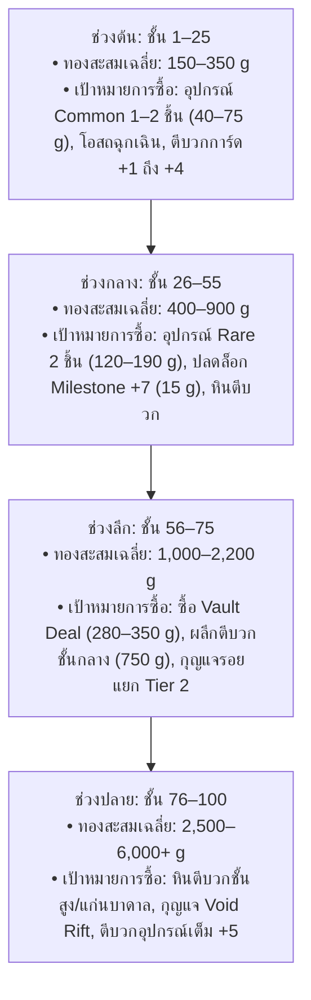

# เอกสารการออกแบบระบบเศรษฐกิจและร้านค้าที่จุดพัก: วิธีการได้มาและสารบบราคาสินค้าครบวงจร (Sanctuary Commerce & Acquisition System)
**เกม:** คาถานอกตำรา (Spell Foundry)  
**หมวดหมู่:** ระบบการซื้อขาย บริการ และเศรษฐกิจประจำจุดพัก (Sanctuary Shop, Forge, Scholar & Altar)  
**สถานะ:** เอกสารข้อกำหนดระบบ (Game Design Specification — Approved Draft)

---

## 1. ปรัชญาและโครงสร้างเศรษฐกิจประจำจุดพัก (Sanctuary Economy Architecture)

**"จุดพักและร้านค้าเวทมนตร์" (Sanctuary)** ปรากฏขึ้นทุกๆ ช่วงการไต่หอคอย เพื่อให้ผู้เล่นได้ฟื้นฟูสภาพ วางแผนกลยุทธ์ และแปลง **ทองคำ (Gold)** กับทรัพยากรที่หาได้จากการต่อสู้ให้กลายเป็นพลังที่จับต้องได้

```text
จุดพักประจำหอคอย (Sanctuary Checkpoints):
- หอคอยช่วงต้น (Tower 1–20) : ชั้น 5, ชั้น 10 (pre/post), ชั้น 15, ชั้น 20 (pre/post)
- หอคอยช่วงลึก (Deep Tower 21–100): ชั้น 25, ชั้น 35, ชั้น 45, ชั้น 55, ชั้น 65, ชั้น 75, ชั้น 85, ชั้น 95
  และจุดพักหลังปราบบอสใหญ่ (Post-Boss Sanctuaries): post30, post40, post50, post60, post70, post80, post90
```

### 1.1 เสาหลัก 4 ประการของเศรษฐกิจในจุดพัก
1. **การเข้าถึงง่ายในช่วงต้น (Early Accessibility):** ผู้เล่นสามารถซื้อไอเทมพื้นฐานและอุปกรณ์ระดับ Common/Rare เพื่อสร้าง Build ตั้งแต่ชั้น 5–25 โดยไม่ต้องพึ่งพาดวงเพียงอย่างเดียว
2. **การคงคุณค่าของทองคำตลอดรัน (Gold Longevity):** ทองคำไม่สูญเปล่าเมื่อเข้าสู่ชั้นลึก (Endgame) เพราะมีสินค้าชั้นสูง, วัตถุดิบตีบวก, บัตรผ่านรอยแยก, และบริการตีบวกอุปกรณ์รองรับ
3. **การแบ่งบทบาทที่ชัดเจนระหว่าง "ร้านค้า" กับ "รอยแยก" (Shop vs. Rift Separation):**
   * **ร้านค้าจุดพัก (Sanctuary Shop):** แหล่งซื้อของระดับ Common & Rare ที่แน่นอน คาดเดาได้ และตอบโจทย์การเริ่มสร้างคอมโบ
   * **รอยแยกอุปกรณ์ (Gear Rift):** แหล่งฟาร์มอุปกรณ์ระดับ Special, Epic, และ Legendary จากการต่อสู้ท้าทาย
4. **ความสมดุลด้านพื้นที่จัดเก็บ (Inventory Balance):** ผู้เล่นมี **เข็มขัดไอเทมด่วน 3 ช่อง (Belt Slots)** สำหรับใช้ในการต่อสู้ และ **คลังสำรอง 12 ช่อง (Stash Slots)** สำหรับเก็บวัตถุดิบและอุปกรณ์สำรอง

---

## 2. หมวดที่ 1: อุปกรณ์สวมใส่ RPG (RPG Equipment Catalog: Weapons, Armors, Accessories)

อุปกรณ์สวมใส่ในร้านค้าจุดพักแบ่งเป็น 2 รูปแบบการวางจำหน่าย:
* **แผงค้าทั่วไป (General Armory):** วางจำหน่ายอุปกรณ์ระดับ **Common** และ **Rare** แบบสุ่มหมุนเวียน 3 ช่อง (1 อาวุธ, 1 ชุดคลุม, 1 เครื่องประดับ) ตามช่วงชั้น
* **ตู้คลังนิรภัยชั้นลึก (Vault Showcase):** ปลดล็อกตั้งแต่ **ชั้น 50 เป็นต้นไป** วางจำหน่ายอุปกรณ์ระดับ **Special** หรือหายากพิเศษ 1 ชิ้นต่อการแวะ

---

### 2.1 อุปกรณ์ระดับธรรมดา (Common Gear) — สำหรับช่วงชั้น 5, 15, 25
> **ราคา:** 40 – 75 ทองคำ | **เป้าหมาย:** วางรากฐานคอมโบธาตุและระบบอัญเชิญเริ่มต้น

#### ก. อาวุธคทา (Weapons) — 6 ชิ้น
| รหัสไอเทม (ID) | ชื่อไอเทม (ไทย / อังกฤษ) | ไอคอน | สไตล์หลัก | สเตตัสและผลลัพธ์ (Traits) | ปลดล็อกชั้น | ราคา (ทอง) |
| :--- | :--- | :---: | :--- | :--- | :---: | :--- : |
| `wand_apprentice_spark` | **คทาประกายไฟฝึกหัด**<br>Apprentice Spark Wand | 🪄 | ไฟ (Fire Burn) | Atk $+1$, คาถาไฟสร้างเผาไหม้ $+1$ | ชั้น 5 | 40 g |
| `wand_droplet_focus` | **คทาหยาดน้ำรวมศูนย์**<br>Droplet Focus Wand | 🪄 | น้ำ (Water Heal) | Atk $+1$, คาถาน้ำฟื้นฟูเลือด $+2$ HP | ชั้น 5 | 40 g |
| `staff_wooden_acolyte` | **ไม้เท้าผู้ช่วยนักบวชหมาป่า**<br>Acolyte Wolf Staff | 🦯 | สุนัข & สัตว์เล็ก | สัตว์ Common หมัดประสาน $+3$ ดาเมจ | ชั้น 5 | 45 g |
| `wand_static_needle` | **คทาเข็มอสุนีประจุไฟฟ้า**<br>Static Needle Wand | ⚡ | สายฟ้า (Lightning)| คาถาสายฟ้าข้ามเกราะ $+1$, สัตว์สายฟ้า Atk $+2$ | ชั้น 15 | 55 g |
| `rod_crag_blunt` | **คทาศิลาทุบแผ่นดิน**<br>Crag Blunt Rod | 🪨 | ดิน & โล่ (Earth) | คาถาดินทุบเกราะ $-1$, สัตว์สายดิน HP $+10$ | ชั้น 15 | 60 g |
| `cane_zephyr_gust` | **ไม้เท้าลมกรดพัดพา**<br>Zephyr Gust Cane | 🦯 | ลมผลัก (Wind Gust) | ผลักศัตรูแรงขึ้น $+2$ ดาเมจเมื่อชนขอบ | ชั้น 25 | 70 g |

#### ข. ชุดคลุมและเกราะ (Robes & Armors) — 6 ชิ้น
| รหัสไอเทม (ID) | ชื่อไอเทม (ไทย / อังกฤษ) | ไอคอน | สไตล์หลัก | สเตตัสและผลลัพธ์ (Traits) | ปลดล็อกชั้น | ราคา (ทอง) |
| :--- | :--- | :---: | :--- | :--- | :---: | :--- : |
| `robe_rough_linen` | **ชุดคลุมผ้าลินินเนื้อหยาบ**<br>Rough Linen Cowl | 🥋 | ป้องกันพื้นฐาน | Max HP $+4$, เริ่มการต่อสู้ด้วยโล่ 3 หน่วย | ชั้น 5 | 40 g |
| `vest_houndmaster_leather`| **เสื้อกั๊กหนังครูฝึกสุนัข**<br>Houndmaster Leather Vest| 🦺 | สุนัข & อัญเชิญ | สุนัขมี HP $+15$, ลดดาเมจที่สุนัขได้รับลง $-1$ | ชั้น 5 | 50 g |
| `cloak_ember_wool` | **ผ้าคลุมขนสัตว์อบอุ่นอัคคี**<br>Cinder-Wool Cloak | 🧣 | ไฟ (Fire Guard) | ต้านทานไฟ $30\%$, สะท้อนไฟ 2 ดาเมจเมื่อถูกตี | ชั้น 5 | 50 g |
| `robe_dewdrop_silk` | **ชุดคลุมผ้าไหมหยาดน้ำค้าง**<br>Dewdrop Silk Robe | 👘 | น้ำ & ฮีล (Water) | เพิ่มผลฟื้นฟูเลือด $+20\%$, เริ่มศึกด้วยสถานะเปียกศัตรู 1 ตัว | ชั้น 15 | 60 g |
| `mail_grounded_copper` | **เกราะถักทองแดงต่อสายดิน**<br>Grounded Copper Mail | 🛡️ | สายฟ้า & ดิน | ต้านทานสายฟ้า $40\%$, คาถาสายฟ้าศัตรูไม่ชิ่งใส่ | ชั้น 15 | 65 g |
| `carapace_slate_chitin` | **เกราะอกกระดองหินชนวน**<br>Slate Chitin Carapace | 🪨 | ดิน & เกราะหนา | เกราะถาวร $+1$, เมื่อร่ายโล่ได้รับเพิ่ม $+2$ | ชั้น 25 | 75 g |

#### ค. เครื่องประดับและแหวน (Accessories) — 6 ชิ้น
| รหัสไอเทม (ID) | ชื่อไอเทม (ไทย / อังกฤษ) | ไอคอน | สไตล์หลัก | สเตตัสและผลลัพธ์ (Traits) | ปลดล็อกชั้น | ราคา (ทอง) |
| :--- | :--- | :---: | :--- | :--- | :---: | :--- : |
| `ring_copper_meditation` | **แหวนทองแดงสมาธิจิต**<br>Copper Meditation Ring | 💍 | ฟื้นมานาต้นศึก | เริ่มต้นการต่อสู้ได้รับ $+1$ MP ฟรี, Max MP $+1$ | ชั้น 5 | 40 g |
| `bracelet_red_string` | **กำไลด้ายแดงผูกจิตสัตว์**<br>Spirit-Thread Bracelet | 📿 | อัญเชิญสัตว์เล็ก | เมื่อร่ายสัตว์ระดับ Common คืน $+1$ MP, หมัด $+2$ | ชั้น 5 | 50 g |
| `pendant_spark_amber` | **จี้อำพันประกายไฟ**<br>Amber Spark Pendant | 📿 | ไฟ (Fire Burn) | สถานะเผาไหม้นานขึ้น $+1$ เทิร์น, ดาเมจไฟ $+2$ | ชั้น 5 | 50 g |
| `ring_dewdrop_pearl` | **แหวนไข่มุกหยาดน้ำค้าง**<br>Dewdrop Pearl Ring | 💍 | น้ำ (Water Heal) | ร่ายน้ำฟื้นเลือด $+2$ HP, ศัตรูติดเปียกนานขึ้น $+1$ เทิร์น | ชั้น 15 | 60 g |
| `brooch_static_quartz` | **เข็มกลัดควอตซ์ประจุไฟฟ้า**<br>Static Quartz Brooch | ⚡ | สายฟ้าชิ่ง | สายฟ้ามีโอกาส $30\%$ ชิ่งใส่ตัวข้างเคียง 4 ดาเมจ | ชั้น 15 | 60 g |
| `bangle_carved_slate` | **กำไลหินชนวนแกะสลัก**<br>Carved Slate Bangle | 🪨 | ดิน & โล่ | โล่ชั้นแรกในศึกบวกความจุ $+3$, ทุบเกราะศัตรูเพิ่ม $-1$ | ชั้น 25 | 75 g |

---

### 2.2 อุปกรณ์ระดับหายาก (Rare Gear) — สำหรับช่วงชั้น 35, 45, 55
> **ราคา:** 120 – 190 ทองคำ | **เป้าหมาย:** เสริมความเชี่ยวชาญเฉพาะทาง รองรับการสู้บอสและศัตรูกลุ่มใหญ่

#### ก. อาวุธคทา (Weapons) — 8 ชิ้น
| รหัสไอเทม (ID) | ชื่อไอเทม (ไทย / อังกฤษ) | ไอคอน | สไตล์หลัก | สเตตัสและผลลัพธ์ (Traits) | ปลดล็อกชั้น | ราคา (ทอง) |
| :--- | :--- | :---: | :--- | :--- | :---: | :--- : |
| `scepter_canine_alpha` | **คทาผู้นำฝูงสุนัขล่าเนื้อ**<br>Alpha Hound Scepter | 🐕 | สุนัข & หมาป่าจ่าฝูง | สัตว์หมัดประสานแทง 2 ครั้งรวด, สุนัข HP $+20$ | ชั้น 35 | 120 g |
| `wand_twin_blaze` | **คทาเพลิงคู่อัคคีแฝด**<br>Twin Blaze Wand | 🔥 | เวทคู่ & ไฟ | คาถาไฟที่มีคำว่า "คู่" เผาไหม้แรงขึ้นเป็น 2 เท่า | ชั้น 35 | 135 g |
| `staff_tidal_conduit` | **ไม้เท้าธาราสื่อพลังสมุทร**<br>Tidal Conduit Staff | 🌊 | น้ำ & คลื่นมหาศาล | คาถาน้ำกวาดล้างสาดเปียกศัตรูทั้งหมด, ฟื้น $+4$ HP | ชั้น 35 | 140 g |
| `rod_voltsurge_arc` | **คทาสายฟ้าประจุอาร์ก**<br>Voltsurge Arc Rod | ⚡ | สายฟ้าชิ่งทะลวง | สายฟ้าชิ่งแรงขึ้น $+4$ ดาเมจ และข้ามเกราะ $100\%$ | ชั้น 45 | 150 g |
| `mace_ironcrag_crusher` | **กระบองศิลาเหล็กทลายผา**<br>Ironcrag Crusher Mace | ⛏️ | ดิน & ทุบเกราะหนัก | ทุบเกราะศัตรู $-2$ ถาวร, หากศัตรูไร้เกราะทำดาเมจแรง $+30\%$ | ชั้น 45 | 160 g |
| `staff_tempest_cyclone`| **ไม้เท้าพายุหมุนวายุคลั่ง**<br>Tempest Cyclone Staff | 🌪️ | ลมผลัก & รวบกลุ่ม | ผลักศัตรู 2 ช่อง และดูดศัตรูข้างเคียงเข้าหากัน | ชั้น 55 | 170 g |
| `wand_glacial_shard` | **คทาผลึกน้ำแข็งยะเยือก**<br>Glacial Shard Wand | ❄️ | น้ำแข็ง (Chill/Freeze)| เพิ่มความหนาว $+3$, แช่แข็งศัตรูทำดาเมจคริติคอล $+40\%$ | ชั้น 55 | 175 g |
| `cane_soulbound_relic` | **ไม้เท้าเชื่อมวิญญาณผูกจิต**<br>Soulbound Relic Cane | 🪄 | สัตว์อัญเชิญทุกสาย | เมื่อสัตว์แตกสลาย คืน $+2$ MP และจั่วการ์ด $+1$ ใบ | ชั้น 55 | 185 g |

#### ข. ชุดคลุมและเกราะ (Robes & Armors) — 8 ชิ้น
| รหัสไอเทม (ID) | ชื่อไอเทม (ไทย / อังกฤษ) | ไอคอน | สไตล์หลัก | สเตตัสและผลลัพธ์ (Traits) | ปลดล็อกชั้น | ราคา (ทอง) |
| :--- | :--- | :---: | :--- | :--- | :---: | :--- : |
| `robe_pack_camaraderie`| **ชุดคลุมขนสัตว์ผูกพันฝูง**<br>Pack Camaraderie Robe | 🐺 | สัตว์เลี้ยงแฝด | เมื่อมีสัตว์ในสนาม ผู้เล่นรับความเสียหายลดลง $-25\%$ | ชั้น 35 | 125 g |
| `vest_pyroclast_quilted`| **เสื้อกั๊กบุนวมกันเถ้าภูเขาไฟ**<br>Pyroclast Quilted Vest| 🌋 | ไฟ & แมกม่า | ภูมิคุ้มกันแอ่งแมกม่า $100\%$, ต้านไฟ $40\%$, Max HP $+8$ | ชั้น 35 | 135 g |
| `mantle_abyssal_kelp` | **ผ้าคลุมสาหร่ายทะเลลึก**<br>Abyssal Kelp Mantle | 🪸 | น้ำ & ฟื้นชีพ | เมื่อเลือดต่ำกว่า $30\%$ ฮีลทันที $+15$ HP (1 ครั้ง/ศึก) | ชั้น 45 | 150 g |
| `harness_storm_absorber`| **สายรัดอกดูดซับพายุอสุนี**<br>Storm Absorber Harness | ⚡ | สายฟ้า & ชาร์จพลัง| เมื่อถูกสายฟ้าตี ได้รับ $+1$ MP แทนการเสียเลือด | ชั้น 45 | 160 g |
| `armor_granite_plated` | **เกราะแผ่นหินแกรนิตผาชัน**<br>Granite-Plated Cuirass | 🗿 | ดิน & ป้องกัน AoE | สัตว์สายดินรับความเสียหายแทนผู้เล่นเพิ่ม $+5$ หน่วย | ชั้น 55 | 170 g |
| `cape_aero_feather` | **ผ้าคลุมขนนกเหินเวหา**<br>Aero Feather Cape | 🪶 | ลม & หลบหลีก | มอบโอกาสหลบหลีกการโจมตี $20\%$, ป้องกันการถูกผลัก | ชั้น 55 | 175 g |
| `robe_rimefrost_weave` | **ชุดคลุมทอละอองเหมันต์**<br>Rimefrost Weave Robe | ❄️ | น้ำแข็ง & ม่าน | เริ่มศึกด้วยม่านน้ำแข็ง 1 ชั้น (Ward), ลดดาเมจรับ $-2$ | ชั้น 55 | 180 g |
| `vest_spirit_sacrifice`| **เสื้อกั๊กพลีชีพดวงวิญญาณ**<br>Spirit-Sacrifice Vest | 🦺 | สัตว์แตกสลายมอบโล่ | เมื่อสัตว์แตกสลาย มอบโล่ป้องกันผู้เล่น $15$ หน่วยทันที | ชั้น 55 | 190 g |

#### ค. เครื่องประดับและแหวน (Accessories) — 8 ชิ้น
| รหัสไอเทม (ID) | ชื่อไอเทม (ไทย / อังกฤษ) | ไอคอน | สไตล์หลัก | สเตตัสและผลลัพธ์ (Traits) | ปลดล็อกชั้น | ราคา (ทอง) |
| :--- | :--- | :---: | :--- | :--- | :---: | :--- : |
| `bell_soul_affinity` | **กระดิ่งวิญญาณผูกมิตร**<br>Soul-Affinity Bell | 🔔 | แตกสลายคืนทุน | เมื่อสัตว์แตก คืน $+2$ MP และจั่ว $+1$ ใบ, สัตว์ HP $+10$ | ชั้น 35 | 130 g |
| `ring_gemini_echo` | **แหวนทวินสะท้อนก้อง**<br>Gemini Echo Ring | ♊ | เวทคู่ & ร่ายซ้ำ | ร่ายคาถา "คู่" จั่วการ์ด $+1$ ใบ, ฮิตสองคริติคอล $50\%$ | ชั้น 35 | 140 g |
| `amulet_cheetah_stride` | **จี้เขี้ยวเสือดาวว่องไว**<br>Cheetah Stride Amulet | 🐆 | จั่วการ์ด & หลบหลีก | ขยายขนาดมือ $+1$ ใบ, จั่วเกิน 3 ใบในเทิร์นได้หลบหลีก $25\%$ | ชั้น 45 | 150 g |
| `insignia_chain_volt` | **ตราประทับสายฟ้าชิ่งไม่สิ้นสุด**<br>Chain-Volt Insignia | ⚡ | สายฟ้าชิ่งกว้าง | ชิ่งข้ามเกราะ $100\%$, ชิ่งโดนเกิน 2 ตัวคืน $+1$ MP | ชั้น 45 | 160 g |
| `ring_vortex_siphon` | **แหวนน้ำวนสูบพลังชีวิต**<br>Vortex Siphon Ring | 🌀 | น้ำ & ดูดเลือด | เมื่อศัตรูเปียกโดนดาเมจ ฟื้นเลือด $+2$ HP, ดาเมจน้ำ $+3$ | ชั้น 55 | 170 g |
| `bangle_cyclone_impact` | **กำไลลมกรดกระแทกทลวง**<br>Gale-Impact Bangle | 🌪️ | ลมผลัก & ชนแรง | ดาเมจผลักชนแรงขึ้นเป็น 12 หน่วย, ผลักไกลขึ้น $+1$ ช่อง | ชั้น 55 | 175 g |
| `talisman_armor_breaker`| **ตะกรุดศิลาทลายเกราะ**<br>Crag Armor-Breaker Talisman| ⛏️ | ดิน & ล้างเกราะถาวร | ทุบเกราะเพิ่ม $+1$, หากเกราะเป็น 0 ดาเมจ $+25\%$ | ชั้น 55 | 180 g |
| `ring_twin_bullet` | **แหวนประจุลูกกระสุนแฝด**<br>Twin Shot Signet | 🔘 | ลูกกระสุนเวท | คาถา "ลูก" แรงขึ้น $+4$, ลดเกราะศัตรูชั่วคราว $-1$ | ชั้น 55 | 190 g |

---

### 2.3 ตู้คลังนิรภัยชั้นลึก (Sanctuary Vault Showcase) — สำหรับชั้น 50, 60, 70, 80
> **ราคา:** 250 – 400 ทองคำ | **ข้อกำหนด:** สุ่มปรากฏเพียง 1 ชิ้นต่อจุดพักชั้น 50+ สำหรับผู้เล่นที่สะสมทองคำมาเป็นพิเศษ

| รหัสไอเทม (ID) | หมวด | ชื่อไอเทม (ไทย / อังกฤษ) | ไอคอน | สเตตัสและเอฟเฟกต์เฉพาะตัว | ปลดล็อกชั้น | ราคา (ทอง) |
| :--- | :---: | :--- | :---: | :--- | :---: | :--- : |
| `staff_gargoyle_sentinel` | อาวุธ | **ไม้เท้าการ์กอยล์ผู้พิทักษ์**<br>Gargoyle Sentinel Staff | 🦇 | การ์กอยล์ HP $+25$, เกราะ $+2$, หมัดประสานกวาดล้างทุกตัว | ชั้น 50 | 280 g |
| `pendant_titan_heart` | ประดับ | **จี้ดวงใจศิลาไททัน**<br>Heart of the Colossus | 🗿 | สลับร่างสัตว์ (Relay Strike) หมัดแรง $+50\%$ และแถมม่าน 1 ชั้น | ชั้น 50 | 280 g |
| `cuirass_colossus_aegis` | เกราะ | **เกราะอกไททันศิลาอภิมหาปราการ**<br>Colossus Bastion Cuirass | 🗿 | Max HP $+30$, เกราะถาวร $+2$, สัตว์สายศิลา HP $+30$ | ชั้น 60 | 320 g |
| `insignia_lion_royalty` | ประดับ | **ตราประทับราชันย์จ่าฝูงสิงโต**<br>Lion Sovereign Crest | 🦁 | สัตว์อัญเชิญทุกตัวมีโอกาสคริติคอล $35\%$, คริแล้วคืน $+1$ MP | ชั้น 60 | 320 g |
| `robe_magma_igneous` | เกราะ | **ชุดคลุมหินอัคนีภูเขาไฟ**<br>Igneous Crucible Robe | 🌋 | แปลงความร้อนเป็นเกราะ $+15$, ศัตรูโจมตีติดเผาไหม้ 6 ดาเมจ | ชั้น 70 | 350 g |
| `rod_heman_frostwyrm` | อาวุธ | **คทามังกรเหมันต์กลืนสมุทร**<br>Frostwyrm Glacial Scepter | ❄️ | คาถาน้ำแข็งแช่แข็งเป้าหมาย 2 เทิร์น, ดาเมจคริติคอล $+60\%$ | ชั้น 70 | 360 g |
| `seal_vayu_tempest` | ประดับ | **ตราประทับพายุวายุคลั่ง**<br>Vayu Tempest Seal | 🌪️ | วายุผลัก 2 ช่อง และดึงตัวข้างเคียงมาชนซ้ำ, สัตว์หลบหลีก $35\%$ | ชั้น 70 | 400 g |

---

### 2.4 ระบบการขายคืนและการย่อยสลายอุปกรณ์ (Resale & Salvage System)
เมื่อผู้เล่นได้รับอุปกรณ์ชิ้นใหม่ที่ดีกว่า สามารถนำอุปกรณ์เก่าที่ไม่ใช้แล้วมาจัดการได้ 2 วิธีที่จุดพัก:
1. **ขายคืนร้านค้า (Sell to Merchant):** ได้รับเงินสดคืนทันที **$40\%$ ของราคาซื้อตั้งต้น** (เช่น อุปกรณ์ราคา 150 ทอง ขายคืนได้ 60 ทอง)
2. **ย่อยสลายที่แท่นตีบวก (Salvage at Forge):** ย่อยอุปกรณ์เพื่อรับ **หินตีบวกหรือผลึกมนตรา** ตามระดับความหายาก:
   * **Common Gear:** ได้รับ **หินตีบวกอักษร (Smithing Stone)** 1 ชิ้น
   * **Rare Gear:** ได้รับ **หินตีบวกอักษร** 2 ชิ้น หรือ **ผลึกตีบวกชั้นกลาง** 1 ก้อน (สุ่มโอกาส $40\%$)
   * **Special Gear:** ได้รับ **ผลึกตีบวกชั้นกลาง (Smithing Crystal)** แน่นอน 1 ชิ้น

---

## 3. หมวดที่ 2: ไอเทมกดใช้และโอสถเวท (Consumables, Potions & Scrolls)

ไอเทมกดใช้มีจุดประสงค์เพื่อกู้วิกฤตฉุกเฉินและพลิกสถานการณ์ในการต่อสู้ โดยมีจำหน่ายทั้งแบบ **ซื้อซ้ำได้ไม่จำกัด (Unlimited)** และแบบ **จำกัด 1 ชิ้นต่อการแวะ (One-Time per visit)**

```text
ข้อกำหนดการพกพา:
- ช่องเข็มขัดด่วน (Belt): สูงสุด 3 ช่อง (กดใช้ในเทิร์นการต่อสู้ได้ทันทีโดยไม่เสียเทิร์น)
- ช่องคลังสำรอง (Stash): สูงสุด 12 ช่อง (สลับขึ้นเข็มขัดหรือกดใช้เพื่อฟื้นฟูที่จุดพักได้)
```

### 3.1 โอสถฟื้นฟูพลังชีวิตและมานา (Restoration Items)
| รหัสไอเทม (ID) | ชื่อไอเทม | ไอคอน | ผลลัพธ์หลัก | เงื่อนไขการซื้อ | ปลดล็อกชั้น | ราคา (ทอง) |
| :--- | :--- | :---: | :--- | :---: | :---: | :---: |
| `healing_draught` | **น้ำยาสมานแผล** | ❤️ | ฟื้นฟู $+12$ HP ทันที | ไม่จำกัด | ชั้น 1 | 16 g |
| `mana_vial` | **ขวดมานาสกัด** | 🧪 | ฟื้นฟู $+4$ MP ทันที | ไม่จำกัด | ชั้น 1 | 18 g |
| `balanced_tonic` | **ยาเสริมกำลัง** | 🍵 | ฟื้นฟู $+8$ HP และ $+3$ MP | ไม่จำกัด | ชั้น 10 | 24 g |
| `greater_healing` | **น้ำยาสมานแผลเข้มข้น** | 💖 | ฟื้นฟู $+24$ HP ทันที | ไม่จำกัด | ชั้น 15 | 30 g |
| `greater_mana` | **ขวดมานาเข้มข้น** | 🔷 | ฟื้นฟู $+8$ MP ทันที | ไม่จำกัด | ชั้น 15 | 32 g |
| `abyssal_elixir` | **ยาฟื้นพลังบาดาล** | 🧪 | ฟื้นฟู $+35$ HP ทันที | ไม่จำกัด | ชั้น 50 | 24 g |
| `deepwater_flask` | **ขวดน้ำลึกกลั่นบริสุทธิ์** | 💧 | ฟื้นฟู $+5$ MP ทันที | ไม่จำกัด | ชั้น 50 | 26 g |
| `tide_cleanser` | **น้ำตาแห่งกระแสน้ำ** | 🌊 | ฟื้นฟู $+25$ HP และ $+3$ MP | ไม่จำกัด | ชั้น 50 | 25 g |
| `magma_draught` | **ยาหลอมเหลวภูเขาไฟ** | 🏺 | ฟื้นฟู $+30$ HP ทันที | ไม่จำกัด | ชั้น 60 | 34 g |
| `cinder_draught` | **โอสถสะเก็ดสุริยะ** | ☀️ | ฟื้นฟู $+7$ MP ทันที | ไม่จำกัด | ชั้น 60 | 35 g |
| `infernal_catalyst`| **ตัวเร่งปฏิกิริยาเพลิง** | 🏮 | ฟื้นฟู $+40$ HP สมานแผลขั้นสูง | ไม่จำกัด | ชั้น 60 | 40 g |
| `thunder_battery` | **แบตเตอรี่อสุนีบาต** | 🔋 | ฟื้นฟู $+6$ MP และประจุสายฟ้า | ไม่จำกัด | ชั้น 70 | 42 g |

---

### 3.2 ไอเทมยุทธวิธีในสนามรบ (Battle Tactical Items & Scrolls)
| รหัสไอเทม (ID) | ชื่อไอเทม | ไอคอน | ผลลัพธ์เชิงยุทธวิธี | เงื่อนไขการซื้อ | ปลดล็อกชั้น | ราคา (ทอง) |
| :--- | :--- | :---: | :--- | :---: | :---: | :---: |
| `redraw_dust` | **ผงเปลี่ยนชะตา** | 🔄 | ทิ้งการ์ดบนมือทั้งหมดแล้วจั่วใหม่ 5 ใบ | ไม่จำกัด | ชั้น 1 | 15 g |
| `aegis_shard` | **ผลึกโล่ฉุกเฉิน** | 🛡 | กางโล่เวทป้องกัน 6 หน่วย (1 ชั้น) ทันที | จำกัด 1 ชิ้น/แวะ | ชั้น 5 | 22 g |
| `ember_scroll` | **ม้วนเพลิงกวาดล้าง** | 🔥 | ปล่อยคลื่นไฟเผาศัตรูทุกตัว 6 ดาเมจ | จำกัด 1 ชิ้น/แวะ | ชั้น 5 | 26 g |
| `frost_dust` | **ผงหมอกเย็น** | ❄️ | ลดแรงโจมตีครั้งถัดไปของศัตรูทุกตัว 4 หน่วย | ไม่จำกัด | ชั้น 15 | 24 g |
| `veil_eraser` | **ผงสลายม่าน** | ✨ | ลบม่านเวท (Ward) ของศัตรูทั้งหมดในสนาม | ไม่จำกัด | ชั้น 20 | 28 g |
| `silence_scroll` | **ม้วนผนึกอาคม** | 📜 | ผนึกศัตรูให้ข้ามท่าสนับสนุน/สลับตำแหน่ง 1 ครั้ง | ไม่จำกัด | ชั้น 20 | 28 g |
| `draw_pages` | **หน้าตำราเรียกคำ** | 📖 | จั่วคำจากชุดคำเพิ่ม 2 ใบขึ้นมือทันที | ไม่จำกัด | ชั้น 20 | 22 g |
| `coral_barrier_tome`| **คัมภีร์ปะการังศิลา** | 🪸 | กางโล่กำแพงปะการัง 20 หน่วยทันที | ไม่จำกัด | ชั้น 50 | 28 g |
| `sea_serpent_fang`| **เขี้ยวอสรพิษสมุทร** | 🗡️ | ซัดเขี้ยวเจาะเกราะ 18 ดาเมจใส่เป้าหมาย | ไม่จำกัด | ชั้น 50 | 30 g |
| `oceanic_bubble` | **ฟองอากาศมหาป้อง** | 🫧 | กางโล่ดูดซับ 15 ดาเมจและล้างสถานะเปียก | ไม่จำกัด | ชั้น 50 | 28 g |
| `volcanic_ash_bomb`| **ระเบิดเถ้าภูเขาไฟ** | 💣 | สร้าง 22 ดาเมจไฟใส่ศัตรูทั้งหมด | ไม่จำกัด | ชั้น 60 | 38 g |
| `pyro_core_extract`| **สารสกัดแก่นเพลิง** | 🔥 | ทำ 15 ดาเมจไฟและเผาไหม้ 5 ดาเมจ | ไม่จำกัด | ชั้น 60 | 36 g |
| `ignite_scroll` | **ม้วนคาถาจุดเพลิง** | 📜 | เผาทำลายม่านเวทของศัตรูทุกตัวทันที | ไม่จำกัด | ชั้น 60 | 32 g |
| `obsidian_armor_flask`| **น้ำยาผลึกออบซิเดียน**| 🛡️ | เคลือบเกราะหินดำ มอบโล่ 25 หน่วย | ไม่จำกัด | ชั้น 60 | 36 g |
| `galvanic_shield_generator`| **เครื่องสร้างสนามแม่เหล็ก**| ⚡ | กางบาเรียแม่เหล็กป้องกัน 30 หน่วย | ไม่จำกัด | ชั้น 70 | 45 g |

---

## 4. หมวดที่ 3: วัตถุดิบตีบวกและแร่เสริมพลัง (Smithing Materials & Catalysts)

วัตถุดิบตีบวกใช้ร่วมกับทองคำที่ **แท่นตีบวก (Forge)** เพื่อเพิ่มอัตราความสำเร็จในการอัปเกรดการ์ดคำและอุปกรณ์ โดยจัดเก็บไว้ในคลังสำรอง (Vault Only)

| รหัสไอเทม (ID) | ชื่อวัตถุดิบ (ไทย / อังกฤษ) | ไอคอน | อัตราสำเร็จที่เพิ่มขึ้น | ปลดล็อกชั้น | ราคาซื้อ (ทอง) | มูลค่าย่อยสลาย |
| :--- | :--- | :---: | :---: | :---: | :---: | :---: |
| `smithing_stone` | **หินตีบวกอักษร**<br>Smithing Stone | ⚒️ | $+15\%$ จุดเปอร์เซ็นต์ | ชั้น 5 | 75 g | 30 g |
| `smithing_crystal` | **ผลึกตีบวกชั้นกลาง**<br>Medium Smithing Crystal | 💎 | $+20\%$ จุดเปอร์เซ็นต์ | ชั้น 50 | 750 g | 300 g |
| `superior_smithing_stone`| **หินตีบวกชั้นสูง**<br>Superior Smithing Stone | ⚒️ | $+30\%$ จุดเปอร์เซ็นต์ | ชั้น 60 | 1,400 g | 560 g |
| `hyper_smithing_cluster` | **คลัสเตอร์ตีบวกไฮเปอร์**<br>Hyper Smithing Cluster | 🔮 | $+40\%$ จุดเปอร์เซ็นต์ | ชั้น 70 | 2,500 g | 1,000 g |
| `abyssal_smithing_core` | **แก่นตีบวกบาดาล**<br>Abyssal Smithing Core | 🧿 | $+50\%$ จุดเปอร์เซ็นต์ | ชั้น 80 | 4,000 g | 1,600 g |
| `godly_smithing_essence`| **สารสกัดตีบวกเทพเจ้า**<br>Godly Smithing Essence | 🌟 | $+100\%$ การันตีสำเร็จ | ชั้น 90 | 7,500 g | 3,000 g |

---

## 5. หมวดที่ 4: บริการแท่นตีบวกและช่างเหล็กมนตรา (Forge & Blacksmith Services)

ผู้เล่นสามารถเข้าใช้บริการที่แท่นตีบวกในจุดพักได้ตลอดเวลา โดยแบ่งค่าบริการออกเป็น 3 หมวดชัดเจน:

### 5.1 ตารางค่าบริการตีบวกการ์ดคำ (Word Card Upgrades +1 ถึง +10)
* **กฎพื้นฐาน:** หากตีพลาด ระดับการ์ดจะคงเดิม (ไม่แตกลดขั้น)
* **สูตรค่าใช้จ่ายทองคำ:** $\text{ค่าทองคำฐาน} \times \text{ตัวคูณความหายากของการ์ด}$
  * Common: $\times 1.0$ | Rare: $\times 1.3$ | Special: $\times 1.6$ | Epic: $\times 2.0$ | Legendary: $\times 2.5$

| ระดับที่ต้องการตีบวก | ค่าช่างทองคำฐาน | อัตราสำเร็จพื้นฐาน | อัตราเมื่อใช้หิน (+15%) | อัตราเมื่อใช้ผลึก (+20%) | หมายเหตุ Milestone |
| :---: | :---: | :---: | :---: | :---: | :--- |
| **+0 $\rightarrow$ +1** | **10 g** | $100\%$ | $100\%$ | $100\%$ | การันตีสำเร็จ 100% |
| **+1 $\rightarrow$ +2** | **14 g** | $100\%$ | $100\%$ | $100\%$ | การันตีสำเร็จ 100% |
| **+2 $\rightarrow$ +3** | **18 g** | $90\%$ | $100\%$ | $100\%$ | เริ่มมีความเสี่ยงเล็กน้อย |
| **+3 $\rightarrow$ +4** | **28 g** | $70\%$ | $85\%$ | $90\%$ | ดาเมจ/สเตตัสเริ่มก้าวกระโดด |
| **+4 $\rightarrow$ +5** | **34 g** | $60\%$ | $75\%$ | $80\%$ | สัตว์ Common มีท่าพิเศษ |
| **+5 $\rightarrow$ +6** | **41 g** | $50\%$ | $65\%$ | $70\%$ | ครึ่งทางของความแกร่ง |
| **+6 $\rightarrow$ +7** | **49 g** | $40\%$ | $55\%$ | $60\%$ | ✦ **Milestone 1: ปลดล็อกเอฟเฟกต์รอง** |
| **+7 $\rightarrow$ +8** | **59 g** | $30\%$ | $45\%$ | $50\%$ | ความยากระดับสูง |
| **+8 $\rightarrow$ +9** | **70 g** | $22\%$ | $37\%$ | $42\%$ | ✦ **Milestone 2: เอฟเฟกต์รองทวีคูณ** |
| **+9 $\rightarrow$ +10** | **84 g** | $15\%$ | $30\%$ | $35\%$ | ✦ **Milestone 3: Sovereign Aura (จุติ)** |

* **ค่าบริการปลดล็อกเอฟเฟกต์รองทันที (Secondary Milestone Direct Unlock):** **15 ทอง** (เมื่อการ์ดถึงระดับ +7 ขึ้นไป)

---

### 5.2 บริการตีบวกอุปกรณ์สวมใส่ RPG (Gear Refinement +1 ถึง +5)
ระบบใหม่ที่เปิดให้ตีบวก **อาวุธ, ชุดคลุม, และเครื่องประดับ** เพื่อเพิ่มขีดความสามารถ:
* **อาวุธ:** เพิ่มพลังโจมตีพื้นฐาน $+1$ Atk ต่อขั้น และเพิ่มหมัดประสาน $+3$ ต่อขั้น
* **ชุดคลุม:** เพิ่ม Max HP $+6$ และเพิ่มเกราะเริ่มต้น $+1$ ทุกๆ 2 ขั้น
* **เครื่องประดับ:** เพิ่มมานาเริ่มต้น $+1$ MP หรือเพิ่มอัตราทริกเกอร์คอมโบ $+5\%$

| ขั้นการตีบวกอุปกรณ์ | ค่าช่างทองคำ (Common) | ค่าช่างทองคำ (Rare) | วัตถุดิบที่ต้องใช้ | อัตราสำเร็จ |
| :---: | :---: | :---: | :---: | :---: |
| **+0 $\rightarrow$ +1** | 20 g | 45 g | - | $100\%$ |
| **+1 $\rightarrow$ +2** | 35 g | 75 g | - | $90\%$ |
| **+2 $\rightarrow$ +3** | 60 g | 120 g | หินตีบวก 1 ก้อน | $75\%$ |
| **+3 $\rightarrow$ +4** | 95 g | 180 g | หินตีบวก 1 ก้อน | $60\%$ |
| **+4 $\rightarrow$ +5** (Max) | 150 g | 280 g | ผลึกตีบวก 1 ก้อน | $45\%$ |

---

## 6. หมวดที่ 5: บริการปราชญ์ ความรู้ และการปรับแต่งสำรับ (Scholar & Deck Services)

ปราชญ์ประจำจุดพัก (Sanctuary Scholar) มอบบริการด้านปัญญาและการควบคุมโชคชะตาของการ์ด:

| บริการ (Service) | ไอคอน | รายละเอียดและผลประโยชน์ | ค่าบริการ (ทอง) | ขีดจำกัด |
| :--- | :---: | :--- | :---: | :---: |
| **ถอดรหัสสูตรคาถาลับ**<br>(Unlock Spell Formula) | 📜 | ปลดล็อกเบาะแสและผลลัพธ์ของสูตรผสมคาถาใหม่ล่วงหน้าในสมุดตำรา โดยไม่ต้องเสี่ยงทดลองร่ายในสนาม | **12 g** | จนกว่าจะครบทุกสูตร |
| **ตั๋วสุ่มคำใหม่ฉุกเฉิน**<br>(Word Draft Reroll Token) | 🎲 | มอบสิทธิ์ในการรีโรลตัวเลือกการ์ดรางวัลในห้องถัดไป หากไม่พอใจตัวเลือกที่สุ่มได้ | **20 g** | พกได้สูงสุด 2 ใบ |
| **พิธีกรรมตัดคำออกจากสำรับ**<br>(Banish Word from Pool) | ✂️ | สั่งลบการ์ดคำที่ผู้เล่นไม่ได้ใช้ออกจากพูลสุ่มดรอปถาวร เพื่อเพิ่มโอกาสพบการ์ดที่ต้องการในคอมโบ | **50 g**<br>(+50 g ทุกครั้งที่ใช้) | สูงสุด 3 ครั้ง/รัน |

---

## 7. หมวดที่ 6: พรศักดิ์สิทธิ์และบัฟกองไฟ (Hearth Blessings & Sacred Shrines)

เมื่อแวะจุดพัก ผู้เล่นสามารถ **พักผ่อนที่กองไฟ (Rest at Campfire)** เพื่อฟื้นฟูเลือดและมานาเต็ม $100\%$ ได้ **ฟรี 1 ครั้ง** นอกจากนี้ยังสามารถถวายทองคำที่แท่นบูชาเพื่อรับ **พรศักดิ์สิทธิ์ (Hearth Blessing)** คุ้มครองการเดินทางได้ 1 พร (มีผลต่อเนื่องจนถึงจุดพักถัดไป):

| ชื่อพรศักดิ์สิทธิ์ | ไอคอน | คุณสมบัติและบัฟพิเศษ | ค่าถวายทองคำ |
| :--- | :---: | :--- | :---: |
| **พรอัคคีโชติช่วง** (Ember) | 🔥 | คาถาไฟสร้างดาเมจ $+2$ และติดสถานะเผาไหม้แรงขึ้น $+1$ ทุกครั้ง | **30 g** |
| **พรผลึกเหมันต์** (Frost) | ❄️ | คาถาน้ำแข็งแรงขึ้น $+2$ และเริ่มการต่อสู้ในทุกห้องด้วยโล่น้ำแข็ง 4 หน่วย | **30 g** |
| **พรอัสนีทะลวง** (Thunder) | ⚡ | คาถาสายฟ้าแรงขึ้น $+2$ และคาถาโจมตีทุกชนิดเจาะเกราะศัตรู $+1$ | **30 g** |
| **พรปราการโบราณ** (Aegis) | 🛡 | ทุกครั้งที่ก้าวเข้าห้องต่อสู้ ได้รับโล่เวทมนตร์ 6 หน่วย (1 ชั้น) ทันที | **25 g** |
| **พรตาน้ำแห่งชีวิต** (Vitality) | 💚 | เพิ่ม Max HP $+4$ ทันที และทำให้คาถาฟื้นฟูกับโล่เวทมีผลแรงขึ้น $+2$ | **25 g** |
| **พรนักล่าสมบัติ** (Fortune) | 💰 | ได้รับเงินสดทันที $+12$ ทอง และมอนสเตอร์ในหอคอยดรอปทองกับ EXP $+35\%$ | **35 g** |
| **พรมิตรแท้สัตว์อัญเชิญ** (Summoner) | 🐾 | สัตว์อัญเชิญตัวแรกที่ร่ายในแต่ละห้องได้รับ Max HP $+15$ และหมัดแรง $+5$ | **35 g** |

---

## 8. หมวดที่ 7: กุญแจและบัตรผ่านรอยแยกอุปกรณ์ (Gear Rift Keys & Compasses)

สำหรับผู้เล่นที่ต้องการล่าอุปกรณ์ระดับสูง (Special / Epic / Legendary) แต่โควตารอยแยกปกติเต็มแล้ว จุดพักมีอุปกรณ์เปิดประตูมิติจำหน่าย:

| รหัสไอเทม (ID) | ชื่ออุปกรณ์รอยแยก | ไอคอน | ประโยชน์การใช้งาน | ปลดล็อกชั้น | ราคา (ทอง) |
| :--- | :--- | :---: | :--- | :---: | :---: |
| `rift_key_tier1` | **กุญแจรอยแยกชั้นต้น**<br>Novice Rift Key | 🗝️ | เปิดสิทธิ์ลง Gear Rift เทียร์ 10–40 เพิ่มเติม 1 ครั้ง | ชั้น 15 | **80 g** |
| `rift_key_tier2` | **กุญแจรอยแยกชั้นลึก**<br>Abyssal Rift Key | 🗝️ | เปิดสิทธิ์ลง Gear Rift เทียร์ 50–70 เพิ่มเติม 1 ครั้ง | ชั้น 50 | **180 g** |
| `rift_key_tier3` | **กุญแจรอยแยกมหาภัย**<br>Void Rift Key | 🗝️ | เปิดสิทธิ์ลง Gear Rift เทียร์ 80–100 เพิ่มเติม 1 ครั้ง | ชั้น 70 | **350 g** |
| `compass_weapon_focus`| **เข็มทิศเล็งศรคทา**<br>Resonant Weapon Compass | 🧭 | บังคับให้บอสใน Gear Rift ดรอป **อาวุธแน่นอน $100\%$** | ชั้น 35 | **60 g** |
| `compass_armor_focus` | **เข็มทิศล็อกใยไหมเกราะ**<br>Resonant Armor Compass | 🧭 | บังคับให้บอสใน Gear Rift ดรอป **ชุดคลุมแน่นอน $100\%$** | ชั้น 35 | **60 g** |
| `compass_trinket_focus`| **เข็มทิศดึงดูดอัญมณี**<br>Resonant Trinket Compass | 🧭 | บังคับให้บอสใน Gear Rift ดรอป **เครื่องประดับแน่นอน $100\%$** | ชั้น 35 | **60 g** |
| `orb_rift_instability` | **ลูกแก้วปั่นป่วนมิติ**<br>Dimensional Instability Orb| 🔮 | เพิ่มเลเวลศัตรูใน Rift $+5$ ชั้น แลกกับอัตราดรอป Epic/Legendary $+20\%$ | ชั้น 60 | **100 g** |

---

## 9. หมวดที่ 8: กฎการรีสต็อกและผังร้านค้า (Shop Restock & Layout Rules)

### 9.1 ค่าบริการสุ่มสินค้าใหม่ (Shop Restock Fee)
หากผู้เล่นไม่พบอุปกรณ์หรือไอเทมที่ต้องการ สามารถจ่ายทองคำเพื่อให้พ่อค้าหมุนเวียนสินค้าล็อตใหม่ทันที:
* **รีสต็อกครั้งที่ 1 ในการแวะ:** **15 ทอง**
* **รีสต็อกครั้งที่ 2 ในการแวะ:** **30 ทอง**
* **รีสต็อกครั้งที่ 3 ในการแวะ:** **60 ทอง** (จำกัดสูงสุด 3 ครั้งต่อการแวะจุดพัก 1 ครั้ง เพื่อป้องกันการฟาร์มสุ่มจนเกินสมดุล)

### 9.2 ผังการจัดแสดงสินค้าในหน้าต่างร้านค้า (Sanctuary Shop UI Layout)
```text
+---------------------------------------------------------------------------------+
|  🏕 ร้านค้าเวทมนตร์ประจำชั้นพัก (Sanctuary Shop)          💰 ทองที่มี: 285 ทอง   |
+---------------------------------------------------------------------------------+
|  [ หมวด: ทั้งหมด ] [ อุปกรณ์สวมใส่ ] [ ฟื้นฟู ] [ ในสนาม ] [ ตีบวก/กุญแจ ]      |
+---------------------------------------------------------------------------------+
|  [ แถวที่ 1: อุปกรณ์สวมใส่ประจำชั้น (Gear Showcase - 3 ช่อง) ]                  |
|   • [🪄 อาวุธ]: คทาผู้นำฝูงสุนัขล่าเนื้อ (120 g)                               |
|   • [🦺 ชุดคลุม]: ชุดคลุมผ้าไหมหยาดน้ำค้าง (60 g)                                |
|   • [💍 เครื่องประดับ]: กระดิ่งวิญญาณผูกมิตร (130 g)                             |
+---------------------------------------------------------------------------------+
|  [ แถวที่ 2: โอสถและม้วนคาถายุทธวิธี (Consumables - 4 ช่อง) ]                   |
|   • [❤️ น้ำยาสมานแผล] (16 g)      • [🧪 ขวดมานาสกัด] (18 g)                      |
|   • [🛡️ ผลึกโล่ฉุกเฉิน] (22 g)     • [✨ ผงสลายม่าน] (28 g)                      |
+---------------------------------------------------------------------------------+
|  [ แถวที่ 3: วัตถุดิบและเครื่องมือรอยแยก (Materials & Rift - 2 ช่อง) ]          |
|   • [⚒️ หินตีบวกอักษร] (75 g)     • [🧭 เข็มทิศเล็งศรคทา] (60 g)                 |
+---------------------------------------------------------------------------------+
|  [ แถวที่ 4 (เฉพาะชั้น 50+): ตู้คลังนิรภัย Vault Deal (1 ช่อง) ]                 |
|   • [⭐ Special Gear]: จี้ดวงใจศิลาไททัน (280 g) [จำกัด 1 ชิ้น]                  |
+---------------------------------------------------------------------------------+
|  [ ปุ่ม: 🔄 สุ่มสินค้าใหม่ (15 ทอง) ]                  [ ปุ่ม: 💼 คลังเก็บของ ]  |
+---------------------------------------------------------------------------------+
```

---

## 10. ตารางวิเคราะห์งบประมาณและเส้นทางเศรษฐกิจของผู้เล่น (Economy Flow Roadmap)

เพื่อให้เห็นภาพการบริหารทองคำของผู้เล่นตั้งแต่ชั้น 1 จนถึงชั้น 100 อย่างสมจริง:



### สัดส่วนการจัดสรรงบประมาณที่แนะนำ (Optimal Budget Allocation)
* **$40\%$ ลงทุนในอุปกรณ์สวมใส่ (Gear):** ซื้อชุด Common/Rare ที่ตรงสายในจุดพัก เพื่อให้มีสเตตัสรองรับการไต่หอคอย
* **$30\%$ ลงทุนในการตีบวกและการ์ด (Forge & Milestones):** ตีบวกการ์ดคำหลักให้ถึง +7 และ +10 เพื่อปลดล็อกเอฟเฟกต์พลิกเกม
* **$15\%$ ซื้อไอเทมกดใช้และโอสถ (Consumables):** พกน้ำยาฮีล, สลายม่าน, และโล่ติดเข็มขัดไว้แก้มือในจังหวะฉุกเฉิน
* **$15\%$ บริการเสริมและรอยแยก (Services & Rift Keys):** ถอดรหัสสูตร, ซื้อกุญแจรอยแยก, และรับพรศักดิ์สิทธิ์ก่อนเข้าห้องบอสใหญ่

---

## 11. ความสอดคล้องและการเชื่อมโยงกับโค้ดระบบปัจจุบัน

1. **การเชื่อมกับ `src/run.js` และ `src/endgame-tower.js`:**
   * ต่อยอดจากโครงสร้าง `SHOP_ITEMS` และ `ENDGAME_SHOP_ITEMS` เดิม
   * ฟังก์ชัน `buyShopItem(state, itemId)` สามารถรองรับไอเทมประเภทสวมใส่ (`item.type === 'gear'`) โดยจัดส่งเข้าช่องเก็บของหรือสวมใส่ทันที
2. **การเชื่อมกับระบบบันทึกเกม (`src/save.js`):**
   * บันทึกรายการสินค้าที่ซื้อไปแล้ว (`state.purchasedShopItems`) และสเตตัสการหมุนเวียนร้านค้า
3. **เอกสารอ้างอิงที่เกี่ยวข้อง:**
   * [DESIGN_GEAR_WEAPONS.md](file:///c:/Users/onura/OneDrive/Desktop/James/spell-foundry-merged-floors-5-8/DESIGN_GEAR_WEAPONS.md)
   * [DESIGN_GEAR_ARMORS.md](file:///c:/Users/onura/OneDrive/Desktop/James/spell-foundry-merged-floors-5-8/DESIGN_GEAR_ARMORS.md)
   * [DESIGN_GEAR_ACCESSORIES.md](file:///c:/Users/onura/OneDrive/Desktop/James/spell-foundry-merged-floors-5-8/DESIGN_GEAR_ACCESSORIES.md)
