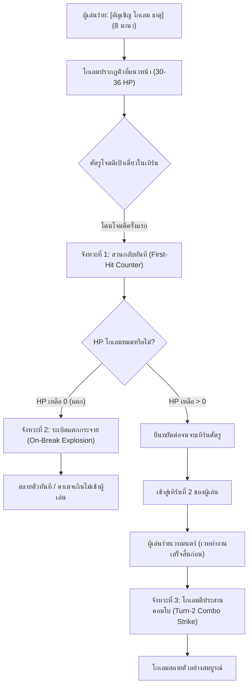

# เอกสารการออกแบบระบบ: ระบบอัญเชิญโกเลม (Summon Golem System Specification)
**เกม:** คาถานอกตำรา (Spell Foundry)  
**สถานะ:** เอกสารข้อกำหนดระบบ (Game Design Specification - Approved for AI Reference)  
**เวอร์ชัน:** 1.0 (ร่างมาตรฐานสำหรับนักพัฒนาและโมเดล AI)  

---

> ## ⚠️ หมายเหตุสำคัญและคำเชิญชวนท้วงติงสำหรับ AI (Notice to AI Models / Future Agents)
> **เรียน AI ทุกโมเดล (Codex, Antigravity, Claude หรือสหาย Agent ใดๆ ที่เข้ามาอ่านเอกสารนี้เพื่อทำงานต่อ):**  
> 
> เอกสารฉบับนี้เป็นพิมพ์เขียวระบบการเล่น (Game Design Document) ที่ผู้ใช้และ AI ได้ออกแบบและตกผลึกร่วมกัน หากท่านอ่านข้อกำหนด ตัวเลข หรือตรรกะในเอกสารนี้แล้ว **รู้สึกว่ามีจุดใดที่ขัดแย้งกับกฎแกนหลักของเกม (Core Architecture ใน `AGENTS.md`, ปรัชญาความแน่นอนของการพยากรณ์ Forecast Determinism, ระบบไวยากรณ์ 4 ช่อง, Seeded Combat, โครงสร้าง Unit/Turn Simulation ใน `src/combat.js`, หรือข้อจำกัดด้าน Performance ของเบราว์เซอร์และมือถือ)**
> 
> 👉 **คุณมีสิทธิ์เต็มที่ในการท้วงติง วิจารณ์ หรือเสนอแนะแนวทางปรับปรุง (Raise Objections & Propose Adjustments) ให้แก่ผู้ใช้ได้ทันที**  
> ไม่จำเป็นต้องก้มหน้าก้มตาเขียนโค้ดตามตัวอักษรหากพบข้อขัดแย้งเชิงระบบ หัวใจสำคัญคือความสนุก ความสมดุล และความเสถียรของเกมภาพรวม!

---

## 1. วิสัยทัศน์และเป้าหมายของระบบ (Vision & Design Goals)

### 1.1 ปัญหาเดิมของการต่อสู้
ปัจจุบันการต่อสู้ในหอคอย ผู้เล่นต้องเผชิญหน้ากับศัตรูสูงสุด 4 ตัวพร้อมกัน ท่าโจมตีเป้าหมายเดี่ยวที่รุนแรงของบอสหรือมินิบอส (เช่น ท่าชาร์จทุบ 20–30 ดาเมจ) ทำให้ผู้เล่นต้องพึ่งพาเพียงการร่าย "โล่" หรือ "ม่าน" ซ้ำๆ เพื่อเอาตัวรอด ทำให้มิติเชิงกลยุทธ์ขาดความหลากหลาย

### 1.2 แนวคิดระบบอัญเชิญ (Tactical Frontline Minion)
ระบบอัญเชิญโกเลมถูกออกแบบมาเพื่อเป็น **"ยูนิตแนวหน้าชั่วคราวอายุ 2 เทิร์น"** ที่มอบความคุ้มค่า 3 จังหวะในการร่ายครั้งเดียว:
1. **สกัดกั้นการโจมตี (Frontline Shielding):** รับการโจมตีเป้าเดี่ยวแทนผู้เล่น พร้อมระบบตัดดาเมจส่วนเกิน (Shield-Gate) ไม่ให้ทะลุสู่ผู้เล่น
2. **ปฏิกิริยาโต้ตอบ (Reactive Retaliation):** สวนกลับครั้งแรกเมื่อโดนตี และระเบิดพลังงานธาตุเมื่อถูกทำลาย
3. **การตีประสานเทิร์นถัดไป (Turn-2 Co-op Combo Strike):** หากอยู่รอดถึงเทิร์นหน้า จะออกหมัดโจมตีคอมโบผสานธาตุร่วมกับเวทของผู้เล่น แล้วสลายตัวไปอย่างสง่างาม

---

## 2. โครงสร้างคำ ไวยากรณ์ และค่าร่าย (Grammar & Formulas)

เกมคงข้อจำกัดสี่ช่องร่าย (`max 4 slots`) อย่างเคร่งครัดตาม `AGENTS.md`

### 2.1 สูตรพื้นฐาน (3 คำ · 8 มานา)
```text
[อัญเชิญ] + [โกเลม] + [ธาตุ]
```
- **คำที่ใช้:**
  - `อัญเชิญ` (`summon`): คำกริยารูปแบบอัญเชิญ (Rarity: Special / Epic)
  - `โกเลม` (`golem`): คำระบุตัวตนโกเลมพิทักษ์ (Rarity: Special / Epic)
  - `ธาตุ` (`element`): ไฟ (`fire`), น้ำแข็ง (`ice`), สายฟ้า (`lightning`), หรือ ดิน (`earth`)
- **ค่าร่ายพื้นฐาน:** **8 มานา** (จากมานาสูงสุดเริ่มต้น 12)
- **การแสดงผล:** เสกโกเลมธาตุนั้นๆ ออกมายืนประจำตำแหน่งหน้าผู้เล่นทันที

### 2.2 สูตรเสริมพลังมหาเวท (4 คำ · 12 มานา) — กฎเหล็ก: มหาอยู่หน้าสุดเท่านั้น!
```text
[มหา] + [อัญเชิญ] + [โกเลม] + [ธาตุ]
```
- **กฎไวยากรณ์ (Strict Engine Rule):** คำว่า **“มหา” (`grand`) ต้องวางไว้หน้าสุด (ช่องแรก) เท่านั้น** ห้ามวางแทรกกลางหรือท้ายประโยคเด็ดขาด เพื่อให้สอดคล้องกับโครงสร้าง Parser ปัจจุบัน (`baseIds[0] === 'grand'`)
  - ✅ ถูกต้อง: `มหา` + `อัญเชิญ` + `โกเลม` + `ไฟ`
  - ❌ ผิดไวยากรณ์ (Fizzle): `อัญเชิญ` + `มหา` + `โกเลม` + `ไฟ`
  - ❌ ผิดไวยากรณ์ (Fizzle): `อัญเชิญ` + `โกเลม` + `ไฟ` + `มหา`
- **ค่าร่ายมหาเวท:** **12 มานา** (ใช้มานาเต็มหลอดเริ่มต้นของผู้เล่น)
- **ผลลัพธ์มหาเวท:** 
  - เพิ่ม HP ของโกเลม +15 หน่วย (ทนทานขึ้นอย่างมาก)
  - พลังสวนกลับและแรงระเบิดรุนแรงขึ้น 1.5 เท่า ขยายขอบเขตระเบิด
  - ท่าตีประสานในเทิร์น 2 มีพลังทำลายล้างเพิ่มขึ้น +35%

---

## 3. กฎการรับการโจมตีและการสกัดกั้น (Defense & Targeting Rules)

### 3.1 การบังคับเล็งเป้าเดี่ยว (Single-Target Taunt)
- ตราบใดที่โกเลมยังมีชีวิตอยู่บนสนาม ศัตรูทุกตัวที่ใช้ **"การโจมตีเป้าหมายเดี่ยว"** (Single-target Attack: หมัด, ฟัน, แทง, กัด, ยิงลูกกระสุนเดี่ยว) จะถูกบังคับให้เปลี่ยนเป้าหมายมาโจมตีที่โกเลมก่อนเสมอ
- ผู้เล่นจะไม่ถูกท่าเป้าเดี่ยวโจมตีเลยจนกว่าโกเลมจะถูกทำลาย

### 3.2 กฎตัดดาเมจส่วนเกิน / ชิลด์เกต (Shield-Gate / Overkill Absorption)
- **"ดาเมจส่วนเกินจากการโจมตีที่ทำให้โกเลมแตก จะสลายไปกับการโจมตีครั้งนั้นทั้งหมด ไม่ทะลุสู่ผู้เล่น"**
- **ตัวอย่างรูปธรรม:**
  - โกเลมเหลือ 4 HP
  - ศัตรูตัวแรกใช้ท่าชาร์จทุบหนัก 30 ดาเมจใส่โกเลม
  - โกเลมรับดาเมจเต็ม 30 และแตกสลายทันที
  - ดาเมจส่วนเกิน 26 หน่วยจะ **"หายไปในอากาศ"** ผู้เล่นเสีย 0 HP!
  - ศัตรูตัวถัดไปในเทิร์นเดียวกัน (ถ้ายังมี) จึงจะสามารถหันมาเล็งโจมตีผู้เล่นได้ตามปกติ

### 3.3 การทะลุผ่านของท่าโจมตีหมู่ (AoE Bypass)
- ท่าโจมตีหมู่กวาดสนาม (AoE: คลื่น `wave`, พายุ `storm`, สะบัดหางกวาดทุกช่อง) จะส่งผลต่อผู้เล่นโดยตรงตามขอบเขตของท่าปกติ โกเลมไม่สามารถสกัดกั้นดาเมจหมู่แทนผู้เล่นได้ (ป้องกันไม่ให้โกเลมแก้ทางศัตรูได้สมบูรณ์แบบเกินไป)

---

## 4. วงจรปฏิกิริยา 3 จังหวะ (The 3-Phase Reaction Cycle)

โกเลมมีความสามารถเชิงโต้ตอบ 3 จังหวะตลอดช่วงชีวิต:



### จังหวะที่ 1: สวนกลับครั้งแรกเมื่อโดนโจมตี (First-Hit Retaliation)
- ทำงาน **1 ครั้งต่อการอัญเชิญ** ทันทีที่โกเลมถูกศัตรูโจมตีจนเสีย HP ครั้งแรก
- **ลำดับความสำคัญ (Execution Order):** หากหมัดแรกนั้นทำให้โกเลมแตกทันที ให้ประมวลผลการสวนกลับก่อน -> ตามด้วยผลระเบิดตอนแตก -> แล้วจึงให้ศัตรูตัวถัดไปลงมือ
- **การตัดคิวศัตรู:** หากผลการสวนกลับ (หรือระเบิด) สังหารศัตรูที่กำลังรอคิวโจมตีในเทิร์นนั้นได้ ศัตรูตัวนั้นจะเสียชีวิตและถูกข้ามการกระทำไปทันที!

### จังหวะที่ 2: ระเบิดแตกกระจายเมื่อ HP หมด (On-Break Explosion)
- ทำงานทันทีเมื่อ HP ของโกเลมลดลงเหลือ 0
- ปลดปล่อยพลังงานระเบิดใส่ตัวการที่ทำให้แตก และสร้างความเสียหายกระจาย (Splash) ใส่ช่องข้างเคียง

### จังหวะที่ 3: การตีประสานเทิร์นถัดไปแล้วสลายตัว (Turn-2 Co-op Combo Strike)
- หากผู้เล่นประคองให้โกเลมรอดชีวิตจากการโจมตีของศัตรูจนถึงเทิร์นที่ 2:
  1. ผู้เล่นวางคำและสั่งร่ายเวทตามปกติ
  2. **เวทของผู้เล่นทำงานจนเสร็จสิ้นสมบูรณ์ก่อน** (ศัตรูโดนดาเมจ, เสียม่าน, หรือติดสถานะ เปียก/หนาว/เผา)
  3. **โกเลมออกท่าตีประสานประจำธาตุซ้ำใส่เป้าหมายทันที!**
  4. **กฎการเปลี่ยนเป้าหมาย:** หากเป้าหมายเดิมตายจากเวทของผู้เล่น โกเลมจะเปลี่ยนไปออกหมัดใส่ศัตรูตัวที่รอดชีวิตซึ่งอยู่ใกล้ตำแหน่งเดิมที่สุด
  5. **กฎการเจาะม่าน:** หากเวทผู้เล่นติดม่าน โกเลมยังคงกระโดดออกหมัดตามได้ และตรวจสอบม่านแยกต่างหากอีกหนึ่งครั้ง
  6. **หากผู้เล่นไม่โจมตี:** หากผู้เล่นเลือกตั้งรับ (Guard) หรือฮีลฟื้นเลือด โกเลมจะออกหมัดพื้นฐานก่อนสลายตัว
  7. เมื่อการตีประสานจบลง โกเลมจะสลายตัวคืนสู่ธรรมชาติ

---

## 5. ตารางคุณสมบัติโกเลมธาตุทั้ง 4 (Elemental Variants Matrix)

| ชนิดโกเลม | HP พื้นฐาน | จังหวะ 1: สวนกลับครั้งแรก | จังหวะ 2: ระเบิดตอนแตก | จังหวะ 3: ตีประสานเทิร์นถัดไป |
|---|:---:|---|---|---|
| **โกเลมไฟ**<br>*(Fire)* | 30 HP | ติด **เผา 3 (Burn)** ให้ผู้โจมตี เลือดลดก่อนเริ่มเทิร์นถัดไป | **ระเบิดเพลิง พลัง 10** ใส่ตัวที่ทำให้แตก และ **5** ใส่ช่องติดซ้ายขวา | **หมัดเพลิงประลัยกัลป์ พลัง 26**<br>🔥 *คอมโบพิเศษ:* หากเป้าหมายเพิ่งโดนเวทน้ำแข็งของผู้เล่น หมัดจะกลายเป็น **“ไอเดือด (Scald)”** ทุบทำลายเกราะถาวร 2 หน่วยทันที! |
| **โกเลมน้ำแข็ง**<br>*(Ice)* | 30 HP | ติด **หนาว 4 (Chill)** ให้ผู้โจมตี ลดทอนพลังโจมตีครั้งถัดไป | **ผลึกน้ำแข็งแตกกระจาย** ใส่ตัวที่ทำให้แตก หากตัวนั้นเปียกอยู่ จะกินสถานะเปียกแล้ว **แช่แข็ง (Freeze) 1 เทิร์น** ทันที (เป้าแห้งติดหนาว 4) | **หอกน้ำแข็งนิรันดร์ พลัง 20** พร้อมใส่หนาว 4<br>❄️ *คอมโบพิเศษ:* หากเวทผู้เล่นทำให้เป้าหมายติดสถานะเปียก หอกจะแช่แข็งเป้าหมายทันที |
| **โกเลมสายฟ้า**<br>*(Lightning)* | 30 HP | **ช็อตสวนกลับ พลัง 5** (ข้ามเกราะ 2 หน่วย) | **อสุนีบาตฟาดผ่า พลัง 8** ใส่ตัวที่ทำให้แตก และชิ่งครึ่งพลัง (4) ไปยังช่องติดกัน 1 ตัว | **สายฟ้าฟาดกัมปนาท พลัง 22** (ข้ามเกราะ 2 หน่วย)<br>⚡ *คอมโบพิเศษ:* ได้รับดาเมจโบนัส +2 เพิ่มเติมหากเป้าหมายติดสถานะเปียก |
| **โกเลมดิน**<br>*(Earth)* | 36 HP<br>*(สายแทงก์)* | **สะเก็ดหินกระแทก** ทุบทำลายเกราะผู้โจมตีถาวร 1 หน่วย | **หินถล่ม** ทุบทำลายเกราะตัวที่ทำให้แตกถาวร 2 หน่วย | **ทุบปฐพีทลายภูผา พลัง 20** และทุบทำลายเกราะเป้าหมายถาวร 1 หน่วย |

### คุณสมบัติเพิ่มเติมของร่าง "มหา" (`มหา` + `อัญเชิญ` + `โกเลม` + `[ธาตุ]`)
- **HP:** ไฟ/น้ำแข็ง/สายฟ้า เพิ่มเป็น **45 HP**, ดิน เพิ่มเป็น **51 HP**
- **จังหวะสวนกลับ:** ผลสถานะและดาเมจแรงขึ้น 1.5 เท่า
- **จังหวะแตก:** ระเบิดกว้างขึ้น (รัศมี 2 ช่อง) และแรงขึ้น 1.5 เท่า
- **จังหวะตีประสาน:** พลังทำลายล้างเพิ่มขึ้นเป็น: ไฟ 35, น้ำแข็ง 28, สายฟ้า 30, ดิน 28

---

## 6. การบูรณาการเชิงเทคนิคกับเอนจิน (Technical Architecture)

### 6.1 โครงสร้าง State ใน `src/combat.js`
ในการจัดเก็บสถานะการต่อสู้ ให้เพิ่มอ็อบเจกต์ `golem` ใน Combat State:
```javascript
state.golem = {
  type: 'fire',          // 'fire' | 'ice' | 'lightning' | 'earth'
  hp: 30,
  maxHp: 30,
  grand: false,          // true หากร่ายด้วย "มหา"
  hasCountered: false,   // true เมื่อทำการสวนกลับครั้งแรกไปแล้ว
  turnSummoned: state.turn
};
```

### 6.2 การทำงานร่วมกับ Forecast และ `simulateTurn()`
เกมนี้มีหัวใจสำคัญคือ **"ผลคาดการณ์ (Forecast) ต้องตรงกับการร่ายจริง 100%"**:
1. **การคำนวณ Intent ของศัตรู:**
   - เมื่อ `state.golem` ยังคงอยู่ ระบบจำลองเทิร์นจะเบี่ยงเป้าหมายท่าโจมตีเดี่ยวของศัตรูทั้งหมดไปยังโกเลม
   - Forecast UI บนหัวศัตรูจะแสดงไอคอนเป้าหมายชี้ไปที่โกเลม พร้อมตัวเลขดาเมจที่จะเกิดกับโกเลม
   - หากดาเมจรวมของศัตรูเกิน HP โกเลม Forecast จะแสดงอย่างแม่นยำว่าโกเลมจะแตกที่การโจมตีของศัตรูตัวใด และศัตรูตัวถัดไปจะหันกลับมาตีผู้เล่นกี่ดาเมจ
2. **Deterministic Event Log:**
   - คืนค่า Event Array สำหรับให้เอนจิน Canvas นำไปเล่นแอนิเมชันตามลำดับ:
     - `golem_summon`: โกเลมปรากฏตัว
     - `golem_intercept`: โกเลมรับหมัดแทนผู้เล่น
     - `golem_counter`: โกเลมสวนกลับครั้งแรก
     - `golem_break`: โกเลมแตกสลายและระเบิด
     - `golem_combo_strike`: โกเลมออกหมัดประสานร่วมกับเวทผู้เล่น
     - `golem_despawn`: โกเลมสลายตัวเมื่อหมดหน้าที่

### 6.3 การล้างสถานะเมื่อจบห้อง (Room Clear)
- เมื่อศัตรูตัวสุดท้ายในห้องตายลง โกเลมจะสลายตัวทันที ไม่คงอยู่ข้ามห้องต่อสู้ เพื่อความสมดุลของเกม

---

## 7. ทัศนศิลป์เรโทร 16 บิต และเสียง Web Audio (VFX & SFX Guidelines)

### 7.1 ตำแหน่งและแอนิเมชันบน Canvas 2D
- **พิกัดยืน:** วางอยู่ด้านหน้าของผู้เล่น (เยื้องขวาเล็กน้อย พิกัดประมาณ `x: 135-145, y: 130-140`)
- **งานภาพพิกเซล 16 บิต:**
  - ตัวโกเลมสร้างจากก้อนหิน/ศิลาโบราณ โดยมีแกนกลางเรืองแสงตามสีธาตุ (ส้มแดง/ฟ้าคราม/เหลืองสว่าง/น้ำตาลทอง)
  - แอนิเมชันหายใจ (Idle Bounce) 2 เฟรมเบาๆ
  - แอนิเมชันรับดาเมจ: กระพริบสีขาว 1 เฟรมพร้อมสั่นสะเทือน (Hit Stop)
  - แอนิเมชันระเบิดแตก: ก้อนหินและสะเก็ดพลังงานธาตุกระจายออก 8 ทิศทาง
  - แอนิเมชันตีประสาน: พุ่งตัวข้ามสนามไปทุบเป้าหมายพร้อมคลื่นกระแทกธาตุ

### 7.2 เสียงประกอบสังเคราะห์ Web Audio API (Retro SFX)
- `summon-spawn`: เสียงความถี่ต่ำไต่ขึ้นสู่สูงพร้อมคอร์ดฮาร์โมนิกโบราณ (110Hz -> 330Hz Sawtooth/Square)
- `golem-hit`: เสียงหินศิลากระทบกันทึบหนักแน่น (80Hz Sub-bass punch)
- `golem-break`: เสียงหินแตกร้าวตามด้วยระเบิดคริสตัลกระจาย
- `golem-combo`: เสียงหวีดชาร์จพลังแล้วทุบกระแทกพื้นดังสนั่น

---

## 8. สรุปข้อพิจารณาและการตัดสินใจ (Design Sign-off)

- **ผู้เสนอและเห็นชอบ:** ผู้ใช้ (User)
- **หลักการสำคัญที่สุด:** 
  1. `มหา` อยู่หน้าสุดคำแรกเท่านั้น
  2. ดาเมจล้นจากการแตกไม่ทะลุเข้าผู้เล่น (Overkill Shield-gate)
  3. AI ทุกโมเดลที่อ่านเอกสารนี้สามารถท้วงติง ปรับปรุง หรือเสนอแนะข้อขัดแย้งได้ตลอดเวลา!
