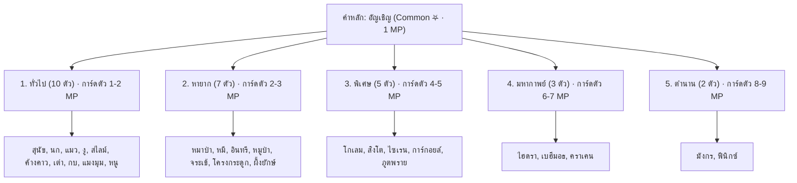
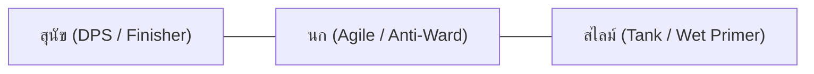

# เอกสารการออกแบบระบบ: ระบบอัญเชิญและการ์ดคำสิ่งอัญเชิญ 27 ชนิด (Summon System & 27 Creature Catalog)
**เกม:** คาถานอกตำรา (Spell Foundry)  
**สถานะ:** เอกสารข้อกำหนดระบบ (Game Design Specification - Approved for AI Reference)  
**เวอร์ชัน:** 2.1 (ร่างสมบูรณ์: บัญชีรายชื่อ 27 สิ่งอัญเชิญ, ระบบคำนวณมานาบวกค่าการ์ด, และรีวิวเชิงลึก 3 การ์ดทั่วไปพร้อมระบบตีบวก +1 ถึง +10 และเอฟเฟกต์รอง +7/+9/+10)  

---

> ## ⚠️ หมายเหตุสำคัญและคำเชิญชวนท้วงติงสำหรับ AI (Notice to AI Models / Future Agents)
> **เรียน AI ทุกโมเดล (Codex, Antigravity, Claude หรือสหาย Agent ใดๆ ที่เข้ามาอ่านเอกสารนี้เพื่อทำงานต่อ):**  
> 
> เอกสารฉบับนี้เป็นพิมพ์เขียวระบบการเล่น (Game Design Document) ที่ผู้ใช้และ AI ได้ออกแบบและตกผลึกร่วมกัน หากท่านอ่านข้อกำหนด ตัวเลข หรือตรรกะในเอกสารนี้แล้ว **รู้สึกว่ามีจุดใดที่ขัดแย้งกับกฎแกนหลักของเกม (Core Architecture ใน `AGENTS.md`, ปรัชญาความแน่นอนของการพยากรณ์ Forecast Determinism, ระบบไวยากรณ์ 4 ช่อง, Seeded Combat, โครงสร้าง Unit/Turn Simulation ใน `src/combat.js`, หรือข้อจำกัดด้าน Performance ของเบราว์เซอร์และมือถือ)**
> 
> 👉 **คุณมีสิทธิ์เต็มที่ในการท้วงติง วิจารณ์ หรือเสนอแนะแนวทางปรับปรุง (Raise Objections & Propose Adjustments) ให้แก่ผู้ใช้ได้ทันที**  
> ไม่จำเป็นต้องก้มหน้าก้มตาเขียนโค้ดตามตัวอักษรหากพบข้อขัดแย้งเชิงระบบ หัวใจสำคัญคือความสนุก ความสมดุล และความเสถียรของเกมภาพรวม!

---

## 1. วิสัยทัศน์และสถาปัตยกรรมระบบอัญเชิญ (Core Philosophy)

### 1.1 การทำงานของการ์ดอัญเชิญ (How Summoning Works)
ระบบอัญเชิญใช้โครงสร้างไวยากรณ์ 3–4 คำในแท่นร่าย 4 ช่อง (`max 4 slots`):
```text
รูปแบบปกติ (3 คำ):      [อัญเชิญ] + [สิ่งอัญเชิญ] + [ธาตุ / คุณลักษณะ]
รูปแบบมหาเวท (4 คำ):   [มหา] + [อัญเชิญ] + [สิ่งอัญเชิญ] + [ธาตุ / คุณลักษณะ]
```

* **การ์ดคำหลัก `อัญเชิญ` (Summon):**
  * **ระดับการ์ด:** **ทั่วไป (Common)** — หาง่ายตั้งแต่ชั้น 1 เพื่อให้ผู้เล่นได้สัมผัสระบบอัญเชิญได้ตั้งแต่ต้นเกม
  * **Glyph:** `⛧` (หรือ `✦`)
  * **ค่าร่ายเฉพาะใบ:** **1 มานา**
  * **หน้าที่:** เป็นคำกริยาขึ้นต้นเพื่อเปิดใช้งานระบบสร้างยูนิตแนวหน้าชั่วคราว 2 เทิร์น

* **กฎเหล็กเรื่องไวยากรณ์ (Strict Prefix Rule):**
  * คำว่า **“มหา” (`grand`) ต้องวางไว้หน้าสุด (ช่องแรก) เท่านั้น** ห้ามวางแทรกกลางหรือท้ายประโยคเด็ดขาด เพื่อให้สอดคล้องกับ Parser ปัจจุบัน (`baseIds[0] === 'grand'`)
  * ✅ ถูกต้อง: `มหา` + `อัญเชิญ` + `มังกร` + `ไฟ`
  * ❌ ผิดไวยากรณ์ (Fizzle): `อัญเชิญ` + `มหา` + `มังกร` + `ไฟ`

---

## 2. สูตรการคำนวณมานาแบบรวมค่าร่ายการ์ด (Additive Card Mana Cost System)

### 2.1 กลไกการคำนวณมานา (The Additive Formula)
สอดคล้องกับโครงสร้างคำนวณของเกม (เช่น `ลูก (1) + ไฟ (2) = 3 มานา`) คาถาอัญเชิญไม่ได้คิดค่าร่ายแบบลอยๆ แต่เกิดจาก **"ผลรวมค่าร่ายของแต่ละการ์ดคำที่นำมาประกอบกัน"**:

$$\text{Total Cost} = \text{Cost}(\text{อัญเชิญ}) + \text{Cost}(\text{สิ่งอัญเชิญ}) + \text{Cost}(\text{ธาตุ})$$

เมื่อมีคำว่า **“มหา” (`grand`)** วางไว้ช่องแรกสุด:

$$\text{Total Cost (มหา)} = \text{Cost}(\text{มหา Modifier}) + \text{Cost}(\text{อัญเชิญ}) + \text{Cost}(\text{สิ่งอัญเชิญ}) + \text{Cost}(\text{ธาตุ})$$

### 2.2 ตารางค่าร่ายขององค์ประกอบแต่ละส่วน (Component Mana Costs)

1. **การ์ดคำกริยา:**
   * `อัญเชิญ` (`summon`): **1 มานา**
2. **การ์ดคำสิ่งอัญเชิญ (ตามเกรด):**
   * **ทั่วไป (Common):** **1 มานา** (ยกเว้นตัวแทงก์ สไลม์/เต่า = **2 มานา**)
   * **หายาก (Rare):** **2–3 มานา** (สัตว์นักล่า = 2 มานา, สัตว์ยักษ์ = 3 มานา)
   * **พิเศษ (Special):** **4–5 มานา** (โกเลม/การ์กอยล์ = 5 มานา)
   * **มหากาพย์ (Epic):** **6–7 มานา** (ไฮดรา/คราเคน = 6 มานา, เบฮีมอธ = 7 มานา)
   * **ตำนาน (Legendary):** **8–9 มานา** (ฟีนิกซ์ = 8 มานา, มังกร = 9 มานา)
3. **การ์ดคำธาตุ / คุณลักษณะเสริม:**
   * **ธาตุพื้นฐาน (ไฟ, น้ำแข็ง, สายฟ้า, ดิน, น้ำ, ลม):** **2 มานา**
   * **ธาตุขั้นสอง (อัคคี, เหมันต์, อัสนี, ปฐพี, วารี, วายุ):** **5 มานา**
   * **ธาตุผสม (แมกม่า, บึงโคลน, พลาสมา, ไอเดือด ฯลฯ):** **7 มานา**
4. **โบนัสมหาเวท (`มหา` Modifier):**
   * เกรดทั่วไป / หายาก: **+3 มานา**
   * เกรดพิเศษ: **+4 มานา**
   * เกรดมหากาพย์: **+5 มานา**
   * เกรดตำนาน: **+6 มานา**

### 2.3 ตัวอย่างการคำนวณจริงในเกม
* **อัญเชิญสุนัขไฟ:** `อัญเชิญ (1) + สุนัข (1) + ไฟ (2)` = **4 มานา** *(ร่ายคล่องต้นเกม)*
* **มหาอัญเชิญสุนัขไฟ:** `มหา (+3) + อัญเชิญ (1) + สุนัข (1) + ไฟ (2)` = **7 มานา**
* **อัญเชิญสไลม์น้ำ:** `อัญเชิญ (1) + สไลม์ (2) + น้ำ (2)` = **5 มานา**
* **อัญเชิญโกเลมไฟ:** `อัญเชิญ (1) + โกเลม (5) + ไฟ (2)` = **8 มานา** *(ตรงตามสเปก 8 มานาเดิม)*
* **มหาอัญเชิญโกเลมไฟ:** `มหา (+4) + อัญเชิญ (1) + โกเลม (5) + ไฟ (2)` = **12 มานา** *(เต็มหลอด 12 พอดี)*
* **อัญเชิญมังกรไฟ:** `อัญเชิญ (1) + มังกร (9) + ไฟ (2)` = **12 มานา** *(ใช้เต็มหลอดเริ่มต้นของผู้เล่น)*
* **มหาอัญเชิญมังกรไฟ:** `มหา (+6) + อัญเชิญ (1) + มังกร (9) + ไฟ (2)` = **18 มานา** *(เกิน 12! ต้องใช้การ์ดจุติร่ายฟรี 0 มานา, มงกุฎนิรันดร์ Max MP 15, การ์ดเบา -1 MP, หรือขวดมานาสกัดช่วย)*

---

## 3. กฎแกนกลางของสิ่งอัญเชิญ (Core Mechanics: Defense & The 3-Phase Cycle)

### 3.1 การสกัดกั้นและตัดดาเมจส่วนเกิน (Taunt & Shield-Gate Overkill Absorption)
* **Taunt เป้าเดี่ยว:** ท่าโจมตีเดี่ยวทั้งหมดของศัตรูต้องเล็งสิ่งอัญเชิญก่อนตราบใดที่ยังมีชีวิตอยู่
* **ชิลด์เกตตัดดาเมจล้น (Overkill Shield-Gate):** หมัดที่ทำให้สิ่งอัญเชิญแตก ดาเมจส่วนเกินทั้งหมดจะสลายไปกับการโจมตีครั้งนั้น ไม่ทะลุสู่ผู้เล่น (เช่น สุนัขเหลือ 2 HP โดนทุบ 30 ดาเมจ สุนัขแตก ดาเมจ 28 หายไป ผู้เล่นเสีย 0 HP)
* **AoE ทะลุผ่าน:** ท่าโจมตีหมู่กวาดสนามยังคงส่งผลต่อผู้เล่นตามปกติ

### 3.2 วงจรปฏิกิริยา 3 จังหวะ (The 3-Phase Reaction Cycle)
1. **จังหวะที่ 1: สวนกลับครั้งแรก (First-Hit Counter):** ทำงาน 1 ครั้งเมื่อโดนโจมตีเสีย HP ครั้งแรก หากหมัดแรกทำให้แตก ให้คิดผลสวนกลับก่อน -> ตามด้วยระเบิดตอนแตก
2. **จังหวะที่ 2: ระเบิดตอนแตก (On-Break Effect):** ทำงานทันทีเมื่อ HP เหลือ 0 ปลดปล่อยผลกระทบใส่ตัวที่ทำให้แตกและช่องข้างเคียง
3. **จังหวะที่ 3: ตีประสานเทิร์น 2 แล้วสลายตัว (Turn-2 Co-op Combo Strike):** ถ้ารอดถึงเทิร์นหน้า เวทของผู้เล่นทำงานจนเสร็จสิ้นก่อน -> สิ่งอัญเชิญออกท่าตีประสานซ้ำ -> แล้วสลายตัวทันที

---

## 4. บัญชีรายชื่อ 27 สิ่งอัญเชิญ ครบทั้ง 5 ระดับ (The 27 Summon Creature Catalog)



---

## 5. รีวิวเชิงลึกการ์ดคำอัญเชิญเกรดทั่วไป 3 ตัว (Deep-Dive Review: 3 Common Summons)

เพื่อให้เห็นภาพการนำไปเขียนโค้ดจริงใน `src/words.js`, `src/combat.js`, และ `src/run.js` ได้ทำการรีวิว 3 ตัวแทนสายหลักของเกรดทั่วไปอย่างละเอียด:



---

### 5.1 สุนัข (Hound / Dog) · `dog`
> **คอนเซปต์:** "คมเขี้ยวล่าเนื้อผู้ซื่อสัตย์ ตัวเปิดแผลเลือดไหลและตัวจบเป้าหมายเลือดต่ำ"

* **ข้อมูลพื้นฐาน:**
  * **ระดับ:** ทั่วไป (Common) | **Glyph:** `🐕`
  * **ค่าร่ายเฉพาะใบ:** **1 มานา** (ร่ายคู่กับอัญเชิญ+ธาตุ = 4 มานา / มหา = 7 มานา)
  * **บทบาท:** Single-Target DPS / Executioner

* **ค่าพลังและการทำงานเริ่มต้น (Level 0):**
  * **HP:** **14 HP** (ร่างมหา: **24 HP**)
  * **จังหวะ 1 สวนกลับ (Bite Counter):** เมื่อโดนตีครั้งแรก กัดสวนกลับทันที **4 ดาเมจ ทะลุเกราะ 1 หน่วย**
  * **จังหวะ 2 ตอนแตก (Intimidating Bark):** เห่าขู่กรรโชก ลดพลังโจมตีของศัตรูตัวที่ทำให้แตก **2 หน่วย** ในเทิร์นถัดไป
  * **จังหวะ 3 ตีประสาน (Throat Rip):** "พุ่งขย้ำคอหอย" **พลัง 12** (หากเป้าหมาย HP ต่ำกว่า 50% ดาเมจคูณ 1.5 เท่า เป็น **18 ดาเมจ!**)

* **การตีบวกการ์ดสุนัข (+1 ถึง +10) — การเติบโตของค่าพลังพื้นฐาน:**
  เมื่อผู้เล่นอัปเกรดการ์ดคำ `สุนัข` ที่แท่นตีเหล็ก (Forge) จะเพิ่มสเตตัสหลักในทุกเลเวล:
  * **HP พื้นฐาน:** เพิ่มขึ้น **+2 HP ต่อเลเวล**
  * **ดาเมจตีประสาน:** เพิ่มขึ้น **+1.5 ต่อเลเวล**
  * **ดาเมจกัดสวนกลับ:** เพิ่มขึ้น **+1 ต่อทุก 2 เลเวล**

| เลเวลการ์ด | HP ปกติ (มหา) | พลังกัดสวนกลับ | พลังตีประสานเทิร์น 2 (ต่ำกว่า 50% HP) |
|:---:|:---:|:---:|:---:|
| **+0** | 14 (24) | 4 | 12 (18) |
| **+1** | 16 (26) | 4 | 13.5 (20) |
| **+3** | 20 (30) | 5 | 16.5 (25) |
| **+5** | 24 (34) | 6 | 19.5 (29) |
| **+7** | 28 (38) | 7 | 22.5 (34) |
| **+9** | 32 (42) | 8 | 25.5 (38) |
| **+10 (MAX)** | **34 (44)** | **9** | **27 (41)** |

* **เอฟเฟกต์รองที่ +7, +9, +10 (Secondary Card Upgrade: `dog_pack_hunter`):**
  * **ชื่อเอฟเฟกต์:** *สุนัขล่าเนื้อรวมฝูง (Pack Hunter)*
  * **ขั้น 1 (+7):**
    * *Badge:* `🐕 ฝูงล่า · เลือดออก +3`
    * *ผลลัพธ์:* สุนัขเปิดแผลลึก ทุกการโจมตี (ทั้งกัดสวนกลับและตีประสาน) จะทำให้ศัตรูติดสถานะ **"เลือดออก (Bleed/Burn) 3 หน่วย เป็นเวลา 2 เทิร์น"**
  * **ขั้น 2 (+9):**
    * *Badge:* `🐕 ฝูงล่า · เลือดออก +5 · ข้ามเกราะ +1`
    * *ผลลัพธ์:* เพิ่มดาเมจเลือดออกเป็น **5 หน่วย** และทุกการโจมตีของสุนัขจะ **ข้ามเกราะเพิ่มขึ้นอีก 1 หน่วย** (รวมข้ามเกราะ 2 หน่วย)
  * **ขั้นสูงสุด (+10):**
    * *Badge:* `🐕 จ่าฝูงกัดปลิดชีพ · คิลแล้วคืน 2 MP + จั่ว 1`
    * *ผลลัพธ์ (Game-Changer):* กลายร่างเป็นจ่าฝูงไร้ปรานี! หากการกัดสวนกลับหรือหมัดตีประสานของสุนัขสามารถ **สังหารศัตรูได้สำเร็จ (On Kill)** สุนัขจะเห่าปลุกขวัญ **ฟื้นฟูมานา 2 MP ให้ผู้เล่นทันที พร้อมจั่วการ์ดขึ้นมือ 1 ใบ!**

---

### 5.2 นก (Bird / Hawk) · `bird`
> **คอนเซปต์:** "วิหคเวหาลาดตระเวน หลบหลีกสายตา สลายม่านกระสุน และผลักปั่นป่วนแถวศัตรู"

* **ข้อมูลพื้นฐาน:**
  * **ระดับ:** ทั่วไป (Common) | **Glyph:** `🦅`
  * **ค่าร่ายเฉพาะใบ:** **1 มานา** (ร่ายคู่กับอัญเชิญ+ธาตุ = 4 มานา / มหา = 7 มานา)
  * **บทบาท:** Agility / Anti-Ward / Disruptor

* **ค่าพลังและการทำงานเริ่มต้น (Level 0):**
  * **HP:** **12 HP** (ร่างมหา: **22 HP**)
  * **คุณสมบัติติดตัว (Aerial Evasion):** บินอยู่บนฟ้า มีโอกาส **40%** ที่จะหลบการโจมตีแรกของศัตรูได้โดยไม่เสีย HP
  * **จังหวะ 1 สวนกลับ (Peck Disruption):** จิกดวงตาก่อกวน 3 ดาเมจ + ทำให้ผู้โจมตีติดสถานะ **"บดบัง (Obscured)"** ลดพลังโจมตีครั้งถัดไป **3 หน่วย**
  * **จังหวะ 2 ตอนแตก (Feather Scatter):** ขนปีกกระจาย สลับตำแหน่งศัตรูตัวการกับช่องข้างเคียง (Displace Slot) เพื่อทำลายกระบวนทัพ
  * **จังหวะ 3 ตีประสาน (Dive Strike):** "โฉบดิ่งเวหา" **พลัง 10 ข้ามม่านกระสุนทั้งหมด (Ignores Ward 100%)**

* **การตีบวกการ์ดนก (+1 ถึง +10) — การเติบโตของค่าพลังพื้นฐาน:**
  * **HP พื้นฐาน:** เพิ่มขึ้น **+1.5 HP ต่อเลเวล**
  * **โอกาสหลบหลีกเวหา (Aerial Evasion):** เพิ่มขึ้น **+2% ต่อเลเวล** (ที่ +10 มีโอกาสหลบหลีกสูงถึง **60%!**)
  * **ดาเมจตีประสาน:** เพิ่มขึ้น **+1.5 ต่อเลเวล**
  * **ผลลดทอนดาเมจจากสถานะบดบัง:** เพิ่มขึ้น **+0.5 ต่อเลเวล**

| เลเวลการ์ด | HP ปกติ (มหา) | โอกาสหลบหลีก | บดบังลดดาเมจศัตรู | พลังตีประสานเทิร์น 2 (ข้ามม่าน) |
|:---:|:---:|:---:|:---:|:---:|
| **+0** | 12 (22) | 40% | -3 | 10 |
| **+1** | 13.5 (23.5) | 42% | -3.5 | 11.5 |
| **+3** | 16.5 (26.5) | 46% | -4.5 | 14.5 |
| **+5** | 19.5 (29.5) | 50% | -5.5 | 17.5 |
| **+7** | 22.5 (32.5) | 54% | -6.5 | 20.5 |
| **+9** | 25.5 (35.5) | 58% | -7.5 | 23.5 |
| **+10 (MAX)** | **27 (37)** | **60%** | **-8** | **25** |

* **เอฟเฟกต์รองที่ +7, +9, +10 (Secondary Card Upgrade: `bird_aerial_recon`):**
  * **ชื่อเอฟเฟกต์:** *เหยี่ยวลาดตระเวนตาเหยี่ยว (Eagle Eye Recon)*
  * **ขั้น 1 (+7):**
    * *Badge:* `🦅 ตาเหยี่ยว · ลบม่าน 1 ชั้น`
    * *ผลลัพธ์:* ดวงตาเหยี่ยวมองทะลุการป้องกัน: เมื่อนกจิกสวนกลับ จะทำการ **ลบล้างม่าน (Dispel Ward) ของเป้าหมาย 1 ชั้นทันที** ก่อนคิดดาเมจ
  * **ขั้น 2 (+9):**
    * *Badge:* `🦅 ตาเหยี่ยว · ลบม่านทั้งหมด · ตีแรง +20%`
    * *ผลลัพธ์:* เมื่อนกโจมตีสวนกลับ จะ **สลายม่านทั้งหมดของเป้าหมายจนหมดสิ้น** และทำให้เวทถัดไปของผู้เล่นที่ยิงใส่เป้าหมายนี้แรงขึ้น **+20%**
  * **ขั้นสูงสุด (+10):**
    * *Badge:* `🦅 พายุขนนกคลื่นลม · ผลักทุกตัว + โฉบหมู่`
    * *ผลลัพธ์ (Game-Changer):* เมื่อนกแตกสลาย จะไม่เพียงแค่สลับช่อง แต่จะปล่อย **"ลมสลาตันปีกเวหา" ผลักศัตรูทุกตัวในสนามถอยหลัง 1 ช่อง (ชนขอบกระแทก 6 ทะลุเกราะ)** และหากนกรอดชีวิตถึงเทิร์น 2 ท่าโฉบดิ่งเวหาจะกลายเป็น **"โฉบกวาดศัตรูทุกตัวในสนาม (Hit All Enemies)" ด้วยพลัง 25 ดาเมจข้ามม่านทั้งหมด!**

---

### 5.3 สไลม์ (Slime) · `slime`
> **คอนเซปต์:** "ก้อนเมือกกรดมีชีวิต สายแทงก์รับดาเมจ ยืนทนทาน และระเบิดสาดเปียกเพื่อคอมโบธาตุ"

* **ข้อมูลพื้นฐาน:**
  * **ระดับ:** ทั่วไป (Common) | **Glyph:** `💧`
  * **ค่าร่ายเฉพาะใบ:** **2 มานา** (เพราะเป็นตัวแทงก์ HP หนา และให้สถานะเปียกหมู่)
  * **สูตรคาถาตัวอย่าง:** `อัญเชิญ (1) + สไลม์ (2) + น้ำ (2)` = **5 มานา** (มหา = 8 มานา)
  * **บทบาท:** Frontline Meatshield / Wet Elemental Primer

* **ค่าพลังและการทำงานเริ่มต้น (Level 0):**
  * **HP:** **18 HP** (ร่างมหา: **30 HP**) *(HP สูงที่สุดในเกรดทั่วไป ยืนรับหมัดได้ถึง 2 ครั้งสบายๆ)*
  * **จังหวะ 1 สวนกลับ (Sticky Cushion):** เมือกเหนียวพ่นสวน ลดพลังโจมตีของผู้ตีลง **3 หน่วย** ทันที
  * **จังหวะ 2 ตอนแตก (Acid Splash):** แตกตัวเป็นน้ำเมือกเหนียว ทำให้ศัตรูตัวการและช่องข้างเคียงติดสถานะ **"เปียก (Wet)" 2 เทิร์น** (ปูทางให้สายฟ้าเจาะเกราะ / หิมะแช่แข็ง)
  * **จังหวะ 3 ตีประสาน (Heavy Squish):** "ทับกระแทกหนืด" **พลัง 14**

* **การตีบวกการ์ดสไลม์ (+1 ถึง +10) — การเติบโตของค่าพลังพื้นฐาน:**
  * **HP พื้นฐาน:** เพิ่มขึ้น **+2.5 HP ต่อเลเวล** (+10 ได้ HP ถึง **43 HP!** หนาเทียบเท่าตัวแทงก์เกรดมหากาพย์)
  * **พลังลดทอนการโจมตีจากเมือก:** เพิ่มขึ้น **+0.5 ต่อเลเวล** (+10 ลดพลังโจมตีศัตรูได้ถึง **8 หน่วย**)
  * **ดาเมจตีประสานทับกระแทก:** เพิ่มขึ้น **+1.2 ต่อเลเวล**

| เลเวลการ์ด | HP ปกติ (มหา) | เมือกเหนียวลดดาเมจศัตรู | พลังตีประสานเทิร์น 2 |
|:---:|:---:|:---:|:---:|
| **+0** | 18 (30) | -3 | 14 |
| **+1** | 20.5 (32.5) | -3.5 | 15.2 |
| **+3** | 25.5 (37.5) | -4.5 | 17.6 |
| **+5** | 30.5 (42.5) | -5.5 | 20.0 |
| **+7** | 35.5 (47.5) | -6.5 | 22.4 |
| **+9** | 40.5 (52.5) | -7.5 | 24.8 |
| **+10 (MAX)** | **43 (55)** | **-8** | **26.0** |

* **เอฟเฟกต์รองที่ +7, +9, +10 (Secondary Card Upgrade: `slime_living_acid`):**
  * **ชื่อเอฟเฟกต์:** *เมือกกรดมีชีวิต (Living Acid Matrix)*
  * **ขั้น 1 (+7):**
    * *Badge:* `💧 กรดกัดกร่อน · ทุบเกราะ −1`
    * *ผลลัพธ์:* เมือกของสไลม์มีฤทธิ์เป็นกรดรุนแรง: ศัตรูที่โจมตีใส่สไลม์จะถูก **ทุบเกราะถาวร 1 หน่วย** ทันทีที่โดนเมือกสวน
  * **ขั้น 2 (+9):**
    * *Badge:* `💧 กรดกัดกร่อน · ทุบเกราะ −2 · เปียก 3 เทิร์น`
    * *ผลลัพธ์:* ทุบเกราะถาวรเพิ่มเป็น **2 หน่วย** และสถานะเปียก (Wet) เมื่อสไลม์แตกจะอยู่ยาวนานขึ้นเป็น **3 เทิร์น**
  * **ขั้นสูงสุด (+10):**
    * *Badge:* `💧 เมือกแบ่งตัวอมตะ · แตกตัวเสกมินิสไลม์ 15 HP`
    * *ผลลัพธ์ (Game-Changer):* **"ปฏิกิริยาแบ่งตัวไมโอซิส (Mitosis Rebirth)":** เมื่อสไลม์โดนตีจนแตกสลาย มันจะไม่ตายหายไปทันที แต่จะ **แบ่งตัวเป็น "มินิสไลม์ (Mini-Slime)" มี 15 HP ยืนรับการโจมตีต่อได้อีก 1 ฮิต!** และเมื่อมินิสไลม์แตก จะสาดน้ำเมือกเปียกโชกใส่ **ศัตรูทุกตัวในกระดาน (Board-wide Wet)** พร้อมลดเกราะทุกคน 2 หน่วย!

---

### 5.4 แมว (Cat / Feline) · `cat`
> **คอนเซปต์:** "วิฬารภูเขาว่องไว เก้าชีวิต กรงเล็บรัตติกาลขโมยมานา และร่างเงาลวงตามอบโล่คุ้มครอง"

* **ข้อมูลพื้นฐาน:**
  * **ระดับ:** ทั่วไป (Common) | **Glyph:** `🐈`
  * **ค่าร่ายเฉพาะใบ:** **1 มานา** (`อัญเชิญ (1) + แมว (1) + ธาตุ (2)` = **4 มานา** / มหา = **7 มานา**)
  * **บทบาท:** Utility / Mana Siphon / Nine Lives Shield

* **ค่าพลังและการทำงานเริ่มต้น (Level 0):**
  * **HP:** **12 HP** (ร่างมหา: **22 HP**)
  * **จังหวะ 1 สวนกลับ (Feline Swat):** ตะปบสวนกลับทันที **3 ดาเมจ + ขโมยมานา 1 MP คืนให้ผู้เล่นทันที!** (Mana Siphon)
  * **จังหวะ 2 ตอนแตก (Nine Lives Echo):** ร่างเงาลวงตาสลายตัว ทิ้งเศษมนตรา **มอบโล่ 4 หน่วย (1 ชั้น) ให้ผู้เล่นทันที**
  * **จังหวะ 3 ตีประสาน (Night Claw):** "กรงเล็บรัตติกาล" **พลัง 11 ข้ามเกราะทั้งหมด (Ignores All Armor)**

* **การตีบวกการ์ดแมว (+1 ถึง +10) — การเติบโตของค่าพลังพื้นฐาน:**
  * **HP พื้นฐาน:** เพิ่มขึ้น **+1.5 HP ต่อเลเวล**
  * **ดาเมจกัดสวนกลับ:** เพิ่มขึ้น **+0.8 ต่อเลเวล**
  * **ดาเมจตีประสาน:** เพิ่มขึ้น **+1.5 ต่อเลเวล**
  * **โล่ที่มอบตอนแตกสลาย:** เพิ่มขึ้น **+0.6 ต่อเลเวล**

| เลเวลการ์ด | HP ปกติ (มหา) | ดาเมจสวนกลับ (+คืน MP) | โล่ที่มอบตอนแตก | พลังตีประสานเทิร์น 2 (ข้ามเกราะ) |
|:---:|:---:|:---:|:---:|:---:|
| **+0** | 12 (22) | 3.0 (+1 MP) | 4.0 | 11.0 |
| **+1** | 13.5 (23.5) | 3.8 (+1 MP) | 4.6 | 12.5 |
| **+3** | 16.5 (26.5) | 5.4 (+1 MP) | 5.8 | 15.5 |
| **+5** | 19.5 (29.5) | 7.0 (+1 MP) | 7.0 | 18.5 |
| **+7** | 22.5 (32.5) | 8.6 (+1 MP) | 8.2 | 21.5 |
| **+9** | 25.5 (35.5) | 10.2 (+1 MP) | 9.4 | 24.5 |
| **+10 (MAX)** | **27 (37)** | **11.0 (+1 MP)** | **10.0** | **26.0** |

* **เอฟเฟกต์รองที่ +7, +9, +10 (Secondary Card Upgrade: `cat_nine_lives`):**
  * **ชื่อเอฟเฟกต์:** *วิฬารเก้าชีวิต (Nine Lives Grace)*
  * **ขั้น 1 (+7):**
    * *Badge:* `🐈 เก้าชีวิต · ขโมย +2 MP`
    * *ผลลัพธ์:* เมื่อตะปบสวนกลับ เพิ่มการขโมยมานาเป็น **+2 MP** (คุ้มทุนค่าร่ายตัวแมวทันที!)
  * **ขั้น 2 (+9):**
    * *Badge:* `🐈 เก้าชีวิต · โล่แมว 8 หน่วย + ติดม่าน 1 ชั้น`
    * *ผลลัพธ์:* เมื่อแมวแตกสลาย โล่เงาลวงตาจะหนาขึ้นเป็น **โล่ 8 หน่วย** พร้อมมอบ **ม่านป้องกันกระสุน (Ward) 1 ชั้น** ให้ผู้เล่นทันที
  * **ขั้นสูงสุด (+10):**
    * *Badge:* `🐈 วิญญาณเก้าชีพ · ฟื้นคืนชีพ 1 ครั้ง (6 HP) + จั่ว 1 ใบ`
    * *ผลลัพธ์ (Game-Changer):* **"ปาฏิหาริย์เก้าชีวิต (Miracle of 9 Lives)":** เมื่อแมวโดนโจมตีจน HP เหลือ 0 ครั้งแรก แมวจะ **ไม่ตายทันที!** แต่จะกระโดดตีลังกาหลบ แล้ว **ฟื้นคืนชีพกลับมาด้วย 6 HP** รับการโจมตีต่อได้อีก 1 ครั้ง พร้อมมอบการ์ดขึ้นมือผู้เล่น 1 ใบ!

---

### 5.5 เต่า (Turtle) · `turtle`
> **คอนเซปต์:** "เต่ากระดองศิลาบรรพกาล ปราการหินเคลื่อนที่ ลดทอนดาเมจหนัก และแตกตัวเป็นมหาปราการคุ้มกัน"

* **ข้อมูลพื้นฐาน:**
  * **ระดับ:** ทั่วไป (Common) | **Glyph:** `🐢`
  * **ค่าร่ายเฉพาะใบ:** **2 มานา** (`อัญเชิญ (1) + เต่า (2) + ธาตุ (2)` = **5 มานา** / มหา = **8 มานา**)
  * **บทบาท:** Pure Armor Tank / Shell Citadel

* **ค่าพลังและการทำงานเริ่มต้น (Level 0):**
  * **HP:** **16 HP** (ร่างมหา: **28 HP**) + **มีเกราะติดตัว 3 Armor** (ลดดาเมจทุกฮิต 3 หน่วย)
  * **จังหวะ 1 สวนกลับ (Shell Deflect):** กระดองสะท้อนแรงกระแทก **ลดดาเมจของการโจมตีครั้งแรกลง 50% ทันที** (ท่าทุบหนัก 30 จะโดนหักเกราะและลดเหลือ 13.5 แล้วเต่ารับไว้ ดาเมจล้นหายไป!)
  * **จังหวะ 2 ตอนแตก (Stone Shell Crag):** กระดองแตกสลายกลายเป็นแผ่นศิลาคุ้มกัน **มอบโล่ 8 หน่วยให้ผู้เล่นทันที**
  * **จังหวะ 3 ตีประสาน (Spinning Shell Slam):** "หมุนกระดองพุ่งชน" **พลัง 12 ผลักเป้าหมายถอยหลัง 1 ช่อง** (หากชนศัตรูอีกตัว กระแทกทะลุเกราะ 3 ทั้งคู่)

* **การตีบวกการ์ดเต่า (+1 ถึง +10) — การเติบโตของค่าพลังพื้นฐาน:**
  * **HP พื้นฐาน:** เพิ่มขึ้น **+2 HP ต่อเลเวล**
  * **เกราะติดตัว (Innate Armor):** เพิ่มขึ้น **+1 ทุก 3 เลเวล** (+10 มีเกราะติดตัวถึง **6 Armor!**)
  * **โล่ที่มอบให้ผู้เล่นตอนแตก:** เพิ่มขึ้น **+1 ต่อเลเวล** (+10 มอบโล่ **18 หน่วย!**)
  * **ดาเมจตีประสาน:** เพิ่มขึ้น **+1 ต่อเลเวล**

| เลเวลการ์ด | HP ปกติ (มหา) | เกราะติดตัว (Armor) | ลดดาเมจฮิตแรก | โล่ที่มอบตอนแตก | พลังตีประสานเทิร์น 2 (ผลักถอย) |
|:---:|:---:|:---:|:---:|:---:|:---:|
| **+0** | 16 (28) | 3 | 50% | 8 | 12 |
| **+1** | 18 (30) | 3 | 50% | 9 | 13 |
| **+3** | 22 (34) | 4 | 50% | 11 | 15 |
| **+5** | 26 (38) | 4 | 50% | 13 | 17 |
| **+7** | 30 (42) | 5 | 50% | 15 | 19 |
| **+9** | 34 (46) | 5 | 50% | 17 | 21 |
| **+10 (MAX)** | **36 (48)** | **6** | **50%** | **18** | **22** |

* **เอฟเฟกต์รองที่ +7, +9, +10 (Secondary Card Upgrade: `turtle_adamant_shell`):**
  * **ชื่อเอฟเฟกต์:** *กระดองศิลาเพชร (Adamant Shell Fortress)*
  * **ขั้น 1 (+7):**
    * *Badge:* `🐢 กระดองเพชร · สวนกลับสะท้อน 6 ดาเมจ`
    * *ผลลัพธ์:* เมื่อลดทอนดาเมจครั้งแรก 50% จะ **สะท้อนความเสียหาย 6 หน่วย ข้ามเกราะ** ย้อนกลับใส่ผู้โจมตีทันที
  * **ขั้น 2 (+9):**
    * *Badge:* `🐢 กระดองเพชร · โล่ตอนแตก 2 ชั้น (รวม 20) + ทุบเกราะผู้ตี 2`
    * *ผลลัพธ์:* เมื่อเต่าแตกสลาย โล่ที่มอบให้ผู้เล่นจะแบ่งเป็น **โล่ 2 ชั้น ชั้นละ 10 หน่วย (รวม 20 HP)** อยู่ได้นาน 2 เทิร์น และสะเก็ดกระดองจะ **ทุบทำลายเกราะถาวร 2 หน่วย** ใส่ศัตรูที่ทำให้แตก
  * **ขั้นสูงสุด (+10):**
    * *Badge:* `🐢 ป้อมปราการศิลาไร้พ่าย · รับดาเมจ AoE แทนผู้เล่น 1 ครั้ง`
    * *ผลลัพธ์ (Game-Changer):* **"มหาเกราะคุ้มกันโลก (Bastion of Aegis)":** กฎเหล็กของเต่าขั้นสูงสุดจะทะลุขีดจำกัดเดิม! เต่าจะ **กางปีกกระดองรับดาเมจท่าโจมตีหมู่ (AoE) แทนผู้เล่นได้ 1 ครั้งเต็มๆ!** ทำให้ผู้เล่นไม่เสีย HP จากท่ากวาดสนามในเทิร์นนั้นเลยแม้แต่หน่วยเดียว!

---

### 5.6 งู (Serpent / Viper) · `snake`
> **คอนเซปต์:** "อสรพิษมัจจุราช ลอบกัดเขี้ยวพิษกรด ทำลายเกราะ และรัดตรึงผนึกท่าสนับสนุนของศัตรู"

* **ข้อมูลพื้นฐาน:**
  * **ระดับ:** ทั่วไป (Common) | **Glyph:** `🐍`
  * **ค่าร่ายเฉพาะใบ:** **1 มานา** (`อัญเชิญ (1) + งู (1) + ธาตุ (2)` = **4 มานา** / มหา = **7 มานา**)
  * **บทบาท:** DoT Poisoner / Support Sealer / Armor Corroder

* **ค่าพลังและการทำงานเริ่มต้น (Level 0):**
  * **HP:** **13 HP** (ร่างมหา: **23 HP**)
  * **จังหวะ 1 สวนกลับ (Venomous Fang):** ฉกเขี้ยวพิษสวนกลับ ทำดาเมจ 3 + ติดสถานะ **"พิษกัดกร่อน (Poison/Burn) 3 หน่วย เป็นเวลา 2 เทิร์น"**
  * **จังหวะ 2 ตอนแตก (Toxic Burst):** ถุงพิษแตกกระจาย สาดละอองพิษ **ทำลายเกราะถาวร 1 หน่วย** ใส่ศัตรูตัวการและศัตรูในช่องติดกันทั้งหมด
  * **จังหวะ 3 ตีประสาน (Coil Constriction):** "รัดตรึงร่าง" **พลัง 10 + สั่ง "ผนึก (Sealed)" ท่าสนับสนุน/ท่าบัฟของเป้าหมาย 1 เทิร์น** (ศัตรูจะไม่สามารถฮีลเพื่อน กางม่าน หรือสลับช่องได้ในเทิร์นถัดไป)

* **การตีบวกการ์ดงู (+1 ถึง +10) — การเติบโตของค่าพลังพื้นฐาน:**
  * **HP พื้นฐาน:** เพิ่มขึ้น **+1.8 HP ต่อเลเวล**
  * **ดาเมจฉกตรง:** เพิ่มขึ้น **+0.6 ต่อเลเวล**
  * **ดาเมจพิษสวนกลับ (Poison DoT):** เพิ่มขึ้น **+0.5 ต่อเลเวล** (+10 ติดพิษถึง **8 หน่วยต่อเทิร์น!**)
  * **ดาเมจตีประสานรัดตรึง:** เพิ่มขึ้น **+1.4 ต่อเลเวล**

| เลเวลการ์ด | HP ปกติ (มหา) | ฉกตรงสวนกลับ | พิษกัดกร่อน (2 เทิร์น) | พลังตีประสานเทิร์น 2 (+ผนึกท่า) |
|:---:|:---:|:---:|:---:|:---:|
| **+0** | 13 (23) | 3.0 | 3.0 | 10.0 |
| **+1** | 14.8 (24.8) | 3.6 | 3.5 | 11.4 |
| **+3** | 18.4 (28.4) | 4.8 | 4.5 | 14.2 |
| **+5** | 22.0 (32.0) | 6.0 | 5.5 | 17.0 |
| **+7** | 25.6 (35.6) | 7.2 | 6.5 | 19.8 |
| **+9** | 29.2 (39.2) | 8.4 | 7.5 | 22.6 |
| **+10 (MAX)** | **31 (41)** | **9.0** | **8.0** | **24.0** |

* **เอฟเฟกต์รองที่ +7, +9, +10 (Secondary Card Upgrade: `snake_neurotoxin`):**
  * **ชื่อเอฟเฟกต์:** *พิษประสาทอสรพิษดำ (Neurotoxic Constrictor)*
  * **ขั้น 1 (+7):**
    * *Badge:* `🐍 พิษประสาท · พิษซ้อน 2 เท่า + เจาะเกราะ 2`
    * *ผลลัพธ์:* พิษมีความเข้มข้นสูง: หากเป้าหมายติดพิษหรือเผาอยู่แล้ว การฉกของงูจะ **ทบจำนวนพิษขึ้นเป็น 2 เท่าทันที** และการฉกข้ามเกราะ 2 หน่วย
  * **ขั้น 2 (+9):**
    * *Badge:* `🐍 พิษประสาท · แตกแล้วทุบเกราะ −2 ทุกตัวในสนาม`
    * *ผลลัพธ์:* เมื่อถุงพิษของงูแตก ละอองกรดมรณะจะคลุ้งทั่วสนาม **ทำลายเกราะถาวร 2 หน่วยใส่ศัตรูทุกตัวในกระดาน (Board-wide Armor Shred -2)**
  * **ขั้นสูงสุด (+10):**
    * *Badge:* `🐍 มหารัดตรึงอัมพาต · ข้ามรอบโจมตี 1 ครั้ง (Paralyze Freeze)`
    * *ผลลัพธ์ (Game-Changer):* **"พิษอัมพาตหยุดชีพ (Lethal Paralysis)":** ท่าตีประสานรัดตรึงร่างของงูจะทรงพลังเทียบเท่ามนตร์น้ำแข็งโบราณ: เป้าหมายที่ถูกรัดตรึงจะ **ติดสถานะ "อัมพาต (Paralyze)" ข้ามรอบการโจมตีจริง 1 ครั้งเต็มๆ!** (ไม่เพียงแค่ผนึกท่าสนับสนุน แต่หยุดยั้งแม้กระทั่งท่าชาร์จโจมตีหนักของบอส!)

---

### 5.7 ค้างคาว (Bat) · `bat`
> **คอนเซปต์:** "ค้างคาวดูดเลือดแห่งถ้ำลึก ดื่มด่ำโลหิตฟื้นฟูเจ้านาย และคลื่นเสียงโซนาร์สลายม่านศัตรูทั้งสนาม"

* **ข้อมูลพื้นฐาน:**
  * **ระดับ:** ทั่วไป (Common) | **Glyph:** `🦇`
  * **ค่าร่ายเฉพาะใบ:** **1 มานา** (`อัญเชิญ (1) + ค้างคาว (1) + ธาตุ (2)` = **4 มานา** / มหา = **7 มานา**)
  * **บทบาท:** Life Steal / Healing Support / Ward Dispel

* **ค่าพลังและการทำงานเริ่มต้น (Level 0):**
  * **HP:** **12 HP** (ร่างมหา: **22 HP**)
  * **จังหวะ 1 สวนกลับ (Vampiric Drain):** ดูดเลือดสวนกลับ **3 ดาเมจ + ฟื้นฟูเลือดให้ผู้เล่น 3 HP ทันที!**
  * **จังหวะ 2 ตอนแตก (Sonar Screech):** คลื่นเสียงโซนาร์สะท้อนความถี่สูง **สลายม่าน (Dispel Ward) ของศัตรูทุกตัวในสนามทันที!** (แก้ทางห้องที่มีตัวกางม่านหนา)
  * **จังหวะ 3 ตีประสาน (Silent Tear):** "กัดกระชากเงียบ" **พลัง 10 + ฟื้นฟูเลือดให้ผู้เล่น 4 HP**

* **การตีบวกการ์ดค้างคาว (+1 ถึง +10) — การเติบโตของค่าพลังพื้นฐาน:**
  * **HP พื้นฐาน:** เพิ่มขึ้น **+1.5 HP ต่อเลเวล**
  * **การดูดเลือดสวนกลับ (ดาเมจ + ฮีล):** เพิ่มขึ้น **+0.7 ต่อเลเวล** (+10 ดูด 3 + 7 = **10 ดาเมจ & ฮีล 10 HP!**)
  * **ดาเมจตีประสาน:** เพิ่มขึ้น **+1.4 ต่อเลเวล**
  * **เลือดที่ฮีลจากการตีประสาน:** เพิ่มขึ้น **+0.6 ต่อเลเวล** (+10 ฮีล 4 + 6 = **10 HP**)

| เลเวลการ์ด | HP ปกติ (มหา) | ดูดเลือดสวนกลับ (+ฮีลผู้เล่น) | สลายม่านตอนแตก | พลังตีประสานเทิร์น 2 (+ฮีลผู้เล่น) |
|:---:|:---:|:---:|:---:|:---:|
| **+0** | 12 (22) | 3.0 (+3.0 HP) | สลายม่านทุกตัว | 10.0 (+4.0 HP) |
| **+1** | 13.5 (23.5) | 3.7 (+3.7 HP) | สลายม่านทุกตัว | 11.4 (+4.6 HP) |
| **+3** | 16.5 (26.5) | 5.1 (+5.1 HP) | สลายม่านทุกตัว | 14.2 (+5.8 HP) |
| **+5** | 19.5 (29.5) | 6.5 (+6.5 HP) | สลายม่านทุกตัว | 17.0 (+7.0 HP) |
| **+7** | 22.5 (32.5) | 7.9 (+7.9 HP) | สลายม่านทุกตัว | 19.8 (+8.2 HP) |
| **+9** | 25.5 (35.5) | 9.3 (+9.3 HP) | สลายม่านทุกตัว | 22.6 (+9.4 HP) |
| **+10 (MAX)** | **27 (37)** | **10.0 (+10.0 HP)** | **สลายม่านทุกตัว** | **24.0 (+10.0 HP)** |

* **เอฟเฟกต์รองที่ +7, +9, +10 (Secondary Card Upgrade: `bat_vampiric_bloodlust`):**
  * **ชื่อเอฟเฟกต์:** *สัญชาตญาณแวมไพร์กระหายเลือด (Vampiric Bloodlust)*
  * **ขั้น 1 (+7):**
    * *Badge:* `🦇 กระหายเลือด · ดูดเลือดล้นกลายเป็นโล่`
    * *ผลลัพธ์:* หากการฮีลเลือดของค้างคาวฟื้นฟูจนเลือดผู้เล่นเต็ม (Max HP) **เลือดส่วนเกินทั้งหมดจะเปลี่ยนเป็นโล่คุ้มกัน (Overheal to Shield) ทันที!**
  * **ขั้น 2 (+9):**
    * *Badge:* `🦇 กระหายเลือด · โซนาร์ดาเมจ 6 ทะลุม่านทุกตัว`
    * *ผลลัพธ์:* เมื่อค้างคาวแตกสลาย คลื่นโซนาร์จะไม่เพียงแค่ลบม่าน แต่จะ **สร้างคลื่นกระแทก 6 ดาเมจแท้ใส่ศัตรูทุกตัวในสนาม**
  * **ขั้นสูงสุด (+10):**
    * *Badge:* `🦇 มหาฝูงค้างคาวโลหิต · ดูดเลือดทั้งกระดาน 15 แท้ + ผนึกเวท`
    * *ผลลัพธ์ (Game-Changer):* **"มหาพายุค้างคาวโลหิต (Swarm of Dracula)":** ท่าตีประสานเทิร์น 2 จะกลายเป็นการอัญเชิญฝูงค้างคาวนับร้อย: **ดูดเลือดศัตรูทุกตัวในสนาม ตัวละ 15 ดาเมจแท้ (ข้ามเกราะและม่าน) และนำผลรวมดาเมจทั้งหมดมาฟื้นฟูเลือดให้ผู้เล่น!** พร้อมสั่ง **ผนึกเวทมนตร์ (Silence/Sealed) ศัตรูทุกตัว 1 เทิร์น!**

---

### 5.8 กบ (Toad / Frog) · `frog`
> **คอนเซปต์:** "กบคางคกบึงโคลน จอมดึงแถวหลังด้วยลิ้นเหนียว พ่นละอองฟองน้ำเปียกโชก และเมือกลื่นทำให้ศัตรูตีพลาด"

* **ข้อมูลพื้นฐาน:**
  * **ระดับ:** ทั่วไป (Common) | **Glyph:** `🐸`
  * **ค่าร่ายเฉพาะใบ:** **1 มานา** (`อัญเชิญ (1) + กบ (1) + ธาตุ (2)` = **4 มานา** / มหา = **7 มานา**)
  * **บทบาท:** Battlefield Positioner / Accuracy Disruptor / Wet Primer

* **ค่าพลังและการทำงานเริ่มต้น (Level 0):**
  * **HP:** **14 HP** (ร่างมหา: **24 HP**)
  * **จังหวะ 1 สวนกลับ (Bubble Spray):** พ่นละอองฟองน้ำสวนกลับ 3 ดาเมจ + ทำให้ผู้โจมตีติดสถานะ **"เปียก (Wet)" 2 เทิร์น**
  * **จังหวะ 2 ตอนแตก (Muddy Slip):** เมือกลื่นไหล ศัตรูตัวการที่ตีจะลื่นไถล **โจมตีพลาด (Miss 100%) ในการโจมตีครั้งถัดไป 1 ครั้ง**
  * **จังหวะ 3 ตีประสาน (Tongue Snare):** "ลิ้นสะบัดดึง" **พลัง 11 + ดึงศัตรูจากแถวหลังเข้ามาข้างหน้า 1 ช่อง (Pull 1 Slot)** (ลากศัตรูสายซัพพอร์ตหรือนักยิงเวทมาให้โดนท่าทุบแถวหน้า)

* **การตีบวกการ์ดกบ (+1 ถึง +10) — การเติบโตของค่าพลังพื้นฐาน:**
  * **HP พื้นฐาน:** เพิ่มขึ้น **+1.8 HP ต่อเลเวล**
  * **ดาเมจพ่นฟองน้ำสวนกลับ:** เพิ่มขึ้น **+0.7 ต่อเลเวล** (+10 พ่นสวน **10 ดาเมจ**)
  * **ดาเมจตีประสานลิ้นดึง:** เพิ่มขึ้น **+1.4 ต่อเลเวล**

| เลเวลการ์ด | HP ปกติ (มหา) | พ่นฟองสวนกลับ (+เปียก) | ศัตรูตัวตีตอนแตก | พลังตีประสานเทิร์น 2 (ดึงตำแหน่ง) |
|:---:|:---:|:---:|:---:|:---:|
| **+0** | 14 (24) | 3.0 (+เปียก 2 เทิร์น) | ตีวืด 1 ครั้ง (Miss) | 11.0 (ดึง 1 ช่อง) |
| **+1** | 15.8 (25.8) | 3.7 | ตีวืด 1 ครั้ง (Miss) | 12.4 (ดึง 1 ช่อง) |
| **+3** | 19.4 (29.4) | 5.1 | ตีวืด 1 ครั้ง (Miss) | 15.2 (ดึง 1 ช่อง) |
| **+5** | 23.0 (33.0) | 6.5 | ตีวืด 1 ครั้ง (Miss) | 18.0 (ดึง 1 ช่อง) |
| **+7** | 26.6 (36.6) | 7.9 | ตีวืด 1 ครั้ง (Miss) | 20.8 (ดึง 2 ช่อง) |
| **+9** | 30.2 (40.2) | 9.3 | ตีวืด 1 ครั้ง (Miss) | 23.6 (ดึง 2 ช่อง) |
| **+10 (MAX)** | **32 (42)** | **10.0 (+เปียก 2 เทิร์น)** | **ตีวืด 1 ครั้ง (Miss)** | **25.0 (ดึง 2 ช่อง)** |

* **เอฟเฟกต์รองที่ +7, +9, +10 (Secondary Card Upgrade: `frog_swamp_predator`):**
  * **ชื่อเอฟเฟกต์:** *มัจจุราชแห่งบึงมฤตยู (Swamp Predator)*
  * **ขั้น 1 (+7):**
    * *Badge:* `🐸 บึงมฤตยู · สาดเปียกช่องข้างเคียง + ลิ้นดึง 2 ช่อง`
    * *ผลลัพธ์:* เมื่อสวนกลับทำให้ศัตรูตัวการและ **ช่องข้างเคียงติดสถานะเปียก (Wet) ทั้งหมด** และท่าตีประสานสามารถ **ดึงศัตรูได้ถึง 2 ช่อง** (ดึงจากแถวหลังสุดมาหน้าสุดได้ทันที)
  * **ขั้น 2 (+9):**
    * *Badge:* `🐸 บึงมฤตยู · แตกแล้วศัตรู 2 ตัวตีวืด + บึงโคลนลดดาเมจ 4`
    * *ผลลัพธ์:* เมื่อกบแตก เมือกโคลนจะทำให้ศัตรูตัวการและศัตรูข้างเคียง **โจมตีพลาด 1 ครั้งทั้ง 2 ตัว** และทิ้งบึงโคลนลดพลังโจมตีศัตรู 4 หน่วย
  * **ขั้นสูงสุด (+10):**
    * *Badge:* `🐸 เขมือบกลืนทั้งตัว · กลืนมอนสเตอร์ 1 ตัว ข้ามเทิร์น 1 รอบ`
    * *ผลลัพธ์ (Game-Changer):* **"ลิ้นยักษ์เขมือบกลืน (Gargantuan Swallow)":** หากเป้าหมายเป็นศัตรูทั่วไป (ไม่ใช่บอส) กบจะใช้ลิ้นยักษ์ **เขมือบกลืนศัตรูเข้าไปในท้อง 1 เทิร์นเต็มๆ!** ศัตรูตัวนั้นจะหายไปจากกระดาน ไม่สามารถทำแอ็กชันใดๆ ได้ในเทิร์นนั้น และเมื่อคายออกมาจะเสียเกราะถาวร 3 หน่วย!

---

### 5.9 แมงมุม (Spider) · `spider`
> **คอนเซปต์:** "มัจจุราชแปดขา วางกับดักใยเหนียวตรึงกระดาน และเร่งปฏิกิริยาดาเมจธาตุทุกชนิด"

* **ข้อมูลพื้นฐาน:**
  * **ระดับ:** ทั่วไป (Common) | **Glyph:** `🕷`
  * **ค่าร่ายเฉพาะใบ:** **1 มานา** (`อัญเชิญ (1) + แมงมุม (1) + ธาตุ (2)` = **4 มานา** / มหา = **7 มานา**)
  * **บทบาท:** Root Controller / Elemental Amplifier / Web Trapper

* **ค่าพลังและการทำงานเริ่มต้น (Level 0):**
  * **HP:** **13 HP** (ร่างมหา: **23 HP**)
  * **จังหวะ 1 สวนกลับ (Web Snare):** พ่นใยตรึงสวนกลับ 3 ดาเมจ + **ตรึงศัตรู (Rooted) ห้ามขยับช่อง** และลดพลังโจมตีของศัตรู **2 หน่วย**
  * **จังหวะ 2 ตอนแตก (Cocoon Rupture):** รังใยระเบิด พันธนาการศัตรูที่ทำให้แตก **ข้ามแอ็กชันการขยับช่องหรือการชาร์จท่า 1 รอบ**
  * **จังหวะ 3 ตีประสาน (Venomous Thread):** "เขี้ยวพิษกระตุกใย" **พลัง 12 + เป้าหมายรับดาเมจธาตุทุกชนิดแรงขึ้น +15% ตลอดการต่อสู้! (Elemental Vulnerability)**

* **การตีบวกการ์ดแมงมุม (+1 ถึง +10) — การเติบโตของค่าพลังพื้นฐาน:**
  * **HP พื้นฐาน:** เพิ่มขึ้น **+1.7 HP ต่อเลเวล**
  * **ดาเมจพ่นใยสวนกลับ:** เพิ่มขึ้น **+0.7 ต่อเลเวล** (+10 พ่นสวน **10 ดาเมจ**)
  * **ดาเมจตีประสานเขี้ยวพิษ:** เพิ่มขึ้น **+1.4 ต่อเลเวล**
  * **โบนัสเร่งดาเมจธาตุ:** เพิ่มขึ้น **+1.5% ต่อเลเวล** (+10 เป้าหมายรับดาเมจธาตุแรงขึ้นถึง **+30%!**)

| เลเวลการ์ด | HP ปกติ (มหา) | พ่นใยตรึงสวนกลับ | ดาเมจศัตรูลดลง | พลังตีประสานเทิร์น 2 (เร่งดาเมจธาตุ) |
|:---:|:---:|:---:|:---:|:---:|
| **+0** | 13 (23) | 3.0 | -2.0 | 12.0 (+แพ้ธาตุ 15%) |
| **+1** | 14.7 (24.7) | 3.7 | -2.3 | 13.4 (+แพ้ธาตุ 16.5%) |
| **+3** | 18.1 (28.1) | 5.1 | -2.9 | 16.2 (+แพ้ธาตุ 19.5%) |
| **+5** | 21.5 (31.5) | 6.5 | -3.5 | 19.0 (+แพ้ธาตุ 22.5%) |
| **+7** | 24.9 (34.9) | 7.9 | -4.1 | 21.8 (+แพ้ธาตุ 25.5%) |
| **+9** | 28.3 (38.3) | 9.3 | -4.7 | 24.6 (+แพ้ธาตุ 28.5%) |
| **+10 (MAX)** | **30 (40)** | **10.0** | **-5.0** | **26.0 (+แพ้ธาตุ 30% ถาวร!)** |

* **เอฟเฟกต์รองที่ +7, +9, +10 (Secondary Card Upgrade: `spider_arachnid_curse`):**
  * **ชื่อเอฟเฟกต์:** *คำสาปราชินีแมงมุมแม่ม่ายดำ (Black Widow's Curse)*
  * **ขั้น 1 (+7):**
    * *Badge:* `🕷 คำสาปใย · ตรึงใยศัตรูทุกตัวในกระดาน`
    * *ผลลัพธ์:* เมื่อสวนกลับ ใยแมงมุมจะแผ่คลุมสนาม **ตรึงศัตรูทุกตัวในสนามไม่ให้ขยับช่องเป็นเวลา 2 เทิร์น**
  * **ขั้น 2 (+9):**
    * *Badge:* `🕷 คำสาปใย · พิษกัดกร่อน 4 หน่วย + สลายม่าน`
    * *ผลลัพธ์:* การโจมตีของแมงมุมจะกัดกินม่านเวท (สลายม่าน 1 ชั้น) และใส่พิษกัดกร่อน 4 หน่วย 2 เทิร์น
  * **ขั้นสูงสุด (+10):**
    * *Badge:* `🕷 ใยพิษมรณะชักใย · ดาเมจเวทชิ่งใส่ศัตรูที่ติดใยทุกตัว 50%`
    * *ผลลัพธ์ (Game-Changer):* **"เครือข่ายใยสังหาร (Vibrational Web Resonance)":** ศัตรูทุกตัวที่ติดใยแมงมุมจะเชื่อมโยงกันด้วยเส้นใยสั่นสะเทือน: เมื่อผู้เล่นยิงเวทโจมตีใส่เป้าหมายที่มีใยแมงมุม **ความเสียหาย 50% ของเวทนั้นจะชิ่งกระแทกผ่านเส้นใยไปโดนศัตรูตัวอื่นที่ติดใยทุกตัวในสนามทันที!** (เปลี่ยนเวทเป้าเดี่ยวให้กลายเป็นเวทหมู่สุดโหด!)

---

## 6. การบูรณาการเชิงเทคนิคและการบันทึกข้อมูล (Technical Implementation Spec)

### 6.1 โครงสร้าง State ใน `src/combat.js`
```javascript
state.summon = {
  id: 'dog',               // รหัสสิ่งอัญเชิญ เช่น 'dog', 'bird', 'slime', 'golem', 'dragon'
  rarity: 'common',        // 'common' | 'rare' | 'special' | 'epic' | 'legendary'
  element: 'fire',         // ธาตุหรือคุณลักษณะเสริม
  hp: 14,
  maxHp: 14,
  grand: false,            // true หากร่ายด้วย "มหา"
  hasCountered: false,     // ทำการสวนกลับครั้งแรกไปแล้วหรือยัง
  turnSummoned: state.turn
};
```

### 6.2 การคำนวณและแสดงผลใน Forecast (Deterministic UI)
1. **Target Intent Overriding:** เมื่อ `state.summon` ยังมีชีวิตอยู่ ท่าโจมตีเดี่ยวของศัตรูจะแสดงไอคอนเล็งมาที่สิ่งอัญเชิญ
2. **Overkill Calculation:** Forecast จะแสดงอย่างชัดเจนว่าการโจมตีใดทำให้สิ่งอัญเชิญแตก และดาเมจส่วนเกินจะกลายเป็น 0 ไม่แสดงตัวเลขล้นเข้าผู้เล่น
3. **Turn-2 Prediction:** ในเทิร์นถัดไป แถบ Forecast จะแสดงดาเมจของสิ่งอัญเชิญพ่วงต่อท้ายดาเมจเวทของผู้เล่นอย่างแม่นยำ

### 6.3 การแสดงผลกราฟิกและเสียง (16-bit Canvas & Retro Web Audio)
* **Canvas Coordinates:** ตำแหน่งยืนแนวหน้าของผู้เล่น `(x: 135-145, y: 130-140)` มีภาพซิลูเอทพิกเซล 16 บิตเฉพาะตัว
* **Web Audio SFX:** เสียงเรียกสังเคราะห์เฉพาะตามเกรด (เกรดทั่วไปเป็นเสียงคอร์ดเรียบง่าย เกรดตำนานเป็นเสียงสะเทือนเลื่อนลั่นและเสียงคำรามสังเคราะห์)

---

## 7. สรุปข้อตกลงการออกแบบ (Design Sign-off)
* **สูตรคำนวณมานา:** คิดแบบรวมค่าร่ายการ์ดจริง `อัญเชิญ (1) + สัตว์ (1-9) + ธาตุ (2-7)` (+ Grand modifier หากมี `มหา`)
* **3 การ์ดทั่วไปที่รีวิว:** สุนัข (`dog`), นก (`bird`), สไลม์ (`slime`) มีระบบเติบโต +1 ถึง +10 และเอฟเฟกต์รอง +7/+9/+10 ครบถ้วน
* **สิทธิ์ของ AI ทุกตัว:** สามารถท้วงติง ปรับปรุง หรือเสนอแนะการปรับแก้ได้ตลอดเวลาหากพบข้อขัดแย้งกับกฎหลัก
