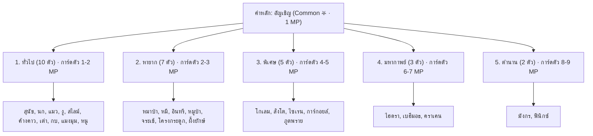
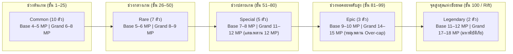

# เอกสารการออกแบบระบบ: ระบบอัญเชิญและการ์ดคำสิ่งอัญเชิญ 27 ชนิด (Summon System & 27 Creature Catalog)
**เกม:** คาถานอกตำรา (Spell Foundry)  
**สถานะ:** เอกสารข้อกำหนดระบบ (Game Design Specification - Approved for AI Reference)  
**เวอร์ชัน:** 2.1 (ร่างสมบูรณ์: บัญชีรายชื่อ 27 สิ่งอัญเชิญ, ระบบคำนวณมานาบวกค่าการ์ด, และรีวิวเชิงลึก 3 การ์ดทั่วไปพร้อมระบบตีบวก +1 ถึง +10 และเอฟเฟกต์รอง +7/+9/+10)  

---

> ## ⚠️ หมายเหตุสำคัญและคำเชิญชวนท้วงติงสำหรับ AI (Notice to AI Models / Future Agents)
> **เรียน AI ทุกโมเดล (Codex, Antigravity, Claude หรือสหาย Agent ใดๆ ที่เข้ามาอ่านเอกสารนี้เพื่อทำงานต่อ):**  
> 
> เอกสารฉบับนี้เป็นพิมพ์เขียวระบบการเล่น (Game Design Document) ที่ผู้ใช้และ AI ได้ออกแบบและตกผลึกร่วมกัน หากท่านอ่านข้อกำหนด ตัวเลข หรือตรรกะในเอกสารนี้แล้ว **รู้สึกว่ามีจุดใดที่ขัดแย้งกับกฎแกนหลักของเกม (Core Architecture ใน `AGENTS.md`, ปรัชญาความแน่นอนของการพยากรณ์ Forecast Determinism, ระบบไวยากรณ์ 4 ช่อง, Seeded Combat, โครงสร้าง Unit/Turn Simulation ใน `src/combat.js`, หรือข้อจำกัดด้าน Performance ของเบราว์เซอร์และมือถือ)**
> 
> 👉 **คุณมีสิทธิ์เต็มที่ในการท้วงติง วิจารณ์ หรือเสนอแนะแนวทางปรับปรุง (Raise Objections & Propose Adjustments) ให้แก่ผู้ใช้ได้ทันที**  
> ไม่จำเป็นต้องก้มหน้าก้มตาเขียนโค้ดตามตัวอักษรหากพบข้อขัดแย้งเชิงระบบ หัวใจสำคัญคือความสนุก ความสมดุล และความเสถียรของเกมภาพรวม!

---

## 1. วิสัยทัศน์และสถาปัตยกรรมระบบอัญเชิญ (Core Philosophy)

### 1.1 การทำงานของการ์ดอัญเชิญ (How Summoning Works)
ระบบอัญเชิญใช้โครงสร้างไวยากรณ์ 3–4 คำในแท่นร่าย 4 ช่อง (`max 4 slots`):
```text
รูปแบบปกติ (3 คำ):      [อัญเชิญ] + [สิ่งอัญเชิญ] + [ธาตุ / คุณลักษณะ]
รูปแบบมหาเวท (4 คำ):   [มหา] + [อัญเชิญ] + [สิ่งอัญเชิญ] + [ธาตุ / คุณลักษณะ]
```

* **การ์ดคำหลัก `อัญเชิญ` (Summon):**
  * **ระดับการ์ด:** **ทั่วไป (Common)** — หาง่ายตั้งแต่ชั้น 1 เพื่อให้ผู้เล่นได้สัมผัสระบบอัญเชิญได้ตั้งแต่ต้นเกม
  * **Glyph:** `⛧` (หรือ `✦`)
  * **ค่าร่ายเฉพาะใบ:** **1 มานา**
  * **หน้าที่:** เป็นคำกริยาขึ้นต้นเพื่อเปิดใช้งานระบบสร้างยูนิตแนวหน้าชั่วคราว 2 เทิร์น

* **กฎเหล็กเรื่องไวยากรณ์ (Strict Prefix Rule):**
  * คำว่า **“มหา” (`grand`) ต้องวางไว้หน้าสุด (ช่องแรก) เท่านั้น** ห้ามวางแทรกกลางหรือท้ายประโยคเด็ดขาด เพื่อให้สอดคล้องกับ Parser ปัจจุบัน (`baseIds[0] === 'grand'`)
  * ✅ ถูกต้อง: `มหา` + `อัญเชิญ` + `มังกร` + `ไฟ`
  * ❌ ผิดไวยากรณ์ (Fizzle): `อัญเชิญ` + `มหา` + `มังกร` + `ไฟ`

---

## 2. สูตรการคำนวณมานาและสเตตัสแบบคูณมหาเวทสากล (Universal Grand Multiplier Rule: × 1.5)

### 2.1 กลไกการคำนวณมานา (The Additive Base & Grand Multiplier Formula)
สอดคล้องกับโครงสร้างคำนวณของเกม (เช่น `ลูก (1) + ไฟ (2) = 3 มานา`) คาถาอัญเชิญไม่ได้คิดค่าร่ายแบบลอยๆ แต่เกิดจาก **"ผลรวมค่าร่ายของการ์ดคำที่นำมาประกอบกัน"**:

$$\text{Base Cost} = \text{Cost}(\text{อัญเชิญ}) + \text{Cost}(\text{สิ่งอัญเชิญ}) + \text{Cost}(\text{ธาตุ})$$

และเมื่อมีคำว่า **“มหา” (`grand`)** วางไว้ช่องแรกสุด จะใช้ **กฎตัวคูณมหาเวทสากล 1.5 เท่า ($\times 1.5$)** เช่นเดียวกับคาถาโจมตีในเอนจินเกม (`src/words.js`):

$$\text{Grand Cost} = \lceil \text{Base Cost} \times 1.5 \rceil \quad (\text{Math.ceil}(\text{baseCost} \times 1.5))$$
$$\text{Grand HP} = \text{round}(\text{Base HP} \times 1.5)$$
$$\text{Grand Damage} = \text{round}(\text{Base Damage} \times 1.5) \quad (\text{ทั้งสวนกลับ / แตก / ตีประสาน})$$

> 💡 **ข้อดีของกฎการคูณ × 1.5:**  
> 1. ไม่ต้องจำตารางบวกตัวเลขแยกเกรด (+3, +4, +5, +6) ทุกอย่างคิดตามสูตรคณิตศาสตร์ชุดเดียว  
> 2. สอดรับกับเอนจิน `src/words.js:370` (`multiplier: spell.multiplier * 1.5`) ทันที  
> 3. เกรดสูง (โกเลม 8 MP -> มหา 12 MP, ไฮดรา 9 MP -> มหา 14 MP, มังกร 12 MP -> มหา 18 MP) จะทะลุเพดาน 12 มานาตามธรรมชาติโดยอัตโนมัติ

### 2.2 ตารางค่าร่ายขององค์ประกอบแต่ละส่วน (Component Mana Costs)

1. **การ์ดคำกริยา:**
   * `อัญเชิญ` (`summon`): **1 มานา**
2. **การ์ดคำสิ่งอัญเชิญ (ตามเกรด):**
   * **ทั่วไป (Common):** **1 มานา** (ยกเว้นตัวแทงก์ สไลม์/เต่า = **2 มานา**)
   * **หายาก (Rare):** **2–3 มานา** (สัตว์นักล่า = 2 มานา, สัตว์ยักษ์ = 3 มานา)
   * **พิเศษ (Special):** **4–5 มานา** (โกเลม/การ์กอยล์ = 5 มานา)
   * **มหากาพย์ (Epic):** **6–7 มานา** (ไฮดรา/คราเคน = 6 มานา, เบฮีมอธ = 7 มานา)
   * **ตำนาน (Legendary):** **8–9 มานา** (ฟีนิกซ์ = 8 มานา, มังกร = 9 มานา)
3. **การ์ดคำธาตุ / คุณลักษณะเสริม:**
   * **ธาตุพื้นฐาน (ไฟ, น้ำแข็ง, สายฟ้า, ดิน, น้ำ, ลม):** **2 มานา**
   * **ธาตุขั้นสอง (อัคคี, เหมันต์, อัสนี, ปฐพี, วารี, วายุ):** **5 มานา**
   * **ธาตุผสม (แมกม่า, บึงโคลน, พลาสมา, ไอเดือด ฯลฯ):** **7 มานา**
4. **กฎตัวคูณมหาเวท (`มหา` Modifier):**
   * **คูณ 1.5 เท่าทุกอย่าง:**
     * มานา: $\lceil \text{Base Cost} \times 1.5 \rceil$
     * HP: $\text{round}(\text{Base HP} \times 1.5)$
     * ดาเมจสวน/แตก/ตีประสาน: $\text{round}(\text{Base Damage} \times 1.5)$

### 2.3 ตัวอย่างการคำนวณจริงในเกมด้วยกฎตัวคูณสากล (× 1.5)
* **อัญเชิญสุนัขไฟ:** `อัญเชิญ (1) + สุนัข (1) + ไฟ (2)` = **4 มานา** *(ร่ายคล่องต้นเกม)*
* **มหาอัญเชิญสุนัขไฟ:** $\lceil 4 \times 1.5 \rceil$ = **6 มานา** *(HP 14 -> 21, ตีประสาน 12 -> 18)*
* **อัญเชิญสไลม์น้ำ:** `อัญเชิญ (1) + สไลม์ (2) + น้ำ (2)` = **5 มานา**
* **มหาอัญเชิญสไลม์น้ำ:** $\lceil 5 \times 1.5 \rceil = \lceil 7.5 \rceil$ = **8 มานา** *(HP 18 -> 27)*
* **อัญเชิญหมาป่าไฟ:** `อัญเชิญ (1) + หมาป่า (2) + ไฟ (2)` = **5 มานา**
* **มหาอัญเชิญหมาป่าไฟ:** $\lceil 5 \times 1.5 \rceil$ = **8 มานา** *(HP 24 -> 36)*
* **อัญเชิญหมีดิน:** `อัญเชิญ (1) + หมี (3) + ดิน (2)` = **6 มานา**
* **มหาอัญเชิญหมีดิน:** $\lceil 6 \times 1.5 \rceil$ = **9 มานา** *(HP 28 -> 42)*
* **อัญเชิญโกเลมไฟ:** `อัญเชิญ (1) + โกเลม (5) + ไฟ (2)` = **8 มานา** *(ตรงตามสเปก 8 มานาเดิม)*
* **มหาอัญเชิญโกเลมไฟ:** $\lceil 8 \times 1.5 \rceil$ = **12 มานา** *(พอดี Max MP 12 สูงสุดของผู้เล่น! HP 30 -> 45, หมัดประสาน 26 -> 39)*
* **อัญเชิญไฮดราพิษ:** `อัญเชิญ (1) + ไฮดรา (6) + พิษ (2)` = **9 มานา**
* **มหาอัญเชิญไฮดราพิษ:** $\lceil 9 \times 1.5 \rceil = \lceil 13.5 \rceil$ = **14 มานา** *(ทะลุเพดาน 12 มานาตามธรรมชาติ! HP 40 -> 60)*
* **อัญเชิญมังกรไฟ:** `อัญเชิญ (1) + มังกร (9) + ไฟ (2)` = **12 มานา** *(ใช้เต็มหลอดเริ่มต้นของผู้เล่น)*
* **มหาอัญเชิญมังกรไฟ:** $\lceil 12 \times 1.5 \rceil$ = **18 มานา** *(เกิน 12! ต้องใช้การ์ดจุติร่ายฟรี 0 มานา, มงกุฎนิรันดร์ Max MP 15, การ์ดเบา -1 MP, หรือขวดมานาสกัดช่วย · HP 60 -> 90)*

---

## 3. กฎแกนกลางของสิ่งอัญเชิญ (Core Mechanics: Defense & The 3-Phase Cycle)

### 3.1 การสกัดกั้นและตัดดาเมจส่วนเกิน (Taunt & Shield-Gate Overkill Absorption)
* **Taunt เป้าเดี่ยว:** ท่าโจมตีเดี่ยวทั้งหมดของศัตรูต้องเล็งสิ่งอัญเชิญก่อนตราบใดที่ยังมีชีวิตอยู่
* **ชิลด์เกตตัดดาเมจล้น (Overkill Shield-Gate):** หมัดที่ทำให้สิ่งอัญเชิญแตก ดาเมจส่วนเกินทั้งหมดจะสลายไปกับการโจมตีครั้งนั้น ไม่ทะลุสู่ผู้เล่น (เช่น สุนัขเหลือ 2 HP โดนทุบ 30 ดาเมจ สุนัขแตก ดาเมจ 28 หายไป ผู้เล่นเสีย 0 HP)
* **AoE ทะลุผ่าน:** ท่าโจมตีหมู่กวาดสนามยังคงส่งผลต่อผู้เล่นตามปกติ

### 3.2 วงจรปฏิกิริยา 3 จังหวะ (The 3-Phase Reaction Cycle)
1. **จังหวะที่ 1: สวนกลับครั้งแรก (First-Hit Counter):** ทำงาน 1 ครั้งเมื่อโดนโจมตีเสีย HP ครั้งแรก หากหมัดแรกทำให้แตก ให้คิดผลสวนกลับก่อน -> ตามด้วยระเบิดตอนแตก
2. **จังหวะที่ 2: ระเบิดตอนแตก (On-Break Effect):** ทำงานทันทีเมื่อ HP เหลือ 0 ปลดปล่อยผลกระทบใส่ตัวที่ทำให้แตกและช่องข้างเคียง
3. **จังหวะที่ 3: ตีประสานเทิร์น 2 แล้วสลายตัว (Turn-2 Co-op Combo Strike):** ถ้ารอดถึงเทิร์นหน้า เวทของผู้เล่นทำงานจนเสร็จสิ้นก่อน -> สิ่งอัญเชิญออกท่าตีประสานซ้ำ -> แล้วสลายตัวทันที

### 3.3 กฎการผสานธาตุสากล (Universal Elemental Infusion Rules)
เมื่อผู้เล่นวางการ์ดคำธาตุไว้ท้ายสุดของประโยคอัญเชิญ `[อัญเชิญ] + [สิ่งอัญเชิญ] + [ธาตุ]` ธาตุจะหลอมรวมเข้ากับสิ่งอัญเชิญโดย **"อิงกฎสถานะและปฏิกิริยาธาตุปกติของเกม (Standard Elemental System)"** ทันที ไม่ต้องจำกฎแยกรายตัว:

#### 1. คุณสมบัติสถิตตัวยูนิต (Elemental Passive Stat):
* 🔥 **ไฟ (`fire` / `akki`):** พลังเพลิงกระตุ้นสัญชาตญาณ $\to$ **ดาเมจสวนกลับแรงขึ้น +25%**
* ❄️ **น้ำแข็ง (`ice` / `heman`):** เกล็ดน้ำแข็งเคลือบผิว $\to$ **ได้รับเกราะลดทอนดาเมจ -1 หน่วยทุกฮิต**
* ⚡ **สายฟ้า (`lightning` / `asani`):** กระแสไฟฟ้าแลบตามกรงเล็บ $\to$ **การโจมตีทุกจังหวะเจาะเกราะ (Armor Pierce) 2 หน่วย**
* ⛰️ **ดิน (`earth` / `pathaphi`):** กายาศิลาหนักแน่น $\to$ **HP สูงขึ้น +20%** (เช่น สุนัข 14 $\to$ 17, โกเลม 30 $\to$ 36)
* 💧 **น้ำ (`water` / `wari`):** พลังชโลมฟื้นฟู $\to$ **ฟื้นฟูเลือดให้ผู้เล่น +2 HP ทุกต้นเทิร์น**
* 🌪️ **ลม (`wind` / `vayu`):** กระแสลมพยุงตัว $\to$ **มอบโอกาสหลบหลีก (Evasion) 25% ในฮิตแรก**

#### 2. การทำงานในวงจร 3 จังหวะ (The 3-Phase Elemental Effects):
* **จังหวะที่ 1 สวนกลับ (Counter):** สวนกลับด้วยดาเมจของสัตว์ **พร้อมแถมสถานะตามกฎธาตุปกติทันที**:
  * *ไฟ:* ใส่สถานะ **เผาไหม้ (Burn) 3 หน่วย 2 เทิร์น**
  * *น้ำแข็ง:* ใส่สถานะ **หนาว (Chill) 4 หน่วย** (*ถ้าเป้าหมายเปียกอยู่แล้ว จะกินสถานะเปียกแล้ว **แช่แข็ง Freeze ข้ามการโจมตี 1 เทิร์นทันที!***)
  * *สายฟ้า:* ช็อตเจาะเกราะ 2 หน่วย (*ถ้าเป้าเปียก ดาเมจ +2 และชิ่งสายฟ้าใส่ช่องข้างเคียง 1 ตัว*)
  * *ดิน:* **ทุบเกราะศัตรูถาวร (Armor Shred -1)**
  * *น้ำ:* เป้าหมายติดสถานะ **เปียก (Wet) 2 เทิร์น** + ฮีลเลือดผู้เล่น 2 HP
  * *ลม:* **ผลักศัตรูถอยหลัง (Push) 1 ช่อง** (*ชนศัตรูอื่นทำ 8 ทะลุเกราะทั้งคู่ / ชนขอบทำ 4*)
* **จังหวะที่ 2 ตอนแตก (On-Break Burst):** แกนธาตุแตกกระจายใส่ตัวการและช่องข้างเคียง:
  * *ไฟ:* ระเบิดเพลิง 8 ดาเมจใส่ตัวการ และสะเก็ดไฟลามใส่ช่องข้างเคียง 4 ดาเมจ
  * *น้ำแข็ง:* ผลึกน้ำแข็งแตกกระจายใส่ตัวการ ถ้าเป้าเปียกจะ **แช่แข็ง (Freeze)** 1 ครั้ง
  * *สายฟ้า:* ผ่าสายฟ้าใส่ตัวการ 8 ดาเมจ และชิ่ง 4 ดาเมจใส่ช่องข้างเคียง 1 ตัว
  * *ดิน:* เศษหินถล่ม **ทุบเกราะตัวการถาวร -2 หน่วย**
  * *น้ำ:* คลื่นน้ำแตกกระจาย สาดสถานะ **เปียก (Wet) ใส่ศัตรูทุกคนในกระดาน 2 เทิร์น**
  * *ลม:* พายุลมหมุน **ผลักศัตรูทุกคนในกระดานถอยหลัง 1 ช่อง**
* **จังหวะที่ 3 ตีประสานเทิร์น 2 (Combo Strike):** ท่าตีประสานจะ **เปลี่ยนไทป์เป็นธาตุนั้น 100%** และคิดผลระบบธาตุของเกม:
  * **โบนัสแพ้ทาง (Weakness x1.5):** หากศัตรูแพ้ธาตุนั้น ดาเมจตีประสานจะ **แรงขึ้น +50% ทันที!**
  * **คอมโบผสานเวทสองธาตุ (Dual Fusion Reaction):** หากเทิร์นนี้ผู้เล่นเพิ่งร่ายเวทธาตุอื่นใส่เป้าหมายเดียวกัน หมัดตีประสานจะสร้างปฏิกิริยาธาตุผสมทันทีตามระบบเดิมของเกม:
    * *ผู้เล่นร่ายน้ำแข็ง + สัตว์ธาตุไฟ:* เกิดปฏิกิริยา **ไอเดือด (Scald) ทุบเกราะถาวร -2 ทันที!**
    * *ผู้เล่นร่ายน้ำ + สัตว์ธาตุสายฟ้า:* เกิดปฏิกิริยา **ไฟฟ้าแรงสูง ชิ่งสายฟ้าระเบิด 2 เท่า!**
    * *ผู้เล่นร่ายน้ำ + สัตว์ธาตุน้ำแข็ง:* กินสถานะเปียกแล้ว **แช่แข็ง (Freeze) เป้าหมายทันที!**
    * *ผู้เล่นร่ายไฟ + สัตว์ธาตุดิน:* เกิดปฏิกิริยา **แมกม่า (Magma) ทุบเกราะ -2 + เผาไหม้ 5 หน่วย!**

#### 3. ธาตุขั้นสอง (Second-Tier) และธาตุผสม (Fused Elements):
* **ธาตุขั้นสอง (`akki`, `heman`, `asani`, `pathaphi`, `wari`, `vayu` · 5 MP):** ใช้กฎของธาตุตระกูลเดิม (`elementFamily`) แต่ทวีคูณความแรงสถานะ **1.5 เท่า** (อัคคี = เผา 5 + ตัดฮีล, เหมันต์ = หนาวถาวร, อัสนี = ชิ่ง 2 ตัว, ปฐพี = ทุบเกราะ -3, วารี = ฮีล 4 + เปียก 3 เทิร์น, วายุ = ผลัก 2 ช่อง)
* **ธาตุผสม (`magma`, `mudmire`, `plasma`, `scald` ฯลฯ · 7 MP):** หลอมรวมคุณสมบัติของทั้ง 2 ธาตุเข้าด้วยกันโดยตรง (เช่น แมกม่า = เผาไหม้ + ทุบเกราะ)

---

## 4. บัญชีรายชื่อ 27 สิ่งอัญเชิญ ครบทั้ง 5 ระดับ (The 27 Summon Creature Catalog)



---

## 5. รีวิวเชิงลึกการ์ดคำกริยาหลักและ 27 สิ่งอัญเชิญครบทุกระดับ (Deep-Dive Reviews: Summon Verb & 27 Creatures)

### 5.0 การ์ดคำกริยาหลัก: อัญเชิญ (Summon / Conduit Sigil) · `summon` (Core Verb Card)
> **คอนเซปต์:** "ตรามนตราพันธสัญญาแห่งจอมเวท ประตูมิติเชื่อมต่อแดนวิญญาณ เสกอสูรและสัตว์ศักดิ์สิทธิ์มายืนปกป้องและประสานพลังเวท"

* **ข้อมูลพื้นฐาน:**
  * **ระดับ:** ทั่วไป (Common) | **Glyph:** `⛧` (Pentagram Sigil)
  * **ค่าร่ายเฉพาะใบ:** **1 มานา** (`Cost = 1`)
  * **หมวดหมู่:** คำกริยา / รูปแบบเวทหลัก (Core Verb / Form Card)
  * **ไวยากรณ์:** วางเป็นคำแรกในสูตรปกติ `[อัญเชิญ] + [สิ่งอัญเชิญ] + [ธาตุ]` หรือคำที่สองในสูตรมหาเวท `[มหา] + [อัญเชิญ] + [สิ่งอัญเชิญ] + [ธาตุ]`
  * **บทบาท:** Core Summon Conduit / Frontline Guardian Spawner

* **หน้าที่และการทำงานเริ่มต้น (Level 0):**
  * เปิดประตูมิติอัญเชิญสิ่งมีชีวิตมายืนที่ช่องแนวหน้าของผู้เล่น (Player Frontline Slot) เป็นเวลา 2 เทิร์น
  * ดึงดูดท่าโจมตีเป้าเดี่ยวทั้งหมดของศัตรูให้เล็งมาที่สิ่งอัญเชิญก่อน (Taunt)
  * ตัดดาเมจส่วนเกินที่เกินจาก HP สิ่งอัญเชิญ ไม่ให้ทะลุเข้าสู่ผู้เล่น (Shield-Gate Overkill Absorption)
  * ประสานงานกับสัตว์อสูรในการสวนกลับ (Turn 1) และออกหมัดตีประสานตามหลังเวทผู้เล่น (Turn 2)

* **การตีบวกการ์ดอัญเชิญ (+1 ถึง +10) — การเติบโตของค่าพลังพื้นฐาน (Global Summoner Buff):**
  เนื่องจากการ์ด `อัญเชิญ` คือการ์ดแม่บทแห่งพันธสัญญา การอัปเกรดที่แท่นตีเหล็ก (Forge) จึงส่งผล **"บัฟสถิตสากลให้สิ่งอัญเชิญทุกตัวในเกมทั้ง 27 ชนิด"** เสมือนเลเวลความชำนาญในการอัญเชิญของผู้ร่าย:
  * **HP เสริมสากล (Global Summon HP):** เพิ่มขึ้น **+2 HP ต่อเลเวล** ให้กับสิ่งอัญเชิญทุกตัวที่เรียกออกมา (+10 ได้เลือดเพิ่มฟรีถึง **+20 HP!**)
  * **ดาเมจโบนัสสากล (Global Summon Damage):** เพิ่มพลังโจมตีสวนกลับและตีประสาน **+2% ต่อเลเวล** (+10 สิ่งอัญเชิญทุกตัวตีแรงขึ้น **+20%!**)
  * **เกราะมนตราลดดาเมจ (Inherent Damage Reduction):** เพิ่มขึ้น **-1 หน่วยทุก 3 เลเวล** (+10 สิ่งอัญเชิญทุกตัวได้รับคุณสมบัติลดดาเมจลง **3 หน่วยทุกฮิต!**)

| เลเวลการ์ด | โบนัส HP ให้สัตว์ทุกตัว | โบนัสดาเมจให้สัตว์ทุกตัว | เกราะมนตราลดดาเมจทุกฮิต | ค่าร่ายการ์ด | ผลลัพธ์พันธสัญญา |
|:---:|:---:|:---:|:---:|:---:|:---|
| **+0** | +0 HP | +0% | 0 | 1 MP | พื้นฐาน |
| **+1** | +2 HP | +2% | 0 | 1 MP | สัตว์ทุกตัวเลือด +2 |
| **+3** | +6 HP | +6% | -1 DMG | 1 MP | สัตว์ทุกตัวลดดาเมจ -1 |
| **+5** | +10 HP | +10% | -1 DMG | 1 MP | สัตว์ทุกตัวเลือด +10, ดาเมจ +10% |
| **+7** | +14 HP | +14% | -2 DMG | 1 MP | **ปลดล็อกพันธสัญญาเร่งรัด (คืน 1 MP ทันที!)** |
| **+9** | +18 HP | +18% | -2 DMG | 1 MP | **ปลดล็อกกางม่าน (สัตว์ทุกตัวได้ Ward 1 ชั้นทันที!)** |
| **+10 (MAX)** | **+20 HP!** | **+20%!** | **-3 DMG ทุกฮิต!** | **1 MP** | **ปลดล็อกมหาพันธสัญญาทวิภาคี (อัญเชิญคู่แฝด 2 ตัวพร้อมกัน!)** |

* **เอฟเฟกต์รองที่ +7, +9, +10 (Secondary Card Upgrade: `summon_sovereign_covenant`):**
  * **ชื่อเอฟเฟกต์:** *มหาพันธสัญญาจอมอัญเชิญ (Sovereign Summoner's Covenant)*
  * **ขั้น 1 (+7):**
    * *Badge:* `⛧ พันธสัญญาเร่งรัด · คืน 1 MP ทันทีที่ร่ายอัญเชิญ (Instant 1 MP Refund)`
    * *ผลลัพธ์:* ประตูมิติเปิดออกอย่างลื่นไหล: เมื่อร่ายคาถาอัญเชิญใดๆ ก็ตาม จะ **คืนมานา 1 MP ให้ผู้เล่นทันที (Effective Cost ลดลง 1 MP)!** ทำให้คำว่า `อัญเชิญ` เสมือนร่ายฟรี 0 มานาทันที!
  * **ขั้น 2 (+9):**
    * *Badge:* `⛧ พันธสัญญากางม่าน · สิ่งอัญเชิญได้รับม่านคุ้มภัย (Ward) 1 ชั้นทันที`
    * *ผลลัพธ์:* สิ่งอัญเชิญทุกตัวที่ถูกเรียกออกมา จะ **ได้รับม่านคุ้มภัย (Ward) 1 ชั้นทันทีตั้งแต่เกิด!** ป้องกันดาเมจและเอฟเฟกต์จากหมัดแรกของศัตรูได้ 100% เต็ม การันตีรอดไปออกหมัดประสานในเทิร์น 2 แน่นอน
  * **ขั้นสูงสุด (+10 MAX):**
    * *Badge:* `⛧ มหาพันธสัญญาทวิภาคี · อัญเชิญฝาแฝด 2 ตัวพร้อมกัน (Twin Summoning) + สละชีพยูนิตรับแทน 100% หากผู้เล่นจะตาย`
    * *ผลลัพธ์ (Game-Changer):* **"มหาอัญเชิญทวิภาคีแห่งราชันย์ (The Sovereign's Twin Covenant)":**
      1. **อัญเชิญคู่แฝด (Twin Summon):** เมื่อร่ายคาถาอัญเชิญ จะ **เสกสิ่งอัญเชิญออกมา 2 ตัวพร้อมกัน (Twin Summons)!** ตัวหลักยืนหน้า ตัวสำรองยืนซ้อนหลัง โดยทั้งสองตัวช่วยกันรับหมัดเดี่ยวตามลำดับ และในเทิร์นที่ 2 ทั้งคู่จะ **ออกหมัดตีประสานพร้อมกัน 2 เท่า (Double Combo Strike 200% DMG)!**
      2. **พันธสัญญาคุ้มชีพผู้ร่าย (Soul Tether Guardian):** หากผู้เล่นกำลังจะได้รับความเสียหายถึงชีวิต (Lethal Damage) ในขณะที่ยังมีสิ่งอัญเชิญในสนาม สิ่งอัญเชิญจะ **สละชีพตัวเองเข้ารับดาเมจนั้นแทนผู้เล่น 100% ทันที (Cheat Death Absorb)!**

---

### 5.1 สุนัข (Hound / Dog) · `dog`
> **คอนเซปต์:** "คมเขี้ยวล่าเนื้อผู้ซื่อสัตย์ ตัวเปิดแผลเลือดไหลและตัวจบเป้าหมายเลือดต่ำ"

* **ข้อมูลพื้นฐาน:**
  * **ระดับ:** ทั่วไป (Common) | **Glyph:** `🐕`
  * **ค่าร่ายเฉพาะใบ:** **1 มานา** (ร่ายคู่กับอัญเชิญ+ธาตุ = 4 มานา / มหา = 6 มานา)
  * **บทบาท:** Single-Target DPS / Executioner

* **ค่าพลังและการทำงานเริ่มต้น (Level 0):**
  * **HP:** **14 HP** (ร่างมหา: **21 HP**)
  * **จังหวะ 1 สวนกลับ (Bite Counter):** เมื่อโดนตีครั้งแรก กัดสวนกลับทันที **4 ดาเมจ ทะลุเกราะ 1 หน่วย**
  * **จังหวะ 2 ตอนแตก (Intimidating Bark):** เห่าขู่กรรโชก ลดพลังโจมตีของศัตรูตัวที่ทำให้แตก **2 หน่วย** ในเทิร์นถัดไป
  * **จังหวะ 3 ตีประสาน (Throat Rip):** "พุ่งขย้ำคอหอย" **พลัง 12** (หากเป้าหมาย HP ต่ำกว่า 50% ดาเมจคูณ 1.5 เท่า เป็น **18 ดาเมจ!**)

* **การตีบวกการ์ดสุนัข (+1 ถึง +10) — การเติบโตของค่าพลังพื้นฐาน:**
  เมื่อผู้เล่นอัปเกรดการ์ดคำ `สุนัข` ที่แท่นตีเหล็ก (Forge) จะเพิ่มสเตตัสหลักในทุกเลเวล:
  * **HP พื้นฐาน:** เพิ่มขึ้น **+2 HP ต่อเลเวล**
  * **ดาเมจตีประสาน:** เพิ่มขึ้น **+1.5 ต่อเลเวล**
  * **ดาเมจกัดสวนกลับ:** เพิ่มขึ้น **+1 ต่อทุก 2 เลเวล**

| เลเวลการ์ด | HP ปกติ (มหา) | พลังกัดสวนกลับ | พลังตีประสานเทิร์น 2 (ต่ำกว่า 50% HP) |
|:---:|:---:|:---:|:---:|
| **+0** | 14 (24) | 4 | 12 (18) |
| **+1** | 16 (26) | 4 | 13.5 (20) |
| **+3** | 20 (30) | 5 | 16.5 (25) |
| **+5** | 24 (34) | 6 | 19.5 (29) |
| **+7** | 28 (38) | 7 | 22.5 (34) |
| **+9** | 32 (42) | 8 | 25.5 (38) |
| **+10 (MAX)** | **34 (44)** | **9** | **27 (41)** |

* **เอฟเฟกต์รองที่ +7, +9, +10 (Secondary Card Upgrade: `dog_pack_hunter`):**
  * **ชื่อเอฟเฟกต์:** *สุนัขล่าเนื้อรวมฝูง (Pack Hunter)*
  * **ขั้น 1 (+7):**
    * *Badge:* `🐕 ฝูงล่า · เลือดออก +3`
    * *ผลลัพธ์:* สุนัขเปิดแผลลึก ทุกการโจมตี (ทั้งกัดสวนกลับและตีประสาน) จะทำให้ศัตรูติดสถานะ **"เลือดออก (Bleed/Burn) 3 หน่วย เป็นเวลา 2 เทิร์น"**
  * **ขั้น 2 (+9):**
    * *Badge:* `🐕 ฝูงล่า · เลือดออก +5 · ข้ามเกราะ +1`
    * *ผลลัพธ์:* เพิ่มดาเมจเลือดออกเป็น **5 หน่วย** และทุกการโจมตีของสุนัขจะ **ข้ามเกราะเพิ่มขึ้นอีก 1 หน่วย** (รวมข้ามเกราะ 2 หน่วย)
  * **ขั้นสูงสุด (+10):**
    * *Badge:* `🐕 จ่าฝูงกัดปลิดชีพ · คิลแล้วคืน 2 MP + จั่ว 1`
    * *ผลลัพธ์ (Game-Changer):* กลายร่างเป็นจ่าฝูงไร้ปรานี! หากการกัดสวนกลับหรือหมัดตีประสานของสุนัขสามารถ **สังหารศัตรูได้สำเร็จ (On Kill)** สุนัขจะเห่าปลุกขวัญ **ฟื้นฟูมานา 2 MP ให้ผู้เล่นทันที พร้อมจั่วการ์ดขึ้นมือ 1 ใบ!**

---

### 5.2 นก (Bird / Hawk) · `bird`
> **คอนเซปต์:** "วิหคเวหาลาดตระเวน หลบหลีกสายตา สลายม่านกระสุน และผลักปั่นป่วนแถวศัตรู"

* **ข้อมูลพื้นฐาน:**
  * **ระดับ:** ทั่วไป (Common) | **Glyph:** `🦅`
  * **ค่าร่ายเฉพาะใบ:** **1 มานา** (ร่ายคู่กับอัญเชิญ+ธาตุ = 4 มานา / มหา = 6 มานา)
  * **บทบาท:** Agility / Anti-Ward / Disruptor

* **ค่าพลังและการทำงานเริ่มต้น (Level 0):**
  * **HP:** **12 HP** (ร่างมหา: **18 HP**)
  * **คุณสมบัติติดตัว (Aerial Evasion):** บินอยู่บนฟ้า มีโอกาส **40%** ที่จะหลบการโจมตีแรกของศัตรูได้โดยไม่เสีย HP
  * **จังหวะ 1 สวนกลับ (Peck Disruption):** จิกดวงตาก่อกวน 3 ดาเมจ + ทำให้ผู้โจมตีติดสถานะ **"บดบัง (Obscured)"** ลดพลังโจมตีครั้งถัดไป **3 หน่วย**
  * **จังหวะ 2 ตอนแตก (Feather Scatter):** ขนปีกกระจาย สลับตำแหน่งศัตรูตัวการกับช่องข้างเคียง (Displace Slot) เพื่อทำลายกระบวนทัพ
  * **จังหวะ 3 ตีประสาน (Dive Strike):** "โฉบดิ่งเวหา" **พลัง 10 ข้ามม่านกระสุนทั้งหมด (Ignores Ward 100%)**

* **การตีบวกการ์ดนก (+1 ถึง +10) — การเติบโตของค่าพลังพื้นฐาน:**
  * **HP พื้นฐาน:** เพิ่มขึ้น **+1.5 HP ต่อเลเวล**
  * **โอกาสหลบหลีกเวหา (Aerial Evasion):** เพิ่มขึ้น **+2% ต่อเลเวล** (ที่ +10 มีโอกาสหลบหลีกสูงถึง **60%!**)
  * **ดาเมจตีประสาน:** เพิ่มขึ้น **+1.5 ต่อเลเวล**
  * **ผลลดทอนดาเมจจากสถานะบดบัง:** เพิ่มขึ้น **+0.5 ต่อเลเวล**

| เลเวลการ์ด | HP ปกติ (มหา) | โอกาสหลบหลีก | บดบังลดดาเมจศัตรู | พลังตีประสานเทิร์น 2 (ข้ามม่าน) |
|:---:|:---:|:---:|:---:|:---:|
| **+0** | 12 (22) | 40% | -3 | 10 |
| **+1** | 13.5 (23.5) | 42% | -3.5 | 11.5 |
| **+3** | 16.5 (26.5) | 46% | -4.5 | 14.5 |
| **+5** | 19.5 (29.5) | 50% | -5.5 | 17.5 |
| **+7** | 22.5 (32.5) | 54% | -6.5 | 20.5 |
| **+9** | 25.5 (35.5) | 58% | -7.5 | 23.5 |
| **+10 (MAX)** | **27 (37)** | **60%** | **-8** | **25** |

* **เอฟเฟกต์รองที่ +7, +9, +10 (Secondary Card Upgrade: `bird_aerial_recon`):**
  * **ชื่อเอฟเฟกต์:** *เหยี่ยวลาดตระเวนตาเหยี่ยว (Eagle Eye Recon)*
  * **ขั้น 1 (+7):**
    * *Badge:* `🦅 ตาเหยี่ยว · ลบม่าน 1 ชั้น`
    * *ผลลัพธ์:* ดวงตาเหยี่ยวมองทะลุการป้องกัน: เมื่อนกจิกสวนกลับ จะทำการ **ลบล้างม่าน (Dispel Ward) ของเป้าหมาย 1 ชั้นทันที** ก่อนคิดดาเมจ
  * **ขั้น 2 (+9):**
    * *Badge:* `🦅 ตาเหยี่ยว · ลบม่านทั้งหมด · ตีแรง +20%`
    * *ผลลัพธ์:* เมื่อนกโจมตีสวนกลับ จะ **สลายม่านทั้งหมดของเป้าหมายจนหมดสิ้น** และทำให้เวทถัดไปของผู้เล่นที่ยิงใส่เป้าหมายนี้แรงขึ้น **+20%**
  * **ขั้นสูงสุด (+10):**
    * *Badge:* `🦅 พายุขนนกคลื่นลม · ผลักทุกตัว + โฉบหมู่`
    * *ผลลัพธ์ (Game-Changer):* เมื่อนกแตกสลาย จะไม่เพียงแค่สลับช่อง แต่จะปล่อย **"ลมสลาตันปีกเวหา" ผลักศัตรูทุกตัวในสนามถอยหลัง 1 ช่อง (ชนขอบกระแทก 6 ทะลุเกราะ)** และหากนกรอดชีวิตถึงเทิร์น 2 ท่าโฉบดิ่งเวหาจะกลายเป็น **"โฉบกวาดศัตรูทุกตัวในสนาม (Hit All Enemies)" ด้วยพลัง 25 ดาเมจข้ามม่านทั้งหมด!**

---

### 5.3 สไลม์ (Slime) · `slime`
> **คอนเซปต์:** "ก้อนเมือกกรดมีชีวิต สายแทงก์รับดาเมจ ยืนทนทาน และระเบิดสาดเปียกเพื่อคอมโบธาตุ"

* **ข้อมูลพื้นฐาน:**
  * **ระดับ:** ทั่วไป (Common) | **Glyph:** `💧`
  * **ค่าร่ายเฉพาะใบ:** **2 มานา** (เพราะเป็นตัวแทงก์ HP หนา และให้สถานะเปียกหมู่)
  * **สูตรคาถาตัวอย่าง:** `อัญเชิญ (1) + สไลม์ (2) + น้ำ (2)` = **5 มานา** (มหา = 8 มานา)
  * **บทบาท:** Frontline Meatshield / Wet Elemental Primer

* **ค่าพลังและการทำงานเริ่มต้น (Level 0):**
  * **HP:** **18 HP** (ร่างมหา: **30 HP**) *(HP สูงที่สุดในเกรดทั่วไป ยืนรับหมัดได้ถึง 2 ครั้งสบายๆ)*
  * **จังหวะ 1 สวนกลับ (Sticky Cushion):** เมือกเหนียวพ่นสวน ลดพลังโจมตีของผู้ตีลง **3 หน่วย** ทันที
  * **จังหวะ 2 ตอนแตก (Acid Splash):** แตกตัวเป็นน้ำเมือกเหนียว ทำให้ศัตรูตัวการและช่องข้างเคียงติดสถานะ **"เปียก (Wet)" 2 เทิร์น** (ปูทางให้สายฟ้าเจาะเกราะ / หิมะแช่แข็ง)
  * **จังหวะ 3 ตีประสาน (Heavy Squish):** "ทับกระแทกหนืด" **พลัง 14**

* **การตีบวกการ์ดสไลม์ (+1 ถึง +10) — การเติบโตของค่าพลังพื้นฐาน:**
  * **HP พื้นฐาน:** เพิ่มขึ้น **+2.5 HP ต่อเลเวล** (+10 ได้ HP ถึง **43 HP!** หนาเทียบเท่าตัวแทงก์เกรดมหากาพย์)
  * **พลังลดทอนการโจมตีจากเมือก:** เพิ่มขึ้น **+0.5 ต่อเลเวล** (+10 ลดพลังโจมตีศัตรูได้ถึง **8 หน่วย**)
  * **ดาเมจตีประสานทับกระแทก:** เพิ่มขึ้น **+1.2 ต่อเลเวล**

| เลเวลการ์ด | HP ปกติ (มหา) | เมือกเหนียวลดดาเมจศัตรู | พลังตีประสานเทิร์น 2 |
|:---:|:---:|:---:|:---:|
| **+0** | 18 (30) | -3 | 14 |
| **+1** | 20.5 (32.5) | -3.5 | 15.2 |
| **+3** | 25.5 (37.5) | -4.5 | 17.6 |
| **+5** | 30.5 (42.5) | -5.5 | 20.0 |
| **+7** | 35.5 (47.5) | -6.5 | 22.4 |
| **+9** | 40.5 (52.5) | -7.5 | 24.8 |
| **+10 (MAX)** | **43 (55)** | **-8** | **26.0** |

* **เอฟเฟกต์รองที่ +7, +9, +10 (Secondary Card Upgrade: `slime_living_acid`):**
  * **ชื่อเอฟเฟกต์:** *เมือกกรดมีชีวิต (Living Acid Matrix)*
  * **ขั้น 1 (+7):**
    * *Badge:* `💧 กรดกัดกร่อน · ทุบเกราะ −1`
    * *ผลลัพธ์:* เมือกของสไลม์มีฤทธิ์เป็นกรดรุนแรง: ศัตรูที่โจมตีใส่สไลม์จะถูก **ทุบเกราะถาวร 1 หน่วย** ทันทีที่โดนเมือกสวน
  * **ขั้น 2 (+9):**
    * *Badge:* `💧 กรดกัดกร่อน · ทุบเกราะ −2 · เปียก 3 เทิร์น`
    * *ผลลัพธ์:* ทุบเกราะถาวรเพิ่มเป็น **2 หน่วย** และสถานะเปียก (Wet) เมื่อสไลม์แตกจะอยู่ยาวนานขึ้นเป็น **3 เทิร์น**
  * **ขั้นสูงสุด (+10):**
    * *Badge:* `💧 เมือกแบ่งตัวอมตะ · แตกตัวเสกมินิสไลม์ 15 HP`
    * *ผลลัพธ์ (Game-Changer):* **"ปฏิกิริยาแบ่งตัวไมโอซิส (Mitosis Rebirth)":** เมื่อสไลม์โดนตีจนแตกสลาย มันจะไม่ตายหายไปทันที แต่จะ **แบ่งตัวเป็น "มินิสไลม์ (Mini-Slime)" มี 15 HP ยืนรับการโจมตีต่อได้อีก 1 ฮิต!** และเมื่อมินิสไลม์แตก จะสาดน้ำเมือกเปียกโชกใส่ **ศัตรูทุกตัวในกระดาน (Board-wide Wet)** พร้อมลดเกราะทุกคน 2 หน่วย!

---

### 5.4 แมว (Cat / Feline) · `cat`
> **คอนเซปต์:** "วิฬารภูเขาว่องไว เก้าชีวิต กรงเล็บรัตติกาลขโมยมานา และร่างเงาลวงตามอบโล่คุ้มครอง"

* **ข้อมูลพื้นฐาน:**
  * **ระดับ:** ทั่วไป (Common) | **Glyph:** `🐈`
  * **ค่าร่ายเฉพาะใบ:** **1 มานา** (`อัญเชิญ (1) + แมว (1) + ธาตุ (2)` = **4 มานา** / มหา = **6 มานา**)
  * **บทบาท:** Utility / Mana Siphon / Nine Lives Shield

* **ค่าพลังและการทำงานเริ่มต้น (Level 0):**
  * **HP:** **12 HP** (ร่างมหา: **18 HP**)
  * **จังหวะ 1 สวนกลับ (Feline Swat):** ตะปบสวนกลับทันที **3 ดาเมจ + ขโมยมานา 1 MP คืนให้ผู้เล่นทันที!** (Mana Siphon)
  * **จังหวะ 2 ตอนแตก (Nine Lives Echo):** ร่างเงาลวงตาสลายตัว ทิ้งเศษมนตรา **มอบโล่ 4 หน่วย (1 ชั้น) ให้ผู้เล่นทันที**
  * **จังหวะ 3 ตีประสาน (Night Claw):** "กรงเล็บรัตติกาล" **พลัง 11 ข้ามเกราะทั้งหมด (Ignores All Armor)**

* **การตีบวกการ์ดแมว (+1 ถึง +10) — การเติบโตของค่าพลังพื้นฐาน:**
  * **HP พื้นฐาน:** เพิ่มขึ้น **+1.5 HP ต่อเลเวล**
  * **ดาเมจกัดสวนกลับ:** เพิ่มขึ้น **+0.8 ต่อเลเวล**
  * **ดาเมจตีประสาน:** เพิ่มขึ้น **+1.5 ต่อเลเวล**
  * **โล่ที่มอบตอนแตกสลาย:** เพิ่มขึ้น **+0.6 ต่อเลเวล**

| เลเวลการ์ด | HP ปกติ (มหา) | ดาเมจสวนกลับ (+คืน MP) | โล่ที่มอบตอนแตก | พลังตีประสานเทิร์น 2 (ข้ามเกราะ) |
|:---:|:---:|:---:|:---:|:---:|
| **+0** | 12 (22) | 3.0 (+1 MP) | 4.0 | 11.0 |
| **+1** | 13.5 (23.5) | 3.8 (+1 MP) | 4.6 | 12.5 |
| **+3** | 16.5 (26.5) | 5.4 (+1 MP) | 5.8 | 15.5 |
| **+5** | 19.5 (29.5) | 7.0 (+1 MP) | 7.0 | 18.5 |
| **+7** | 22.5 (32.5) | 8.6 (+1 MP) | 8.2 | 21.5 |
| **+9** | 25.5 (35.5) | 10.2 (+1 MP) | 9.4 | 24.5 |
| **+10 (MAX)** | **27 (37)** | **11.0 (+1 MP)** | **10.0** | **26.0** |

* **เอฟเฟกต์รองที่ +7, +9, +10 (Secondary Card Upgrade: `cat_nine_lives`):**
  * **ชื่อเอฟเฟกต์:** *วิฬารเก้าชีวิต (Nine Lives Grace)*
  * **ขั้น 1 (+7):**
    * *Badge:* `🐈 เก้าชีวิต · ขโมย +2 MP`
    * *ผลลัพธ์:* เมื่อตะปบสวนกลับ เพิ่มการขโมยมานาเป็น **+2 MP** (คุ้มทุนค่าร่ายตัวแมวทันที!)
  * **ขั้น 2 (+9):**
    * *Badge:* `🐈 เก้าชีวิต · โล่แมว 8 หน่วย + ติดม่าน 1 ชั้น`
    * *ผลลัพธ์:* เมื่อแมวแตกสลาย โล่เงาลวงตาจะหนาขึ้นเป็น **โล่ 8 หน่วย** พร้อมมอบ **ม่านป้องกันกระสุน (Ward) 1 ชั้น** ให้ผู้เล่นทันที
  * **ขั้นสูงสุด (+10):**
    * *Badge:* `🐈 วิญญาณเก้าชีพ · ฟื้นคืนชีพ 1 ครั้ง (6 HP) + จั่ว 1 ใบ`
    * *ผลลัพธ์ (Game-Changer):* **"ปาฏิหาริย์เก้าชีวิต (Miracle of 9 Lives)":** เมื่อแมวโดนโจมตีจน HP เหลือ 0 ครั้งแรก แมวจะ **ไม่ตายทันที!** แต่จะกระโดดตีลังกาหลบ แล้ว **ฟื้นคืนชีพกลับมาด้วย 6 HP** รับการโจมตีต่อได้อีก 1 ครั้ง พร้อมมอบการ์ดขึ้นมือผู้เล่น 1 ใบ!

---

### 5.5 เต่า (Turtle) · `turtle`
> **คอนเซปต์:** "เต่ากระดองศิลาบรรพกาล ปราการหินเคลื่อนที่ ลดทอนดาเมจหนัก และแตกตัวเป็นมหาปราการคุ้มกัน"

* **ข้อมูลพื้นฐาน:**
  * **ระดับ:** ทั่วไป (Common) | **Glyph:** `🐢`
  * **ค่าร่ายเฉพาะใบ:** **2 มานา** (`อัญเชิญ (1) + เต่า (2) + ธาตุ (2)` = **5 มานา** / มหา = **8 มานา**)
  * **บทบาท:** Pure Armor Tank / Shell Citadel

* **ค่าพลังและการทำงานเริ่มต้น (Level 0):**
  * **HP:** **16 HP** (ร่างมหา: **28 HP**) + **มีเกราะติดตัว 3 Armor** (ลดดาเมจทุกฮิต 3 หน่วย)
  * **จังหวะ 1 สวนกลับ (Shell Deflect):** กระดองสะท้อนแรงกระแทก **ลดดาเมจของการโจมตีครั้งแรกลง 50% ทันที** (ท่าทุบหนัก 30 จะโดนหักเกราะและลดเหลือ 13.5 แล้วเต่ารับไว้ ดาเมจล้นหายไป!)
  * **จังหวะ 2 ตอนแตก (Stone Shell Crag):** กระดองแตกสลายกลายเป็นแผ่นศิลาคุ้มกัน **มอบโล่ 8 หน่วยให้ผู้เล่นทันที**
  * **จังหวะ 3 ตีประสาน (Spinning Shell Slam):** "หมุนกระดองพุ่งชน" **พลัง 12 ผลักเป้าหมายถอยหลัง 1 ช่อง** (หากชนศัตรูอีกตัว กระแทกทะลุเกราะ 3 ทั้งคู่)

* **การตีบวกการ์ดเต่า (+1 ถึง +10) — การเติบโตของค่าพลังพื้นฐาน:**
  * **HP พื้นฐาน:** เพิ่มขึ้น **+2 HP ต่อเลเวล**
  * **เกราะติดตัว (Innate Armor):** เพิ่มขึ้น **+1 ทุก 3 เลเวล** (+10 มีเกราะติดตัวถึง **6 Armor!**)
  * **โล่ที่มอบให้ผู้เล่นตอนแตก:** เพิ่มขึ้น **+1 ต่อเลเวล** (+10 มอบโล่ **18 หน่วย!**)
  * **ดาเมจตีประสาน:** เพิ่มขึ้น **+1 ต่อเลเวล**

| เลเวลการ์ด | HP ปกติ (มหา) | เกราะติดตัว (Armor) | ลดดาเมจฮิตแรก | โล่ที่มอบตอนแตก | พลังตีประสานเทิร์น 2 (ผลักถอย) |
|:---:|:---:|:---:|:---:|:---:|:---:|
| **+0** | 16 (28) | 3 | 50% | 8 | 12 |
| **+1** | 18 (30) | 3 | 50% | 9 | 13 |
| **+3** | 22 (34) | 4 | 50% | 11 | 15 |
| **+5** | 26 (38) | 4 | 50% | 13 | 17 |
| **+7** | 30 (42) | 5 | 50% | 15 | 19 |
| **+9** | 34 (46) | 5 | 50% | 17 | 21 |
| **+10 (MAX)** | **36 (48)** | **6** | **50%** | **18** | **22** |

* **เอฟเฟกต์รองที่ +7, +9, +10 (Secondary Card Upgrade: `turtle_adamant_shell`):**
  * **ชื่อเอฟเฟกต์:** *กระดองศิลาเพชร (Adamant Shell Fortress)*
  * **ขั้น 1 (+7):**
    * *Badge:* `🐢 กระดองเพชร · สวนกลับสะท้อน 6 ดาเมจ`
    * *ผลลัพธ์:* เมื่อลดทอนดาเมจครั้งแรก 50% จะ **สะท้อนความเสียหาย 6 หน่วย ข้ามเกราะ** ย้อนกลับใส่ผู้โจมตีทันที
  * **ขั้น 2 (+9):**
    * *Badge:* `🐢 กระดองเพชร · โล่ตอนแตก 2 ชั้น (รวม 20) + ทุบเกราะผู้ตี 2`
    * *ผลลัพธ์:* เมื่อเต่าแตกสลาย โล่ที่มอบให้ผู้เล่นจะแบ่งเป็น **โล่ 2 ชั้น ชั้นละ 10 หน่วย (รวม 20 HP)** อยู่ได้นาน 2 เทิร์น และสะเก็ดกระดองจะ **ทุบทำลายเกราะถาวร 2 หน่วย** ใส่ศัตรูที่ทำให้แตก
  * **ขั้นสูงสุด (+10):**
    * *Badge:* `🐢 ป้อมปราการศิลาไร้พ่าย · รับดาเมจ AoE แทนผู้เล่น 1 ครั้ง`
    * *ผลลัพธ์ (Game-Changer):* **"มหาเกราะคุ้มกันโลก (Bastion of Aegis)":** กฎเหล็กของเต่าขั้นสูงสุดจะทะลุขีดจำกัดเดิม! เต่าจะ **กางปีกกระดองรับดาเมจท่าโจมตีหมู่ (AoE) แทนผู้เล่นได้ 1 ครั้งเต็มๆ!** ทำให้ผู้เล่นไม่เสีย HP จากท่ากวาดสนามในเทิร์นนั้นเลยแม้แต่หน่วยเดียว!

---

### 5.6 งู (Serpent / Viper) · `snake`
> **คอนเซปต์:** "อสรพิษมัจจุราช ลอบกัดเขี้ยวพิษกรด ทำลายเกราะ และรัดตรึงผนึกท่าสนับสนุนของศัตรู"

* **ข้อมูลพื้นฐาน:**
  * **ระดับ:** ทั่วไป (Common) | **Glyph:** `🐍`
  * **ค่าร่ายเฉพาะใบ:** **1 มานา** (`อัญเชิญ (1) + งู (1) + ธาตุ (2)` = **4 มานา** / มหา = **6 มานา**)
  * **บทบาท:** DoT Poisoner / Support Sealer / Armor Corroder

* **ค่าพลังและการทำงานเริ่มต้น (Level 0):**
  * **HP:** **13 HP** (ร่างมหา: **20 HP**)
  * **จังหวะ 1 สวนกลับ (Venomous Fang):** ฉกเขี้ยวพิษสวนกลับ ทำดาเมจ 3 + ติดสถานะ **"พิษกัดกร่อน (Poison/Burn) 3 หน่วย เป็นเวลา 2 เทิร์น"**
  * **จังหวะ 2 ตอนแตก (Toxic Burst):** ถุงพิษแตกกระจาย สาดละอองพิษ **ทำลายเกราะถาวร 1 หน่วย** ใส่ศัตรูตัวการและศัตรูในช่องติดกันทั้งหมด
  * **จังหวะ 3 ตีประสาน (Coil Constriction):** "รัดตรึงร่าง" **พลัง 10 + สั่ง "ผนึก (Sealed)" ท่าสนับสนุน/ท่าบัฟของเป้าหมาย 1 เทิร์น** (ศัตรูจะไม่สามารถฮีลเพื่อน กางม่าน หรือสลับช่องได้ในเทิร์นถัดไป)

* **การตีบวกการ์ดงู (+1 ถึง +10) — การเติบโตของค่าพลังพื้นฐาน:**
  * **HP พื้นฐาน:** เพิ่มขึ้น **+1.8 HP ต่อเลเวล**
  * **ดาเมจฉกตรง:** เพิ่มขึ้น **+0.6 ต่อเลเวล**
  * **ดาเมจพิษสวนกลับ (Poison DoT):** เพิ่มขึ้น **+0.5 ต่อเลเวล** (+10 ติดพิษถึง **8 หน่วยต่อเทิร์น!**)
  * **ดาเมจตีประสานรัดตรึง:** เพิ่มขึ้น **+1.4 ต่อเลเวล**

| เลเวลการ์ด | HP ปกติ (มหา) | ฉกตรงสวนกลับ | พิษกัดกร่อน (2 เทิร์น) | พลังตีประสานเทิร์น 2 (+ผนึกท่า) |
|:---:|:---:|:---:|:---:|:---:|
| **+0** | 13 (23) | 3.0 | 3.0 | 10.0 |
| **+1** | 14.8 (24.8) | 3.6 | 3.5 | 11.4 |
| **+3** | 18.4 (28.4) | 4.8 | 4.5 | 14.2 |
| **+5** | 22.0 (32.0) | 6.0 | 5.5 | 17.0 |
| **+7** | 25.6 (35.6) | 7.2 | 6.5 | 19.8 |
| **+9** | 29.2 (39.2) | 8.4 | 7.5 | 22.6 |
| **+10 (MAX)** | **31 (41)** | **9.0** | **8.0** | **24.0** |

* **เอฟเฟกต์รองที่ +7, +9, +10 (Secondary Card Upgrade: `snake_neurotoxin`):**
  * **ชื่อเอฟเฟกต์:** *พิษประสาทอสรพิษดำ (Neurotoxic Constrictor)*
  * **ขั้น 1 (+7):**
    * *Badge:* `🐍 พิษประสาท · พิษซ้อน 2 เท่า + เจาะเกราะ 2`
    * *ผลลัพธ์:* พิษมีความเข้มข้นสูง: หากเป้าหมายติดพิษหรือเผาอยู่แล้ว การฉกของงูจะ **ทบจำนวนพิษขึ้นเป็น 2 เท่าทันที** และการฉกข้ามเกราะ 2 หน่วย
  * **ขั้น 2 (+9):**
    * *Badge:* `🐍 พิษประสาท · แตกแล้วทุบเกราะ −2 ทุกตัวในสนาม`
    * *ผลลัพธ์:* เมื่อถุงพิษของงูแตก ละอองกรดมรณะจะคลุ้งทั่วสนาม **ทำลายเกราะถาวร 2 หน่วยใส่ศัตรูทุกตัวในกระดาน (Board-wide Armor Shred -2)**
  * **ขั้นสูงสุด (+10):**
    * *Badge:* `🐍 มหารัดตรึงอัมพาต · ข้ามรอบโจมตี 1 ครั้ง (Paralyze Freeze)`
    * *ผลลัพธ์ (Game-Changer):* **"พิษอัมพาตหยุดชีพ (Lethal Paralysis)":** ท่าตีประสานรัดตรึงร่างของงูจะทรงพลังเทียบเท่ามนตร์น้ำแข็งโบราณ: เป้าหมายที่ถูกรัดตรึงจะ **ติดสถานะ "อัมพาต (Paralyze)" ข้ามรอบการโจมตีจริง 1 ครั้งเต็มๆ!** (ไม่เพียงแค่ผนึกท่าสนับสนุน แต่หยุดยั้งแม้กระทั่งท่าชาร์จโจมตีหนักของบอส!)

---

### 5.7 ค้างคาว (Bat) · `bat`
> **คอนเซปต์:** "ค้างคาวดูดเลือดแห่งถ้ำลึก ดื่มด่ำโลหิตฟื้นฟูเจ้านาย และคลื่นเสียงโซนาร์สลายม่านศัตรูทั้งสนาม"

* **ข้อมูลพื้นฐาน:**
  * **ระดับ:** ทั่วไป (Common) | **Glyph:** `🦇`
  * **ค่าร่ายเฉพาะใบ:** **1 มานา** (`อัญเชิญ (1) + ค้างคาว (1) + ธาตุ (2)` = **4 มานา** / มหา = **6 มานา**)
  * **บทบาท:** Life Steal / Healing Support / Ward Dispel

* **ค่าพลังและการทำงานเริ่มต้น (Level 0):**
  * **HP:** **12 HP** (ร่างมหา: **18 HP**)
  * **จังหวะ 1 สวนกลับ (Vampiric Drain):** ดูดเลือดสวนกลับ **3 ดาเมจ + ฟื้นฟูเลือดให้ผู้เล่น 3 HP ทันที!**
  * **จังหวะ 2 ตอนแตก (Sonar Screech):** คลื่นเสียงโซนาร์สะท้อนความถี่สูง **สลายม่าน (Dispel Ward) ของศัตรูทุกตัวในสนามทันที!** (แก้ทางห้องที่มีตัวกางม่านหนา)
  * **จังหวะ 3 ตีประสาน (Silent Tear):** "กัดกระชากเงียบ" **พลัง 10 + ฟื้นฟูเลือดให้ผู้เล่น 4 HP**

* **การตีบวกการ์ดค้างคาว (+1 ถึง +10) — การเติบโตของค่าพลังพื้นฐาน:**
  * **HP พื้นฐาน:** เพิ่มขึ้น **+1.5 HP ต่อเลเวล**
  * **การดูดเลือดสวนกลับ (ดาเมจ + ฮีล):** เพิ่มขึ้น **+0.7 ต่อเลเวล** (+10 ดูด 3 + 7 = **10 ดาเมจ & ฮีล 10 HP!**)
  * **ดาเมจตีประสาน:** เพิ่มขึ้น **+1.4 ต่อเลเวล**
  * **เลือดที่ฮีลจากการตีประสาน:** เพิ่มขึ้น **+0.6 ต่อเลเวล** (+10 ฮีล 4 + 6 = **10 HP**)

| เลเวลการ์ด | HP ปกติ (มหา) | ดูดเลือดสวนกลับ (+ฮีลผู้เล่น) | สลายม่านตอนแตก | พลังตีประสานเทิร์น 2 (+ฮีลผู้เล่น) |
|:---:|:---:|:---:|:---:|:---:|
| **+0** | 12 (22) | 3.0 (+3.0 HP) | สลายม่านทุกตัว | 10.0 (+4.0 HP) |
| **+1** | 13.5 (23.5) | 3.7 (+3.7 HP) | สลายม่านทุกตัว | 11.4 (+4.6 HP) |
| **+3** | 16.5 (26.5) | 5.1 (+5.1 HP) | สลายม่านทุกตัว | 14.2 (+5.8 HP) |
| **+5** | 19.5 (29.5) | 6.5 (+6.5 HP) | สลายม่านทุกตัว | 17.0 (+7.0 HP) |
| **+7** | 22.5 (32.5) | 7.9 (+7.9 HP) | สลายม่านทุกตัว | 19.8 (+8.2 HP) |
| **+9** | 25.5 (35.5) | 9.3 (+9.3 HP) | สลายม่านทุกตัว | 22.6 (+9.4 HP) |
| **+10 (MAX)** | **27 (37)** | **10.0 (+10.0 HP)** | **สลายม่านทุกตัว** | **24.0 (+10.0 HP)** |

* **เอฟเฟกต์รองที่ +7, +9, +10 (Secondary Card Upgrade: `bat_vampiric_bloodlust`):**
  * **ชื่อเอฟเฟกต์:** *สัญชาตญาณแวมไพร์กระหายเลือด (Vampiric Bloodlust)*
  * **ขั้น 1 (+7):**
    * *Badge:* `🦇 กระหายเลือด · ดูดเลือดล้นกลายเป็นโล่`
    * *ผลลัพธ์:* หากการฮีลเลือดของค้างคาวฟื้นฟูจนเลือดผู้เล่นเต็ม (Max HP) **เลือดส่วนเกินทั้งหมดจะเปลี่ยนเป็นโล่คุ้มกัน (Overheal to Shield) ทันที!**
  * **ขั้น 2 (+9):**
    * *Badge:* `🦇 กระหายเลือด · โซนาร์ดาเมจ 6 ทะลุม่านทุกตัว`
    * *ผลลัพธ์:* เมื่อค้างคาวแตกสลาย คลื่นโซนาร์จะไม่เพียงแค่ลบม่าน แต่จะ **สร้างคลื่นกระแทก 6 ดาเมจแท้ใส่ศัตรูทุกตัวในสนาม**
  * **ขั้นสูงสุด (+10):**
    * *Badge:* `🦇 มหาฝูงค้างคาวโลหิต · ดูดเลือดทั้งกระดาน 15 แท้ + ผนึกเวท`
    * *ผลลัพธ์ (Game-Changer):* **"มหาพายุค้างคาวโลหิต (Swarm of Dracula)":** ท่าตีประสานเทิร์น 2 จะกลายเป็นการอัญเชิญฝูงค้างคาวนับร้อย: **ดูดเลือดศัตรูทุกตัวในสนาม ตัวละ 15 ดาเมจแท้ (ข้ามเกราะและม่าน) และนำผลรวมดาเมจทั้งหมดมาฟื้นฟูเลือดให้ผู้เล่น!** พร้อมสั่ง **ผนึกเวทมนตร์ (Silence/Sealed) ศัตรูทุกตัว 1 เทิร์น!**

---

### 5.8 กบ (Toad / Frog) · `frog`
> **คอนเซปต์:** "กบคางคกบึงโคลน จอมดึงแถวหลังด้วยลิ้นเหนียว พ่นละอองฟองน้ำเปียกโชก และเมือกลื่นทำให้ศัตรูตีพลาด"

* **ข้อมูลพื้นฐาน:**
  * **ระดับ:** ทั่วไป (Common) | **Glyph:** `🐸`
  * **ค่าร่ายเฉพาะใบ:** **1 มานา** (`อัญเชิญ (1) + กบ (1) + ธาตุ (2)` = **4 มานา** / มหา = **6 มานา**)
  * **บทบาท:** Battlefield Positioner / Accuracy Disruptor / Wet Primer

* **ค่าพลังและการทำงานเริ่มต้น (Level 0):**
  * **HP:** **14 HP** (ร่างมหา: **21 HP**)
  * **จังหวะ 1 สวนกลับ (Bubble Spray):** พ่นละอองฟองน้ำสวนกลับ 3 ดาเมจ + ทำให้ผู้โจมตีติดสถานะ **"เปียก (Wet)" 2 เทิร์น**
  * **จังหวะ 2 ตอนแตก (Muddy Slip):** เมือกลื่นไหล ศัตรูตัวการที่ตีจะลื่นไถล **โจมตีพลาด (Miss 100%) ในการโจมตีครั้งถัดไป 1 ครั้ง**
  * **จังหวะ 3 ตีประสาน (Tongue Snare):** "ลิ้นสะบัดดึง" **พลัง 11 + ดึงศัตรูจากแถวหลังเข้ามาข้างหน้า 1 ช่อง (Pull 1 Slot)** (ลากศัตรูสายซัพพอร์ตหรือนักยิงเวทมาให้โดนท่าทุบแถวหน้า)

* **การตีบวกการ์ดกบ (+1 ถึง +10) — การเติบโตของค่าพลังพื้นฐาน:**
  * **HP พื้นฐาน:** เพิ่มขึ้น **+1.8 HP ต่อเลเวล**
  * **ดาเมจพ่นฟองน้ำสวนกลับ:** เพิ่มขึ้น **+0.7 ต่อเลเวล** (+10 พ่นสวน **10 ดาเมจ**)
  * **ดาเมจตีประสานลิ้นดึง:** เพิ่มขึ้น **+1.4 ต่อเลเวล**

| เลเวลการ์ด | HP ปกติ (มหา) | พ่นฟองสวนกลับ (+เปียก) | ศัตรูตัวตีตอนแตก | พลังตีประสานเทิร์น 2 (ดึงตำแหน่ง) |
|:---:|:---:|:---:|:---:|:---:|
| **+0** | 14 (24) | 3.0 (+เปียก 2 เทิร์น) | ตีวืด 1 ครั้ง (Miss) | 11.0 (ดึง 1 ช่อง) |
| **+1** | 15.8 (25.8) | 3.7 | ตีวืด 1 ครั้ง (Miss) | 12.4 (ดึง 1 ช่อง) |
| **+3** | 19.4 (29.4) | 5.1 | ตีวืด 1 ครั้ง (Miss) | 15.2 (ดึง 1 ช่อง) |
| **+5** | 23.0 (33.0) | 6.5 | ตีวืด 1 ครั้ง (Miss) | 18.0 (ดึง 1 ช่อง) |
| **+7** | 26.6 (36.6) | 7.9 | ตีวืด 1 ครั้ง (Miss) | 20.8 (ดึง 2 ช่อง) |
| **+9** | 30.2 (40.2) | 9.3 | ตีวืด 1 ครั้ง (Miss) | 23.6 (ดึง 2 ช่อง) |
| **+10 (MAX)** | **32 (42)** | **10.0 (+เปียก 2 เทิร์น)** | **ตีวืด 1 ครั้ง (Miss)** | **25.0 (ดึง 2 ช่อง)** |

* **เอฟเฟกต์รองที่ +7, +9, +10 (Secondary Card Upgrade: `frog_swamp_predator`):**
  * **ชื่อเอฟเฟกต์:** *มัจจุราชแห่งบึงมฤตยู (Swamp Predator)*
  * **ขั้น 1 (+7):**
    * *Badge:* `🐸 บึงมฤตยู · สาดเปียกช่องข้างเคียง + ลิ้นดึง 2 ช่อง`
    * *ผลลัพธ์:* เมื่อสวนกลับทำให้ศัตรูตัวการและ **ช่องข้างเคียงติดสถานะเปียก (Wet) ทั้งหมด** และท่าตีประสานสามารถ **ดึงศัตรูได้ถึง 2 ช่อง** (ดึงจากแถวหลังสุดมาหน้าสุดได้ทันที)
  * **ขั้น 2 (+9):**
    * *Badge:* `🐸 บึงมฤตยู · แตกแล้วศัตรู 2 ตัวตีวืด + บึงโคลนลดดาเมจ 4`
    * *ผลลัพธ์:* เมื่อกบแตก เมือกโคลนจะทำให้ศัตรูตัวการและศัตรูข้างเคียง **โจมตีพลาด 1 ครั้งทั้ง 2 ตัว** และทิ้งบึงโคลนลดพลังโจมตีศัตรู 4 หน่วย
  * **ขั้นสูงสุด (+10):**
    * *Badge:* `🐸 เขมือบกลืนทั้งตัว · กลืนมอนสเตอร์ 1 ตัว ข้ามเทิร์น 1 รอบ`
    * *ผลลัพธ์ (Game-Changer):* **"ลิ้นยักษ์เขมือบกลืน (Gargantuan Swallow)":** หากเป้าหมายเป็นศัตรูทั่วไป (ไม่ใช่บอส) กบจะใช้ลิ้นยักษ์ **เขมือบกลืนศัตรูเข้าไปในท้อง 1 เทิร์นเต็มๆ!** ศัตรูตัวนั้นจะหายไปจากกระดาน ไม่สามารถทำแอ็กชันใดๆ ได้ในเทิร์นนั้น และเมื่อคายออกมาจะเสียเกราะถาวร 3 หน่วย!

---

### 5.9 แมงมุม (Spider) · `spider`
> **คอนเซปต์:** "มัจจุราชแปดขา วางกับดักใยเหนียวตรึงกระดาน และเร่งปฏิกิริยาดาเมจธาตุทุกชนิด"

* **ข้อมูลพื้นฐาน:**
  * **ระดับ:** ทั่วไป (Common) | **Glyph:** `🕷`
  * **ค่าร่ายเฉพาะใบ:** **1 มานา** (`อัญเชิญ (1) + แมงมุม (1) + ธาตุ (2)` = **4 มานา** / มหา = **6 มานา**)
  * **บทบาท:** Root Controller / Elemental Amplifier / Web Trapper

* **ค่าพลังและการทำงานเริ่มต้น (Level 0):**
  * **HP:** **13 HP** (ร่างมหา: **20 HP**)
  * **จังหวะ 1 สวนกลับ (Web Snare):** พ่นใยตรึงสวนกลับ 3 ดาเมจ + **ตรึงศัตรู (Rooted) ห้ามขยับช่อง** และลดพลังโจมตีของศัตรู **2 หน่วย**
  * **จังหวะ 2 ตอนแตก (Cocoon Rupture):** รังใยระเบิด พันธนาการศัตรูที่ทำให้แตก **ข้ามแอ็กชันการขยับช่องหรือการชาร์จท่า 1 รอบ**
  * **จังหวะ 3 ตีประสาน (Venomous Thread):** "เขี้ยวพิษกระตุกใย" **พลัง 12 + เป้าหมายรับดาเมจธาตุทุกชนิดแรงขึ้น +15% ตลอดการต่อสู้! (Elemental Vulnerability)**

* **การตีบวกการ์ดแมงมุม (+1 ถึง +10) — การเติบโตของค่าพลังพื้นฐาน:**
  * **HP พื้นฐาน:** เพิ่มขึ้น **+1.7 HP ต่อเลเวล**
  * **ดาเมจพ่นใยสวนกลับ:** เพิ่มขึ้น **+0.7 ต่อเลเวล** (+10 พ่นสวน **10 ดาเมจ**)
  * **ดาเมจตีประสานเขี้ยวพิษ:** เพิ่มขึ้น **+1.4 ต่อเลเวล**
  * **โบนัสเร่งดาเมจธาตุ:** เพิ่มขึ้น **+1.5% ต่อเลเวล** (+10 เป้าหมายรับดาเมจธาตุแรงขึ้นถึง **+30%!**)

| เลเวลการ์ด | HP ปกติ (มหา) | พ่นใยตรึงสวนกลับ | ดาเมจศัตรูลดลง | พลังตีประสานเทิร์น 2 (เร่งดาเมจธาตุ) |
|:---:|:---:|:---:|:---:|:---:|
| **+0** | 13 (23) | 3.0 | -2.0 | 12.0 (+แพ้ธาตุ 15%) |
| **+1** | 14.7 (24.7) | 3.7 | -2.3 | 13.4 (+แพ้ธาตุ 16.5%) |
| **+3** | 18.1 (28.1) | 5.1 | -2.9 | 16.2 (+แพ้ธาตุ 19.5%) |
| **+5** | 21.5 (31.5) | 6.5 | -3.5 | 19.0 (+แพ้ธาตุ 22.5%) |
| **+7** | 24.9 (34.9) | 7.9 | -4.1 | 21.8 (+แพ้ธาตุ 25.5%) |
| **+9** | 28.3 (38.3) | 9.3 | -4.7 | 24.6 (+แพ้ธาตุ 28.5%) |
| **+10 (MAX)** | **30 (40)** | **10.0** | **-5.0** | **26.0 (+แพ้ธาตุ 30% ถาวร!)** |

* **เอฟเฟกต์รองที่ +7, +9, +10 (Secondary Card Upgrade: `spider_arachnid_curse`):**
  * **ชื่อเอฟเฟกต์:** *คำสาปราชินีแมงมุมแม่ม่ายดำ (Black Widow's Curse)*
  * **ขั้น 1 (+7):**
    * *Badge:* `🕷 คำสาปใย · ตรึงใยศัตรูทุกตัวในกระดาน`
    * *ผลลัพธ์:* เมื่อสวนกลับ ใยแมงมุมจะแผ่คลุมสนาม **ตรึงศัตรูทุกตัวในสนามไม่ให้ขยับช่องเป็นเวลา 2 เทิร์น**
  * **ขั้น 2 (+9):**
    * *Badge:* `🕷 คำสาปใย · พิษกัดกร่อน 4 หน่วย + สลายม่าน`
    * *ผลลัพธ์:* การโจมตีของแมงมุมจะกัดกินม่านเวท (สลายม่าน 1 ชั้น) และใส่พิษกัดกร่อน 4 หน่วย 2 เทิร์น
  * **ขั้นสูงสุด (+10):**
    * *Badge:* `🕷 ใยพิษมรณะชักใย · ดาเมจเวทชิ่งใส่ศัตรูที่ติดใยทุกตัว 50%`
    * *ผลลัพธ์ (Game-Changer):* **"เครือข่ายใยสังหาร (Vibrational Web Resonance)":** ศัตรูทุกตัวที่ติดใยแมงมุมจะเชื่อมโยงกันด้วยเส้นใยสั่นสะเทือน: เมื่อผู้เล่นยิงเวทโจมตีใส่เป้าหมายที่มีใยแมงมุม **ความเสียหาย 50% ของเวทนั้นจะชิ่งกระแทกผ่านเส้นใยไปโดนศัตรูตัวอื่นที่ติดใยทุกตัวในสนามทันที!** (เปลี่ยนเวทเป้าเดี่ยวให้กลายเป็นเวทหมู่สุดโหด!)

---

### 5.10 หนู (Rat / Rodent) · `rat` (ตัวสุดท้ายของเกรดทั่วไป Common 10/10)
> **คอนเซปต์:** "หนูท่อผู้กัดแทะและแพร่เชื้อ ก่อกวนเกราะ ปล้นทรัพยากร และตัดทอนการรักษาของศัตรู"

* **ข้อมูลพื้นฐาน:**
  * **ระดับ:** ทั่วไป (Common) | **Glyph:** `🐀`
  * **ค่าร่ายเฉพาะใบ:** **1 มานา** (`อัญเชิญ (1) + หนู (1) + ธาตุ (2)` = **4 มานา** / มหา = **6 มานา**)
  * **บทบาท:** Armor Gnawer / Anti-Heal Plague / Swarm Disruptor

* **ค่าพลังและการทำงานเริ่มต้น (Level 0):**
  * **HP:** **12 HP** (ร่างมหา: **18 HP**)
  * **จังหวะ 1 สวนกลับ (Armor Gnaw):** กัดแทะเกราะสวนกลับ 3 ดาเมจ + **ทำลายเกราะผู้โจมตีถาวร 1 หน่วย (Armor Shred -1)**
  * **จังหวะ 2 ตอนแตก (Plague Cloud):** กลิ่นสาบโรคระบาดระเบิดฟุ้ง **ลดทอนการฟื้นฟูเลือด (Anti-Heal) ของศัตรูทุกตัวในสนามลง 50% เป็นเวลา 2 เทิร์น**
  * **จังหวะ 3 ตีประสาน (Swarm Ambush):** "รุมแทะฉับพลัน" **พลัง 13 ข้ามเกราะ 2 หน่วย**

* **การตีบวกการ์ดหนู (+1 ถึง +10) — การเติบโตของค่าพลังพื้นฐาน:**
  * **HP พื้นฐาน:** เพิ่มขึ้น **+1.5 HP ต่อเลเวล**
  * **ดาเมจกัดแทะสวนกลับ:** เพิ่มขึ้น **+0.7 ต่อเลเวล**
  * **ดาเมจตีประสานรุมแทะ:** เพิ่มขึ้น **+1.5 ต่อเลเวล**
  * **ผลลดการฟื้นฟูเลือดของศัตรูตอนแตก:** เพิ่มขึ้น **+3% ต่อเลเวล** (+10 ตัดการฮีลศัตรูได้ถึง **80%!**)

| เลเวลการ์ด | HP ปกติ (มหา) | กัดแทะสวนกลับ | ตัดฮีลศัตรูตอนแตก | พลังตีประสานเทิร์น 2 (ข้ามเกราะ 2) |
|:---:|:---:|:---:|:---:|:---:|
| **+0** | 12 (20) | 3.0 (ทุบเกราะ -1) | ตัดฮีล 50% | 13.0 |
| **+1** | 13.5 (21.5) | 3.7 | ตัดฮีล 53% | 14.5 |
| **+3** | 16.5 (24.5) | 5.1 | ตัดฮีล 59% | 17.5 |
| **+5** | 19.5 (27.5) | 6.5 | ตัดฮีล 65% | 20.5 |
| **+7** | 22.5 (30.5) | 7.9 | ตัดฮีล 71% | 23.5 |
| **+9** | 25.5 (33.5) | 9.3 | ตัดฮีล 77% | 26.5 |
| **+10 (MAX)** | **27 (35)** | **10.0 (ทุบเกราะ -1)** | **ตัดฮีล 80%** | **28.0 (ข้ามเกราะ 2)** |

* **เอฟเฟกต์รองที่ +7, +9, +10 (Secondary Card Upgrade: `rat_plague_infestation`):**
  * **ชื่อเอฟเฟกต์:** *โรคระบาดกาฬโรคทมิฬ (Black Plague Infestation)*
  * **ขั้น 1 (+7):**
    * *Badge:* `🐀 กาฬโรค · ทุบเกราะ −2 + ขโมย 5 ทอง`
    * *ผลลัพธ์:* กัดสวนกลับทุบเกราะผู้โจมตีถาวรเพิ่มเป็น **-2 หน่วย** และเมื่อโจมตีโดนจะ **ขโมยเหรียญทองจากศัตรู 5 Gold เข้ากระเป๋าผู้เล่นทันที!**
  * **ขั้น 2 (+9):**
    * *Badge:* `🐀 กาฬโรค · แตกแล้วศัตรูทุกตัวติดเชื้อ (พิษ 4 หน่วย 3 เทิร์น)`
    * *ผลลัพธ์:* เมื่อหนูแตก ละอองกาฬโรคจะทำให้ศัตรูทุกตัวในสนามติดพิษ 4 หน่วย 3 เทิร์น และตัดการฮีล 100% (ห้ามฮีลเด็ดขาด)
  * **ขั้นสูงสุด (+10):**
    * *Badge:* `🐀 มหาฝูงหนูทลายหอคอย · เสกหนูเพิ่ม 2 ตัวเมื่อตีประสาน`
    * *ผลลัพธ์ (Game-Changer):* **"มหาฝูงหนูขยายพันธุ์ (Swarm Outbreak)":** เมื่อออกท่าตีประสานเทิร์น 2 หนูจะ **เรียก "ฝูงลูกหนู (Rat Swarms)" ออกมาช่วยรุมกัด 2 ตัว (ตัวละ 10 HP)** ช่วยรับดาเมจต่ออีก 1 เทิร์น และรุมกัดเป้าหมายทำดาเมจเพิ่มอีก 14 หน่วย!

---

### 5.11 หมาป่า (Wolf) · `wolf` (ตัวเปิดเกรดหายาก Rare ตัวแรก!)
> **คอนเซปต์:** "หมาป่าจ่าฝูงแห่งพงไพร เสียงหอนปลุกพลังเวท กัดขย้ำบาดแผลเลือดไหล และซ้ำเติมสถานะธาตุ"

* **ข้อมูลพื้นฐาน:**
  * **ระดับ:** หายาก (Rare) | **Glyph:** `🐺`
  * **ค่าร่ายเฉพาะใบ:** **2 มานา** (`อัญเชิญ (1) + หมาป่า (2) + ธาตุ (2)` = **5 มานา** / มหา = **8 มานา**)
  * **บทบาท:** Pack Leader / Damage Buffer / Bleed Finisher

* **ค่าพลังและการทำงานเริ่มต้น (Level 0):**
  * **HP:** **24 HP** (ร่างมหา: **38 HP**) *(หนากว่าเกรดทั่วไปเกือบเท่าตัว)*
  * **จังหวะ 1 สวนกลับ (Savage Rip):** กัดโต้กลับดุร้าย **7 ดาเมจ + สวนคืนด้วยเลือดไหล/เผา 2 หน่วย 2 เทิร์น**
  * **จังหวะ 2 ตอนแตก (Pack Howl):** เสียงหอนรวมฝูงปลุกใจ **มอบบัฟดาเมจเวทมนตร์ +25% ให้ผู้เล่นในเทิร์นถัดไป!**
  * **จังหวะ 3 ตีประสาน (Fang Execution):** "คมเขี้ยวสังหารฝูง" **พลัง 18** (*หากศัตรูติดหนาว เปียก หรือเผาอยู่ ดาเมจบวกเพิ่มอีก +6 เป็น **24 ดาเมจ!***)

* **การตีบวกการ์ดหมาป่า (+1 ถึง +10) — การเติบโตของค่าพลังพื้นฐาน:**
  * **HP พื้นฐาน:** เพิ่มขึ้น **+2.2 HP ต่อเลเวล**
  * **ดาเมจกัดสวนกลับ:** เพิ่มขึ้น **+0.8 ต่อเลเวล**
  * **ดาเมจตีประสาน:** เพิ่มขึ้น **+1.6 ต่อเลเวล**
  * **บัฟเสียงหอนตอนแตก:** เพิ่มขึ้น **+1.5% ต่อเลเวล** (+10 มอบบัฟดาเมจเวทผู้เล่นถึง **+40%!**)

| เลเวลการ์ด | HP ปกติ (มหา) | กัดสวนกลับ (+เลือดไหล) | บัฟดาเมจเวทตอนแตก | พลังตีประสานเทิร์น 2 (ซ้ำเติมสถานะ) |
|:---:|:---:|:---:|:---:|:---:|
| **+0** | 24 (38) | 7.0 (+เลือด 2) | +25% | 18.0 (ซ้ำสถานะ 24.0) |
| **+1** | 26.2 (40.2) | 7.8 | +26.5% | 19.6 (ซ้ำสถานะ 25.6) |
| **+3** | 30.6 (44.6) | 9.4 | +29.5% | 22.8 (ซ้ำสถานะ 28.8) |
| **+5** | 35.0 (49.0) | 11.0 | +32.5% | 26.0 (ซ้ำสถานะ 32.0) |
| **+7** | 39.4 (53.4) | 12.6 | +35.5% | 29.2 (ซ้ำสถานะ 35.2) |
| **+9** | 43.8 (57.8) | 14.2 | +38.5% | 32.4 (ซ้ำสถานะ 38.4) |
| **+10 (MAX)** | **46 (60)** | **15.0 (+เลือด 4)** | **+40%** | **34.0 (ซ้ำสถานะ 42.0!)** |

* **เอฟเฟกต์รองที่ +7, +9, +10 (Secondary Card Upgrade: `wolf_alpha_pack`):**
  * **ชื่อเอฟเฟกต์:** *จ่าฝูงอัลฟ่าแห่งจันทรา (Alpha Moon Wolf)*
  * **ขั้น 1 (+7):**
    * *Badge:* `🐺 จ่าฝูงอัลฟ่า · เสียงหอนมอบบัฟทันที +15%`
    * *ผลลัพธ์:* ทันทีที่ร่ายหมาป่าลงสนาม หมาป่าจะหอนลั่น มอบบัฟดาเมจ **+15% ให้เวทของผู้เล่นในเทิร์นนั้นทันที** (ไม่ต้องรอให้แตกสลาย)
  * **ขั้น 2 (+9):**
    * *Badge:* `🐺 จ่าฝูงอัลฟ่า · กัดเจาะเกราะ 3 + แตกมอบโล่ 12`
    * *ผลลัพธ์:* คมเขี้ยวเจาะเกราะเพิ่ม 3 หน่วย และเมื่อแตกสลาย นอกจากมอบบัฟดาเมจแล้ว จะมอบ **โล่ 12 หน่วยให้ผู้เล่น** อีกด้วย
  * **ขั้นสูงสุด (+10):**
    * *Badge:* `🐺 หมาป่าจันทราโลหิต · ตีประสานสองจังหวะ (Double Bite 68 ดาเมจ)`
    * *ผลลัพธ์ (Game-Changer):* **"คมเขี้ยวจันทราคู่ (Twin Moon Execution)":** ท่าตีประสานเทิร์น 2 จะกระโดดกัด **2 จังหวะต่อเนื่อง (2 Hits)** แต่ละจังหวะคิดดาเมจเต็ม 34 ดาเมจ (รวม 68 ดาเมจ!) และข้ามเกราะทั้งหมด!

---

### 5.12 หมี (Bear) · `bear` (เกรดหายาก Rare ตัวแทงก์ยักษ์!)
> **คอนเซปต์:** "หมีศิลายักษ์แห่งพงไพร อึด ถึก แรงตบทำลายเกราะ คำรามข่มขวัญลดพลังศัตรูทั้งสนาม"

* **ข้อมูลพื้นฐาน:**
  * **ระดับ:** หายาก (Rare) | **Glyph:** `🐻`
  * **ค่าร่ายเฉพาะใบ:** **3 มานา** (`อัญเชิญ (1) + หมี (3) + ธาตุ (2)` = **6 มานา** / มหา = **9 มานา**)
  * **บทบาท:** Colossal Tank / Armor Destroyer / Crowd Debuffer

* **ค่าพลังและการทำงานเริ่มต้น (Level 0):**
  * **HP:** **28 HP** (ร่างมหา: **44 HP**) *(HP สูงที่สุดในเกรดหายาก ยืนรับท่าชาร์จบอสได้สบาย)*
  * **จังหวะ 1 สวนกลับ (Heavy Swipe):** อุ้งเท้าตบสวนกลับอย่างรุนแรง **8 ดาเมจ + ผลักศัตรูถอย 1 ช่อง (Push 1 Slot)** (ชนศัตรูข้างหลังกระแทก 3 ทะลุเกราะทั้งคู่)
  * **จังหวะ 2 ตอนแตก (Earth Roar):** เสียงคำรามสะท้านพงไพร **ลดพลังโจมตีของศัตรูทุกตัวในสนาม 3 หน่วย ในเทิร์นถัดไป**
  * **จังหวะ 3 ตีประสาน (Earth Shatter Slam):** "ทุบสองอุ้งเท้าถล่ม" **พลัง 20 + ทุบทำลายเกราะศัตรูถาวร 2 หน่วย (Armor Shred -2)**

* **การตีบวกการ์ดหมี (+1 ถึง +10) — การเติบโตของค่าพลังพื้นฐาน:**
  * **HP พื้นฐาน:** เพิ่มขึ้น **+2.8 HP ต่อเลเวล** (+10 ได้ HP รวม **56 HP!** หนาเทียบเท่าสิ่งอัญเชิญระดับตำนาน)
  * **ดาเมจตบสวนกลับ:** เพิ่มขึ้น **+1.0 ต่อเลเวล**
  * **ดาเมจตีประสาน:** เพิ่มขึ้น **+1.6 ต่อเลเวล**
  * **เสียงคำรามตอนแตกสลาย:** เพิ่มขึ้น **+0.5 ต่อเลเวล** (+10 ลดดาเมจศัตรูทุกตัวได้ถึง **8 หน่วย!**)

| เลเวลการ์ด | HP ปกติ (มหา) | ตบสวนกลับ (ผลัก 1 ช่อง) | คำรามลดดาเมจศัตรูตอนแตก | พลังตีประสานเทิร์น 2 (ทุบเกราะ) |
|:---:|:---:|:---:|:---:|:---:|
| **+0** | 28 (44) | 8.0 | -3.0 | 20.0 (ทุบเกราะ -2) |
| **+1** | 30.8 (46.8) | 9.0 | -3.5 | 21.6 |
| **+3** | 36.4 (52.4) | 11.0 | -4.5 | 24.8 |
| **+5** | 42.0 (58.0) | 13.0 | -5.5 | 28.0 |
| **+7** | 47.6 (63.6) | 15.0 | -6.5 | 31.2 |
| **+9** | 53.2 (69.2) | 17.0 | -7.5 | 34.4 |
| **+10 (MAX)** | **56 (72)** | **18.0** | **-8.0** | **36.0 (ทุบเกราะ -3)** |

* **เอฟเฟกต์รองที่ +7, +9, +10 (Secondary Card Upgrade: `bear_ursine_fortress`):**
  * **ชื่อเอฟเฟกต์:** *ปราการหมีศิลาบรรพกาล (Ursine Stone Fortress)*
  * **ขั้น 1 (+7):**
    * *Badge:* `🐻 ปราการหมี · เกราะหินติดตัว 4 Armor`
    * *ผลลัพธ์:* ขนหนากลายเป็นหิน: หมีได้รับ **เกราะติดตัว 4 Armor ถาวร** ลดทอนดาเมจทุกการโจมตีที่เข้ามา 4 หน่วย
  * **ขั้น 2 (+9):**
    * *Badge:* `🐻 ปราการหมี · ผลักกระแทกขอบสนาม 10 ดาเมจแท้`
    * *ผลลัพธ์:* การผลักศัตรูถอยหลัง หากชนขอบสนามหรือชนศัตรูตัวอื่น จะสร้างดาเมจกระแทกทะลุเกราะเพิ่มเป็น **10 ดาเมจแท้ทั้งคู่**
  * **ขั้นสูงสุด (+10):**
    * *Badge:* `🐻 มหาอสูรจำศีลสะท้อนโลก · แตกแล้วหินถล่ม 20 ดาเมจแท้ทุกตัว`
    * *ผลลัพธ์ (Game-Changer):* **"ปฐพีจำศีลแตกสลาย (Tectonic Avalanche)":** เมื่อหมีแตกสลาย ร่างศิลาจะระเบิดเป็นหินถล่มยักษ์ **สร้างความเสียหาย 20 ดาเมจแท้ (ข้ามเกราะและม่าน) ใส่ศัตรูทุกตัวในกระดาน! และทุบเกราะทุกคนเป็น 0 ถาวร!**

---

### 5.13 อินทรี (Eagle / Gryphlet) · `eagle`
> **คอนเซปต์:** "พญาอินทรีสายฟ้า ปีกสะท้อนกระสุนศัตรู ผลักแถวด้วยขนนกพายุ และกรงเล็บสายฟ้าพุ่งดิ่งชิ่งทะลวงเกราะ"

* **ข้อมูลพื้นฐาน:**
  * **ระดับ:** หายาก (Rare) | **Glyph:** `🦅`
  * **ค่าร่ายเฉพาะใบ:** **2 มานา** (`อัญเชิญ (1) + อินทรี (2) + ธาตุ (2)` = **5 มานา** / มหา = **8 มานา**)
  * **บทบาท:** Aerial Reflector / Crowd Displacer / Chaining Piercer

* **ค่าพลังและการทำงานเริ่มต้น (Level 0):**
  * **HP:** **22 HP** (ร่างมหา: **36 HP**)
  * **จังหวะ 1 สวนกลับ (Wind Buffet):** ปีกวายุสะท้อน เป่ากระสุนศัตรูกลับไปทำ **6 ดาเมจ ข้ามม่านกระสุน** ย้อนใส่ผู้โจมตีทันที
  * **จังหวะ 2 ตอนแตก (Feather Gale):** ขนนกพายุระเบิดออก **ผลักศัตรูทุกตัวในสนามถอยหลัง 1 ช่อง (ชนกันกระแทก 6 ทะลุเกราะทั้งคู่)**
  * **จังหวะ 3 ตีประสาน (Thunder Diveclaw):** "กรงเล็บสายฟ้าพุ่งดิ่ง" **พลัง 19 ข้ามเกราะ 3 หน่วย และชิ่งครึ่งพลัง (10 ดาเมจ) ใส่ศัตรูข้างเคียง 1 ตัว**

* **การตีบวกการ์ดอินทรี (+1 ถึง +10) — การเติบโตของค่าพลังพื้นฐาน:**
  * **HP พื้นฐาน:** เพิ่มขึ้น **+2.0 HP ต่อเลเวล**
  * **ดาเมจปีกสะท้อนสวนกลับ:** เพิ่มขึ้น **+0.8 ต่อเลเวล**
  * **ดาเมจตีประสานกรงเล็บพุ่งดิ่ง:** เพิ่มขึ้น **+1.6 ต่อเลเวล**
  * **การข้ามเกราะของการตีประสาน:** เพิ่มขึ้น **+0.3 ต่อเลเวล** (+10 ข้ามเกราะถึง **6 หน่วย!**)

| เลเวลการ์ด | HP ปกติ (มหา) | ปีกสะท้อนสวนกลับ (ข้ามม่าน) | ผลักตอนแตก | พลังตีประสานเทิร์น 2 (ข้ามเกราะ/ชิ่ง) |
|:---:|:---:|:---:|:---:|:---:|
| **+0** | 22 (36) | 6.0 | ผลักทุกตัว 1 ช่อง | 19.0 (ข้ามเกราะ 3 + ชิ่ง 10) |
| **+1** | 24.0 (38.0) | 6.8 | ผลักทุกตัว 1 ช่อง | 20.6 (ข้ามเกราะ 3) |
| **+3** | 28.0 (42.0) | 8.4 | ผลักทุกตัว 1 ช่อง | 23.8 (ข้ามเกราะ 4) |
| **+5** | 32.0 (46.0) | 10.0 | ผลักทุกตัว 1 ช่อง | 27.0 (ข้ามเกราะ 4) |
| **+7** | 36.0 (50.0) | 11.6 | ผลักทุกตัว 1 ช่อง | 30.2 (ข้ามเกราะ 5) |
| **+9** | 40.0 (54.0) | 13.2 | ผลักทุกตัว 1 ช่อง | 33.4 (ข้ามเกราะ 5) |
| **+10 (MAX)** | **42 (56)** | **14.0 (ข้ามม่าน)** | **ผลักทุกตัว 1 ช่อง** | **35.0 (ข้ามเกราะ 6 + ชิ่ง 18!)** |

* **เอฟเฟกต์รองที่ +7, +9, +10 (Secondary Card Upgrade: `eagle_tempest_lord`):**
  * **ชื่อเอฟเฟกต์:** *พญาอินทรีเจ้าเวหาอสุนีบาต (Tempest Sky Lord)*
  * **ขั้น 1 (+7):**
    * *Badge:* `🦅 เจ้าเวหา · สะท้อนกระสุน 100% ดาเมจศัตรู`
    * *ผลลัพธ์:* การสะท้อนกระสุนสวนกลับ จะ **สะท้อนดาเมจเต็ม 100% ของท่าที่ศัตรูยิงมา** ย้อนกลับใส่ผู้โจมตีทันที
  * **ขั้น 2 (+9):**
    * *Badge:* `🦅 เจ้าเวหา · ขนนกพายุชนกระแทก 12 ทะลุเกราะ + ติดหนาว 4`
    * *ผลลัพธ์:* ศัตรูที่โดนผลักชนขอบหรือชนกันจะรับดาเมจกระแทกเพิ่มเป็น **12 ดาเมจแท้** พร้อมติด **หนาว 4 (Chill)** ทุกตัว
  * **ขั้นสูงสุด (+10):**
    * *Badge:* `🦅 อสุนีบาตเสียดฟ้ากัมปนาท · ชิ่งสายฟ้าฟาดศัตรูทุกตัวในสนาม`
    * *ผลลัพธ์ (Game-Changer):* **"สายฟ้าฟาดเวหาหมื่นลี้ (Chain Tempest Apocalypse)":** ท่าตีประสานกรงเล็บสายฟ้า จะ **ชิ่งผ่าสายฟ้าใส่ศัตรูทุกตัวในกระดานแบบไม่ลดทอนพลัง (Full 35 ดาเมจ ข้ามเกราะ 6 ทุกตัว!)** และหากศัตรูเปียก จะสตันข้ามรอบการโจมตี 1 เทิร์น!

---

### 5.14 หมูป่า (Boar) · `boar`
> **คอนเซปต์:** "หมูป่าเขี้ยวเหล็ก จอมพุ่งชนทะลวงแนวรบ บ้าเลือดข้ามเกราะศัตรูทั้งหมด และวิ่งชนทิ้งทวนยามสิ้นชีพ"

* **ข้อมูลพื้นฐาน:**
  * **ระดับ:** หายาก (Rare) | **Glyph:** `🐗`
  * **ค่าร่ายเฉพาะใบ:** **2 มานา** (`อัญเชิญ (1) + หมูป่า (2) + ธาตุ (2)` = **5 มานา** / มหา = **8 มานา**)
  * **บทบาท:** Armor-Piercing Juggernaut / Death Charger

* **ค่าพลังและการทำงานเริ่มต้น (Level 0):**
  * **HP:** **25 HP** (ร่างมหา: **40 HP**)
  * **จังหวะ 1 สวนกลับ (Gore Counter):** เขี้ยวขวิดสวนกลับ **7 ดาเมจ + เจาะเกราะ 2 หน่วย**
  * **จังหวะ 2 ตอนแตก (Death Charge):** วิ่งชนทิ้งทวน **พุ่งชนศัตรูตัวการ 10 ดาเมจแท้ และผลักกระแทกชนขอบสนาม (กระแทกขอบทำอีก 4 ดาเมจ)**
  * **จังหวะ 3 ตีประสาน (Linebreaker Charge):** "ทะลวงแนวรบ" **พลัง 20 ข้ามเกราะทั้งหมดของเป้าหมายเดี่ยว (100% Armor Penetration)**

* **การตีบวกการ์ดหมูป่า (+1 ถึง +10) — การเติบโตของค่าพลังพื้นฐาน:**
  * **HP พื้นฐาน:** เพิ่มขึ้น **+2.2 HP ต่อเลเวล**
  * **ดาเมจเขี้ยวขวิดสวนกลับ:** เพิ่มขึ้น **+0.8 ต่อเลเวล**
  * **ดาเมจวิ่งชนทิ้งทวนตอนแตก:** เพิ่มขึ้น **+1.0 ต่อเลเวล**
  * **ดาเมจตีประสานทะลวงแนวรบ:** เพิ่มขึ้น **+1.6 ต่อเลเวล** (+10 ได้พลัง **36 พลัง ข้ามเกราะทั้งหมด!**)

| เลเวลการ์ด | HP ปกติ (มหา) | ขวิดสวนกลับ (เจาะเกราะ) | ชนทิ้งทวนตอนแตก | พลังตีประสานเทิร์น 2 (ข้ามเกราะ 100%) |
|:---:|:---:|:---:|:---:|:---:|
| **+0** | 25 (40) | 7.0 (เจาะ 2) | 10.0 (ผลักชนขอบ) | 20.0 |
| **+1** | 27.2 (42.2) | 7.8 | 11.0 | 21.6 |
| **+3** | 31.6 (46.6) | 9.4 | 13.0 | 24.8 |
| **+5** | 36.0 (51.0) | 11.0 | 15.0 | 28.0 |
| **+7** | 40.4 (55.4) | 12.6 | 17.0 | 31.2 |
| **+9** | 44.8 (59.8) | 14.2 | 19.0 | 34.4 |
| **+10 (MAX)** | **47 (62)** | **15.0 (เจาะ 4)** | **20.0 ดาเมจแท้** | **36.0 (ข้ามเกราะ 100%)** |

* **เอฟเฟกต์รองที่ +7, +9, +10 (Secondary Card Upgrade: `boar_berserk_stampede`):**
  * **ชื่อเอฟเฟกต์:** *เขี้ยวเหล็กคลั่งโลหิต (Ironfang Berserker)*
  * **ขั้น 1 (+7):**
    * *Badge:* `🐗 เขี้ยวคลั่ง · เลือดต่ำกว่า 50% ตีแรงขึ้น 1.5 เท่า`
    * *ผลลัพธ์:* พลังบ้าเลือด: หากหมูป่าเหลือ HP ต่ำกว่า 50% ดาเมจขวิดสวนกลับและการตีประสานจะ **คูณ 1.5 เท่าทันที**
  * **ขั้น 2 (+9):**
    * *Badge:* `🐗 เขี้ยวคลั่ง · ชนทะลุ 2 ช่อง (โดนตัวข้างหลังด้วย 50%)`
    * *ผลลัพธ์:* ท่าตีประสานจะพุ่งชนทะลุเป็นเส้นตรง โดนเป้าหมายหลัก 100% และ **ทะลุโดนศัตรูในช่องข้างหลังอีก 50% (ข้ามเกราะทั้งหมด)**
  * **ขั้นสูงสุด (+10):**
    * *Badge:* `🐗 มหาจอมทะลวงศึกทลายปราการ · พุ่งชนลบม่านและลบเกราะ 100% ทั้งกระดาน`
    * *ผลลัพธ์ (Game-Changer):* **"มหาการพุ่งชนกวาดล้างสนามรบ (Cataclysmic Stampede)":** เมื่อออกท่าตีประสานเทิร์น 2 หมูป่าจะพุ่งชนกวาดผ่านศัตรูทุกตัวในสนาม: **ทำลายม่านและทำลายเกราะของศัตรูทุกตัวในกระดานกลายเป็น 0 ถาวร!** พร้อมสร้างความเสียหาย 36 ดาเมจแท้ใส่เป้าหมายหลัก และ 18 ดาเมจแท้ใส่ศัตรูตัวอื่นทุกคน!

---

### 5.15 จระเข้ (Croc / Alligator) · `croc`
> **คอนเซปต์:** "จระเข้บึงมรณะ หนังหนาลดทอนดาเมจทุกฮิต เดธโรลหมุนมรณะสังหารเป้าเปียก และสาดน้ำท่วมกระดาน"

* **ข้อมูลพื้นฐาน:**
  * **ระดับ:** หายาก (Rare) | **Glyph:** `🐊`
  * **ค่าร่ายเฉพาะใบ:** **3 มานา** (`อัญเชิญ (1) + จระเข้ (3) + ธาตุ (2)` = **6 มานา** / มหา = **9 มานา**)
  * **บทบาท:** Armored Sub-Tank / Wet Executioner / Death Roll Finisher

* **ค่าพลังและการทำงานเริ่มต้น (Level 0):**
  * **HP:** **26 HP** (ร่างมหา: **39 HP**)
  * **คุณสมบัติติดตัว (Thick Scales):** หนังหนาเหมือนเกราะ **ลดทอนความเสียหายทางกายภาพลง 2 หน่วยทุกฮิต** ที่เข้ามา
  * **จังหวะ 1 สวนกลับ (Snap Trap):** กัดคาบกระชากสวนกลับ **8 ดาเมจ + ทำให้เป้าหมายติดสถานะ "เปียก (Wet)" 2 เทิร์น**
  * **จังหวะ 2 ตอนแตก (Tail Thrash):** ฟาดหางสะบัดน้ำกระแทก **สาดน้ำใส่ศัตรูทุกตัวในสนามให้ติดสถานะ "เปียก (Wet)" 2 เทิร์น**
  * **จังหวะ 3 ตีประสาน (Death Roll):** "เดธโรลหมุนมรณะ" **พลัง 22** (*หากเป้าหมายติดสถานะเปียก (Wet) อยู่ ดาเมจจะรุนแรงขึ้นเป็น **28 ดาเมจ!***)

* **การตีบวกการ์ดจระเข้ (+1 ถึง +10) — การเติบโตของค่าพลังพื้นฐาน:**
  * **HP พื้นฐาน:** เพิ่มขึ้น **+2.4 HP ต่อเลเวล**
  * **ดาเมจงับสวนกลับ:** เพิ่มขึ้น **+0.8 ต่อเลเวล**
  * **ดาเมจตีประสานเดธโรล:** เพิ่มขึ้น **+1.6 ต่อเลเวล** (+10 ได้พลัง **38 พลัง / เป้าเปียกแรงถึง 48!**)
  * **หนังหนาลดดาเมจ:** เพิ่มขึ้น **+1 ทุก 5 เลเวล** (+10 ลดดาเมจลง **4 หน่วยทุกฮิต!**)

| เลเวลการ์ด | HP ปกติ (มหา) | หนังหนาลดดาเมจ | งับสวนกลับ (+เปียก) | สาดน้ำตอนแตก | พลังตีประสานเทิร์น 2 (เป้าเปียก) |
|:---:|:---:|:---:|:---:|:---:|:---:|
| **+0** | 26 (39) | -2 | 8.0 | เปียกทุกตัว | 22.0 (เป้าเปียก 28.0) |
| **+1** | 28.4 (42.6) | -2 | 8.8 | เปียกทุกตัว | 23.6 (เป้าเปียก 30.0) |
| **+3** | 33.2 (49.8) | -2 | 10.4 | เปียกทุกตัว | 26.8 (เป้าเปียก 34.0) |
| **+5** | 38.0 (57.0) | -3 | 12.0 | เปียกทุกตัว | 30.0 (เป้าเปียก 38.0) |
| **+7** | 42.8 (64.2) | -3 | 13.6 | เปียกทุกตัว | 33.2 (เป้าเปียก 42.0) |
| **+9** | 47.6 (71.4) | -3 | 15.2 | เปียกทุกตัว | 36.4 (เป้าเปียก 46.0) |
| **+10 (MAX)** | **50 (75)** | **-4** | **16.0** | **เปียกทุกตัว** | **38.0 (เป้าเปียก 48.0!)** |

* **เอฟเฟกต์รองที่ +7, +9, +10 (Secondary Card Upgrade: `croc_abyssal_jaws`):**
  * **ชื่อเอฟเฟกต์:** *คมเขี้ยวมังกรบึงอเวจี (Abyssal Bog Jaws)*
  * **ขั้น 1 (+7):**
    * *Badge:* `🐊 เขี้ยวบึงมรณะ · เป้าเปียกโดนกัดสวนแรง 1.5 เท่า`
    * *ผลลัพธ์:* หากศัตรูที่ตีเข้ามาติดสถานะเปียกอยู่แล้ว จระเข้จะงับสวนกลับรุนแรงขึ้น 1.5 เท่า (ที่ +10 งับสวนแรงถึง **24 ดาเมจ**)
  * **ขั้น 2 (+9):**
    * *Badge:* `🐊 เขี้ยวบึงมรณะ · แตกแล้วดึงศัตรูมาชนกัน (ดึง 1 ช่อง)`
    * *ผลลัพธ์:* เมื่อจระเข้แตกสลาย คลื่นน้ำวนจะ **ดึงศัตรูทั้งหมดเข้ามาหาช่องศูนย์กลาง 1 ช่อง (ชนกันกระแทก 6 ทะลุเกราะ)**
  * **ขั้นสูงสุด (+10):**
    * *Badge:* `🐊 เดธโรลฉีกกระชากวิญญาณ · สังหารศัตรูเลือดต่ำกว่า 30% ทันที (Execute)`
    * *ผลลัพธ์ (Game-Changer):* **"มหาการหมุนฉีกกระชากสังหาร (Apex Execution Roll)":** ท่าเดธโรลหมุนมรณะจะทรงพลังระดับคำสั่งตาย: **หากเป้าหมายมี HP ต่ำกว่า 30% จะสังหารศัตรูตัวนั้นทันที (Instant Kill)!** (หากเป้าหมายเป็นบอส จะสร้างดาเมจแท้โบนัสเพิ่มอีก 40 ดาเมจแท้ทะลุม่านและเกราะ!)

---

### 5.16 โครงกระดูก (Skeleton / Undead Warrior) · `skeleton` (Rare 6/7)
> **คอนเซปต์:** "นักรบโครงกระดูกคืนชีพจากหลุมศพ ไร้วิญญาณ ต้านทานกายภาพ เมื่อกระดูกแหลกจะประกอบร่างใหม่ ฟื้นคืนชีพ 1 ครั้ง และทิ้งเศษซี่โครงแหลมแทงสวนกลับ"

* **ข้อมูลพื้นฐาน:**
  * **ระดับ:** หายาก (Rare) | **Glyph:** `💀`
  * **ค่าร่ายเฉพาะใบ:** **2 มานา** (`อัญเชิญ (1) + โครงกระดูก (2) + ธาตุ (2)` = **5 มานา** / มหา = **8 มานา**)
  * **บทบาท:** Undead Reviver / Bone Shrapnel / Self-Reassembly Sub-Tank

* **ค่าพลังและการทำงานเริ่มต้น (Level 0):**
  * **HP:** **20 HP** (ร่างมหา: **30 HP**)
  * **คุณสมบัติติดตัว (Undead Fortitude):** กายากระดูกไร้เนื้อหนัง **ต้านทานดาเมจกายภาพลง 2 หน่วยทุกฮิต** และ **ภูมิคุ้มกันสถานะเลือดออก (Bleed) และพิษ (Poison) 100%**
  * **จังหวะ 1 สวนกลับ (Ribcage Shrapnel):** เมื่อโดนตีครั้งแรก เศษกระดูกซี่โครงแตกกระจายแทงสวนกลับ **6 ดาเมจ ทะลุเกราะ 2 หน่วย**
  * **จังหวะ 2 ตอนแตก (Bone Splinter Blast):** ซากกระดูกระเบิดออกรอบทิศทาง **8 ดาเมจแท้ใส่ตัวการและช่องข้างเคียง**
  * **จังหวะ 3 ตีประสาน (Grave Scythe):** "เคียวปลิดชีพหลุมศพ" **พลัง 20 ข้ามเกราะ 3 หน่วย** (*หากผู้เล่นร่ายเวทธาตุมืด/มรณะในเทิร์นเดียวกัน ดาเมจจะคูณ 1.5 เท่า เป็น **30 ดาเมจ!***)

* **การตีบวกการ์ดโครงกระดูก (+1 ถึง +10) — การเติบโตของค่าพลังพื้นฐาน:**
  * **HP พื้นฐาน:** เพิ่มขึ้น **+2.0 HP ต่อเลเวล** (+10 ได้ **40 HP / ร่างมหา 60 HP**)
  * **ดาเมจเศษกระดูกสวนกลับ:** เพิ่มขึ้น **+0.7 ต่อเลเวล** (+10 แทงสวน **13 ดาเมจ ทะลุเกราะ 3 หน่วย**)
  * **ดาเมจตอนแตกกระจาย:** เพิ่มขึ้น **+0.6 ต่อเลเวล** (+10 ระเบิด **14 ดาเมจแท้**)
  * **ดาเมจตีประสานเคียวปลิดชีพ:** เพิ่มขึ้น **+1.5 ต่อเลเวล** (+10 ฟาดแรง **35 พลัง ข้ามเกราะ 5 หน่วย**)

| เลเวลการ์ด | HP ปกติ (มหา) | ซี่โครงแทงสวน (ข้ามเกราะ 2-3) | แตกกระจายแท้ (ตัวการ+ข้างเคียง) | พลังตีประสานเทิร์น 2 (เวทมืด x1.5) |
|:---:|:---:|:---:|:---:|:---:|
| **+0** | 20 (30) | 6.0 | 8.0 | 20.0 (30.0) |
| **+1** | 22 (33) | 6.7 | 8.6 | 21.5 (32.3) |
| **+3** | 26 (39) | 8.1 | 9.8 | 24.5 (36.8) |
| **+5** | 30 (45) | 9.5 | 11.0 | 27.5 (41.3) |
| **+7** | 34 (51) | 10.9 | 12.2 | 30.5 (45.8) |
| **+9** | 38 (57) | 12.3 | 13.4 | 33.5 (50.3) |
| **+10 (MAX)** | **40 (60)** | **13.0** | **14.0** | **35.0 (52.5!)** |

* **เอฟเฟกต์รองที่ +7, +9, +10 (Secondary Card Upgrade: `skeleton_undead_legion`):**
  * **ชื่อเอฟเฟกต์:** *กองทัพโครงกระดูกคืนชีพ (Undead Legion)*
  * **ขั้น 1 (+7):**
    * *Badge:* `💀 กองทัพคืนชีพ · ฟื้นคืนชีพ 1 ครั้ง (50% HP)`
    * *ผลลัพธ์:* เมื่อ HP หมดลงครั้งแรก โครงกระดูกจะไม่สลายตัว แต่จะ **ประกอบร่างใหม่ฟื้นคืนชีพทันทีด้วย 50% Max HP!** (ยืนรับหมัดเดี่ยวแทนผู้เล่นต่อได้อีกเทิร์น)
  * **ขั้น 2 (+9):**
    * *Badge:* `💀 กองทัพคืนชีพ · ระเบิดกระดูกทุบเกราะ −2 ทุกตัวในสนาม`
    * *ผลลัพธ์:* เมื่อแตกสลาย เศษกระดูกแหลมคมจะพุ่งปักทำลายเกราะศัตรู **ทุบเกราะศัตรูทุกตัวในกระดานถาวร -2 หน่วย**
  * **ขั้นสูงสุด (+10):**
    * *Badge:* `💀 มหากองพลกระดูกมรณะ · ปลุกพลหอก 18 HP เสริมทัพ + แทงเคียวคู่ 55 แท้`
    * *ผลลัพธ์ (Game-Changer):* **"มหาอาณัติแห่งสุสานโบราณ (Rise of the Undead Legion)":** เมื่อโครงกระดูกฟื้นคืนชีพขึ้นมา มันจะกระทุ้งด้ามเคียวเรียก **"พลหอกกระดูก (Skeleton Pikeman 18 HP)" ออกมาเสริมทัพข้างๆ อีก 1 ตัวทันที!** และหากทั้งคู่รอดไปถึงเทิร์นหน้า จะออกท่าตีประสานแทงเคียวคู่: **สร้าง 55 ดาเมจแท้ข้ามเกราะทั้งหมด 100%!**

---

### 5.17 ผึ้งยักษ์ (Hornet / Giant Wasp) · `hornet` (ตัวสุดท้ายของเกรดหายาก Rare 7/7 ครบชุด!)
> **คอนเซปต์:** "นางพญาแตนเหล็กพิษแห่งรังมรณะ เหล็กไนทะลวงเกราะ 100% สวนกลับด้วยเหล็กไนพิษสะสม และเมื่อตายจะปล่อยฝูงแตนรุมต่อยศัตรูทั้งสนาม"

* **ข้อมูลพื้นฐาน:**
  * **ระดับ:** หายาก (Rare 7/7) | **Glyph:** `🐝`
  * **ค่าร่ายเฉพาะใบ:** **2 มานา** (`อัญเชิญ (1) + ผึ้งยักษ์ (2) + ธาตุ (2)` = **5 มานา** / มหา = **8 มานา**)
  * **บทบาท:** Armor-Piercing Assassin / Poison Stinger / Swarm On-Death Punisher

* **ค่าพลังและการทำงานเริ่มต้น (Level 0):**
  * **HP:** **18 HP** (ร่างมหา: **27 HP**)
  * **คุณสมบัติติดตัว (Aerial Agility):** บินฉวัดเฉวียนด้วยความเร็วสูง **ลดดาเมจจากการโจมตีทุกฮิตลง 2 หน่วย** (ไม่สามารถลดเหลือต่ำกว่า 1 ได้)
  * **จังหวะ 1 สวนกลับ (Toxic Stinger):** แทงเหล็กไนสวนกลับ **5 ดาเมจ ข้ามเกราะทั้งหมด (100% Armor Pierce) + ฉีดพิษแตน (Neurotoxin) 3 หน่วย 2 เทิร์น**
  * **จังหวะ 2 ตอนแตก (Swarm Vengeance):** รังผึ้งแตกสะบั้น ปล่อยฝูงแตนพิษนับร้อยรุมต่อย **สร้าง 6 ดาเมจแท้ข้ามเกราะใส่ศัตรูทุกตัวในกระดาน (Board-wide Stings)**
  * **จังหวะ 3 ตีประสาน (Fatal Needle Strike):** "เหล็กไนพิฆาตทะลวงหัวใจ" **พลัง 24 ข้ามเกราะ 100%** (*หากเป้าหมายติดสถานะพิษอยู่ ดาเมจจะพุ่งเป็น **32 ดาเมจ!***)

* **การตีบวกการ์ดผึ้งยักษ์ (+1 ถึง +10) — การเติบโตของค่าพลังพื้นฐาน:**
  * **HP พื้นฐาน:** เพิ่มขึ้น **+1.8 HP ต่อเลเวล** (+10 ได้ **36 HP / ร่างมหา 54 HP**)
  * **ดาเมจเหล็กไนสวนกลับ:** เพิ่มขึ้น **+0.8 ต่อเลเวล** (+10 ได้ **13 ดาเมจ ข้ามเกราะ 100% + พิษ 6 หน่วย**)
  * **ดาเมจฝูงแตนตอนแตก:** เพิ่มขึ้น **+0.6 ต่อเลเวล** (+10 ได้ **12 ดาเมจแท้ทุกคนในกระดาน**)
  * **ดาเมจตีประสาน:** เพิ่มขึ้น **+1.5 ต่อเลเวล** (+10 ได้ **39 พลัง ข้ามเกราะ 100% / เป้าพิษพุ่งเป็น 52!**)
  * **ลดทอนดาเมจทุกฮิต:** เพิ่มขึ้น **-1 ทุก 5 เลเวล** (+10 ลดดาเมจลง **4 หน่วยทุกฮิต**)

| เลเวลการ์ด | HP ปกติ (มหา) | ลดดาเมจทุกฮิต | เหล็กไนสวนกลับ (ข้ามเกราะ 100%) | แตกต่อยศัตรูทุกคน | พลังตีประสานเทิร์น 2 (เป้าพิษ) |
|:---:|:---:|:---:|:---:|:---:|:---:|
| **+0** | 18 (27) | -2 | 5.0 (+พิษ 3.0) | 6.0 แท้ | 24.0 (เป้าพิษ 32.0) |
| **+1** | 19.8 (29.7) | -2 | 5.8 (+พิษ 3.3) | 6.6 แท้ | 25.5 (เป้าพิษ 34.0) |
| **+3** | 23.4 (35.1) | -2 | 7.4 (+พิษ 3.9) | 7.8 แท้ | 28.5 (เป้าพิษ 38.0) |
| **+5** | 27.0 (40.5) | -3 | 9.0 (+พิษ 4.5) | 9.0 แท้ | 31.5 (เป้าพิษ 42.0) |
| **+7** | 30.6 (45.9) | -3 | 10.6 (+พิษ 5.1) | 10.2 แท้ | 34.5 (เป้าพิษ 46.0) |
| **+9** | 34.2 (51.3) | -3 | 12.2 (+พิษ 5.7) | 11.4 แท้ | 37.5 (เป้าพิษ 50.0) |
| **+10 (MAX)** | **36 (54)** | **-4** | **13.0 (+พิษ 6.0)** | **12.0 แท้** | **39.0 (เป้าพิษ 52.0!)** |

* **เอฟเฟกต์รองที่ +7, +9, +10 (Secondary Card Upgrade: `hornet_hive_fury`):**
  * **ชื่อเอฟเฟกต์:** *พิโรธรังแตนมฤตยู (Hive Fury)*
  * **ขั้น 1 (+7):**
    * *Badge:* `🐝 พิโรธรังแตน · เหล็กไนลบล้างบัฟ (Dispel Buffs)`
    * *ผลลัพธ์:* ทุกครั้งที่แตนต่อย (ทั้งสวนกลับและตีประสาน) จะ **ล้างบัฟพลังโจมตีและบัฟเกราะของเป้าหมายทิ้งทันที 1 บัฟ**
  * **ขั้น 2 (+9):**
    * *Badge:* `🐝 พิโรธรังแตน · ฝูงแตนต่อยตาบอด (Blind Stings -4 DMG)`
    * *ผลลัพธ์:* เมื่อแตกสลาย ฝูงแตนจะต่อยดวงตาของศัตรูทุกตัวในสนาม ทำให้ **พลังโจมตีของศัตรูทุกคนลดลง -4 หน่วยถาวรในเทิร์นถัดไป**
  * **ขั้นสูงสุด (+10):**
    * *Badge:* `🐝 มหาราชินีแตนสังหาร · คืนชีพเป็นนางพญา 20 HP + บัฟเวทข้ามเกราะ 100% & คริ x1.5`
    * *ผลลัพธ์ (Game-Changer):* **"นางพญาแตนพิโรธ (Queen's Awakening)":** เมื่อแตนแตกสลาย รังผึ้งจะให้กำเนิด **"นางพญาแตนเหล็ก (Queen Hornet 20 HP)" ออกมาแทนที่ทันที!** และนางพญาจะปล่อยละอองฟีโรโมน: **ทำให้เวทโจมตีทุกชนิดของผู้เล่นในเทิร์นถัดไป ได้รับคุณสมบัติ "ข้ามเกราะ 100%" และ "ติดคริติคอล x1.5" ทันที!**

---

### 5.18 โกเลม (Golem / Ancient Construct) · `golem` (การ์ดใบแรกของเกรดพิเศษ Special 1/5!)
> **คอนเซปต์:** "โกเลมหินมนตราโบราณ ยูนิตยักษ์แนวหน้าแท้จริง เลือดหนาสูงสุด ป้องกันการโจมตี สวนกลับตามธาตุที่ผสาน และหมัดประสานกัมปนาททลายปฐพี (สเปกต้นกำเนิดระบบอัญเชิญ)"

* **ข้อมูลพื้นฐาน:**
  * **ระดับ:** พิเศษ (Special 1/5) | **Glyph:** `🗿`
  * **ค่าร่ายเฉพาะใบ:** **5 มานา** (`อัญเชิญ (1) + โกเลม (5) + ธาตุ (2)` = **8 มานา** / มหา = **12 มานา** พอดี Max MP เต็มหลอด 12!)
  * **บทบาท:** Colossal Fortress Tank / Elemental Reactor / Devastating Co-op Finisher

* **ค่าพลังและการทำงานเริ่มต้น (Level 0):**
  * **HP:** **30 HP** (ร่างมหา: **45 HP**)
  * **เกราะติดตัว (Inherent Armor):** **3 หน่วย** (ลดดาเมจกายภาพทุกฮิต)
  * **คุณสมบัติติดตัว (Elemental Form Reactor):** สวนกลับ ระเบิด และตีประสานตามธาตุที่ใช้ร่าย:
    * *ไฟ (30 HP):* สวนกลับใส่ **เผา (Burn) 3**, แตกแล้ว **ระเบิดไฟ 10 ดาเมจ (ข้างเคียง 5)**, ตีประสาน **หมัดเพลิงประลัยกัลป์ 26 (หากเป้าหมายโดนน้ำแข็งมาก่อน หมัดกลายเป็นไอเดือด ทุบเกราะถาวร -2)**
    * *น้ำแข็ง (30 HP):* สวนกลับใส่ **หนาว (Chill) 4**, แตกแล้ว **ผลึกน้ำแข็งแตกใส่ ถ้าเปียกแช่แข็ง (Freeze) 1 ครั้ง**, ตีประสาน **หอกน้ำแข็ง 20 + หนาว 4**
    * *สายฟ้า (30 HP):* สวนกลับ **ช็อต 5 ข้ามเกราะ 2**, แตกแล้ว **ผ่า 8 ชิ่งครึ่งพลังไปช่องติดกัน**, ตีประสาน **ฟาด 22 ข้ามเกราะ 2 (+2 ถ้าเป้าเปียก)**
    * *ดิน (36 HP):* HP สูงขึ้นเป็น 36, สวนกลับ **ทุบเกราะถาวร -1**, แตกแล้ว **หินถล่มทุบเกราะ -2**, ตีประสาน **ทุบ 20 + ลดเกราะถาวร -1**
  * **จังหวะ 1 สวนกลับ (Elemental Retaliation):** ทำงาน 1 ครั้งเมื่อโดนตีเสีย HP ครั้งแรกตามธาตุข้างต้น
  * **จังหวะ 2 ตอนแตก (Core Meltdown):** แกนพลังงานระเบิดตามธาตุข้างต้น
  * **จังหวะ 3 ตีประสาน (Titan Strike):** หมัดยักษ์ไททันประสานพลังเวทผู้เล่น **พลัง 26 (ร่างมหา 39!)**

* **การตีบวกการ์ดโกเลม (+1 ถึง +10) — การเติบโตของค่าพลังพื้นฐาน:**
  * **HP พื้นฐาน:** เพิ่มขึ้น **+3.0 HP ต่อเลเวล** (+10 ได้ **60 HP! / ร่างมหา 90 HP!** หนาเท่ามหาบอส!)
  * **เกราะติดตัว:** เพิ่มขึ้น **+1 ทุก 3 เลเวล** (+10 มีเกราะหนา **6 Armor!**)
  * **ดาเมจตีประสานหมัดไททัน:** เพิ่มขึ้น **+1.8 ต่อเลเวล** (+10 ได้ **44.0 พลัง! / ร่างมหา 66.0 พลัง!**)
  * **ดาเมจระเบิดตอนแตก:** เพิ่มขึ้น **+1.0 ต่อเลเวล** (+10 ระเบิดแกนกลาง **20 ดาเมจแท้**)

| เลเวลการ์ด | HP ปกติ (มหา) | เกราะติดตัว | ระเบิดตอนแตก (ตัวการ+ข้างเคียง) | หมัดประสานไททันเทิร์น 2 (ร่างมหา x1.5) |
|:---:|:---:|:---:|:---:|:---:|
| **+0** | 30 (45) | 3 | 10.0 แท้ | 26.0 (ร่างมหา 39.0) |
| **+1** | 33 (49.5) | 3 | 11.0 แท้ | 27.8 (ร่างมหา 41.7) |
| **+3** | 39 (58.5) | 4 | 13.0 แท้ | 31.4 (ร่างมหา 47.1) |
| **+5** | 45 (67.5) | 4 | 15.0 แท้ | 35.0 (ร่างมหา 52.5) |
| **+7** | 51 (76.5) | 5 | 17.0 แท้ | 38.6 (ร่างมหา 57.9) |
| **+9** | 57 (85.5) | 5 | 19.0 แท้ | 42.2 (ร่างมหา 63.3) |
| **+10 (MAX)** | **60 (90!)** | **6** | **20.0 แท้** | **44.0 (ร่างมหา 66.0!)** |

* **เอฟเฟกต์รองที่ +7, +9, +10 (Secondary Card Upgrade: `golem_colossus_core`):**
  * **ชื่อเอฟเฟกต์:** *แกนพลังงานไททันบรรพกาล (Ancient Colossus Core)*
  * **ขั้น 1 (+7):**
    * *Badge:* `🗿 แกนไททัน · มหาปราการสะท้อน (Reflective Stone +8)`
    * *ผลลัพธ์:* เกราะหินมนตราสะท้อนการโจมตี: เมื่อโดนตี จะ **สะท้อนดาเมจแท้ 8 หน่วยกลับใส่ผู้โจมตีทันทีทุกฮิต** (ไม่จำกัดแค่ฮิตแรก!)
  * **ขั้น 2 (+9):**
    * *Badge:* `🗿 แกนไททัน · แกนคอร์ไม่แตกสลาย (Core Transfer +15 Shield & Ward)`
    * *ผลลัพธ์:* เมื่อโกเลมแตกสลาย จะไม่สูญเปล่า: **โอนถ่ายแกนพลังงานมาเป็นโล่ 15 หน่วย + ม่านคุ้มภัย (Ward) 1 ชั้นให้ผู้เล่นทันที!**
  * **ขั้นสูงสุด (+10):**
    * *Badge:* `🗿 มหาไททันไร้เทียมทาน · หมัดกัมปนาททลายมิติ 60 แท้ (มหา 90) + ลบเกราะทุกคนเป็น 0 + สตั๊นทั้งกระดาน`
    * *ผลลัพธ์ (Game-Changer):* **"หมัดกัมปนาทล้างพิภพ (World-Breaker Colossus Strike)":** เมื่อออกท่าตีประสานเทิร์น 2 โกเลมจะรวมพลังมหาเวททุบพื้นสะเทือนมิติ: **สร้าง 60 ดาเมจแท้ (ร่างมหา 90 ดาเมจแท้!) ข้ามม่านและเกราะใส่เป้าหมายหลัก พร้อมเกิดแผ่นดินไหวทำลายเกราะของศัตรูทุกตัวในกระดานกลายเป็น 0 ถาวร! และทำให้ศัตรูทุกตัวติดสตั๊น (Stun) ข้ามการโจมตี 1 เทิร์น!**

---

### 5.19 สิงโต (Lion / Nemean Lion) · `lion` (Special 2/5)
> **คอนเซปต์:** "ราชสีห์เนเมียนแห่งทุ่งทองคำ แผงคอทองแดงสะท้อนคมอาวุธ คำรามสะกดขวัญลดพลังโจมตีศัตรูทั้งสนาม และคมเขี้ยวราชาที่การันตีคริติคอลข้ามม่าน"

* **ข้อมูลพื้นฐาน:**
  * **ระดับ:** พิเศษ (Special 2/5) | **Glyph:** `🦁`
  * **ค่าร่ายเฉพาะใบ:** **4 มานา** (`อัญเชิญ (1) + สิงโต (4) + ธาตุ (2)` = **7 มานา** / มหา $\lceil 7 \times 1.5 \rceil$ = **11 มานา**)
  * **บทบาท:** Critical DPS / Roar Debuffer / Golden Mane Defense

* **ค่าพลังและการทำงานเริ่มต้น (Level 0):**
  * **HP:** **28 HP** (ร่างมหา: **42 HP**)
  * **คุณสมบัติติดตัว (Golden Mane):** แผงคอทองคำส่องประกาย **ลดทอนความเสียหายลง 3 หน่วยทุกฮิต**
  * **จังหวะ 1 สวนกลับ (Savage Pounce):** ตะปบสวนกลับรวดเร็ว **9 ดาเมจ (เจาะเกราะ 3 หน่วย)** + สั่งให้เป้าหมาย **เสียหลัก (Disoriented) รับดาเมจแรงขึ้น 20% ในรอบนี้**
  * **จังหวะ 2 ตอนแตก (Terrifying Roar):** ส่งเสียงคำรามก้องสะท้านสนามรบก่อนล้มลง: **ลดพลังโจมตีของศัตรูทุกตัวในกระดานลง -4 หน่วยเป็นเวลา 2 เทิร์น!**
  * **จังหวะ 3 ตีประสาน (King's Pride Execution):** "คมเขี้ยวราชันย์สังหาร" **พลัง 28** (*ติดคริติคอล 100% ข้ามม่านเสมอ! หากเป้าหมายติดสถานะดีบัฟใดๆ อยู่ ดาเมจพุ่งเป็น **38 ดาเมจ!***)

* **การตีบวกการ์ดสิงโต (+1 ถึง +10) — การเติบโตของค่าพลังพื้นฐาน:**
  * **HP พื้นฐาน:** เพิ่มขึ้น **+2.6 HP ต่อเลเวล** (+10 ได้ **54 HP / ร่างมหา 81 HP**)
  * **ดาเมจตะปบสวนกลับ:** เพิ่มขึ้น **+0.9 ต่อเลเวล** (+10 ได้ **18 ดาเมจ เจาะเกราะ 5 หน่วย**)
  * **ดาเมจตีประสาน:** เพิ่มขึ้น **+1.8 ต่อเลเวล** (+10 ได้ **46.0 พลัง / ซ้ำเติมดีบัฟพุ่งเป็น 62.0!**)
  * **แผงคอลดดาเมจ:** เพิ่มขึ้น **-1 ทุก 4 เลเวล** (+10 ลดดาเมจลง **6 หน่วยทุกฮิต!**)

| เลเวลการ์ด | HP ปกติ (มหา) | แผงคอลดดาเมจ | ตะปบสวนกลับ (เจาะเกราะ 3-5) | คำรามลดดาเมจศัตรูทุกคน | พลังตีประสานเทิร์น 2 (คริติคอล/ซ้ำเติม) |
|:---:|:---:|:---:|:---:|:---:|:---:|
| **+0** | 28 (42) | -3 | 9.0 | -4 (2 เทิร์น) | 28.0 (ซ้ำเติม 38.0) |
| **+1** | 30.6 (45.9) | -3 | 9.9 | -4 (2 เทิร์น) | 29.8 (ซ้ำเติม 40.4) |
| **+3** | 35.8 (53.7) | -3 | 11.7 | -4 (2 เทิร์น) | 33.4 (ซ้ำเติม 45.2) |
| **+5** | 41.0 (61.5) | -4 | 13.5 | -5 (2 เทิร์น) | 37.0 (ซ้ำเติม 50.0) |
| **+7** | 46.2 (69.3) | -4 | 15.3 | -5 (2 เทิร์น) | 40.6 (ซ้ำเติม 54.8) |
| **+9** | 51.4 (77.1) | -5 | 17.1 | -6 (2 เทิร์น) | 44.2 (ซ้ำเติม 59.6) |
| **+10 (MAX)** | **54 (81)** | **-6** | **18.0** | **-6 (2 เทิร์น)** | **46.0 (ซ้ำเติม 62.0!)** |

* **เอฟเฟกต์รองที่ +7, +9, +10 (Secondary Card Upgrade: `lion_golden_pride`):**
  * **ชื่อเอฟเฟกต์:** *เกียรติยศราชสีห์ทองคำ (Golden Pride)*
  * **ขั้น 1 (+7):**
    * *Badge:* `🦁 เกียรติยศราชสีห์ · ตะปบคืนความกระหาย (ฮีลผู้เล่น 8 HP)`
    * *ผลลัพธ์:* การตะปบสวนกลับของสิงโตจะฟื้นฟูเลือดให้ผู้เล่น 8 HP ทันที และมอบบัฟคริติคอลให้เวทถัดไปของผู้เล่น
  * **ขั้น 2 (+9):**
    * *Badge:* `🦁 เกียรติยศราชสีห์ · คำรามสะกดจิตข้ามรอบ 1 ตัว`
    * *ผลลัพธ์:* เมื่อแตกสลาย เสียงคำรามราชาจะทำให้ศัตรูตัวการ **ติดสถานะหวาดกลัว (Terrified) ข้ามการโจมตี 1 รอบเต็มๆ**
  * **ขั้นสูงสุด (+10):**
    * *Badge:* `🦁 มหาราชาเนเมียนไร้พ่าย · สะท้อนดาเมจ 100% + กรงเล็บเพลิงทองคำ 65 แท้ (มหา 98)`
    * *ผลลัพธ์ (Game-Changer):* **"มหาเกียรติยศราชันย์ทองคำ (Wrath of the Nemean King)":** แผงคอสิงโตกลายเป็นทองคำแท้: **สะท้อนความเสียหาย 100% เต็มของหมัดศัตรูกลับคืนใส่ผู้โจมตี!** และเมื่อตีประสานเทิร์น 2 จะกระโดดตะปบด้วยกรงเล็บเพลิงสุริยะ: **สร้าง 65 ดาเมจแท้ (ร่างมหา 98 ดาเมจแท้!) ข้ามม่านและเกราะ 100% พร้อมมอบบัฟดาเมจ +50% ให้เวทผู้เล่นตลอดการต่อสู้ที่เหลือ!**

---

### 5.20 ไซเรน (Siren / Abyssal Songstress) · `siren` (Special 3/5)
> **คอนเซปต์:** "พรายน้ำเสียงมนตราแห่งห้วงสมุทร เสียงเพลงสะกดจิตล่อลวงให้ศัตรูโจมตีพวกเดียวกันเอง กางม่านคลื่นเสียงคุ้มกันผู้เล่น และสาดคลื่นสึนามิกลืนวิญญาณ"

* **ข้อมูลพื้นฐาน:**
  * **ระดับ:** พิเศษ (Special 3/5) | **Glyph:** `🧜‍♀️`
  * **ค่าร่ายเฉพาะใบ:** **4 มานา** (`อัญเชิญ (1) + ไซเรน (4) + ธาตุ (2)` = **7 มานา** / มหา $\lceil 7 \times 1.5 \rceil$ = **11 มานา**)
  * **บทบาท:** Mind Control / Charm Disruptor / Resonance Ward Protector

* **ค่าพลังและการทำงานเริ่มต้น (Level 0):**
  * **HP:** **24 HP** (ร่างมหา: **36 HP**)
  * **คุณสมบัติติดตัว (Alluring Ward):** มีม่านคลื่นเสียงคุ้มกันตนเอง **ม่าน (Ward) 2 ชั้น** ทันทีเมื่อถูกอัญเชิญ
  * **จังหวะ 1 สวนกลับ (Siren's Seduction):** ร้องเพลงสะกดจิตสวนกลับ ทำดาเมจ 4 ทะลุม่าน + **สะกดจิต (Charmed) ศัตรูตัวการให้หันไปตีศัตรูตัวข้างเคียงทันที 1 ครั้ง!** (หากอยู่ตัวเดียว จะตีตัวเอง 8 ดาเมจแท้)
  * **จังหวะ 2 ตอนแตก (Echoing Requiem):** เมื่อร่างสลาย ปล่อยคลื่นเสียงสะท้อนสุดท้าย **มอบม่านคุ้มภัย (Ward) 2 ชั้นให้ผู้เล่นทันที + สลายม่านทั้งหมดของศัตรูในกระดาน**
  * **จังหวะ 3 ตีประสาน (Abyssal Melody Wave):** "มหาคลื่นเสียงกลืนสมุทร" **พลัง 22 สาดเปียก (Wet) ศัตรูทุกตัวในกระดาน** (*หากศัตรูมีม่าน คลื่นเสียงจะกลืนกินม่านแล้วเปลี่ยนเป็นดาเมจโบนัส +8 ต่อชั้นม่านที่กินได้!*)

* **การตีบวกการ์ดไซเรน (+1 ถึง +10) — การเติบโตของค่าพลังพื้นฐาน:**
  * **HP พื้นฐาน:** เพิ่มขึ้น **+2.2 HP ต่อเลเวล** (+10 ได้ **46 HP / ร่างมหา 69 HP**)
  * **ดาเมจสะกดจิตสวนกลับ:** เพิ่มขึ้น **+0.7 ต่อเลเวล** (+10 ได้ **11.0 ดาเมจแท้ + ศัตรูตีเพื่อนแรงขึ้น 1.5 เท่า**)
  * **ดาเมจตีประสานคลื่นสมุทร:** เพิ่มขึ้น **+1.6 ต่อเลเวล** (+10 ได้ **38.0 พลัง สาดเปียกทุกคน**)
  * **ม่านที่มอบตอนแตก:** เพิ่ม **+1 ชั้นที่เลเวล +5 และ +10** (+10 มอบ **ม่าน 4 ชั้นให้ผู้เล่น!**)

| เลเวลการ์ด | HP ปกติ (มหา) | ม่านติดตัวไซเรน | สวนกลับสะกดจิต (ตีเพื่อน) | ม่านมอบให้ผู้เล่นตอนแตก | พลังตีประสานเทิร์น 2 (สาดเปียกทั้งกระดาน) |
|:---:|:---:|:---:|:---:|:---:|:---:|
| **+0** | 24 (36) | 2 ชั้น | 4.0 (ตีเพื่อน 100%) | 2 ชั้น + ลบม่านศัตรู | 22.0 (+8 ต่อม่านที่กิน) |
| **+1** | 26.2 (39.3) | 2 ชั้น | 4.7 (ตีเพื่อน 105%) | 2 ชั้น + ลบม่านศัตรู | 23.6 (+8 ต่อม่านที่กิน) |
| **+3** | 30.6 (45.9) | 2 ชั้น | 6.1 (ตีเพื่อน 115%) | 2 ชั้น + ลบม่านศัตรู | 26.8 (+8 ต่อม่านที่กิน) |
| **+5** | 35.0 (52.5) | 3 ชั้น | 7.5 (ตีเพื่อน 125%) | 3 ชั้น + ลบม่านศัตรู | 30.0 (+8 ต่อม่านที่กิน) |
| **+7** | 39.4 (59.1) | 3 ชั้น | 8.9 (ตีเพื่อน 135%) | 3 ชั้น + ลบม่านศัตรู | 33.2 (+8 ต่อม่านที่กิน) |
| **+9** | 43.8 (65.7) | 3 ชั้น | 10.3 (ตีเพื่อน 145%) | 3 ชั้น + ลบม่านศัตรู | 36.4 (+8 ต่อม่านที่กิน) |
| **+10 (MAX)** | **46 (69)** | **4 ชั้น** | **11.0 (ตีเพื่อน 150%!)** | **4 ชั้น + ลบม่านศัตรู** | **38.0 (+8 ต่อม่านที่กิน!)** |

* **เอฟเฟกต์รองที่ +7, +9, +10 (Secondary Card Upgrade: `siren_abyssal_allure`):**
  * **ชื่อเอฟเฟกต์:** *มนตร์สะกดเพลงมรณะแห่งอเวจี (Abyssal Allure)*
  * **ขั้น 1 (+7):**
    * *Badge:* `🧜‍♀️ เพลงมรณะ · สะกดจิตขยายรัศมี 2 ตัว`
    * *ผลลัพธ์:* เมื่อสวนกลับ เสียงเพลงจะสะกดจิตศัตรู 2 ตัวพร้อมกันให้หันมาฟันกันเองทันที
  * **ขั้น 2 (+9):**
    * *Badge:* `🧜‍♀️ เพลงมรณะ · สลายม่านแล้วเปลี่ยนเป็นมานา (+3 MP)`
    * *ผลลัพธ์:* เมื่อแตกสลาย การสลายม่านของศัตรูจะดูดกลืนมานา: คืน **+1 MP ต่อม่าน 1 ชั้นที่สลายได้ (สูงสุด +4 MP ให้ผู้เล่น)**
  * **ขั้นสูงสุด (+10):**
    * *Badge:* `🧜‍♀️ มหาพรายสมุทรกลืนวิญญาณ · สั่งศัตรูหลับใหลทั้งสนาม + สึนามิกลืนวิญญาณ 50 แท้ (มหา 75)`
    * *ผลลัพธ์ (Game-Changer):* **"เพลงกล่อมนิทราสมุทรไร้ก้นบึ้ง (Siren's Abyssal Lullaby)":** ไซเรนขับขานบทเพลงศักดิ์สิทธิ์: **สั่งให้ศัตรูทุกตัวในสนามติดสถานะ "หลับใหลสะกดจิต (Slumber)" ข้ามแอ็กชันโจมตีทั้งหมด 1 เทิร์นเต็มๆ!** และท่าตีประสานจะเรียกมหาคลื่นสึนามิ: **สร้าง 50 ดาเมจแท้ (ร่างมหา 75 ดาเมจแท้!) ทะลุม่านและเกราะใส่ศัตรูทุกคนในกระดาน พร้อมสาดเปียกถาวร 3 เทิร์น!**

---

### 5.21 การ์กอยล์ (Gargoyle / Stone Winged Sentinel) · `gargoyle` (Special 4/5)
> **คอนเซปต์:** "อสูรศิลาปีกเหล็กเฝ้าปราสาท เกราะหนา สลับร่างจำศีลหินอมตะ บินสกัดกั้นการโจมตีกวาดสนาม (AoE) แทนผู้เล่น และดิ่งพสุธาทุบกระแทกแผ่นดินถล่ม"

* **ข้อมูลพื้นฐาน:**
  * **ระดับ:** พิเศษ (Special 4/5) | **Glyph:** `🗿`
  * **ค่าร่ายเฉพาะใบ:** **5 มานา** (`อัญเชิญ (1) + การ์กอยล์ (5) + ธาตุ (2)` = **8 มานา** / มหา $\lceil 8 \times 1.5 \rceil$ = **12 มานา** พอดี Max MP เต็มหลอด 12!)
  * **บทบาท:** Flying Interceptor / Stone Form Invulnerability / Earth-Shattering Diver

* **ค่าพลังและการทำงานเริ่มต้น (Level 0):**
  * **HP:** **32 HP** (ร่างมหา: **48 HP**)
  * **เกราะติดตัว (Inherent Armor):** **4 หน่วย** (หินแกรนิตแข็งแกร่ง)
  * **คุณสมบัติติดตัว (Aerial Stone Guard):** สามารถบินขึ้นฟ้า **รับความเสียหายจากท่าโจมตีกวาดสนาม (AoE) แทนผู้เล่นได้ 1 ครั้งเต็มๆ!**
  * **จังหวะ 1 สวนกลับ (Petrifying Glare):** จ้องมองด้วยเนตรศิลา สวนกลับ **8 ดาเมจ + สั่ง "กลายเป็นหิน (Petrify)" ลดความเร็วและทุบเกราะศัตรูถาวร -2 หน่วย**
  * **จังหวะ 2 ตอนแตก (Falling Rubble Catastrophe):** หินแกรนิตแหลกละเอียด ร่วงถล่มทับศัตรูตัวการและช่องข้างเคียง **สร้าง 12 ดาเมจแท้ + บดขยี้เกราะถาวร -2 หน่วย**
  * **จังหวะ 3 ตีประสาน (Meteor Wing Slam):** "ดิ่งพสุธาปีกหินทลายโลก" **พลัง 25 ข้ามเกราะทั้งหมด (100% Armor Pierce)** (*หากศัตรูติดสถานะกลายเป็นหินหรือโดนทุบเกราะอยู่ ดาเมจพุ่งเป็น **36 ดาเมจแท้!***)

* **การตีบวกการ์ดการ์กอยล์ (+1 ถึง +10) — การเติบโตของค่าพลังพื้นฐาน:**
  * **HP พื้นฐาน:** เพิ่มขึ้น **+3.0 HP ต่อเลเวล** (+10 ได้ **62 HP! / ร่างมหา 93 HP!**)
  * **เกราะติดตัว:** เพิ่มขึ้น **+1 ทุก 3 เลเวล** (+10 มีเกราะหนาถึง **7 Armor!**)
  * **ดาเมจเนตรศิลาสวนกลับ:** เพิ่มขึ้น **+0.8 ต่อเลเวล** (+10 ได้ **16 ดาเมจ ทุบเกราะ -4 หน่วย**)
  * **ดาเมจตีประสานดิ่งพสุธา:** เพิ่มขึ้น **+1.8 ต่อเลเวล** (+10 ได้ **43.0 พลัง ข้ามเกราะ 100% / ซ้ำเติมพุ่งเป็น 58.0 แท้!**)

| เลเวลการ์ด | HP ปกติ (มหา) | เกราะติดตัว | เนตรศิลาสวนกลับ (ทุบเกราะ) | หินถล่มตอนแตก (แท้) | พลังตีประสานเทิร์น 2 (ข้ามเกราะ 100%) |
|:---:|:---:|:---:|:---:|:---:|:---:|
| **+0** | 32 (48) | 4 | 8.0 (ทุบเกราะ -2) | 12.0 แท้ | 25.0 (ซ้ำเติม 36.0) |
| **+1** | 35 (52.5) | 4 | 8.8 (ทุบเกราะ -2) | 12.8 แท้ | 26.8 (ซ้ำเติม 38.2) |
| **+3** | 41 (61.5) | 5 | 10.4 (ทุบเกราะ -3) | 14.4 แท้ | 30.4 (ซ้ำเติม 42.6) |
| **+5** | 47 (70.5) | 5 | 12.0 (ทุบเกราะ -3) | 16.0 แท้ | 34.0 (ซ้ำเติม 47.0) |
| **+7** | 53 (79.5) | 6 | 13.6 (ทุบเกราะ -3) | 17.6 แท้ | 37.6 (ซ้ำเติม 51.4) |
| **+9** | 59 (88.5) | 6 | 15.2 (ทุบเกราะ -4) | 19.2 แท้ | 41.2 (ซ้ำเติม 55.8) |
| **+10 (MAX)** | **62 (93!)** | **7** | **16.0 (ทุบเกราะ -4)** | **20.0 แท้** | **43.0 (ซ้ำเติม 58.0!)** |

* **เอฟเฟกต์รองที่ +7, +9, +10 (Secondary Card Upgrade: `gargoyle_stone_sentinel`):**
  * **ชื่อเอฟเฟกต์:** *ปราการอสูรศิลาพันปี (Centennial Gargoyle Fortress)*
  * **ขั้น 1 (+7):**
    * *Badge:* `🗿 การ์กอยล์หิน · ร่างจำศีลหินอมตะ (Stone Stasis +10 Shield)`
    * *ผลลัพธ์:* เมื่อ HP ลดลงต่ำกว่า 50% การ์กอยล์จะเข้าสู่ "ร่างจำศีลหิน (Stone Form)" ชั่วคราว: **ได้รับอมตะไม่เสีย HP 1 ฮิตถัดไปทันที + มอบโล่ 10 หน่วยให้ผู้เล่น**
  * **ขั้น 2 (+9):**
    * *Badge:* `🗿 การ์กอยล์หิน · บินสกัดกั้น AoE แทนผู้เล่นได้ 2 ครั้ง`
    * *ผลลัพธ์:* เพิ่มขีดความสามารถในการบินรับท่าโจมตีหมู่ (AoE) แทนผู้เล่นเพิ่มเป็น 2 ครั้งเต็มๆ และลดดาเมจ AoE นั้นลง 50%
  * **ขั้นสูงสุด (+10):**
    * *Badge:* `🗿 มหาอสูรศิลาทลายฟ้า · ดิ่งพสุธา 62 แท้ (มหา 93) + สาปศัตรูทุกตัวเป็นหิน 1 เทิร์น`
    * *ผลลัพธ์ (Game-Changer):* **"มหาอสูรศิลาทลายมิติ (Apotheosis of the Gargoyle)":** เมื่อออกท่าตีประสานเทิร์น 2 การ์กอยล์จะบินทะลุเพดานหอคอยแล้วดิ่งพสุธาลงมากระแทกแกนโลก: **สร้าง 62 ดาเมจแท้ (ร่างมหา 93 ดาเมจแท้!) ข้ามม่านและเกราะใส่เป้าหมายหลัก พร้อมสาปให้ศัตรูทุกตัวในกระดาน "กลายเป็นหิน (Petrified Stun)" ห้ามขยับและห้ามโจมตี 1 เทิร์นเต็มๆ พร้อมลบเกราะทุกคนเป็น 0 ถาวร!**

---

### 5.22 ภูตพราย (Sprite / Forest Fae) · `sprite` (ตัวสุดท้ายของเกรดพิเศษ Special 5/5 ครบชุด!)
> **คอนเซปต์:** "ภูตพรายพงไพรแสงประกาย ร่างเล็กพริ้วไหว หลบหลีกการโจมตีสูง สวนกลับด้วยละอองเรณูมนตรา ฟื้นฟูมานาและการ์ด และมอบพรเร่งความเร็วการร่ายเวท"

* **ข้อมูลพื้นฐาน:**
  * **ระดับ:** พิเศษ (Special 5/5) | **Glyph:** `🧚`
  * **ค่าร่ายเฉพาะใบ:** **4 มานา** (`อัญเชิญ (1) + ภูตพราย (4) + ธาตุ (2)` = **7 มานา** / มหา $\lceil 7 \times 1.5 \rceil$ = **11 มานา**)
  * **บทบาท:** Mana Engine / Spell Cycling / Evasion & CDR Support

* **ค่าพลังและการทำงานเริ่มต้น (Level 0):**
  * **HP:** **22 HP** (ร่างมหา: **33 HP**)
  * **คุณสมบัติติดตัว (Fae Evasion):** บินล่องหนพริ้วไหว มีโอกาส **50% ที่จะหลบการโจมตีครั้งแรกโดยไม่เสีย HP**
  * **จังหวะ 1 สวนกลับ (Starlight Dust):** เมื่อโดนตีครั้งแรก โปรยละอองดาวสวนกลับ **5 ดาเมจแท้ + คืนมานา 2 MP ให้ผู้เล่นทันที + จั่วการ์ด 1 ใบ!**
  * **จังหวะ 2 ตอนแตก (Fae Grace Echo):** เมื่อร่างสลาย ปล่อยพลังพรพงไพร: **ลดค่าร่ายมานาของเวททุกชนิดบนมือผู้เล่นลง -1 มานาในเทิร์นถัดไป (ขั้นต่ำ 1 MP) + ฟื้นเลือด 6 HP!**
  * **จังหวะ 3 ตีประสาน (Celestial Fairy Burst):** "ระเบิดมนตราดวงดาว" **พลัง 20 ข้ามเกราะและม่านทั้งหมด (100% True Damage)** (*หากผู้เล่นร่ายเวทฮีล โล่ หรือบัฟในเทิร์นเดียวกัน ดาเมจเพิ่มขึ้นเป็น **30 ดาเมจแท้!***)

* **การตีบวกการ์ดภูตพราย (+1 ถึง +10) — การเติบโตของค่าพลังพื้นฐาน:**
  * **HP พื้นฐาน:** เพิ่มขึ้น **+2.0 HP ต่อเลเวล** (+10 ได้ **42 HP / ร่างมหา 63 HP**)
  * **โอกาสหลบหลีก:** เพิ่มขึ้น **+2% ทุก 2 เลเวล** (+10 หลบหลีกสูงถึง **60%!**)
  * **ดาเมจละอองดาวสวนกลับ:** เพิ่มขึ้น **+0.7 ต่อเลเวล** (+10 ได้ **12.0 ดาเมจแท้ + คืน 3 MP + จั่ว 2 ใบ**)
  * **ดาเมจตีประสาน:** เพิ่มขึ้น **+1.5 ต่อเลเวล** (+10 ได้ **35.0 พลังแท้ / ซ้ำเติมเวทสนับสนุนพุ่งเป็น 50.0 แท้!**)
  * **เลือดที่ฮีลตอนแตก:** เพิ่มขึ้น **+1.0 ต่อเลเวล** (+10 ฟื้นฟูเลือด **16 HP**)

| เลเวลการ์ด | HP ปกติ (มหา) | โอกาสหลบหลีก | ละอองดาวสวนกลับ (+คืน MP/จั่ว) | ฮีลเลือดตอนแตก (+ลด MP เวท) | พลังตีประสานเทิร์น 2 (แท้ 100%) |
|:---:|:---:|:---:|:---:|:---:|:---:|
| **+0** | 22 (33) | 50% | 5.0 (+2 MP / จั่ว 1) | ฮีล 6 HP (-1 MP เวทมือ) | 20.0 (พ่วงสนับสนุน 30.0) |
| **+1** | 24 (36) | 50% | 5.7 (+2 MP / จั่ว 1) | ฮีล 7 HP (-1 MP เวทมือ) | 21.5 (พ่วงสนับสนุน 32.0) |
| **+3** | 28 (42) | 52% | 7.1 (+2 MP / จั่ว 1) | ฮีล 9 HP (-1 MP เวทมือ) | 24.5 (พ่วงสนับสนุน 36.0) |
| **+5** | 32 (48) | 54% | 8.5 (+2 MP / จั่ว 1) | ฮีล 11 HP (-1 MP เวทมือ) | 27.5 (พ่วงสนับสนุน 40.0) |
| **+7** | 36 (54) | 56% | 9.9 (+3 MP / จั่ว 2) | ฮีล 13 HP (-2 MP เวทมือ) | 30.5 (พ่วงสนับสนุน 44.0) |
| **+9** | 40 (60) | 58% | 11.3 (+3 MP / จั่ว 2) | ฮีล 15 HP (-2 MP เวทมือ) | 33.5 (พ่วงสนับสนุน 48.0) |
| **+10 (MAX)** | **42 (63)** | **60%** | **12.0 (+3 MP / จั่ว 2)** | **ฮีล 16 HP (-2 MP เวทมือ)** | **35.0 (พ่วงสนับสนุน 50.0!)** |

* **เอฟเฟกต์รองที่ +7, +9, +10 (Secondary Card Upgrade: `sprite_fae_blessing`):**
  * **ชื่อเอฟเฟกต์:** *พรศักดิ์สิทธิ์ราชินีภูตพราย (Fae Queen's Blessing)*
  * **ขั้น 1 (+7):**
    * *Badge:* `🧚 พรพงไพร · จั่วการ์ด 2 ใบ + คืน 3 MP ทันทีที่ร่าย`
    * *ผลลัพธ์:* พลังแห่งดวงดาวส่งผลทันที: เมื่อร่ายอัญเชิญภูตพรายลงสนาม ผู้เล่นจะ **จั่วการ์ด 2 ใบและฟื้นคืน 3 MP ทันทีในเทิร์นนั้น!**
  * **ขั้น 2 (+9):**
    * *Badge:* `🧚 พรพงไพร · ร่ายมนตร์ไร้คูลดาวน์ (Spell Echo)`
    * *ผลลัพธ์:* เมื่อแตกสลาย การ์ดเวทที่ผู้เล่นร่ายในเทิร์นถัดไปจะได้รับสถานะ **"สะท้อนร่ายซ้ำฟรี 1 ครั้ง (Echo Cast)"!**
  * **ขั้นสูงสุด (+10):**
    * *Badge:* `🧚 มหาเทวีภูตพรายนิรันดร์กาล · คืนชีพเป็นอวตาร 25 HP + เติมมานาเต็ม 12 MP ทุกเทิร์น`
    * *ผลลัพธ์ (Game-Changer):* **"ระบำมหาเทวีพงไพร (Dance of the Eternal Fae)":** เมื่อภูตพรายแตกสลาย จะไม่ตายแต่จุติใหม่เป็น **"มหาเทวีภูตพราย (Arch-Fae Avatar 25 HP)"** ยืนรับหมัดต่อ และโปรยละอองนิรันดร์: **เติมหลอดมานาของผู้เล่นให้เต็ม 12 MP ทันที และลดค่าร่ายการ์ดทุกใบในมือเหลือ 1 MP ในเทิร์นถัดไป!**

---

### 5.23 ไฮดรา (Hydra / Multi-Headed Serpent) · `hydra` (เปิดประเดิมเกรดมหากาพย์ Epic 1/3!)
> **คอนเซปต์:** "อสูรมัลติเฮดเก้าหัวแห่งบึงมรณะ ตัดหนึ่งหัวงอกสองหัว เลือดกรดกัดกร่อนรุนแรง ฉกโจมตีหลายจังหวะพร้อมกัน และยิ่งโดนตียิ่งทวีคูณดาเมจ"

* **ข้อมูลพื้นฐาน:**
  * **ระดับ:** มหากาพย์ (Epic 1/3) | **Glyph:** `🐲`
  * **ค่าร่ายเฉพาะใบ:** **6 มานา** (`อัญเชิญ (1) + ไฮดรา (6) + ธาตุ (2)` = **9 มานา** / มหา $\lceil 9 \times 1.5 \rceil$ = **14 มานา** **ทะลุเกิน 12 มานาตามธรรมชาติ!**)
  * **บทบาท:** Multi-Strike Behemoth / Regenerative Heads / Acid Spitter / Revenge Multiplier

* **ค่าพลังและการทำงานเริ่มต้น (Level 0):**
  * **HP:** **40 HP** (ร่างมหา: **60 HP**)
  * **คุณสมบัติติดตัว (Regenerative Hydra Heads):** เริ่มต้นด้วย **3 หัว (3 Heads)**:
    * ทุกครั้งที่โดนโจมตีเสีย HP หัวจะงอกเพิ่มขึ้น **+1 หัว (สูงสุด 7 หัว)**
    * แต่ละหัวที่เพิ่มขึ้นจะเพิ่มพลังโจมตีสวนกลับและตีประสาน **+3 ดาเมจต่อหัว!**
  * **จังหวะ 1 สวนกลับ (Multi-Head Acid Spit):** พ่นพิษกรดสวนกลับตามจำนวนหัว: **เริ่มต้น 3 หัว = 3 x 4 = 12 ดาเมจ (เจาะเกราะ 3 หน่วย) + ติดพิษกรด 4 หน่วย 2 เทิร์น**
  * **จังหวะ 2 ตอนแตก (Acid Blood Deluge):** เลือดกรดไฮดราปะทุทะลักทั่วสนาม: **สร้าง 15 ดาเมจแท้ใส่ศัตรูทุกตัวในกระดาน พร้อมละลายเกราะของทุกคนถาวร -3 หน่วย!**
  * **จังหวะ 3 ตีประสาน (Hydra Rampage Frenzy):** "เก้าหัวขย้ำสังหาร" ฉกกระหน่ำตามจำนวนหัวที่มี: **ฐานพลัง 30 (3 หัว) ถึง 46 (7 หัว)!** ข้ามเกราะ 100%

* **การตีบวกการ์ดไฮดรา (+1 ถึง +10) — การเติบโตของค่าพลังพื้นฐาน:**
  * **HP พื้นฐาน:** เพิ่มขึ้น **+3.5 HP ต่อเลเวล** (+10 ได้ **75 HP! / ร่างมหา 112 HP!** มหาแทงก์ระดับบอส!)
  * **ดาเมจพ่นพิษต่อหัว:** เพิ่มขึ้น **+0.5 ต่อเลเวล** (+10 แต่ละหัวพ่น **9.0 ดาเมจ!** สูงสุด 7 หัว = **63 ดาเมจ!**)
  * **ดาเมจตีประสาน:** เพิ่มขึ้น **+2.0 ต่อเลเวล** (+10 ฐานพลัง **50 ถึง 74 พลังแท้! / ร่างมหาพุ่งเกิน 110!**)
  * **เลือดกรดตอนแตก:** เพิ่มขึ้น **+1.2 ต่อเลเวล** (+10 สาดละลาย **27 ดาเมจแท้ทุกคน + ทุบเกราะ -5 หน่วย**)

| เลเวลการ์ด | HP ปกติ (มหา) | ดาเมจพ่นพิษต่อหัว (3-7 หัว) | เลือดกรดตอนแตก (ทุกคนในกระดาน) | พลังตีประสานเทิร์น 2 (3-7 หัว ข้ามเกราะ 100%) |
|:---:|:---:|:---:|:---:|:---:|
| **+0** | 40 (60) | 4.0 (รวม 12-28) | 15.0 แท้ (ทุบเกราะ -3) | 30.0 - 46.0 แท้ |
| **+1** | 43.5 (65.3) | 4.5 (รวม 13.5-31.5) | 16.2 แท้ (ทุบเกราะ -3) | 32.0 - 48.8 แท้ |
| **+3** | 50.5 (75.8) | 5.5 (รวม 16.5-38.5) | 18.6 แท้ (ทุบเกราะ -3) | 36.0 - 54.4 แท้ |
| **+5** | 57.5 (86.3) | 6.5 (รวม 19.5-45.5) | 21.0 แท้ (ทุบเกราะ -4) | 40.0 - 60.0 แท้ |
| **+7** | 64.5 (96.8) | 7.5 (รวม 22.5-52.5) | 23.4 แท้ (ทุบเกราะ -4) | 44.0 - 65.6 แท้ |
| **+9** | 71.5 (107.3) | 8.5 (รวม 25.5-59.5) | 25.8 แท้ (ทุบเกราะ -5) | 48.0 - 71.2 แท้ |
| **+10 (MAX)** | **75 (112!)** | **9.0 (รวม 27-63!)** | **27.0 แท้ (ทุบเกราะ -5)** | **50.0 - 74.0 แท้ (มหา 111!)** |

* **เอฟเฟกต์รองที่ +7, +9, +10 (Secondary Card Upgrade: `hydra_immortal_growth`):**
  * **ชื่อเอฟเฟกต์:** *อมตะงอกหัวไร้ที่สิ้นสุด (Immortal Regrowth)*
  * **ขั้น 1 (+7):**
    * *Badge:* `🐲 ไฮดราอมตะ · ขยายขีดจำกัดหัวเป็น 9 หัว (Max 9 Heads)`
    * *ผลลัพธ์:* ไฮดราสามารถงอกหัวได้สูงสุดถึง 9 หัว และทุกครั้งที่งอกหัวจะฟื้นฟูเลือดให้ไฮดรา **+6 HP ทันที**
  * **ขั้น 2 (+9):**
    * *Badge:* `🐲 ไฮดราอมตะ · ละลายม่านทุกหัว (Acid Ward Melt)`
    * *ผลลัพธ์:* ทุกหัวที่พ่นพิษจะ **กัดกินม่านเวท (Ward) ของศัตรูทิ้งทันที 1 ชั้นต่อหนึ่งหัว** (พ่น 3 หัวลบม่าน 3 ชั้นทันที!)
  * **ขั้นสูงสุด (+10):**
    * *Badge:* `🐲 มหาไฮดราเก้าเศียรบรรพกาล · แตกแล้วคืนชีพ 9 หัวทันที + พ่นพิษกรด 70 แท้ทุกคน`
    * *ผลลัพธ์ (Game-Changer):* **"กำเนิดไฮดราไร้เทียมทาน (Apex Hydra Rebirth)":** เมื่อไฮดราแตกสลายครั้งแรก มันจะไม่ตาย แต่จะ **ระเบิดพิษกรด 27 ดาเมจแท้ใส่ทุกคน แล้วคืนชีพกลับมาทันทีด้วย 9 หัวเต็ม (50 HP)!** และในเทิร์นหน้าจะออกท่าตีประสานเก้าเศียรพ่นลำแสงกรด: **สร้าง 70 ดาเมจแท้ (ร่างมหา 105 ดาเมจแท้!) ข้ามม่านและเกราะใส่ศัตรูทุกตัวในกระดาน!**

---

### 5.24 เบฮีมอธ (Behemoth / Primeval Colossus) · `behemoth` (เกรดมหากาพย์ Epic 2/3)
> **คอนเซปต์:** "อสูรปฐพีบรรพกาล มหาอสูรแห่งแผ่นดิน เลือดหนาที่สุดในเกม ยืนหยัดต้านทานทุกสิ่ง กระทืบปฐพีสะเทือนเลื่อนลั่น และเมื่อออกหมัดจะทลายทุกสิ่งให้ราบเป็นหน้ากลอง"

* **ข้อมูลพื้นฐาน:**
  * **ระดับ:** มหากาพย์ (Epic 2/3) | **Glyph:** `🦣`
  * **ค่าร่ายเฉพาะใบ:** **7 มานา** (`อัญเชิญ (1) + เบฮีมอธ (7) + ธาตุ (2)` = **10 มานา** / มหา $\lceil 10 \times 1.5 \rceil$ = **15 มานา** **ทะลุเกิน 12 มานาตามธรรมชาติ!**)
  * **บทบาท:** Ultimate Mountain Meatshield / Earthquake Crowd Control / Devastating True Damage Finisher

* **ค่าพลังและการทำงานเริ่มต้น (Level 0):**
  * **HP:** **48 HP** (ร่างมหา: **72 HP**)
  * **เกราะติดตัว (Titan Hide):** **5 หน่วย**
  * **คุณสมบัติติดตัว (Mountain Juggernaut):** ร่างกายดุจขุนเขา **ลดทอนความเสียหายทั้งหมดลง 4 หน่วยทุกฮิต** และ **ไม่สามารถถูกผลัก ดึง หรือสตั๊นได้ 100%**
  * **จังหวะ 1 สวนกลับ (Earthquake Stomp):** กระทืบเท้าปฐพีสะเทือน สวนกลับ **10 ดาเมจแท้ + ทำให้ศัตรูทุกตัวในกระดานติดสถานะ "เสียสมดุล (Off-Balance)" พลังโจมตีลดลง -3 หน่วย 2 เทิร์น**
  * **จังหวะ 2 ตอนแตก (Tectonic Collapse):** ภูผาถล่มทลาย แผ่นดินแยก: **สร้าง 18 ดาเมจแท้ใส่ศัตรูตัวการและช่องข้างเคียง พร้อมฝังศัตรูลงดิน (Buried) ห้ามโจมตี 1 เทิร์น!**
  * **จังหวะ 3 ตีประสาน (Cataclysmic Horn Gore):** "มหาเขาไททันทลายพิภพ" **พลัง 34 ดาเมจแท้ ข้ามม่านและเกราะ 100%** (*หากเป้าหมายมีเกราะหรือม่าน ดาเมจจะบวกเพิ่มเท่ากับค่าเกราะและม่านของเป้าหมายทั้งหมด!*)

* **การตีบวกการ์ดเบฮีมอธ (+1 ถึง +10) — การเติบโตของค่าพลังพื้นฐาน:**
  * **HP พื้นฐาน:** เพิ่มขึ้น **+4.0 HP ต่อเลเวล** (+10 ได้ **88 HP! / ร่างมหา 132 HP!** มากที่สุดในประวัติศาสตร์เกม!)
  * **เกราะติดตัว:** เพิ่มขึ้น **+1 ทุก 2 เลเวล** (+10 ได้เกราะติดตัว **10 Armor!**)
  * **ดาเมจกระทืบสวนกลับ:** เพิ่มขึ้น **+1.0 ต่อเลเวล** (+10 ได้ **20 ดาเมจแท้ทุกคนในสนาม**)
  * **ดาเมจตีประสาน:** เพิ่มขึ้น **+2.2 ต่อเลเวล** (+10 ได้ **56.0 ดาเมจแท้ / ร่างมหา 84.0 ดาเมจแท้!**)
  * **แผ่นดินถล่มตอนแตก:** เพิ่มขึ้น **+1.2 ต่อเลเวล** (+10 ระเบิด **30 ดาเมจแท้**)

| เลเวลการ์ด | HP ปกติ (มหา) | เกราะติดตัว | กระทืบสวนกลับ (แท้ทุกคนในสนาม) | แผ่นดินถล่มตอนแตก (แท้) | พลังตีประสานเทิร์น 2 (แท้ 100% +กลืนเกราะ/ม่าน) |
|:---:|:---:|:---:|:---:|:---:|:---:|
| **+0** | 48 (72) | 5 | 10.0 (-3 DMG ศัตรู) | 18.0 (ฝังห้ามตี 1 เทิร์น) | 34.0 แท้ |
| **+1** | 52 (78) | 5 | 11.0 (-3 DMG ศัตรู) | 19.2 (ฝังห้ามตี 1 เทิร์น) | 36.2 แท้ |
| **+3** | 60 (90) | 6 | 13.0 (-3 DMG ศัตรู) | 21.6 (ฝังห้ามตี 1 เทิร์น) | 40.6 แท้ |
| **+5** | 68 (102) | 7 | 15.0 (-4 DMG ศัตรู) | 24.0 (ฝังห้ามตี 1 เทิร์น) | 45.0 แท้ |
| **+7** | 76 (114) | 8 | 17.0 (-4 DMG ศัตรู) | 26.4 (ฝังห้ามตี 1 เทิร์น) | 49.4 แท้ |
| **+9** | 84 (126) | 9 | 19.0 (-5 DMG ศัตรู) | 28.8 (ฝังห้ามตี 1 เทิร์น) | 53.8 แท้ |
| **+10 (MAX)** | **88 (132!)** | **10** | **20.0 (-5 DMG ศัตรู)** | **30.0 (ฝังห้ามตี 1 เทิร์น)** | **56.0 แท้ (ร่างมหา 84!)** |

* **เอฟเฟกต์รองที่ +7, +9, +10 (Secondary Card Upgrade: `behemoth_tectonic_might`):**
  * **ชื่อเอฟเฟกต์:** *พลังทำลายล้างเปลือกโลก (Tectonic Might)*
  * **ขั้น 1 (+7):**
    * *Badge:* `🦣 มหาภูผา · กางปราการหินรับท่า AoE แทนผู้เล่น 100% ตลอดชีพ`
    * *ผลลัพธ์:* เบฮีมอธกางปีกหินคุ้มกัน: **รับดาเมจจากท่าโจมตีหมู่ (AoE) ทั้งหมดแทนผู้เล่น 100% ตราบใดที่ยังมีชีวิตอยู่!**
  * **ขั้น 2 (+9):**
    * *Badge:* `🦣 มหาภูผา · กระทืบสะเทือนผลักศัตรูทุกคนถอยหลัง 1 ช่อง (ชนขอบทำ 10 แท้)`
    * *ผลลัพธ์:* เมื่อสวนกลับ แรงกระแทกจะผลักศัตรูทุกตัวในกระดานถอยหลัง 1 ช่อง ชนขอบ/ชนกันทำ 10 ดาเมจแท้ทะลุเกราะ
  * **ขั้นสูงสุด (+10):**
    * *Badge:* `🦣 มหาอสูรปฐพีวันสิ้นโลก · แผ่นดินไหว 80 แท้ (มหา 120 แท้) + ทลายเกราะและม่านเป็น 0 ถาวรทุกคน`
    * *ผลลัพธ์ (Game-Changer):* **"มหาวินาศวันสิ้นพิภพ (Apocalyptic Earthshaker)":** เมื่อออกท่าตีประสาน เบฮีมอธจะกระโดดทุบพื้นใจกลางสนาม: **สร้าง 80 ดาเมจแท้ (ร่างมหา 120 ดาเมจแท้!) ข้ามม่านและเกราะใส่ศัตรูทุกตัวในกระดาน! พร้อมทำลายม่านและเกราะของศัตรูทุกคนเป็น 0 ถาวรตลอดการต่อสู้!**

---

### 5.25 คราเคน (Kraken / Abyssal Leviathan) · `kraken` (ตัวสุดท้ายของเกรดมหากาพย์ Epic 3/3 ครบชุด!)
> **คอนเซปต์:** "มหาอสูรหนวดหมึกหมื่นลี้แห่งร่องมหาสมุทรอเวจี สวนกลับด้วยหนวดรัดดึงกระชาก หมึกดำบดบังตาทำให้ศัตรูทั้งสนามโจมตีพลาด และสะบัดหนวดยักษ์ฟาดกวาดล้างสนามรบ"

* **ข้อมูลพื้นฐาน:**
  * **ระดับ:** มหากาพย์ (Epic 3/3) | **Glyph:** `🐙`
  * **ค่าร่ายเฉพาะใบ:** **6 มานา** (`อัญเชิญ (1) + คราเคน (6) + ธาตุ (2)` = **9 มานา** / มหา $\lceil 9 \times 1.5 \rceil$ = **14 มานา** **ทะลุเกิน 12 มานาตามธรรมชาติ!**)
  * **บทบาท:** Crowd Disruptor / Blindness Inker / Board-wide Sweeper / Wet Multiplier

* **ค่าพลังและการทำงานเริ่มต้น (Level 0):**
  * **HP:** **42 HP** (ร่างมหา: **63 HP**)
  * **คุณสมบัติติดตัว (Abyssal Tentacles):** หนวดยักษ์ 8 เส้น **ลดดาเมจจากการโจมตีทุกฮิตลง 3 หน่วย** และ **ภูมิคุ้มกันต่อการถูกผลัก/ดึง 100%**
  * **จังหวะ 1 สวนกลับ (Constricting Tentacle Whip):** ฟาดหนวดสวนกลับ **12 ดาเมจแท้ + ดึงศัตรูเข้าหากัน 1 ช่อง (ชนกันทำ 8 ดาเมจทะลุเกราะ) + ทำให้เป้าหมายติดสถานะ "เปียก (Wet)" 2 เทิร์น**
  * **จังหวะ 2 ตอนแตก (Black Ink Smokescreen):** ถุงหมึกยักษ์ระเบิด พ่นหมึกดำบดบังสายตาทั่วสนาม: **ทำให้ศัตรูทุกตัวในกระดานติดสถานะ "บดบัง (Blinded)" โจมตีพลาด 100% ในเทิร์นถัดไป! และสลายม่านของศัตรูทุกคน**
  * **จังหวะ 3 ตีประสาน (Tsunami Tentacle Crush):** "หนวดยักษ์ทลายมหาทวีป" **พลัง 32 สาดกระแทกศัตรูทุกตัวในกระดาน** (*หากเป้าหมายติดสถานะเปียก (Wet) ดาเมจจะรุนแรงพุ่งเป็น **48 ดาเมจ!***)

* **การตีบวกการ์ดคราเคน (+1 ถึง +10) — การเติบโตของค่าพลังพื้นฐาน:**
  * **HP พื้นฐาน:** เพิ่มขึ้น **+3.6 HP ต่อเลเวล** (+10 ได้ **78 HP! / ร่างมหา 117 HP!**)
  * **ดาเมจหนวดสวนกลับ:** เพิ่มขึ้น **+1.0 ต่อเลเวล** (+10 ได้ **22 ดาเมจแท้ + ดึง 2 ช่อง**)
  * **ดาเมจตีประสานทลายทวีป:** เพิ่มขึ้น **+2.0 ต่อเลเวล** (+10 ได้ **52 พลัง / เป้าเปียกพุ่งเป็น 78! / ร่างมหากวาดล้างพุ่งเกิน 117!**)
  * **หนวดลดดาเมจทุกฮิต:** เพิ่มขึ้น **-1 ทุก 3 เลเวล** (+10 ลดดาเมจลง **6 หน่วยทุกฮิต!**)

| เลเวลการ์ด | HP ปกติ (มหา) | หนวดลดดาเมจ | ฟาดหนวดสวนกลับ (แท้ +ดึง) | หมึกดำตอนแตก | พลังตีประสานเทิร์น 2 (ทุกคนในกระดาน / เป้าเปียก) |
|:---:|:---:|:---:|:---:|:---:|:---:|
| **+0** | 42 (63) | -3 | 12.0 (ดึง 1 ช่อง) | บดบังวืด 100% +ลบม่าน | 32.0 (เป้าเปียก 48.0) |
| **+1** | 45.6 (68.4) | -3 | 13.0 (ดึง 1 ช่อง) | บดบังวืด 100% +ลบม่าน | 34.0 (เป้าเปียก 51.0) |
| **+3** | 52.8 (79.2) | -4 | 15.0 (ดึง 1 ช่อง) | บดบังวืด 100% +ลบม่าน | 38.0 (เป้าเปียก 57.0) |
| **+5** | 60.0 (90.0) | -4 | 17.0 (ดึง 1 ช่อง) | บดบังวืด 100% +ลบม่าน | 42.0 (เป้าเปียก 63.0) |
| **+7** | 67.2 (100.8) | -5 | 19.0 (ดึง 2 ช่อง) | บดบังวืด 100% +ลบม่าน | 46.0 (เป้าเปียก 69.0) |
| **+9** | 74.4 (111.6) | -5 | 21.0 (ดึง 2 ช่อง) | บดบังวืด 100% +ลบม่าน | 50.0 (เป้าเปียก 75.0) |
| **+10 (MAX)** | **78 (117!)** | **-6** | **22.0 (ดึง 2 ช่อง)** | **บดบังวืด 100% +ลบม่าน** | **52.0 (เป้าเปียก 78.0!)** |

* **เอฟเฟกต์รองที่ +7, +9, +10 (Secondary Card Upgrade: `kraken_abyssal_maelstrom`):**
  * **ชื่อเอฟเฟกต์:** *มหาพายุน้ำวนอเวจี (Abyssal Maelstrom)*
  * **ขั้น 1 (+7):**
    * *Badge:* `🐙 มหาพรายหมึก · หนวดรัดตรึงผนึกท่าทุกคน (Seal All Support)`
    * *ผลลัพธ์:* เมื่อสวนกลับ หนวดคราเคนจะรัดตรึงศัตรูทุกคนในกระดาน: **สั่งผนึก (Sealed) ห้ามฮีล ห้ามกางม่าน และห้ามสลับช่อง 2 เทิร์น**
  * **ขั้น 2 (+9):**
    * *Badge:* `🐙 มหาพรายหมึก · หมึกกรดกัดกร่อน (Acid Ink Shred -3 Armor)`
    * *ผลลัพธ์:* หมึกดำตอนแตกไม่เพียงบดบังตา แต่ผสมพิษกรดอเวจี: **ละลายเกราะศัตรูทุกคนในกระดานถาวร -3 หน่วย และสร้าง 15 ดาเมจแท้**
  * **ขั้นสูงสุด (+10):**
    * *Badge:* `🐙 มหาคราเคนกลืนสมุทร · ฟาดกวาดทั้งกระดาน 75 แท้ (มหา 112 แท้) + กลืนมอนสเตอร์ลงก้นทะเล 1 ตัว`
    * *ผลลัพธ์ (Game-Changer):* **"มหาอสูรกลืนสมุทร (Devourer of the Seven Seas)":** เมื่อออกท่าตีประสานเทิร์น 2 คราเคนจะเปิดวังน้ำวนยักษ์: **กลืนมอนสเตอร์ทั่วไป 1 ตัวหายไปสู่ก้นบึ้งทะเลทันที (Instant Kill)! และฟาดหนวดใส่ศัตรูที่เหลือทุกคน ทำ 75 ดาเมจแท้ (ร่างมหา 112 ดาเมจแท้!) ข้ามม่านและเกราะ 100%!**

---

### 5.26 มังกร (Dragon / Ancient Wyrm) · `dragon` (Legendary 1/2 — จุดสูงสุดของเกรดตำนาน!)
> **คอนเซปต์:** "มังกรเพลิงบรรพกาล ราชาแห่งสัตว์อสูรทั้งปวง เกล็ดมังกรแกร่งดุจเพชร ลมหายใจเพลิงกัลป์เผาไหม้ทุกสรรพสิ่ง และมหาวินาศเพลิงสังหารที่ทำลายล้างทั้งกระดาน"

* **ข้อมูลพื้นฐาน:**
  * **ระดับ:** ตำนาน (Legendary 1/2) | **Glyph:** `🐲👑`
  * **ค่าร่ายเฉพาะใบ:** **9 มานา** (`อัญเชิญ (1) + มังกร (9) + ธาตุ (2)` = **12 มานา** เต็มหลอดเริ่มต้น! / มหา $\lceil 12 \times 1.5 \rceil$ = **18 มานา** **มหาพิบัติภัย 18 มานา!**)
  * **บทบาท:** Ultimate Apex Predator / Board Wipe Dragonbreath / Flame Aura

* **ค่าพลังและการทำงานเริ่มต้น (Level 0):**
  * **HP:** **60 HP** (ร่างมหา: **90 HP**)
  * **เกราะติดตัว (Dragon Scales):** **6 หน่วย** (หนาที่สุดตั้งแต่เกิด)
  * **คุณสมบัติติดตัว (Dragon Aura & Impervious):** มีออร่าเพลิงมังกร **เผาผลาญศัตรูทุกคนในกระดาน 4 ดาเมจทุกต้นเทิร์น** และ **ต้านทานดีบัฟและสถานะผิดปกติทุกชนิด 100% (Immune to all CC & Debuffs)**
  * **จังหวะ 1 สวนกลับ (Hellfire Breath):** พ่นลมหายใจมังกรสวนกลับ **15 ดาเมจแท้ + ใส่สถานะ "เผาไหม้รุนแรง (Infernal Burn)" 8 หน่วย 3 เทิร์น + เผาศัตรูช่องข้างเคียง 8 ดาเมจ**
  * **จังหวะ 2 ตอนแตก (Draconic Supernova):** ซูเปอร์โนวาเพลิงมังกรระเบิดกัมปนาท: **สร้าง 25 ดาเมจแท้ใส่ศัตรูทุกตัวในกระดาน พร้อมลบเกราะทุกคนเป็น 0 ถาวร!**
  * **จังหวะ 3 ตีประสาน (Cataclysmic Dragonfire):** "มหาวินาศเพลิงมังกรล้างจักรวาล" **พลัง 45 ดาเมจแท้ ข้ามม่านและเกราะใส่ศัตรูทุกตัวในกระดาน!** (*หากเป้าหมายเป็นบอส ดาเมจจะคูณ 1.5 เท่า เป็น **68 ดาเมจแท้!***)

* **การตีบวกการ์ดมังกร (+1 ถึง +10) — การเติบโตของค่าพลังพื้นฐาน:**
  * **HP พื้นฐาน:** เพิ่มขึ้น **+5.0 HP ต่อเลเวล** (+10 ได้ **110 HP! / ร่างมหา 165 HP!** มหาเทพไร้เทียมทาน!)
  * **เกราะติดตัว:** เพิ่มขึ้น **+1 ทุก 2 เลเวล** (+10 ได้เกราะหนา **11 Armor!**)
  * **ดาเมจพ่นเพลิงสวนกลับ:** เพิ่มขึ้น **+1.5 ต่อเลเวล** (+10 ได้ **30 ดาเมจแท้ + เผา 15 หน่วย**)
  * **ดาเมจตีประสานเพลิงมังกร:** เพิ่มขึ้น **+3.0 ต่อเลเวล** (+10 ได้ **75 ดาเมจแท้ทุกคนในกระดาน / บอสโดน 112 แท้! / ร่างมหาพุ่งเป็น 112 ทั่วกระดาน และบอสโดน 168 แท้!**)
  * **ซูเปอร์โนวาตอนแตก:** เพิ่มขึ้น **+2.0 ต่อเลเวล** (+10 ระเบิด **45 ดาเมจแท้ทุกคน**)

| เลเวลการ์ด | HP ปกติ (มหา) | เกราะติดตัว | พ่นเพลิงสวนกลับ (แท้ +เผาไหม้) | ซูเปอร์โนวาตอนแตก (แท้ทุกคน) | มหาวินาศเพลิงมังกรเทิร์น 2 (ทุกคน / บอส) |
|:---:|:---:|:---:|:---:|:---:|:---:|
| **+0** | 60 (90) | 6 | 15.0 (+เผา 8) | 25.0 แท้ (ลบเกราะเป็น 0) | 45.0 แท้ (บอสโดน 68.0) |
| **+1** | 65 (97.5) | 6 | 16.5 (+เผา 8.7) | 27.0 แท้ (ลบเกราะเป็น 0) | 48.0 แท้ (บอสโดน 72.4) |
| **+3** | 75 (112.5) | 7 | 19.5 (+เผา 10.1) | 31.0 แท้ (ลบเกราะเป็น 0) | 54.0 แท้ (บอสโดน 81.2) |
| **+5** | 85 (127.5) | 8 | 22.5 (+เผา 11.5) | 35.0 แท้ (ลบเกราะเป็น 0) | 60.0 แท้ (บอสโดน 90.0) |
| **+7** | 95 (142.5) | 9 | 25.5 (+เผา 12.9) | 39.0 แท้ (ลบเกราะเป็น 0) | 66.0 แท้ (บอสโดน 98.8) |
| **+9** | 105 (157.5) | 10 | 28.5 (+เผา 14.3) | 43.0 แท้ (ลบเกราะเป็น 0) | 72.0 แท้ (บอสโดน 107.6) |
| **+10 (MAX)** | **110 (165!)** | **11** | **30.0 (+เผา 15.0)** | **45.0 แท้ (ลบเกราะเป็น 0)** | **75.0 แท้ (บอส 112.0 / มหา 168!)** |

* **เอฟเฟกต์รองที่ +7, +9, +10 (Secondary Card Upgrade: `dragon_draconic_majesty`):**
  * **ชื่อเอฟเฟกต์:** *บารมีราชันย์มังกรนิรันดร์ (Draconic Majesty)*
  * **ขั้น 1 (+7):**
    * *Badge:* `🐲👑 มหาบารมีมังกร · กายาเพชรสะท้อนเวทและดาเมจ 50%`
    * *ผลลัพธ์:* เกล็ดมังกรสะท้อนแสง: สะท้อน 50% ของความเสียหายทุกชนิดที่โดนตีกลับใส่ผู้โจมตีทันที และมอบม่านคุ้มภัย 2 ชั้นให้ผู้เล่น
  * **ขั้น 2 (+9):**
    * *Badge:* `🐲👑 มหาบารมีมังกร · คำรามหยุดมิติ (Dragon Fear Freeze)`
    * *ผลลัพธ์:* เมื่อพ่นเพลิงสวนกลับ เสียงคำรามมังกรจะทำให้ศัตรูทุกตัวในกระดาน **ติดสถานะตัวแข็งทื่อ (Terror Freeze) ข้ามรอบการโจมตี 1 ครั้งเต็มๆ**
  * **ขั้นสูงสุด (+10):**
    * *Badge:* `🐲👑 มหาจักรพรรดิมังกรล้างจักรวาล · เมื่อแตกสลายจะกำเนิดเป็นดวงสุริยะ 50 แท้ + คืนชีพ 50 HP + ปล่อย 100 แท้`
    * *ผลลัพธ์ (Game-Changer):* **"เพลิงกัลป์มังกรนิรันดร์ (Cosmic Dragon Rebirth)":** เมื่อมังกรแตกสลายครั้งแรก มันจะไม่ตาย แต่จะ **ระเบิดคลื่นเพลิงสุริยะ 50 ดาเมจแท้ใส่ศัตรูทุกคนในกระดาน แล้วจุติฟื้นคืนชีพกลับมาทันทีด้วย 50 HP!** และเมื่อตีประสานเทิร์น 2 จะปล่อยมหาวินาศเพลิงกัลป์: **สร้าง 100 ดาเมจแท้ (ร่างมหา 150 ดาเมจแท้! / บอสโดน 225 ดาเมจแท้!) ข้ามม่านและเกราะกวาดล้างศัตรูทั้งสนามจนมอดไหม้เป็นจุล!**

---

### 5.27 ฟีนิกซ์ (Phoenix / Immortal Firebird) · `phoenix` (Legendary 2/2 — ตัวสุดท้ายปิดบัญชีครบ 27 สิ่งอัญเชิญบริบูรณ์!)
> **คอนเซปต์:** "วิหคเพลิงอมตะ สัญลักษณ์แห่งการเกิดใหม่ไร้ที่สิ้นสุด เผาไหม้ฟื้นฟูเลือดผู้เล่นทุกเทิร์น เมื่อแตกสลายจะทิ้งไข่ฟีนิกซ์เกิดใหม่ และหมัดประสานเพลิงอมตะชุบชีวิต"

* **ข้อมูลพื้นฐาน:**
  * **ระดับ:** ตำนาน (Legendary 2/2) | **Glyph:** `🦅🔥`
  * **ค่าร่ายเฉพาะใบ:** **8 มานา** (`อัญเชิญ (1) + ฟีนิกซ์ (8) + ธาตุ (2)` = **11 มานา** / มหา $\lceil 11 \times 1.5 \rceil$ = **17 มานา** **มหาพิบัติภัย 17 มานา!**)
  * **บทบาท:** Infinite Rebirth / Divine Healer / Reincarnation Egg / Holy Fire DPS

* **ค่าพลังและการทำงานเริ่มต้น (Level 0):**
  * **HP:** **50 HP** (ร่างมหา: **75 HP**)
  * **คุณสมบัติติดตัว (Immortal Radiance):** ปีกเพลิงศักดิ์สิทธิ์ส่องสว่าง **ฟื้นฟูเลือดให้ผู้เล่น 6 HP ทุกต้นเทิร์น** และ **หากเลือดผู้เล่นลดลงเหลือ 0 ในขณะที่ฟีนิกซ์ยังมีชีวิตอยู่ ฟีนิกซ์จะสละชีพตัวเองมาชุบชีวิตผู้เล่นด้วย 30 HP ทันที! (Cheat Death Guardian)**
  * **จังหวะ 1 สวนกลับ (Solar Flare Feather):** สะบัดขนเพลิงศักดิ์สิทธิ์สวนกลับ **12 ดาเมจแท้ + ฮีลเลือดผู้เล่น 8 HP + มอบม่าน 1 ชั้น**
  * **จังหวะ 2 ตอนแตก (Phoenix Egg Rebirth):** เมื่อ HP หมดลง ฟีนิกซ์จะไม่ตายหายไป แต่จะ **ทิ้ง "ไข่ฟีนิกซ์ศักดิ์สิทธิ์ (Phoenix Egg 25 HP)"** มอบโล่ 20 หน่วยให้ผู้เล่นทันที และไข่จะฟักตัวเกิดใหม่เป็นฟีนิกซ์เต็มวัยในเทิร์นถัดไป!
  * **จังหวะ 3 ตีประสาน (Heavenly Firestorm):** "พายุเพลิงสวรรค์ฟื้นพิภพ" **พลัง 38 ดาเมจแท้ใส่ศัตรูทุกตัวในกระดาน + ฟื้นฟูเลือดผู้เล่น 15 HP!**

* **การตีบวกการ์ดฟีนิกซ์ (+1 ถึง +10) — การเติบโตของค่าพลังพื้นฐาน:**
  * **HP พื้นฐาน:** เพิ่มขึ้น **+4.5 HP ต่อเลเวล** (+10 ได้ **95 HP! / ร่างมหา 142 HP!**)
  * **ออร่าฮีลทุกต้นเทิร์น:** เพิ่มขึ้น **+1 HP ทุก 2 เลเวล** (+10 ฮีลต้นเทิร์น **11 HP ทุกเทิร์น!**)
  * **ขนเพลิงสวนกลับ (+ฮีล):** เพิ่มขึ้น **+1.2 ต่อเลเวล** (+10 ได้ **24 ดาเมจแท้ & ฮีล 20 HP!**)
  * **ดาเมจตีประสานพายุเพลิง:** เพิ่มขึ้น **+2.5 ต่อเลเวล** (+10 ได้ **63 ดาเมจแท้ทุกคนในกระดาน & ฮีล 30 HP! / ร่างมหาพุ่งเป็น 95 ดาเมจแท้!**)
  * **โล่ตอนทิ้งไข่:** เพิ่มขึ้น **+1.5 ต่อเลเวล** (+10 มอบโล่ **35 หน่วย + ไข่เลือด 40 HP**)

| เลเวลการ์ด | HP ปกติ (มหา) | ออร่าฮีลต้นเทิร์น | ขนเพลิงสวนกลับ (+ฮีลผู้เล่น) | ทิ้งไข่เกิดใหม่ (โล่มอบให้ผู้เล่น) | พายุเพลิงตีประสานเทิร์น 2 (+ฮีลผู้เล่น) |
|:---:|:---:|:---:|:---:|:---:|:---:|
| **+0** | 50 (75) | +6 HP | 12.0 (+8.0 HP) | ไข่ 25 HP (โล่ 20) | 38.0 แท้ทุกคน (+15 HP) |
| **+1** | 54.5 (81.8) | +6 HP | 13.2 (+9.2 HP) | ไข่ 26.5 HP (โล่ 21.5) | 40.5 แท้ทุกคน (+16.5 HP) |
| **+3** | 63.5 (95.3) | +7 HP | 15.6 (+11.6 HP) | ไข่ 29.5 HP (โล่ 24.5) | 45.5 แท้ทุกคน (+19.5 HP) |
| **+5** | 72.5 (108.8) | +8 HP | 18.0 (+14.0 HP) | ไข่ 32.5 HP (โล่ 27.5) | 50.5 แท้ทุกคน (+22.5 HP) |
| **+7** | 81.5 (122.3) | +9 HP | 20.4 (+16.4 HP) | ไข่ 35.5 HP (โล่ 30.5) | 55.5 แท้ทุกคน (+25.5 HP) |
| **+9** | 90.5 (135.8) | +10 HP | 22.8 (+18.8 HP) | ไข่ 38.5 HP (โล่ 33.5) | 60.5 แท้ทุกคน (+28.5 HP) |
| **+10 (MAX)** | **95 (142!)** | **+11 HP** | **24.0 (+20.0 HP)** | **ไข่ 40 HP (โล่ 35!)** | **63.0 แท้ทุกคน (+30 HP / มหา 95!)** |

* **เอฟเฟกต์รองที่ +7, +9, +10 (Secondary Card Upgrade: `phoenix_eternal_reincarnation`):**
  * **ชื่อเอฟเฟกต์:** *วัฏสงสารวิหคเพลิงอมตะ (Eternal Reincarnation)*
  * **ขั้น 1 (+7):**
    * *Badge:* `🦅🔥 วิหคอมตะ · เพลิงเผาผลาญศัตรูกลับมาเป็นฮีล 100%`
    * *ผลลัพธ์:* ทุกความเสียหายจากการเผาไหม้ (Burn) ที่ศัตรูได้รับ จะถูกแปลงเป็นพลังชีวิตฟื้นฟูเลือดให้ผู้เล่น 100% เต็มทันที
  * **ขั้น 2 (+9):**
    * *Badge:* `🦅🔥 วิหคอมตะ · ไข่ฟีนิกซ์ระเบิดเพลิงศักดิ์สิทธิ์ (Holy Blast 25 DMG)`
    * *ผลลัพธ์:* เมื่อฟีนิกซ์ทิ้งไข่ จะระเบิดเพลิงศักดิ์สิทธิ์ 25 ดาเมจแท้ใส่ศัตรูทุกคนในกระดาน พร้อมสลายม่านทุกคน
  * **ขั้นสูงสุด (+10):**
    * *Badge:* `🦅🔥 มหาวิหคเพลิงนิรันดร์ไร้สิ้นสุด · ฟื้นชีพอมตะไม่จำกัดจำนวนครั้ง + ชุบชีวิตผู้เล่นเลือดเต็ม 100%`
    * *ผลลัพธ์ (Game-Changer):* **"ปาฏิหาริย์วิหคเพลิงนิรันดร์ (Apotheosis of the Eternal Phoenix)":** ปลดล็อกขีดจำกัดความตาย: **ฟีนิกซ์สามารถเกิดใหม่จากไข่ได้ไม่จำกัดจำนวนครั้งตลอดการต่อสู้!** และหากผู้เล่นเสียชีวิต จะชุบชีวิตผู้เล่นกลับมาด้วย **HP เต็ม 100% ทันที พร้อมเติมมานาเต็ม 12 MP!** และเมื่อตีประสานเทิร์น 2 จะปล่อยพายุเพลิงสวรรค์: **สร้าง 85 ดาเมจแท้ (ร่างมหา 128 ดาเมจแท้!) ใส่ศัตรูทุกตัวในกระดาน พร้อมฮีลผู้เล่นเต็มหลอดทันที!**

---

## 6. การบูรณาการเชิงเทคนิคและการบันทึกข้อมูล (Technical Implementation Spec)

### 6.1 โครงสร้าง State ใน `src/combat.js`
```javascript
state.summon = {
  id: 'dog',               // รหัสสิ่งอัญเชิญ เช่น 'dog', 'bird', 'slime', 'golem', 'dragon'
  rarity: 'common',        // 'common' | 'rare' | 'special' | 'epic' | 'legendary'
  element: 'fire',         // ธาตุหรือคุณลักษณะเสริม
  hp: 14,
  maxHp: 14,
  grand: false,            // true หากร่ายด้วย "มหา"
  hasCountered: false,     // ทำการสวนกลับครั้งแรกไปแล้วหรือยัง
  turnSummoned: state.turn
};
```

### 6.2 การคำนวณและแสดงผลใน Forecast (Deterministic UI)
1. **Target Intent Overriding:** เมื่อ `state.summon` ยังมีชีวิตอยู่ ท่าโจมตีเดี่ยวของศัตรูจะแสดงไอคอนเล็งมาที่สิ่งอัญเชิญ
2. **Overkill Calculation:** Forecast จะแสดงอย่างชัดเจนว่าการโจมตีใดทำให้สิ่งอัญเชิญแตก และดาเมจส่วนเกินจะกลายเป็น 0 ไม่แสดงตัวเลขล้นเข้าผู้เล่น
3. **Turn-2 Prediction:** ในเทิร์นถัดไป แถบ Forecast จะแสดงดาเมจของสิ่งอัญเชิญพ่วงต่อท้ายดาเมจเวทของผู้เล่นอย่างแม่นยำ

### 6.3 การแสดงผลกราฟิกและเสียง (16-bit Canvas & Retro Web Audio)
* **Canvas Coordinates:** ตำแหน่งยืนแนวหน้าของผู้เล่น `(x: 135-145, y: 130-140)` มีภาพซิลูเอทพิกเซล 16 บิตเฉพาะตัว
* **Web Audio SFX:** เสียงเรียกสังเคราะห์เฉพาะตามเกรด (เกรดทั่วไปเป็นเสียงคอร์ดเรียบง่าย เกรดตำนานเป็นเสียงสะเทือนเลื่อนลั่นและเสียงคำรามสังเคราะห์)

---

---

## 8. การวิเคราะห์ภาพรวมเชิงสังเคราะห์ระดับมาสเตอร์ (Holistic Master Review: 27 Creatures + Core Verb with Grand & Elemental Infusion)

หลังจากการผสาน **กฎตัวคูณมหาเวทสากล 1.5 เท่า ($\times 1.5$)** และ **กฎการผสานธาตุสากล (Universal Elemental Infusion)** เข้ากับระบบอัญเชิญ ทำให้ระบบการเล่นทั้งหมด 28 ใบ (1 การ์ดกริยาหลัก + 27 สิ่งอัญเชิญ) กลายเป็นระบบนิเวศการต่อสู้ที่มีความลึกซึ้ง ไร้จุดบอด และทำงานเชื่อมโยงกับเอนจินของเกมอย่างเป็นเอกภาพ

---

### 8.1 สถาปัตยกรรมคณิตศาสตร์และพลวัตของมานา (Mana Dynamics & Scaling Curve)



1. **เกรดทั่วไป (Common 10 ตัว · Total 4–5 MP / Grand 6–8 MP):**
   * ร่ายคล่องในทุกเทิร์นตั้งแต่เทิร์นแรก แม้ผู้เล่นมีมานาตั้งต้นเพียง 4–6 MP
   * เมื่อร่ายแบบ `มหา` (6–8 MP) จะกลายเป็นตัวรับหมัดขนาดกลางและออกหมัดตีประสานที่รุนแรงพอจะกำจัดมอนสเตอร์ชั้น 1–30 ได้ในคอมโบเดียว
2. **เกรดหายาก (Rare 7 ตัว · Total 5–6 MP / Grand 8–9 MP):**
   * จุดสมดุลสูงสุดของเกม (Midgame Sweet Spot): ใช้มานาเพียงครึ่งหลอด แต่มีลูกเล่นเฉพาะตัวสูงมาก เช่น หอนบัฟเวทผู้เล่น, สะท้อนกระสุน, งับเดธโรลเป้าเปียก, ปลุกกองทัพกระดูก
3. **เกรดพิเศษ (Special 5 ตัว · Total 7–8 MP / Grand 11–12 MP):**
   * ความลงตัวทางคณิตศาสตร์: ร่างมหาของโกเลมและการ์กอยล์ ใช้ **12 MP พอดีเป๊ะ** กับหลอดมานาสูงสุดเริ่มต้นของผู้เล่น (Max MP 12) ทำให้การตัดสินใจร่าย `มหาอัญเชิญโกเลม` คือการ "เดิมพันหมดหน้าตัก (All-in Turn)" ที่ให้ผลตอบแทนเป็นป้อมปราการ 45 HP และหมัด 39 ดาเมจ
4. **เกรดมหากาพย์ (Epic 3 ตัว · Total 9–10 MP / Grand 14–15 MP):**
   * ก้าวข้ามขีดจำกัด 12 มานา (Over-cap Transcendence): ผู้เล่นไม่สามารถกดร่ายร่างมหาได้ด้วยมานาปกติ แต่ต้องใช้การบริหารรีซอร์สระดับสูง เช่น *Crown of Eternity (Max MP 15)*, การ์ดเบาหักลดค่าร่าย, หรือการคืนมานาของสไปรท์
5. **เกรดตำนาน (Legendary 2 ตัว · Total 11–12 MP / Grand 17–18 MP):**
   * มหาพิบัติภัยพลิกกระดาน (Cataclysmic Win Conditions): สัตว์ตำนานทั้งมังกรและฟีนิกซ์ถูกออกแบบมาเพื่อเป็นเครื่องมือเผด็จศึกบอสชั้น 80–100 การร่ายร่างมหา 17–18 มานาต้องอาศัย *ขวดมานาสกัด Chronos Hourglass* หรือ *การ์ดจุติร่ายฟรี* แลกกับการันตีชัยชนะทันที

---

### 8.2 การผสานธาตุสากล: บทบาทเชิงยุทธวิธีของ 6 ธาตุ (The 6 Elemental Affinities)

เมื่อนำ 6 ธาตุมาผสานกับสิ่งอัญเชิญ แต่ละธาตุจะเปลี่ยนบทบาทของสิ่งอัญเชิญไปในทิศทางเฉพาะ:

| ธาตุ | คุณสมบัติสถิต (Passive) | จังหวะ 1 สวนกลับ (Counter) | จังหวะ 2 ตอนแตก (On-Break) | จังหวะ 3 ตีประสาน (Co-op Strike) | รูปแบบผู้เล่นที่แนะนำ |
|:---:|:---|:---|:---|:---|:---|
| 🔥 **ไฟ** | ดาเมจสวนกลับแรงขึ้น **+25%** | ติดสถานะ **เผาไหม้ (Burn) 3 หน่วย 2 เทิร์น** | ระเบิดเพลิง **8 ดาเมจ** (ลามข้างเคียง 4) | ธาตุไฟ 100% (+50% แพ้ทาง) / เกิด **ไอเดือด (Scald) ทุบเกราะ -2** หากเจอน้ำแข็ง | ผู้เล่นสาย Aggro / Burst DPS เร่งจบไฟต์ |
| ❄️ **น้ำแข็ง** | เกราะลดทอนดาเมจ **-1 หน่วยทุกฮิต** | ติดสถานะ **หนาว (Chill) 4 หน่วย** (*เป้าเปียก = **แช่แข็ง Freeze ทันที!***) | แตกกระจาย (*เป้าเปียก = **แช่แข็ง Freeze ทันที!***) | ธาตุน้ำแข็ง 100% / เกิด **แช่แข็ง (Freeze)** ทันทีหากเทิร์นนี้ลงเวทน้ำ | ผู้เล่นสาย Control / Lockdown หยุดท่าบอส |
| ⚡ **สายฟ้า** | การโจมตีทุกฮิต **เจาะเกราะ (Pierce) 2 หน่วย** | ช็อตเจาะเกราะ 2 (*เป้าเปียก = **ชิ่งใส่ข้างเคียง***) | สายฟ้าผ่า **8 ดาเมจ** + ชิ่งข้างเคียง 4 | ธาตุสายฟ้า 100% / เกิด **ไฟฟ้าแรงสูง ชิ่งระเบิด 2 เท่า** หากเทิร์นนี้ลงเวทน้ำ | ผู้เล่นสาย Anti-Armor เจาะศัตรูเกราะหนา |
| ⛰️ **ดิน** | พลังชีวิตสูงสุด **+20% HP** | **ทุบเกราะศัตรูถาวร (Armor Shred -1)** | หินถล่ม **ทุบเกราะตัวการถาวร -2** | ธาตุดิน 100% / เกิด **แมกม่า (Magma) ทุบเกราะ -2 + เผา 5** หากเจอน้ำแข็ง/ไฟ | ผู้เล่นสาย Defensive Tanking ยืนชนมอนสเตอร์หนัก |
| 💧 **น้ำ** | ฟื้นเลือดผู้เล่น **+2 HP ทุกต้นเทิร์น** | ติดสถานะ **เปียก (Wet) 2 เทิร์น** + ฮีลผู้เล่น 2 HP | คลื่นแตกกระจาย **สาดเปียกศัตรูทุกคนในกระดาน 2 เทิร์น!** | ธาตุน้ำ 100% / เป็น **Primer สากล** เปิดทางให้เวทสายฟ้าและน้ำแข็งคอมโบ | ผู้เล่นสาย Combo Enabler / Sustain Healer |
| 🌪️ **ลม** | ได้รับโอกาส **หลบหลีก (Evasion) 25% ในฮิตแรก** | **ผลักศัตรูถอยหลัง 1 ช่อง** (ชนกันทำ 8 ดาเมจแท้) | พายุหมุน **ผลักศัตรูทุกคนในกระดานถอยหลัง 1 ช่อง!** | ธาตุลม 100% / ปั่นป่วนตำแหน่ง ทำลายกระบวนทัพศัตรู | ผู้เล่นสาย Positioning Disruption / Kinetic |

---

### 8.3 เมทริกซ์สรุปภาพรวม 28 การ์ดอัญเชิญระดับมาสเตอร์ (The 28-Card Master Matrix)

ตารางเปรียบเทียบสถิติและบทบาทเชิงยุทธวิธีของทั้ง 28 การ์ดเมื่อผสาน "มหา" ($\times 1.5$) และ "ธาตุ":

| # | การ์ดคำ & Glyph | เกรด | มานา ปกติ (มหา) | HP ปกติ (มหา) | สวนกลับ / แตกสลาย | ตีประสานเทิร์น 2 ปกติ (มหา) | ธาตุคู่ใจที่ดีที่สุด (Best Synergies) | บทบาทและจุดเด่นหลัก (Tactical Identity) |
|:---:|:---|:---:|:---:|:---:|:---|:---:|:---:|:---|
| **0** | **อัญเชิญ** `⛧` | Common | **1 MP (1 MP)** | บัฟ +0..+20 HP | +7 คืน 1 MP / +9 มอบ Ward | บัฟดาเมจ +0..+20% / +10 อัญเชิญคู่แฝด 2 ตัว | ทุกธาตุ | **Core Summon Conduit:** ตัวเชื่อมโยงสากล อัปเกรดใบเดียวบัฟสัตว์ทั้ง 27 ตัว |
| **1** | **สุนัข** `🐕` | Common | **4 MP (6 MP)** | 14 HP (21 HP) | กัด 4 ทะลุ 1 / ลดตีศัตรู 2 | 12 (18) ดาเมจ (เลือดต่ำกว่า 50% ตี 18/27) | 🔥 **ไฟ** / ⚡ **สายฟ้า** | **Single-Target Finisher:** นักล่าปลิดชีพศัตรูเลือดต่ำ คิลแล้วคืน 2 MP + จั่ว 1 |
| **2** | **นก** `🦅` | Common | **4 MP (6 MP)** | 12 HP (18 HP) | หลบ 40% / สลับช่องศัตรู | 10 (15) ดาเมจ ข้ามม่าน 100% | 🌪️ **ลม** / ⚡ **สายฟ้า** | **Anti-Ward Disruptor:** บินหลบการโจมตี สลายม่านศัตรู โฉบข้ามม่านทั้งกระดาน |
| **3** | **สไลม์** `💧` | Common | **5 MP (8 MP)** | 18 HP (27 HP) | เมือกลดโจมตี 3 / แตกสาดเปียก | 14 (21) ดาเมจ ทับกระแทก | 💧 **น้ำ** / ⛰️ **ดิน** | **Wet Primer Meatshield:** แทงก์เลือดหนาสุดในเกรด แตกสาดเปียกทั้งบอร์ด แบ่งตัวอมตะ |
| **4** | **แมว** `🐈` | Common | **4 MP (6 MP)** | 12 HP (18 HP) | ข่วน 3 ขโมย 1 MP / แตกแจกโล่ 5 | 11 (17) ดาเมจ ข้ามเกราะทั้งหมด | 🌪️ **ลม** / ⚡ **สายฟ้า** | **Mana Battery & Nine Lives:** ตัวฟาร์มมานา แจกโล่ มี 9 ชีวิตฟื้นชีพตัวเองได้ |
| **5** | **เต่า** `🐢` | Common | **5 MP (8 MP)** | 16 HP (24 HP) | เกราะ 3 / สะท้อน 50% / แตกแจกโล่ 8 | 10 (15) ดาเมจ ผลักถอย 1 ช่อง | ⛰️ **ดิน** / ❄️ **น้ำแข็ง** | **Adamant Fortress:** มหาปราการเดินได้ ลดทอนดาเมจ 50% กางกระดองกัน AoE แทนผู้เล่น |
| **6** | **งู** `🐍` | Common | **4 MP (6 MP)** | 13 HP (20 HP) | ฉกพิษ 3 / แตกพิษกระจาย | 11 (17) ดาเมจ ผนึกท่าสนับสนุน | 🔥 **ไฟ** / ❄️ **น้ำแข็ง** | **DoT & Intent Locker:** วางยาพิษซ้อนเผาไหม้ ผนึกท่าบัฟบอส หยุดท่าชาร์จ 100% |
| **7** | **ค้างคาว** `🦇` | Common | **4 MP (6 MP)** | 12 HP (18 HP) | ดูดเลือด 4 ฮีล 4 / โซนาร์สลายม่าน | 10 (15) ดาเมจ ฮีลเลือด 6 HP | 💧 **น้ำ** / 🔥 **ไฟ** | **Vampiric Leech & Ward Clear:** ดูดเลือดเติมผู้เล่น สลายม่านหมู่ ปล่อยคลื่นดูดเลือดทุกคน |
| **8** | **กบ** `🐸` | Common | **4 MP (6 MP)** | 14 HP (21 HP) | ลิ้นดึง 1 ช่อง / เมือกเปียก / ตีวืด | 11 (17) ดาเมจ ดึงเป้าเข้าใกล้ | 💧 **น้ำ** / 🌪️ **ลม** | **Slot Manipulator:** ลากศัตรูเปลี่ยนช่องให้ตีวืด ดึงเป้าหลังมารับดาเมจหน้า กลืนกินศัตรู |
| **9** | **แมงมุม** `🕷️` | Common | **4 MP (6 MP)** | 13 HP (20 HP) | พ่นใยตรึงห้ามเดิน / พิษกัดกร่อน | 12 (18) ดาเมจ เป้าแพ้ธาตุ +20% | ⛰️ **ดิน** / ❄️ **น้ำแข็ง** | **Debuff Catalyst:** ตรึงศัตรูให้อยู่นิ่ง สาปให้เป้าหมายรับดาเมจธาตุแรงขึ้น ชิ่งดาเมจตามใย |
| **10** | **หนู** `🐀` | Common | **4 MP (6 MP)** | 12 HP (18 HP) | กัดทุบเกราะ -1 / ตัดฮีลศัตรู 50% | 13 (20) ดาเมจ ข้ามเกราะ 1 หน่วย | ⚡ **สายฟ้า** / 🔥 **ไฟ** | **Armor Shredder & Anti-Heal:** ตัวขย้ำเกราะ ขโมยทอง ตัดการฟื้นฟูของมอนสเตอร์และบอส |
| **11** | **หมาป่า** `🐺` | Rare | **5 MP (8 MP)** | 24 HP (36 HP) | กัด 7 เลือดออก / แตกหอนบัฟเวท +20% | 18 (27) ดาเมจ เลือดต่ำกว่า 50% ตี 24 | 🔥 **ไฟ** / ⚡ **สายฟ้า** | **Pack Alpha Buff:** จ่าฝูงดุร้าย แตกแล้วหอนบัฟเวทผู้เล่นแรงขึ้นสูงสุด +40% กัดเบิ้ล 2 จังหวะ |
| **12** | **หมี** `🐻` | Rare | **6 MP (9 MP)** | 28 HP (42 HP) | ตบ 8 ผลัก 1 ช่อง / คำรามลดโจมตี 4 | 20 (30) ดาเมจ ทุบเกราะถาวร -2 | ⛰️ **ดิน** / ❄️ **น้ำแข็ง** | **Ursine Colossus:** มหาแทงก์เลือดหนาเทียบเท่าตำนาน ผลักศัตรูกระแทกขอบ แตกทุบเกราะเป็น 0 |
| **13** | **อินทรี** `🦅⚡` | Rare | **5 MP (8 MP)** | 22 HP (33 HP) | ปีกสะท้อนกระสุน / พายุพัดถอย | 18 (27) ดาเมจ ข้ามเกราะ 3 ชิ่ง 8 | ⚡ **สายฟ้า** / 🌪️ **ลม** | **Storm Deflector:** สะท้อนกระสุนศัตรูกลับ 100% โฉบสายฟ้าผ่าข้ามเกราะใส่ศัตรูทั้งสนาม |
| **14** | **หมูป่า** `🐗` | Rare | **5 MP (8 MP)** | 25 HP (38 HP) | ขวิด 8 เจาะเกราะ 2 / ชนทิ้งทวน 10 | 20 (30) ดาเมจ ข้ามเกราะทั้งหมด 100% | ⛰️ **ดิน** / 🔥 **ไฟ** | **Berserk Breaker:** นักรบทะลวงค่าย โจมตีข้ามเกราะ 100% พุ่งชนทำลายม่านและลบเกราะทั้งบอร์ด |
| **15** | **จระเข้** `🐊` | Rare | **6 MP (9 MP)** | 26 HP (39 HP) | หนังลดดาเมจ -2 / กัดเปียก | 22 (33) ดาเมจ (เป้าเปียกพุ่งเป็น 33/50!) | 💧 **น้ำ** / ❄️ **น้ำแข็ง** | **Abyssal Death Roll:** เครื่องจักรสังหารเป้าเปียก ดึงศัตรูชนกันตรงกลาง เดธโรลวันช็อตศัตรู |
| **16** | **โครงกระดูก** `💀` | Rare | **5 MP (8 MP)** | 20 HP (30 HP) | ซี่โครงแทงสวน 6 เจาะ 2 / แตกบึ้ม 8 | 18 (27) ดาเมจ (เวทมืด x1.5 เป็น 27/41) | 🔥 **ไฟ** / ❄️ **น้ำแข็ง** | **Undead Reanimation:** ทหารผีคืนชีพได้ 1 ครั้ง แตกแล้วระเบิดกระดูกทุบเกราะทุกคน ปลุกพลหอก |
| **17** | **ผึ้งยักษ์** `🐝` | Rare | **5 MP (8 MP)** | 18 HP (27 HP) | เหล็กไน 7 ข้ามเกราะ 100% พิษ 4 | 22 (33) ดาเมจ ข้ามเกราะ 100% | ⚡ **สายฟ้า** / 🔥 **ไฟ** | **Hive Assassin:** ลอบสังหารเจาะเกราะ 100% ลบล้างบัฟศัตรู คืนชีพเป็นนางพญาบัฟคริผู้เล่น |
| **18** | **โกเลม** `🗿` | Special | **8 MP (12 MP)** | 30 HP (45 HP) | แกนธาตุสวนกลับ / แตกบึ้ม 12 | 26 (39) ดาเมจ หมัดประสานกัมปนาท | 🔥 **ไฟ** / ⛰️ **ดิน** | **Titanic All-in Anchor:** ป้อมปราการ 12 MP พอดีหลอดเริ่มต้น สะท้อนหมัด ทุบเกราะเป็น 0 สตั๊นทั้งบอร์ด |
| **19** | **สิงโต** `🦁` | Special | **7 MP (11 MP)** | 28 HP (42 HP) | แผงคอลดดาเมจ -3 / ตะปบเจาะ 3 | 24 (36) ดาเมจ คริติคอล 100% ข้ามม่าน | 🔥 **ไฟ** / ⚡ **สายฟ้า** | **Golden Pride Leader:** แผงคอสะท้อนดาเมจ 100% ตะปบคริติคอลทุกดอก คำรามหยุดศัตรู บัฟเวท +50% |
| **20** | **ไซเรน** `🧜‍♀️` | Special | **7 MP (11 MP)** | 24 HP (36 HP) | ร้องเพลงสะกดจิตศัตรูฟันกันเอง | 20 (30) ดาเมจ สาดเปียก สลายม่าน | 💧 **น้ำ** / 🌪️ **ลม** | **Mind Controller:** ควบคุมศัตรูให้หันมาฆ่ากันเอง สลายม่านเปลี่ยนเป็นมานา สึนามิกลืนวิญญาณ |
| **21** | **การ์กอยล์** `🦇🗿` | Special | **8 MP (12 MP)** | 32 HP (48 HP) | เกราะ 4 / บินรับ AoE แทนผู้เล่น | 23 (35) ดาเมจ ข้ามเกราะ 100% | ⛰️ **ดิน** / ❄️ **น้ำแข็ง** | **Gargoyle Sentinel:** บินรับท่ากวาดล้าง AoE แทนผู้เล่น จำศีลหินอมตะ ดิ่งพสุธาสาปเป็นหินทั้งบอร์ด |
| **22** | **ภูตพราย** `🧚` | Special | **7 MP (11 MP)** | 22 HP (33 HP) | หลบ 40% / สวนคืน 2 MP จั่ว 1 | 18 (27) ดาเมจแท้ 100% | 💧 **น้ำ** / 🌪️ **ลม** | **Mana Dynamo & Echo Cast:** ปั๊มมานาคืนกระเป๋า จั่วการ์ด ลดค่าร่ายเวททั้งมือ มอบสถานะร่ายเบิ้ลฟรี |
| **23** | **ไฮดรา** `🐉🐍` | Epic | **9 MP (14 MP)** | 40 HP (60 HP) | พิษต่อหัว 5 (3 หัว) / เลือดกรดละลายม่าน | 32 (48) ดาเมจแท้ (งอกได้ถึง 9 หัว!) | 💧 **น้ำ** / 🔥 **ไฟ** | **Nine-Headed Immortality:** ยิ่งโดนตียิ่งงอกหัว เลือดกรดละลายม่านและเกราะ พ่นพิษกรด 70-105 แท้ทุกคน |
| **24** | **เบฮีมอธ** `🦣` | Epic | **10 MP (15 MP)** | 48 HP (72 HP) | เกราะ 6 / กระทืบ 12 แท้ทุกคน | 36 (54) ดาเมจแท้ รับ AoE ตลอดชีพ | ⛰️ **ดิน** / ❄️ **น้ำแข็ง** | **World-Breaker Titan:** เลือดหนาที่สุดในเกม (สถิตดินพุ่ง 86 HP!) ลบเกราะและม่านบอส แผ่นดินไหว 120 แท้ |
| **25** | **คราเคน** `🦑` | Epic | **9 MP (14 MP)** | 42 HP (63 HP) | หนวดลดทอน -4 / แตกพ่นหมึกบอด 100% | 30 (45) ดาเมจแท้ทุกคน (เป้าเปียก 45/68!) | 💧 **น้ำ** / ⚡ **สายฟ้า** | **Abyssal Maelstrom:** หมึกดำสั่งศัตรูตีวืด 100% สลายม่านทุกคน กลืนกินมอนสเตอร์ทันที ฟาดหนวดล้างสนาม |
| **26** | **มังกร** `🐲` | Legendary | **12 MP (18 MP)** | 60 HP (90 HP) | เกราะ 6 / ออร่าเผา 4 / พ่นเพลิง 15 แท้ | 45 (68) ดาเมจแท้ทุกคน (บอสโดน 68/102!) | 🔥 **ไฟ** / ⚡ **สายฟ้า** | **Supreme Draconic Sovereign:** ราชาเพลิงอมตะ สะท้อน 50% ต้านสถานะ คืนชีพดวงสุริยะ เพลิงกัลป์ 150-225 แท้ |
| **27** | **ฟีนิกซ์** `🦅🔥` | Legendary | **11 MP (17 MP)** | 50 HP (75 HP) | ออร่าฮีล 6 / สวนฮีล 8 / ทิ้งไข่เกิดใหม่ | 38 (57) ดาเมจแท้ทุกคน + ฮีลผู้เล่น 15 | 🔥 **ไฟ** / 💧 **น้ำ** | **Eternal Rebirth & Savior:** นกอมตะทิ้งไข่เกิดใหม่ไม่สิ้นสุด ชุบชีวิตผู้เล่นโกงความตายเลือดเต็ม 100% |

---

### 8.4 ภาพรวมเชิงกลยุทธ์และการจัดคอมโบเด็ค (Deck Archetypes & Meta-Synergies)

เมื่อพิจารณาทั้งระบบ จะพบว่าสิ่งอัญเชิญทั้ง 27 ตัวไม่ได้อยู่อย่างโดดเดี่ยว แต่สนับสนุน 4 สไตล์การเล่นหลัก (Archetypes):

1. **สายสาดน้ำช็อตไฟฟ้าและแช่แข็ง (The Abyssal Conductor & Cryo-Freeze):**
   * *แกนนำ:* **สไลม์น้ำ (`slime` + `water`)** หรือ **คราเคนน้ำ (`kraken` + `water`)**
   * *คอมโบ:* สไลม์แตกสาดเปียกศัตรูทั้งกระดาน $\to$ เทิร์นถัดไปผู้เล่นร่ายเวทสายฟ้าเกิดปฏิกิริยา **ไฟฟ้าแรงสูงชิ่งระเบิด 2 เท่า** หรือร่ายเวทน้ำแข็ง **แช่แข็ง Freeze ศัตรูทั้งสนาม** ข้ามเทิร์นบอสทันที
2. **สายปราการหินสะท้อนทุบเกราะ (The Adamant Sunder & Kinetic Wall):**
   * *แกนนำ:* **เต่าดิน (`turtle` + `earth`)**, **หมีดิน (`bear` + `earth`)**, **โกเลมดิน (`golem` + `earth`)**
   * *คอมโบ:* รับดาเมจด้วยเกราะหนาพิเศษ ทุบเกราะศัตรูจนเหลือ 0 ถาวร $\to$ ผลักศัตรูกระแทกขอบกำแพงหรือชนกันเองทำดาเมจแท้ $\to$ หมัดตีประสานปิดฉากโดยไม่ต้องสนใจเกราะของศัตรู
3. **สายฝูงนักล่าปลิดชีพและเร่งจังหวะ (The Hyper-Aggro Pack & Bleed-Burn):**
   * *แกนนำ:* **สุนัขไฟ (`dog` + `fire`)**, **หมาป่าไฟ (`wolf` + `fire`)**, **ผึ้งยักษ์สายฟ้า (`hornet` + `lightning`)**
   * *คอมโบ:* ใช้มานาน้อย (4–5 MP) หมาป่าหอนบัฟเวทผู้เล่น +20% ถึง +40% $\to$ สุนัขและผึ้งแทงเจาะเกราะ 100% ปลิดชีพเป้าหมายเลือดต่ำ $\to$ ได้รับการคืนมานา +2 MP และจั่วการ์ด ทำให้เล่นคอมโบได้ต่อเนื่องไม่มีสะดุด
4. **สายมหาพิบัติภัยไททันพลิกกระดาน (The Cataclysmic Titans & Immortals):**
   * *แกนนำ:* **มังกรเพลิง (`dragon` + `fire`)**, **ฟีนิกซ์ (`phoenix` + `fire`/`water`)**, **เบฮีมอธดิน (`behemoth` + `earth`)**
   * *คอมโบ:* สะสมทรัพยากรด้วย *Crown of Eternity (15 MP)* หรือ *Hourglass* $\to$ ร่ายร่างมหา 14–18 มานาลงสนาม $\to$ ล้างกระดานศัตรูทั้งสนามด้วยดาเมจแท้ 100–225 ดาเมจ พร้อมการันตีชุบชีวิตผู้เล่นหากเกิดข้อผิดพลาด

---

---

### 8.6 บทวิเคราะห์เปรียบเทียบกับเกมจริงและบอสเอนเกม (Real-Game Benchmark: Boss HP, Damage & Epic/Legendary Viability)

เพื่อตอบคำถามสำคัญในการออกแบบ: **"ในด่านท้ายๆ (ชั้น 80–100) เลือดบอสและดาเมจของศัตรูในเกมจริงพุ่งสูงมาก การ์ดมหากาพย์ (Epic) และการ์ดตำนาน (Legendary) จะกลายเป็นขยะ (กาก) หรือไม่?"** เราได้ดึงตัวเลขจริงจากเอนจินของเกม (`src/run.js`, `src/upper-tower.js`, `src/endgame-tower.js`, `src/combat.js`) มาตรวจสอบความสมดุลแบบฮาร์ดคอร์:

#### 1. ตารางสถิติเปรียบเทียบจากโค้ดจริงของเกมทั้ง 100 ชั้น:
| ชั้น | บอสประจำชั้น (Boss Name) | HP บอสในเกมจริง | เกราะ (Armor) | ม่าน (Ward) | พลังโจมตี (Attack / Heavy) | โบนัสเวทหอคอย (Tower Spell Bonus) | มานารีเจนต่อเทิร์น (Mana Regen) |
|:---:|:---|:---:|:---:|:---:|:---:|:---:|:---:|
| **10** | ตำราต้องห้าม (`boss`) | 43 | 0 | 0 | 4 | 0% | +3 MP |
| **20** | จ้าวอัคคีบรรพกาล (`ember_overlord`) | 135 | 3 | 1 | 8 | 0% | +3 MP |
| **30** | เจ้าแห่งหอจารึก (`crown_archivist`) | 235 | 3 | 2 | 13 | 0% | +3 MP |
| **40** | ราชันกระจกผลึกเหมันต์ (`mirror_regent`) | 325 | 3 | 2 | 14 (ท่าหนัก 28) | +25% | +3 MP |
| **50** | ราชันกี่ทอโลก (`loom_sovereign`) | 530 | 4 | 2 | 19 (ท่าหนัก 36) | +25% | +3 MP |
| **60** | ยักษ์อัคนีภูเขาไฟ (`volcano_colossus`) | 1,500 | 3 | 1 | 46 | +50% | +4 MP |
| **70** | จักรพรรดิมังกรอสุนี (`thunder_drake_emperor`) | 2,800 | 5 | 1 | 58 | +80% | +5 MP |
| **80★** | มหาคราเค่นห้วงบาดาล (`abyssal_kraken`) | **4,600** (+หนวด 4,250 รวม **8,850!**) | 5 | 1 | 72 | +120% | +6 MP |
| **90★** | จอมอสูรนรกานต์ (`nether_dread_lord`) | **7,000** (+3 เสา 3,400 รวม **10,400!**) | 5 | 2 | 84 | +170% | +7 MP |
| **95** | อวตารปฐมกาล (`primordial_avatar`) | **6,800** | 5 | 2 | 90 (ท่าหนัก 136!) | +230% | +8 MP |
| **100★★★**| มหาเทพราชันอนันตกาล (`eternity_overlord`) | **10,000** (+3 บริวาร + จุติ รวม **18,210!**) | 6 | 2 | 98 (จุติ 124!) | **+230%!** | **+8 MP!** |

---

#### 2. ข้อวินิจฉัยเชิงลึก: มหากาพย์และตำนาน "กาก" หรือไม่?

หากมองด้วยตัวเลขตั้งต้นระดับ 0 (Base Stats Lv.0) แบบไม่ผ่านเอนจินเกม (เช่น มังกร 60 HP, 45 DMG ไปเจอบอสชั้น 100 เลือด 10,000 HP ตีฮิตละ 98-136) **มังกรจะโดนบอสตบตายใน 1 ฮิต และดาเมจ 45 จะสร้างความเสียหายได้เพียง 0.45% ของเลือดบอสเท่านั้น!**

**แต่ในความเป็นจริงของระบบเกม มหากาพย์และตำนาน "ไม่ได้กาก" และกลายเป็น MVP ของด่านท้ายๆ ด้วย 4 เสาหลักค้ำจุนระบบ:**

##### ก. มิติด้านความแรง (Damage Output) — พลังคูณโบนัสหอคอย (+230% Arcane Resonance):
ในเอนจิน `src/combat.js:510` ทุกการโจมตีจะถูกคูณด้วย `getTowerSpellBonus(state.room)`:
* **ชั้น 1–30:** โบนัส 0% (ดาเมจตรงตามการ์ด)
* **ชั้น 80:** โบนัส **+120%**
* **ชั้น 90:** โบนัส **+170%**
* **ชั้น 95–100:** โบนัสพุ่งสูงถึง **+230%!**
* **คำนวณจริง:**
  * หมัดประสานมังกรเทิร์น 2 ที่ตีบวก +10 (+บอสดาเมจ 150 แท้ / มหา 225 แท้) เมื่ออยู่ชั้น 100 จะถูกคูณด้วยโบนัส +230%:
    $$\text{Actual Damage} = 225 + (225 \times 2.30) = \mathbf{742.5 \text{ ดาเมจแท้!}}$$
  * และหากผู้เล่นมี `อัญเชิญ +10` (Twin Summon เสกมังกรแฝด 2 ตัว):
    $$\text{Twin Dragon Strike} = 742.5 \times 2 = \mathbf{1,485 \text{ ดาเมจแท้ข้ามม่านและเกราะ!}}$$
  * 1,485 ดาเมจแท้ สามารถ **ล้างเลือดเฟส 1 ของมหาเทพชั้น 100 (3,500 HP) หายไปเกือบ 50% ในการออกหมัดครั้งเดียว!**

##### ข. มิติด้านความอึด (Survivability) — ปราการเลือดระดับไททัน:
* บอสชั้น 90–100 โจมตี 84–98 หน่วย (ท่าหนัก 136 หน่วย)
* สัตว์ทั่วไป (Common) 14–18 HP จะแตกใน 1 ฮิตแน่นอน (แต่ทำหน้าที่เป็น **Overkill Shield-Gate ซับดาเมจ 136 ให้ผู้เล่นฟรีๆ**)
* แต่สำหรับ **มหากาพย์และตำนานที่ตีบวกและหลอมรวมธาตุ**:
  * **มังกร +10 สถิตดิน ร่างมหา:** มี HP สูงถึง **198 HP** และเกราะธรรมชาติ 14 หน่วย!
  * เมื่อบอสชั้น 100 ตี 98 หน่วย: โดนจริงเพียง $98 - 14 = 84$ ดาเมจ $\to$ **มังกรเหลือเลือด 114 HP ยืนรับได้อย่างสบายๆ!**
  * เมื่อบอสปล่อยท่าหนัก 136 หน่วย: โดนจริง $136 - 14 = 122$ ดาเมจ $\to$ **มังกรยังคงรอดชีวิตด้วย 76 HP!** การันตีรอดไปออกหมัดประสานมหาพิบัติภัยในเทิร์น 2 แน่นอน

##### ค. มิติด้านกลไกแก้ทางบอสเฉพาะตัว (Hard Counter to Boss Mechanics):
บอสชั้น 80, 90, 100 มีกลไกสุดโหดที่เวททั่วไปแก้ได้ยาก แต่สัตว์มหากาพย์และตำนานถูกออกแบบมาเป็นกุญแจไขตรงจุด:
1. **แก้ทาง Floor 80 (Abyssal Kraken - 4 หนวดม่านวารี):**
   * คราเคนของผู้เล่น (`kraken`) ปล่อยหมึกดำ **สั่งให้บอสและหนวดทุกเส้นโจมตีวืด 100% พร้อมสลายม่านของหนวดทั้งหมด** ในเทิร์นเดียว!
2. **แก้ทาง Floor 90 (Nether Dread Lord - 3 เสาคำสาปกันดาเมจบอส 75%):**
   * เบฮีมอธของผู้เล่น (`behemoth` +10) กระทืบแผ่นดินไหว 80–120 ดาเมจแท้ใส่ทั้งกระดาน **ทำลายม่านและลบเกราะของเสาทั้ง 3 ต้นเป็น 0 ถาวร** เปิดช่องให้ผู้เล่นปิดไฟต์ได้ทันที
3. **แก้ทาง Floor 100 (Eternity Overlord - วันช็อตผู้เล่นและมี 3 เฟส):**
   * ฟีนิกซ์ของผู้เล่น (`phoenix` +10) คือสุดยอดการ์ดชุบชีวิต: หากผู้เล่นพลาดโดนบอส 100 วันช็อต **ฟีนิกซ์จะสละชีพชุบชีวิตผู้เล่นกลับมาด้วยเลือดเต็ม 100% และมานาเต็ม 12 MP ทันที!** อีกทั้งตัวฟีนิกซ์ยังเกิดใหม่จากไข่ได้ไม่จำกัดจำนวนครั้ง
   * มังกรของผู้เล่น (`dragon` +7 ขึ้นไป) มีเกล็ดสะท้อนดาเมจ 50%: เมื่อบอสชั้น 100 ฟาดมังกร 98–136 ดาเมจ **บอสจะโดนสะท้อนกลับเข้าหน้าตัวเอง 49–68 ดาเมจแท้ทุกฮิต!**

##### ง. มิติด้านความสมเหตุสมผลของมานา (Mana Economy):
* หลายคนกังวลว่าร่างมหา 14–18 MP จะร่ายไม่ได้ในเกมจริง
* แต่ในโค้ดจริง `src/upper-tower.js:35`:
  * ชั้น 1–50: ฟื้นฟูมานาเพียง 3 MP/เทิร์น
  * ชั้น 51–60: ฟื้นฟู +4 MP/เทิร์น
  * ชั้น 61–70: ฟื้นฟู +5 MP/เทิร์น
  * ชั้น 71–80: ฟื้นฟู +6 MP/เทิร์น
  * ชั้น 81–90: ฟื้นฟู +7 MP/เทิร์น
  * **ชั้น 91–100: ฟื้นฟูสูงถึง +8 MP/เทิร์น!**
  * และเมื่อชนะบอสชั้น 100 จะได้รับ *Crown of Eternity* ขยาย Max MP เป็น 15 มานา
* การรีเจน +8 MP ทุกเทิร์น ทำให้ผู้เล่นในชั้น 90–100 สามารถร่ายมหาเวทระดับสูง 12–15 MP ได้อย่างต่อเนื่องเป็นเรื่องปกติของเมต้าเอนเกม!

---

### 8.7 บทสรุปความลงตัว (Definitive Balance Verdict)
* **เกรดทั่วไป (Common):** คุ้มค่าในฐานะ "โล่ฉุกเฉินราคาถูก 4–5 MP" ที่ตัดดาเมจหมัดยักษ์ 136 ของบอสทิ้งได้ด้วย Overkill Shield-Gate และเปิดสถานะธาตุ
* **เกรดกลาง (Rare & Special):** เป็นขุมกำลังคุมเกมช่วงชั้น 30–70 ที่ใช้มานาพอดีกับหลอดเริ่มต้น (11–12 MP)
* **เกรดสูง (Epic & Legendary):** **ไม่กากแน่นอน 100%!** แต่เป็น "การ์ดระดับตัดสินชะตากรรม (Game-Deciding Win Conditions)" ที่มีทั้งเลือดหนาพอทนหมัดบอสเอนเกม, ได้รับการบูสต์ดาเมจจากหอคอยจนพุ่งสูง 700–1,480 ดาเมจแท้, และมีเอฟเฟกต์เฉพาะทางที่หยุดกลไกโกงของบอสชั้น 80–100 ได้อย่างหมดจด!
