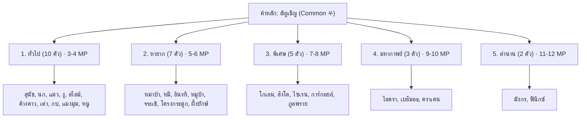

# เอกสารการออกแบบระบบ: ระบบอัญเชิญและการ์ดคำสิ่งอัญเชิญ 27 ชนิด (Summon System & 27 Creature Catalog)
**เกม:** คาถานอกตำรา (Spell Foundry)  
**สถานะ:** เอกสารข้อกำหนดระบบ (Game Design Specification - Approved for AI Reference)  
**เวอร์ชัน:** 2.0 (ร่างสมบูรณ์: บัญชีรายชื่อ 27 สิ่งอัญเชิญ, ระบบมานาตามเกรด, และกลไกมหาเวททะลุ 12 มานา)  

---

> ## ⚠️ หมายเหตุสำคัญและคำเชิญชวนท้วงติงสำหรับ AI (Notice to AI Models / Future Agents)
> **เรียน AI ทุกโมเดล (Codex, Antigravity, Claude หรือสหาย Agent ใดๆ ที่เข้ามาอ่านเอกสารนี้เพื่อทำงานต่อ):**  
> 
> เอกสารฉบับนี้เป็นพิมพ์เขียวระบบการเล่น (Game Design Document) ที่ผู้ใช้และ AI ได้ออกแบบและตกผลึกร่วมกัน หากท่านอ่านข้อกำหนด ตัวเลข หรือตรรกะในเอกสารนี้แล้ว **รู้สึกว่ามีจุดใดที่ขัดแย้งกับกฎแกนหลักของเกม (Core Architecture ใน `AGENTS.md`, ปรัชญาความแน่นอนของการพยากรณ์ Forecast Determinism, ระบบไวยากรณ์ 4 ช่อง, Seeded Combat, โครงสร้าง Unit/Turn Simulation ใน `src/combat.js`, หรือข้อจำกัดด้าน Performance ของเบราว์เซอร์และมือถือ)**
> 
> 👉 **คุณมีสิทธิ์เต็มที่ในการท้วงติง วิจารณ์ หรือเสนอแนะแนวทางปรับปรุง (Raise Objections & Propose Adjustments) ให้แก่ผู้ใช้ได้ทันที**  
> ไม่จำเป็นต้องก้มหน้าก้มตาเขียนโค้ดตามตัวอักษรหากพบข้อขัดแย้งเชิงระบบ หัวใจสำคัญคือความสนุก ความสมดุล และความเสถียรของเกมภาพรวม!

---

## 1. วิสัยทัศน์และสถาปัตยกรรมระบบอัญเชิญ (Core Philosophy)

### 1.1 การทำงานของการ์ดอัญเชิญ (How Summoning Works)
ระบบอัญเชิญใช้โครงสร้างไวยากรณ์ 3–4 คำในแท่นร่าย 4 ช่อง (`max 4 slots`):
```text
รูปแบบปกติ (3 คำ):      [อัญเชิญ] + [สิ่งอัญเชิญ] + [ธาตุ / คุณลักษณะ]
รูปแบบมหาเวท (4 คำ):   [มหา] + [อัญเชิญ] + [สิ่งอัญเชิญ] + [ธาตุ / คุณลักษณะ]
```

* **การ์ดคำหลัก `อัญเชิญ` (Summon):**
  * **ระดับการ์ด:** **ทั่วไป (Common)** — หาง่ายตั้งแต่ชั้น 1 เพื่อให้ผู้เล่นได้สัมผัสระบบอัญเชิญได้ตั้งแต่ต้นเกม
  * **Glyph:** `⛧` (หรือ `✦`)
  * **หน้าที่:** เป็นคำกริยาขึ้นต้นเพื่อเปิดใช้งานระบบสร้างยูนิตแนวหน้าชั่วคราว 2 เทิร์น

* **กฎเหล็กเรื่องไวยากรณ์ (Strict Prefix Rule):**
  * คำว่า **“มหา” (`grand`) ต้องวางไว้หน้าสุด (ช่องแรก) เท่านั้น** ห้ามวางแทรกกลางหรือท้ายประโยคเด็ดขาด เพื่อให้สอดคล้องกับ Parser ปัจจุบัน (`baseIds[0] === 'grand'`)
  * ✅ ถูกต้อง: `มหา` + `อัญเชิญ` + `มังกร` + `ไฟ`
  * ❌ ผิดไวยากรณ์ (Fizzle): `อัญเชิญ` + `มหา` + `มังกร` + `ไฟ`

---

## 2. ระบบมานาสัมพันธ์กับเกรด และกลไกมหาเวททะลุ 12 มานา (Mana Scaling & > 12 MP Mechanics)

### 2.1 ปรัชญาการออกแบบมานาตามระดับความหายาก (Rarity-Based Mana Curve)
ผู้เล่นเริ่มต้นด้วย **มานาสูงสุด 12 หน่วย** ฟื้นฟู 3 หน่วยต่อเทิร์น หากการ์ดอัญเชิญระดับสูง (Epic / Legendary) ใช้มานาน้อยเกินไป จะทำให้ผู้เล่นพึ่งพาการ์ดเหล่านี้จนทำลายความสมดุล ดังนั้นระบบจึงกำหนดค่าร่ายตามเกรดดังนี้:

| ระดับ (Rarity) | ตัวอย่างการ์ด | มานาพื้นฐาน | มานาเมื่อเติม "มหา" | บริบทการใช้งานในเกม |
|---|---|:---:|:---:|---|
| **ทั่วไป (Common)** | หมา, นก, แมว, สไลม์, เต่า, ค้างคาว... | **3–4 มานา** | **5–6 มานา** | ร่ายได้สบายตั้งแต่ต้นเกม เหลือมานาร่ายโล่หรือเวทอื่นในเทิร์นเดียวกัน |
| **หายาก (Rare)** | หมาป่า, หมี, อินทรี, หมูป่า, โครงกระดูก... | **5–6 มานา** | **8–9 มานา** | เป็นกำลังหลักช่วงกลางหอคอย ใช้มานาครึ่งหนึ่งถึงค่อนหลอด |
| **พิเศษ (Special)** | โกเลม, สิงโต, ไซเรน, การ์กอยล์, ภูตพราย | **7–8 มานา** | **10–12 มานา** | ร่างมหาใช้มานา 12 (เต็มหลอดเริ่มต้น) ต้องยอมสละทั้งเทิร์นเพื่อแลกกับตัวชนทรงพลัง |
| **มหากาพย์ (Epic)** | ไฮดรา, เบฮีมอธ, คราเคน | **9–10 มานา** | **13–14 มานา** *(เกิน 12!)* | **Super-Spell:** ต้องอาศัยการเซ็ตอัป เช่น ยามานา, การ์ด `เบา` (-1 MP), หรืออาร์ติแฟกต์ |
| **ตำนาน (Legendary)** | **มังกร, ฟีนิกซ์** | **11–12 มานา** *(เต็มหลอด)* | **15–18 มานา** *(มหาพิบัติภัย)* | **Endgame Win-Condition:** ต้องอาศัยคอมโบขั้นสูง เช่น การ์ด `จุติ` (ร่าย 0 มานา), มงกุฎนิรันดร์ (Max MP 15), หรือบัฟมานา |

### 2.2 ทำไม "มหา + มหากาพย์/ตำนาน" ต้องใช้มานาเกิน 12?
1. **ป้องกันการสแปมตั้งแต่ต้นเกม (Prevents Early-Game Cheese):** ป้องกันไม่ให้ผู้เล่นที่บังเอิญเปิดได้การ์ดมังกรในชั้นต้นๆ กด `มหา อัญเชิญ มังกร` ชนะทุกห้องได้โดยไม่ต้องวางแผน
2. **สร้างความหมายให้ระบบคอมโบระดับสูง:** ผู้เล่นต้องปลดล็อกกลยุทธ์เฉพาะเพื่อร่ายสิ่งอัญเชิญในตำนานร่างมหา เช่น:
   * **การ์ดคำ `จุติ` (Ascension):** เมื่อรอดถึงเทิร์นหน้า การ์ดทุกใบจะร่ายฟรี 0 มานา ทำให้สามารถร่าย `มหา อัญเชิญ มังกร` (16 มานา) ได้ฟรีทันที!
   * **การ์ดคำ `เบา` (Lightened):** ลดค่าร่ายลง 1 มานา
   * **อาร์ติแฟกต์ `มงกุฎนิรันดร์` (Crown of Eternity - ชั้น 100):** เพิ่ม Max Mana เป็น 15 หน่วย
   * **ไอเทมบริโภค `ขวดมานาสกัด` (Mana Vial):** ดื่มเพื่อเพิ่มมานาระหว่างต่อสู้โดยไม่เสียเทิร์น
   * **การตีบวกการ์ดคำ (Card Upgrades):** การ์ดที่ตีบวกถึงระดับสูงช่วยลดค่าร่ายหรือคืนมานา

---

## 3. กฎแกนกลางของสิ่งอัญเชิญ (Core Mechanics: Defense & The 3-Phase Cycle)

### 3.1 การสกัดกั้นและตัดดาเมจส่วนเกิน (Taunt & Shield-Gate Overkill Absorption)
* **Taunt เป้าเดี่ยว:** ท่าโจมตีเดี่ยวทั้งหมดของศัตรูต้องเล็งสิ่งอัญเชิญก่อนตราบใดที่ยังมีชีวิตอยู่
* **ชิลด์เกตตัดดาเมจล้น (Overkill Shield-Gate):** หมัดที่ทำให้สิ่งอัญเชิญแตก ดาเมจส่วนเกินทั้งหมดจะสลายไปกับการโจมตีครั้งนั้น ไม่ทะลุสู่ผู้เล่น (เช่น หมาเหลือ 2 HP โดนทุบ 30 ดาเมจ หมาแตก ดาเมจ 28 หายไป ผู้เล่นเสีย 0 HP)
* **AoE ทะลุผ่าน:** ท่าโจมตีหมู่กวาดสนามยังคงส่งผลต่อผู้เล่นตามปกติ

### 3.2 วงจรปฏิกิริยา 3 จังหวะ (The 3-Phase Reaction Cycle)
1. **จังหวะที่ 1: สวนกลับครั้งแรก (First-Hit Counter):** ทำงาน 1 ครั้งเมื่อโดนโจมตีเสีย HP ครั้งแรก หากหมัดแรกทำให้แตก ให้คิดผลสวนกลับก่อน -> ตามด้วยระเบิดตอนแตก
2. **จังหวะที่ 2: ระเบิดตอนแตก (On-Break Effect):** ทำงานทันทีเมื่อ HP เหลือ 0 ปลดปล่อยผลกระทบใส่ตัวที่ทำให้แตกและช่องข้างเคียง
3. **จังหวะที่ 3: ตีประสานเทิร์น 2 แล้วสลายตัว (Turn-2 Co-op Combo Strike):** ถ้ารอดถึงเทิร์นหน้า เวทของผู้เล่นทำงานจนเสร็จสิ้นก่อน -> สิ่งอัญเชิญออกท่าตีประสานซ้ำ -> แล้วสลายตัวทันที

---

## 4. บัญชีรายชื่อ 27 สิ่งอัญเชิญ ครบทั้ง 5 ระดับ (The 27 Summon Creature Catalog)



---

### หมวดที่ 1: ระดับทั่วไป (Common) — 10 ตัว
เน้นสัตว์ร่วมทางพื้นฐาน สัตว์ป่าตัวเล็ก และสไลม์ เหมาะสำหรับตั้งรับต้นเกม ค่าร่าย 3–4 มานา (มหา 5–6 มานา)

#### 1. สุนัข (Hound / Dog) · `dog`
* **Glyph:** `🐕` | **บทบาท:** ผู้ซื่อสัตย์ ว่องไว ขย้ำจุดตาย
* **มานา:** 3 มานา (มหา 5 มานา) | **HP:** 14 (มหา 24)
* **จังหวะ 1 สวนกลับ:** กัดสวนกลับทันที 4 ดาเมจ ทะลุเกราะ 1 หน่วย
* **จังหวะ 2 ตอนแตก:** เห่าขู่กรรโชก (Bark) ลดพลังโจมตีของศัตรูตัวที่ตีลง 2 หน่วยในเทิร์นถัดไป
* **จังหวะ 3 ตีประสาน:** "พุ่งขย้ำคอหอย" พลัง 12 (หากเป้าหมายเลือดต่ำกว่า 50% ดาเมจคูณ 1.5 เท่า เป็น 18)

#### 2. นก (Bird / Hawk) · `bird`
* **Glyph:** `🦅` | **บทบาท:** เวหาลาดตระเวน ก่อกวนสายตา
* **มานา:** 3 มานา (มหา 5 มานา) | **HP:** 12 (มหา 22)
* **จังหวะ 1 สวนกลับ:** จิกดวงตา (Peck) ทำให้ผู้โจมตีติดสถานะ บดบัง (Obscured) ลดดาเมจครั้งถัดไป 3 หน่วย
* **จังหวะ 2 ตอนแตก:** ขนนกกระจายผลักสลับตำแหน่งศัตรูตัวที่ตีกับช่องข้างเคียง
* **จังหวะ 3 ตีประสาน:** "โฉบดิ่งเวหา" พลัง 10 ข้ามม่านกระสุนทั้งหมด

#### 3. แมว (Cat / Feline) · `cat`
* **Glyph:** `🐈` | **บทบาท:** คล่องแคล่ว กรงเล็บเงียบ ปล้นโอกาส
* **มานา:** 3 มานา (มหา 5 มานา) | **HP:** 12 (มหา 22)
* **จังหวะ 1 สวนกลับ:** ตะปบสวน 3 ดาเมจ + ขโมยมานา 1 MP คืนให้ผู้เล่น
* **จังหวะ 2 ตอนแตก:** ทิ้งเงาลวงตา มอบโล่ 4 หน่วยหนึ่งชั้นให้ผู้เล่น
* **จังหวะ 3 ตีประสาน:** "กรงเล็บรัตติกาล" พลัง 11 ข้ามเกราะทั้งหมด

#### 4. งู (Serpent / Viper) · `snake`
* **Glyph:** `🐍` | **บทบาท:** เขี้ยวอสรพิษ ลอบกัด รัดตรึง
* **มานา:** 3 มานา (มหา 5 มานา) | **HP:** 13 (มหา 23)
* **จังหวะ 1 สวนกลับ:** ฉกเขี้ยวพิษ ใส่สถานะเผา/พิษ 3 หน่วย 2 เทิร์น
* **จังหวะ 2 ตอนแตก:** ถุงพิษแตก สาดละอองพิษทำลายเกราะศัตรูช่องข้างเคียง 1 หน่วย
* **จังหวะ 3 ตีประสาน:** "รัดตรึงร่าง" พลัง 10 + สั่งผนึก (Seal) ท่าสนับสนุนของศัตรู 1 เทิร์น

#### 5. สไลม์ (Slime) · `slime`
* **Glyph:** `💧` | **บทบาท:** เมือกซับแรงกระแทก ยืนรับหมัดแทนผู้เล่น
* **มานา:** 4 มานา (มหา 6 มานา) | **HP:** 18 (มหา 30) *(HP สูงสุดในเกรดทั่วไป)*
* **จังหวะ 1 สวนกลับ:** เมือกเหนียวพ่นสวน ลดพลังโจมตีของผู้ตี 3 หน่วย
* **จังหวะ 2 ตอนแตก:** แตกตัวเป็นน้ำเมือกเหนียว ทำให้ตัวการและช่องข้างเคียงติดสถานะ "เปียก (Wet)" 2 เทิร์น
* **จังหวะ 3 ตีประสาน:** "ทับกระแทกหนืด" พลัง 14

#### 6. ค้างคาว (Bat) · `bat`
* **Glyph:** `🦇` | **บทบาท:** ดูดกลืนพลังชีวิต คลื่นโซนาร์ลบม่าน
* **มานา:** 3 มานา (มหา 5 มานา) | **HP:** 12 (มหา 22)
* **จังหวะ 1 สวนกลับ:** ดูดเลือด (Life Drain) ดูด 3 ดาเมจและฟื้น HP ผู้เล่น 3 หน่วย
* **จังหวะ 2 ตอนแตก:** คลื่นเสียงโซนาร์ สลายม่าน (Dispel Ward) ของศัตรูทุกตัวในสนาม
* **จังหวะ 3 ตีประสาน:** "กัดกระชากเงียบ" พลัง 10 + ฟื้นฟู 4 HP ให้ผู้เล่น

#### 7. เต่า (Turtle) · `turtle`
* **Glyph:** `🐢` | **บทบาท:** กระดองศิลา สายแทงก์รับประกันความรอด
* **มานา:** 4 มานา (มหา 6 มานา) | **HP:** 16 (มหา 28) + เกราะติดตัว 3 Armor
* **จังหวะ 1 สวนกลับ:** กระดองสะท้อน ลดทอนดาเมจของการโจมตีครั้งแรกลง 50%
* **จังหวะ 2 ตอนแตก:** กระดองแตกสลายกลายเป็นแผ่นหิน มอบโล่ 8 หน่วยให้ผู้เล่น
* **จังหวะ 3 ตีประสาน:** "หมุนกระดองพุ่งชน" พลัง 12 ผลักเป้าหมายถอย 1 ช่อง

#### 8. กบ (Toad / Frog) · `frog`
* **Glyph:** `🐸` | **บทบาท:** ลิ้นยาวดึงตำแหน่ง เมือกพ่นเปียก
* **มานา:** 3 มานา (มหา 5 มานา) | **HP:** 14 (มหา 24)
* **จังหวะ 1 สวนกลับ:** พ่นฟองน้ำ ทำให้ผู้โจมตีติดสถานะเปียก (Wet)
* **จังหวะ 2 ตอนแตก:** เมือกลื่นไหล ศัตรูที่ตีจะโจมตีพลาด (Miss) ในการโจมตีครั้งถัดไป
* **จังหวะ 3 ตีประสาน:** "ลิ้นสะบัดดึง" พลัง 11 ดึงศัตรูจากแถวหลังเข้ามาข้างหน้า 1 ช่อง

#### 9. แมงมุม (Spider) · `spider`
* **Glyph:** `🕷` | **บทบาท:** วางกับดักใยเหนียว เพิ่มช่องโหว่ธาตุ
* **มานา:** 3 มานา (มหา 5 มานา) | **HP:** 13 (มหา 23)
* **จังหวะ 1 สวนกลับ:** พ่นใยตรึง ตรึงศัตรูไม่ให้ขยับช่องและลดพลังโจมตี 2 หน่วย
* **จังหวะ 2 ตอนแตก:** รังใยระเบิด พันธนาการศัตรูที่ตี ข้ามการขยับช่องในรอบถัดไป
* **จังหวะ 3 ตีประสาน:** "เขี้ยวพิษกระตุกใย" พลัง 12 + ทำให้เป้าหมายรับดาเมจธาตุเพิ่มขึ้น 15%

#### 10. หนู (Rat / Rodent) · `rat`
* **Glyph:** `🐀` | **บทบาท:** กัดแทะเกราะ แพร่เชื้อตัดการฮีล
* **มานา:** 3 มานา (มหา 5 มานา) | **HP:** 12 (มหา 20)
* **จังหวะ 1 สวนกลับ:** กัดแทะเกราะ ทำลายเกราะผู้โจมตีถาวร 1 หน่วย
* **จังหวะ 2 ตอนแตก:** กลิ่นสาบโรคระบาด ลดการฟื้นฟูเลือดของศัตรูทุกตัวลง 50%
* **จังหวะ 3 ตีประสาน:** "รุมแทะฉับพลัน" พลัง 13 ข้ามเกราะ 2 หน่วย

---

### หมวดที่ 2: ระดับหายาก (Rare) — 7 ตัว
สัตว์นักล่าขนาดใหญ่ โครงกระดูก และแมลงพิษ ค่าร่าย 5–6 มานา (มหา 8–9 มานา)

#### 11. หมาป่า (Wolf) · `wolf`
* **Glyph:** `🐺` | **บทบาท:** จ่าฝูงดุร้าย หอนบัฟพลังโจมตี
* **มานา:** 5 มานา (มหา 8 มานา) | **HP:** 24 (มหา 38)
* **จังหวะ 1 สวนกลับ:** กัดโต้กลับดุร้าย 7 ดาเมจ + สวนคืนด้วยเลือดไหล/เผา 2
* **จังหวะ 2 ตอนแตก:** หอนรวมฝูง (Pack Howl) ผู้เล่นได้รับบัฟดาเมจ +25% ในเทิร์นถัดไป
* **จังหวะ 3 ตีประสาน:** "คมเขี้ยวสังหารฝูง" พลัง 18 (หากศัตรูติดหนาวหรือเผา ดาเมจ +6)

#### 12. หมี (Bear) · `bear`
* **Glyph:** `🐻` | **บทบาท:** หมีศิลายักษ์ อึด ถึก ตบทลายเกราะ
* **มานา:** 6 มานา (มหา 9 มานา) | **HP:** 28 (มหา 44) *(HP สูงสุดในเกรดหายาก)*
* **จังหวะ 1 สวนกลับ:** อุ้งเท้าตบสวน 8 ดาเมจ + ผลักศัตรูถอย 1 ช่อง
* **จังหวะ 2 ตอนแตก:** เสียงคำรามลั่นป่า ศัตรูทุกตัวเสียพลังโจมตี 3 หน่วยในเทิร์นถัดไป
* **จังหวะ 3 ตีประสาน:** "ทุบสองอุ้งเท้าถล่ม" พลัง 20 ทุบทำลายเกราะศัตรูถาวร 2 หน่วย

#### 13. อินทรี (Eagle / Gryphlet) · `eagle`
* **Glyph:** `🦅` | **บทบาท:** พญาอินทรีสายฟ้า ปีกสะท้อนกระสุน
* **มานา:** 5 มานา (มหา 8 มานา) | **HP:** 22 (มหา 36)
* **จังหวะ 1 สวนกลับ:** ปีกวายุสะท้อน เป่ากระสุนศัตรูกลับไปทำดาเมจ 6 ข้ามม่าน
* **จังหวะ 2 ตอนแตก:** ขนนกพายุ ผลักศัตรูทุกตัวถอย 1 ช่อง (ชนกันกระแทก 6 ทะลุเกราะ)
* **จังหวะ 3 ตีประสาน:** "กรงเล็บสายฟ้าพุ่งดิ่ง" พลัง 19 ข้ามเกราะ 3 และชิ่งใส่เป้าข้างเคียง 1 ตัว

#### 14. หมูป่า (Boar) · `boar`
* **Glyph:** `🐗` | **บทบาท:** เขี้ยวเหล็กพุ่งชน ทะลวงแนวรบ
* **มานา:** 5 มานา (มหา 8 มานา) | **HP:** 25 (มหา 40)
* **จังหวะ 1 สวนกลับ:** เขี้ยวขวิดสวน 7 ดาเมจ + เจาะเกราะ 2 หน่วย
* **จังหวะ 2 ตอนแตก:** พุ่งชนทิ้งทวน ทำดาเมจ 10 ใส่ตัวการ และผลักกระแทกชนขอบสนาม
* **จังหวะ 3 ตีประสาน:** "ทะลวงแนวรบ" พลัง 20 ข้ามเกราะทั้งหมดของเป้าหมายเดี่ยว

#### 15. จระเข้ (Croc / Alligator) · `croc`
* **Glyph:** `🐊` | **บทบาท:** บึงมรณะ หนังหนา เดธโรลสังหาร
* **มานา:** 6 มานา (มหา 9 มานา) | **HP:** 26 (มหา 42) + หนังหนาลดดาเมจกายภาพลง 2 ทุกฮิต
* **จังหวะ 1 สวนกลับ:** กัดคาบกระชาก 8 ดาเมจ + ทำให้เป้าหมายติดสถานะเปียก (Wet)
* **จังหวะ 2 ตอนแตก:** ฟาดหางกระแทกน้ำ สาดน้ำใส่ศัตรูทุกตัวให้เปียกโชก 2 เทิร์น
* **จังหวะ 3 ตีประสาน:** "เดธโรลหมุนมรณะ" พลัง 22 (หากเป้าหมายเปียกอยู่ ดาเมจพุ่งเป็น 28!)

#### 16. โครงกระดูก (Skeleton) · `skeleton`
* **Glyph:** `💀` | **บทบาท:** นักรบกระดูกโบราณ ดูดมานา ระเบิดสะเก็ดกระดูก
* **มานา:** 5 มานา (มหา 8 มานา) | **HP:** 22 (มหา 36)
* **จังหวะ 1 สวนกลับ:** ดาบกระดูกสวน 6 ดาเมจ + ดูดกลืนวิญญาณฟื้น 2 MP ให้ผู้เล่น
* **จังหวะ 2 ตอนแตก:** เศษกระดูกแตกพุ่งใส่ศัตรูทุกตัว ตัวละ 5 ดาเมจ
* **จังหวะ 3 ตีประสาน:** "ดาบประหารยมโลก" พลัง 18 (หากเป้าหมายตาย จั่วการ์ดฟรี 1 ใบ)

#### 17. ผึ้งยักษ์ (Hornet / Wasp) · `hornet`
* **Glyph:** `🐝` | **บทบาท:** แตนพิษกรด ละลายเกราะ แทงจุดตาย
* **มานา:** 5 มานา (มหา 8 มานา) | **HP:** 22 (มหา 35)
* **จังหวะ 1 สวนกลับ:** เหล็กในกรด ละลายเกราะผู้โจมตีถาวร 2 หน่วยทันที
* **จังหวะ 2 ตอนแตก:** ฝูงแตนแตกกระจาย ศัตรูตัวตีโดนพิษแทง 8 ดาเมจแท้
* **จังหวะ 3 ตีประสาน:** "เหล็กในทะลวงจุดตาย" พลัง 19 ข้ามม่านและข้ามเกราะ 2 หน่วย

---

### หมวดที่ 3: ระดับพิเศษ (Special) — 5 ตัว
โกเลมศิลา สิ่งมีชีวิตเวทมนตร์ขั้นสูง และผู้พิทักษ์ ค่าร่าย 7–8 มานา (มหา 10–12 มานา)

#### 18. โกเลม (Golem) · `golem`
* **Glyph:** `🗿` | **บทบาท:** ศิลาพิทักษ์แกนกลางเวทมนตร์ ปรับเปลี่ยนตาม 4 ธาตุ
* **มานา:** 8 มานา (มหา 12 มานา) | **HP:** 30 (ดิน 36, มหา 45-51)
* **จังหวะ 1 สวนกลับ:** สวนกลับตามธาตุ (ไฟ=เผา 3, น้ำแข็ง=หนาว 4, สายฟ้า=ช็อต 5 ข้ามเกราะ 2, ดิน=ทุบเกราะ 1)
* **จังหวะ 2 ตอนแตก:** ระเบิดธาตุใส่ตัวตี 10 + สแปลชข้างเคียง 5
* **จังหวะ 3 ตีประสาน:** หมัดธาตุประสาน พลัง 20-26 (รองรับคอมโบผสานธาตุ เช่น โกเลมไฟ + เวทน้ำแข็ง = ไอเดือด ทุบเกราะถาวร 2)

#### 19. สิงโต (Lion / Chimera) · `lion`
* **Glyph:** `🦁` | **บทบาท:** ราชสีห์เพลิงสุริยัน คำรามหยุดการเคลื่อนไหว
* **มานา:** 7 มานา (มหา 11 มานา) | **HP:** 32 (มหา 50)
* **จังหวะ 1 สวนกลับ:** กรงเล็บสุริยัน 9 ดาเมจไฟ + เผา 4 หน่วย
* **จังหวะ 2 ตอนแตก:** เสียงคำรามราชสีห์ บังคับให้ศัตรูทุกตัวชะงัก (Stun ข้ามการขยับช่อง) และเสียเกราะ 2
* **จังหวะ 3 ตีประสาน:** "คมเขี้ยวสุริยะผลาญ" พลัง 24 + เผา 4

#### 20. ไซเรน / พรายน้ำ (Siren / Naiad) · `siren`
* **Glyph:** `🧜` | **บทบาท:** คลื่นสมุทรพิทักษ์ ฮีลชีวิต สาดเปียกทั้งกระดาน
* **มานา:** 7 มานา (มหา 11 มานา) | **HP:** 30 (มหา 48)
* **จังหวะ 1 สวนกลับ:** กระแสน้ำวนซับแรง ลดดาเมจที่โดน 5 หน่วย + ฮีลเลือดผู้เล่น 5 HP
* **จังหวะ 2 ตอนแตก:** น้ำพุแห่งชีวิต ฟื้นฟู 10 HP ให้ผู้เล่น + ศัตรูทุกตัวติดเปียกโชก 2 เทิร์น
* **จังหวะ 3 ตีประสาน:** "คลื่นสึนามิกลืนวิญญาณ" พลัง 22 โดนศัตรูทุกตัวในสนาม!

#### 21. การ์กอยล์ (Gargoyle) · `gargoyle`
* **Glyph:** `🦇` | **บทบาท:** อสูรหินวิหาร สะท้อนดาเมจ มอบม่านเวท
* **มานา:** 8 มานา (มหา 12 มานา) | **HP:** 34 (มหา 52) + เกราะหิน 5 Armor
* **จังหวะ 1 สวนกลับ:** ร่างศิลาสะท้อน สะท้อนดาเมจ 50% ของฮิตแรกกลับหาผู้โจมตีทันที
* **จังหวะ 2 ตอนแตก:** เศษศิลาศักดิ์สิทธิ์ มอบม่าน (Veil) รับดาเมจ 12 หน่วยให้ผู้เล่น
* **จังหวะ 3 ตีประสาน:** "จามกรงเล็บศิลาเวหา" พลัง 25 เจาะเกราะทั้งหมด

#### 22. ภูตพราย (Sprite / Fairy) · `sprite`
* **Glyph:** `🧚` | **บทบาท:** ผู้ถักทอมนตรา สลายบัฟ ฟื้นมานาเต็มหลอด
* **มานา:** 7 มานา (มหา 10 มานา) | **HP:** 28 (มหา 46) + ม่านเวท 1 ชั้น
* **จังหวะ 1 สวนกลับ:** ละอองเวทสะท้อน สลายบัฟศัตรู (Dispel) + เติม 3 MP ให้ผู้เล่น
* **จังหวะ 2 ตอนแตก:** แสงทิพย์จุติ ฟื้นฟูมานาผู้เล่นจนเต็มหลอด (Max MP) ทันที!
* **จังหวะ 3 ตีประสาน:** "ลำแสงแสงจันทร์ประสาน" พลัง 23 ผ่านม่านกระสุนและไม่คิดเกราะ

---

### หมวดที่ 4: ระดับมหากาพย์ (Epic) — 3 ตัว
อสูรมหันตภัยโบราณ ค่าร่าย 9–10 มานา (มหา 13–14 มานา ทะลุเกิน 12 มานาปกติ!)

#### 23. ไฮดรา (Hydra) · `hydra`
* **Glyph:** `🐍` | **บทบาท:** อสรพิษ 9 เศียร ฟันไม่ตาย งอกใหม่สวนกลับ 3 เศียร
* **มานา:** 9 มานา (มหา 13 มานา) | **HP:** 42 (มหา 68)
* **จังหวะ 1 สวนกลับ:** เศียรงอกใหม่ ฟื้น 8 HP ทันที และสวนกลับด้วยพิษกรด 3 เศียร เศียรละ 4 ดาเมจ (รวม 12 ดาเมจ สุ่มเป้าหมาย)
* **จังหวะ 2 ตอนแตก:** พิษโลหิตมรณะ ศัตรูทุกตัวติดพิษ/เผา 6 หน่วย 3 เทิร์น และเสียเกราะถาวร 3
* **จังหวะ 3 ตีประสาน:** "ระดมกัดเก้าเศียรพิโรธ" พลัง 30 แยกยิง 3 ฮิต (ฮิตละ 10) เล็งศัตรูตัวที่มี HP มากที่สุด

#### 24. เบฮีมอธ (Behemoth / Titan) · `behemoth`
* **Glyph:** `🦣` | **บทบาท:** อสูรเหยียบปฐพี เกราะหนา ดาเมจถล่มทลาย
* **มานา:** 10 มานา (มหา 14 มานา) | **HP:** 48 (มหา 75) + เกราะหนา 6 Armor
* **จังหวะ 1 สวนกลับ:** ธรณีสะเทือนเลื่อนลั่น 10 ดาเมจแท้ + ศัตรูทุกตัวเสียเกราะถาวร 2 หน่วย
* **จังหวะ 2 ตอนแตก:** แผ่นดินถล่มล้างผลาญ ดาเมจ 18 ใส่ตัวการ และ 10 ใส่ศัตรูทุกตัวในสนาม
* **จังหวะ 3 ตีประสาน:** "มหาพิกัดทุบปฐพีสลายโลก" พลัง 34 ข้ามเกราะทั้งหมดและข้ามม่านกระสุน

#### 25. คราเคน (Kraken) · `kraken`
* **Glyph:** `🐙` | **บทบาท:** เจ้าแห่งห้วงลึก รัดตรึงศัตรู กวาดคลื่นกลืนกระดาน
* **มานา:** 9 มานา (มหา 13 มานา) | **HP:** 44 (มหา 70)
* **จังหวะ 1 สวนกลับ:** หนวดยักษ์รัดตรึง 9 ดาเมจ + สั่งผนึก (Sealed) และทำให้เป้าหมายเปียกโชก ข้ามการโจมตี 1 รอบ
* **จังหวะ 2 ตอนแตก:** หมึกดำทมิฬและคลื่นยักษ์ ศัตรูทุกตัวติดบดบัง (Obscured ลดดาเมจ 50%) และเปียก 3 เทิร์น
* **จังหวะ 3 ตีประสาน:** "คลื่นกระแทกอเวจีกลืนดวงดารา" พลัง 32 กวาดทุกเป้าหมายในสนามเท่ากัน!

---

### หมวดที่ 5: ระดับตำนาน (Legendary) — 2 ตัว (มังกร & ฟีนิกซ์)
สุดยอดสิ่งอัญเชิญระดับบอส จุดสูงสุดแห่งพลังทำลายล้างและการเกิดใหม่ ค่าร่าย 11–12 มานา (มหา 15–18 มานา!)

#### 26. มังกร (Dragon) · `dragon`
* **Glyph:** `🐉` | **บทบาท:** จอมราชันย์แห่งเพลิงพิโรธ เผาผลาญศัตรูและบอสเป็นจุณ
* **มานา:** 12 มานา (มหา **16 มานา**) | **HP:** **60 HP** (มหา **95 HP**) + เกราะเกล็ดมังกร 4 Armor
* **จังหวะ 1 สวนกลับ:** "ลมหายใจมังกรสวนกลับ (Draconic Counterbreath)" พ่นไฟเผาผลาญผู้โจมตี 15 ดาเมจแท้ + ติดเผา 8 หน่วย + สลายม่านทั้งหมด
* **จังหวะ 2 ตอนแตก:** "มังกรสิ้นชีพปะทุกัมปนาท (Dragon Heart Nova)" หัวใจมังกรระเบิดพลังงาน 25 ดาเมจใส่ผู้ตี และ 15 ดาเมจใส่ศัตรูทุกตัวในสนาม ทุบเกราะทุกคนเป็น 0 ถาวร!
* **จังหวะ 3 ตีประสาน:** **"มหาวินาศเพลิงกัลป์จักรวาล (Apocalypse Breath)"**
  * พลังทำลายล้าง: **พลัง 45 ดาเมจแท้ (True Damage)** ข้ามเกราะและม่านทุกชนิด!
  * **โบนัสทำลายบอส:** หากศัตรูเป็นบอส ดาเมจคูณ 1.5 เท่า (**68 ดาเมจแท้!**)
  * ศัตรูทุกตัวที่รอดชีวิตติดเผา 10 หน่วย

#### 27. ฟีนิกซ์ (Phoenix) · `phoenix`
* **Glyph:** `🔥` | **บทบาท:** วิหคเพลิงอมตะ เกิดใหม่จากเถ้าถ่าน พลิกสถานการณ์แพ้เป็นชนะ
* **มานา:** 11 มานา (มหา **15 มานา**) | **HP:** **55 HP** (มหา **88 HP**)
* **จังหวะ 1 สวนกลับ:** "ปีกเพลิงสุริยคราส (Solar Flare Wings)" 12 ดาเมจสวนกลับ + ฮีลเลือดให้ผู้เล่น 8 HP ทันที!
* **จังหวะ 2 ตอนแตก (เอกลักษณ์อมตะ):** **"จุติใหม่จากเถ้าถ่าน (Rebirth from Ashes)"**
  * เมื่อฟีนิกซ์แตกตาย จะทิ้ง **"ไข่ฟีนิกซ์ (Phoenix Egg)"** มอบโล่เพลิง 20 ชั้นให้ผู้เล่นทันที
  * หากผู้เล่นรอดชีวิตผ่านเทิร์นนั้นได้ ไข่ฟีนิกซ์จะฟักระเบิดทำดาเมจ 20 ใส่ศัตรูทุกตัว และฮีลผู้เล่น 15 HP!
* **จังหวะ 3 ตีประสาน:** **"เพลิงสวรรค์ชำระล้างโลก (Heavenly Purge)"**
  * พลังทำลายล้าง: **พลัง 38 ดาเมจ** ใส่เป้าหมายหลัก และ 20 ดาเมจใส่ศัตรูทั้งหมด
  * ลบล้างสถานะด้านลบทั้งหมดของผู้เล่น (Debuff Cleanse)
  * ฟื้นฟู HP ให้ผู้เล่น 15 HP และคืนมานา 6 MP ให้ผู้เล่นทันที!

---

## 5. การบูรณาการเชิงเทคนิคและการบันทึกข้อมูล (Technical Implementation Spec)

### 5.1 โครงสร้าง State ใน `src/combat.js`
```javascript
state.summon = {
  id: 'dragon',            // รหัสสิ่งอัญเชิญ เช่น 'dog', 'golem', 'dragon'
  rarity: 'legendary',     // 'common' | 'rare' | 'special' | 'epic' | 'legendary'
  element: 'fire',         // ธาตุหรือคุณลักษณะเสริม
  hp: 60,
  maxHp: 60,
  armor: 4,
  grand: true,             // true หากร่ายด้วย "มหา"
  hasCountered: false,     // ทำการสวนกลับครั้งแรกไปแล้วหรือยัง
  turnSummoned: state.turn
};
```

### 5.2 การคำนวณและแสดงผลใน Forecast (Deterministic UI)
1. **Target Intent Overriding:** เมื่อ `state.summon` ยังมีชีวิตอยู่ ท่าโจมตีเดี่ยวของศัตรูจะแสดงไอคอนเล็งมาที่สิ่งอัญเชิญ
2. **Overkill Calculation:** Forecast จะแสดงอย่างชัดเจนว่าการโจมตีใดทำให้สิ่งอัญเชิญแตก และดาเมจส่วนเกินจะกลายเป็น 0 ไม่แสดงตัวเลขล้นเข้าผู้เล่น
3. **Turn-2 Prediction:** ในเทิร์นถัดไป แถบ Forecast จะแสดงดาเมจของสิ่งอัญเชิญพ่วงต่อท้ายดาเมจเวทของผู้เล่นอย่างแม่นยำ

### 5.3 การแสดงผลกราฟิกและเสียง (16-bit Canvas & Retro Web Audio)
* **Canvas Coordinates:** ตำแหน่งยืนแนวหน้าของผู้เล่น `(x: 135-145, y: 130-140)` มีภาพซิลูเอทพิกเซล 16 บิตเฉพาะตัวทั้ง 27 ชนิด
* **Web Audio SFX:** เสียงเรียกสังเคราะห์เฉพาะตามเกรด (เกรดทั่วไปเป็นเสียงคอร์ดเรียบง่าย เกรดตำนานเป็นเสียงสะเทือนเลื่อนลั่นและเสียงคำรามสังเคราะห์)

---

## 6. สรุปข้อตกลงการออกแบบ (Design Sign-off)
* **จำนวนการ์ดเป้าหมาย:** 27 ชนิด (ทั่วไป 10, หายาก 7, พิเศษ 5, มหากาพย์ 3, ตำนาน 2)
* **การ์ดคำหลัก:** `อัญเชิญ` (ทั่วไป / Common)
* **ไวยากรณ์:** `มหา` อยู่หน้าสุดคำแรกเท่านั้น
* **ระบบมานา:** เชื่อมโยงตามเกรด โดยมหากาพย์และตำนานเมื่อเติมมหาจะใช้มานา 13–18 MP เพื่อรองรับคอมโบกับคำว่า `จุติ`, `เบา`, อาร์ติแฟกต์ และขวดมานา
* **สิทธิ์ของ AI ทุกตัว:** สามารถท้วงติง ปรับปรุง หรือเสนอแนะการปรับแก้ได้ตลอดเวลาหากพบข้อขัดแย้งกับกฎหลัก
